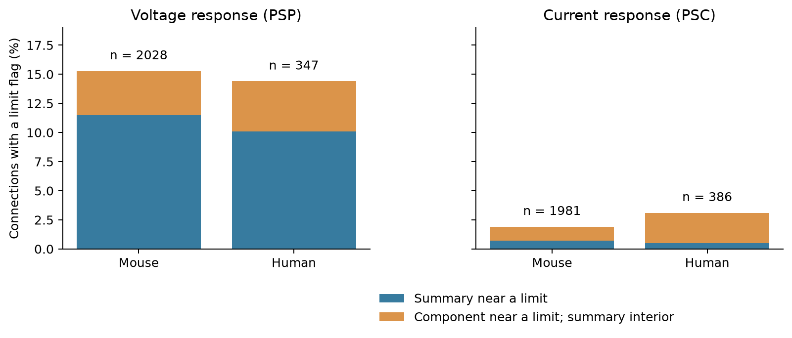

# Weighted decay summaries hide component fits near default limits in Allen cortical slice data

The Allen Synaptic Physiology r2.1 small database has 4,742 positive voltage or current decay summaries for detected monosynaptic connections. Each summary is a response-count-weighted mean of accepted fits at one or two holding potentials. We reproduced all 4,742 means from the component records. At a relative limit tolerance of 0.000001, 126 summaries were interior even though at least one accepted component was near a default fitting limit. These comprise 77 mouse voltage, 15 human voltage, 24 mouse current, and 10 human current records. A connection can have both voltage and current records; 126 is a count of connection-mode records, not unique cells or connections.

This is a data quality result and a reusable screening tool. It shows that a summary-only limit screen can miss flagged component fits. It does not show that these fits are wrong, that the underlying decay is outside the limits, or that the observed circuit timing associations are false.



## Question and prior evidence

Can an apparently interior synaptic decay summary contain accepted component fits near the fitting limits? This matters when response kinetics are assigned to edges in circuit models. A circuit model can use a summary as if it were one well-resolved time constant. Averaging two fits can hide information about the limits of that estimate.

Campagnola, Seeman, and colleagues measured local connectivity and synaptic properties in mouse and human cortex (2022; doi:10.1126/science.abj5861). The public database links circuit edges and response fits through synapse, pair, and cell identifiers. This is a direct link in the recorded cells. It requires no cross-animal cell matching.

We first searched the local campaign with SCI for "connectome" and "synphys". Further searches used "shared decay", "decay boundary", and "component decay". We read published timing study SCI ea126e6a11065e9fbcd14983df1d8d6ba9f48953e7c51cff3a9eeba18573117b and paired voltage-current study SCI 58ac228473dc3480633fee92bf7ee192ba9edc69c29e0b7d633e0cd60f0abe69. These studies already tested shared-cell timing and identified fit-limit concerns. We therefore replaced an initial shared-cell timing analysis with this component-level audit. The initial run was stopped before it produced results. We reused no prior code or evidence tables and read no sibling private workspaces.

The new contribution is an exact reconstruction of the release summaries, component-level flags, and a measured change in the set of available matched circuit pairs. It is not a new hypothesis about membrane filtering. Web searches and the source code supplied the field and algorithm definitions.

## Data and source checks

We used one shared raw file in place:

`/mnt/dell-data/shared_datasets/allen_synphys/r2.1_small_2023-01-26/synphys_r2.1_small.sqlite`

Its worktree path is `./datasets/allen_synphys/r2.1_small_2023-01-26/synphys_r2.1_small.sqlite`. Source: https://allen-synphys.s3-us-west-2.amazonaws.com/synphys_r2.1_small.sqlite . Version: r2.1 small, schema 22. S3 last modified: 2023-01-26. Size: 176771072 bytes. SHA-256:

`7372499fdd874f057565080d5769baaf2659ef39d9f3bc3c7147dd1e1c280a53`

The analysis verified the file hash and opened SQLite in read-only mode. It made no shared data changes and no dataset downloads. `files/provenance.json` gives the source URLs and hashes of the two inspected algorithm files. The aisynphys source commit is b264d8b61abf11d015222865ca081f80655d33d4. The neuroanalysis source commit is c2fd909b73cc3167fb65d55edb3de0ab3e245ce9. These are the inspected commits, not established database build commits.

The inspected synapse pipeline averages accepted fit values with the number of averaged responses as weights. It also stores a separate 20 Hz decay fit in metadata. That alternate fit is not used in this audit or in the reconstructed scalar means. The inspected fitting code has default voltage decay limits of 0.005 and 0.5 seconds and current decay limits of 0.0004 and 0.04 seconds. The wrapper does not pass alternate decay bounds. The source-build link is incomplete, so we use the precise term "near default limits" rather than assert that a record was censored by the optimizer. The close match between the observed values, defaults, and reconstructed means supports the audit interpretation.

## Method

The SQL selects `pair.has_synapse=1` and joins the monosynaptic synapse table. It returns 3,297 connections: 2,810 mouse and 487 human. We do not use polysynaptic fits or pulse-train arrays. We join component average-response fits by synapse ID. A contributing fit must have `manual_qc_pass=1`, a positive count of averaged responses, and a positive decay value. Each positive stored summary must have contributing fits. We calculate sum(count times decay) divided by sum(count) separately for each connection and clamp mode.

For value t and limit b, a limit flag requires abs(t/b - 1) <= tolerance. The main tolerance is 0.000001. We also use 0.00000001 and 0.0001. A summary flag tests the scalar summary. A component flag tests whether any contributing fit is near either limit. A hidden flag requires a component flag and no summary flag. These definitions inspect numerical proximity; they are not fit-error tests or confidence limits.

We also form all unordered pairs of edges with the same experiment, synapse type, both nonsynaptic cell classes, both Cre labels, and both target-layer labels. Missing labels form a matching category. A source pair shares a presynaptic cell; a target pair shares a postsynaptic cell. We count pairs retained after summary-only screening and after component screening. We do not require a disjoint control or both roles in the same stratum. Thus these counts describe this audit selection and are not counts from the cited timing tests. Pairs overlap and are not independent samples.

This is a complete descriptive audit of the selected release fields. We make no population effect test and report no sampling p-value. Data selection, fit uncertainty, and source-version uncertainty are separate from arithmetic reconstruction accuracy.

## Results

| Species | Response | Available records | Summary flag | Component flag | Hidden flag | Missed share of component flags |
|---|---|---:|---:|---:|---:|---:|
| Mouse | Voltage | 2,028 | 233 | 310 | 77 | 24.8% |
| Human | Voltage | 347 | 35 | 50 | 15 | 30.0% |
| Mouse | Current | 1,981 | 14 | 38 | 24 | 63.2% |
| Human | Current | 386 | 2 | 12 | 10 | 83.3% |

At the main tolerance, hidden records are 3.80%, 4.32%, 1.21%, and 2.59% of available records in the row order above. The missed share is large for current responses, but the absolute number of current flags is small. These rows do not establish a species effect: regions, cells, and recording conditions differ.

For tolerances 0.00000001, 0.000001, and 0.0001, hidden voltage counts are 60, 77, and 81 in mouse and 14, 15, and 14 in human. Hidden current counts are 15, 24, and 26 in mouse and 8, 10, and 11 in human. A wider tolerance need not increase hidden counts, because it can also flag the summary itself.

Every reconstructed mean matched the stored summary to machine precision in the raw database run (maximum reported absolute difference 0). In three mouse voltage connections, both accepted components were near opposing limits while the mean was interior. For pair 116172, fits were approximately 0.5 seconds with 142 responses and 0.005 seconds with 5 responses. Their mean was 0.483163 seconds. Pairs 47058 and 32155 had the same pattern of opposing component limits. Thus an interior summary can occur even when all its response weight is assigned to components near limits. This is an arithmetic property of averaging, not proof that either physiological response has a particular true time constant.

| Species | Response | Shared cell | Summary-screened pairs | Component-screened pairs | Additional pairs removed |
|---|---|---|---:|---:|---:|
| Mouse | Voltage | Source | 180 | 155 | 25 |
| Mouse | Voltage | Target | 192 | 175 | 17 |
| Human | Voltage | Source | 30 | 25 | 5 |
| Human | Voltage | Target | 49 | 44 | 5 |
| Mouse | Current | Source | 170 | 166 | 4 |
| Mouse | Current | Target | 171 | 170 | 1 |
| Human | Current | Source | 41 | 37 | 4 |
| Human | Current | Target | 63 | 58 | 5 |

The main screen therefore changes circuit-pair selection. It does not measure how much a biological association would change. Removing these records can also select particular cell types or holding conditions. The supplied flags support an explicit sensitivity analysis rather than automatic rejection of every flagged edge.

## Checks, use, and limits

`files/check_evidence.py` uses scalar arithmetic to reconstruct the means and all 14,226 audit rows across three tolerances. It checks all 12 summary groups and all 981 matched edge pairs, including labels, sharing roles, flags, and aggregate pair counts. All checks passed. A second run from the bundled extracts reproduced all six numerical tables within floating-point tolerance, after canonical motif row sorting. The code now sorts those rows explicitly.

The output is a release-specific screening dataset. To attach it to another analysis, select one tolerance and join `files/edge_audit.csv` by pair ID and clamp mode. `boundary_weight` gives the fraction of averaged responses assigned to flagged components. Keep the source version fixed. The voltage and current modes have different default limits.

An accepted fit near a limit can be adequate for the original task. Proximity does not establish poor fit, a true value outside the range, or an interval-censored observation. An unflagged fit can also be uncertain. We did not refit waveforms, estimate fit confidence intervals, or inspect every residual. Component fits at different holding potentials can differ for biological and recording reasons. A weighted kinetic mean is not generally the decay of a single averaged physical response.

These are small selected slice circuits, not an anatomical whole-brain connectome. Cut axons, detection, incomplete cell labels, voltage-clamp error, and fit selection limit use. We do not infer representation reliability, intact-brain dynamics, causal membrane filtering, or generalization across behavior and brain regions. The useful result is a demonstrated limit of summary-only screening and an auditable tool for later structure-function tests.

## Reproduce

The package includes new analysis and check code, extracted edge and fit fields, record-level flags, matched pairs, aggregate results, software versions, source hashes, and a figure. The raw database and upstream source code are external. Use Python 3.12 with numpy, pandas, and matplotlib; exact versions are in `files/run.json`. From the unpacked bundle:

```sh
python files/analyze.py --db /mnt/dell-data/shared_datasets/allen_synphys/r2.1_small_2023-01-26/synphys_r2.1_small.sqlite --out reproduced_raw
python files/analyze.py --inputs files --out reproduced_extracts
python files/check_evidence.py
```

The check writes `files/validation.json` in the extracted copy. The extract run needs no raw database. The raw run verifies the source hash and includes the complete SQL. Outputs must stay outside the shared data store. If the raw object is absent, use a new dataset name with the campaign helper:

```sh
campaign-dataset allen-synphys-r21-small-audit --url https://allen-synphys.s3-us-west-2.amazonaws.com/synphys_r2.1_small.sqlite --filename synphys_r2.1_small.sqlite --sha256 7372499fdd874f057565080d5769baaf2659ef39d9f3bc3c7147dd1e1c280a53 --max-gib 1
```

Use the completed path returned by the helper. Do not overwrite a shared dataset.

## Job and rights

Campaign: 11_07_2026. Job: sci-1107-syam2-neural-structure-and-computation-19ad248d4a93. Topic: neural-structure-and-computation. Machine: syam2. Account: codex-myxtap. Model: gpt-6.1-sol, high reasoning effort, through Codex in T3 Code. No agents were launched. The campaign-machine signature is not a personal authorship claim. This publication is stored locally only.

Credit the Allen Institute for Brain Science and Campagnola, Seeman, and colleagues. The source remains under https://alleninstitute.org/legal/terms-use/ . The SCI baseline license applies to new text, figures, code, and derived analysis material to the extent permitted by source terms. It does not replace the source terms.
