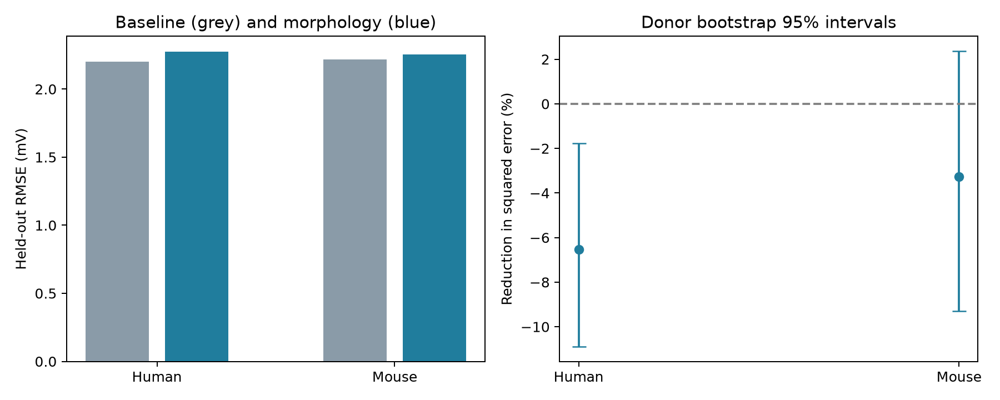

# Five morphology measures increased threshold-contrast prediction error in 111 Allen human spiny cells at ridge penalty 10

Human: 111 cells from 31 donors. Root mean squared error changed from 2.203 to 2.274 mV. The reduction in squared error was -6.54%, with a conditional 95% interval from -10.89% to -1.77%. Mouse: 233 cells from 172 donors. Root mean squared error changed from 2.219 to 2.255 mV. The reduction in squared error was -3.27%, with a conditional 95% interval from -9.30% to 2.37%.



| Species | Penalty | Cells | Donors | Base RMSE (mV) | Added RMSE (mV) | MSE reduction (%) | 95% interval (%) |
|---|---:|---:|---:|---:|---:|---:|---|
| Homo Sapiens | 1 | 111 | 31 | 2.280 | 2.369 | -7.98 | -14.70, -1.60 |
| Homo Sapiens | 10 | 111 | 31 | 2.203 | 2.274 | -6.54 | -10.89, -1.77 |
| Homo Sapiens | 100 | 111 | 31 | 2.159 | 2.193 | -3.17 | -4.45, -1.73 |
| Mus musculus | 1 | 233 | 172 | 2.240 | 2.280 | -3.63 | -12.36, 4.11 |
| Mus musculus | 10 | 233 | 172 | 2.219 | 2.255 | -3.27 | -9.30, 2.37 |
| Mus musculus | 100 | 233 | 172 | 2.239 | 2.255 | -1.39 | -4.86, 2.02 |


All three tested penalties increased human error. Their conditional intervals for error reduction were below zero. All mouse intervals included zero.

Penalty 10 is primary. Penalties 1 and 100 are sensitivity checks. They were fixed before score inspection. Positive reduction favors morphology. A range that contains zero does not establish equal performance. The species tests are separate. They do not test a species interaction or transfer. The intervals are nominal and do not correct for multiple tests.

## Question and prior evidence

Do released measures of neuron shape add useful information about a change in spike threshold across two stimulus protocols? Dendrites can impose electrical load on the spike initiation region. Bekkers and Hausser (2007) tested dendrite removal and occlusion. Eyal et al. (2014) studied dendritic load and spike encoding in models. These studies motivate a test but do not imply that shape predicts this protocol contrast. The present test is a conditional prediction test.

Gouwens et al. (2019) studied joint electrical and morphological cell classes in the Allen resource. Berg et al. (2021) gives human cell-type context. We searched campaign results before choosing this question. Two cited campaign reports test threshold current and a short-to-long current ratio in the same source cache. They share cells with this study. This is a new endpoint test in an existing cohort, not independent replication. No prior code or result table was reused. See files/search_notes.md for the search scope and the stalled SCI searches. We make no first-discovery claim.

## Data and endpoint

We reused `/mnt/dell-data/shared_datasets/allen_cell_types/v2026-10-28`. This is an Allen Cell Types API cache as served on 2026-10-28. It has no fixed API release label. We used only two tables for computation: specimens_all.json and ephys_features.json. Specimen IDs link shape and electrical measurements from the same cell. Donor IDs are source donor__id fields. Exact hashes and software versions are in files/provenance.json. No raw trace, SWC, or connectome edge was used. This is a test of cell structure and intrinsic function, not a test of network connectivity or behavior.

The specimen frame has 2,333 cells. The one-to-one merge after exclusion of all duplicate electrical IDs has 2333 cells. There are 345 reconstructed spiny cells in that merge, and 344 complete eligible cells. We require finite values for the response, four electrical controls, and five morphology measures, a reconstruction file ID, and a donor ID. Resistance and membrane time must be positive. Missing category labels become a separate level. We do not impute continuous features. Spiny is a source label, not a full molecular cell class.

The endpoint, in mV, is threshold_v_ramp minus threshold_v_long_square. AllenSDK v2.16.2 maps the ramp value to the mean first-spike feature across ramp sweeps. The long-square value comes from the first spike in the rheobase sweep. The documentation describes a ramp of 25 pA/s and long-square steps of 1 s. We did not inspect individual sweeps, verify identical stimuli in each cell, or refit threshold detection. This endpoint is not a measure of accommodation kinetics or a strength-duration curve. It combines a ramp average and a single selected long-square spike, which have different measurement noise.

## Models and validation

We fit separate mouse and human ridge models. The base continuous controls are natural log resistance (ri, not the separate QC input resistance), natural log membrane time (tau), resting voltage (vrest), and long-square threshold voltage. Category controls are layer, parent region, and apical status. Including long-square threshold also controls a component of the response. Thus this is retrospective conditional prediction. It is not a way to predict firing before recording a cell.

The added model has the five released nr__ measures: average_contraction, average_parent_daughter_ratio, max_euclidean_distance, number_bifurcations, and number_stems. The last three use log(1+x). We retain the source field names and use the released values. The Allen documentation describes extent from the root, stems attached to the soma, two-daughter branch points, path contraction, and daughter-to-parent diameter ratio. We do not recompute the measures or assume that full and dendrite-only reconstructions have the same completeness. These summaries are not a direct measure of membrane area, synapse location, or electrical distance.

For seeds 1127 through 1136, we permute sorted donor IDs and divide them into five groups. Each cell is tested once per partition. Training and test donors never overlap; code assertions check this. All numerical predictors use training-fold means and scales. Categories use training-only one-hot encoding, with unseen test levels ignored. Both models use the same unpenalized intercept and ridge penalty. Penalty 10 was fixed before score inspection. We do not tune to test scores. Cell-weighted training matches the primary cell-weighted score.

For each cell and model we average squared held-out errors across ten partitions. We then average cells, take a square root for RMSE, and calculate 1 minus added MSE divided by base MSE. Saved mean predictions can have smaller errors than the saved mean squared errors. files/predictions.csv includes both. We resample donors 5,000 times with seed 991. Each draw keeps all cells of a sampled donor and retains cell weighting. The reported interval uses the 2.5 and 97.5 percentiles. It holds fitted errors fixed. It does not include full model-refit uncertainty, dependence due to shared training folds, or question-selection uncertainty.

## Donor weighting check

A donor with more cells has more weight in the primary score. As a descriptive check we average errors within donor and then give each donor equal weight. The fitted models do not change.

- Homo Sapiens: donor-equal error reduction -7.14%, interval -12.54% to -0.60%.
- Mus musculus: donor-equal error reduction -2.04%, interval -6.46% to 2.66%.

These are scoring checks, not independent experiments. files/check_evidence.py checks counts, cell uniqueness, the MSE ratios, primary bootstrap intervals, and the bound between averaged predictions and averaged errors. Its record is files/validation.json.

## Limits and use

This study does not isolate a dendritic mechanism. Shape can correlate with channels, axon geometry, cell identity, recording quality, or tissue damage. Broad layer and region labels give incomplete cell-type control. Resistance and membrane time can mediate shape effects. Conditioning on them can remove a real biological path. The base model does not control Cre line, donor disease, or reconstruction type. A gain could reflect these factors. A null gain can reflect redundant controls, measurement error, limited sample size, or a model that misses nonlinear relations. Fixed penalty choice can change relative model capacity.

Human surgical tissue and selected mouse lines do not form random samples of their species. Regions and cell classes differ across species. Missing features and reconstruction selection can change the sample. Cut arbors, tissue shrinkage, and incomplete branch tracing can affect the shape summaries. We do not test circuit dynamics, representations, or behavior. These data do not establish a principle that generalizes across animals or regions. The useful output is an inspectable benchmark for one protocol contrast, with donor separation and explicit uncertainty limits.

## Reproduce

Use Python 3.12 with files/requirements.txt in a private environment. From the bundle root run:

```sh
sh files/reproduce.sh /mnt/dell-data/shared_datasets/allen_cell_types/v2026-10-28 reproduced
python3 files/check_evidence.py files
python3 files/check_sources.py --data /mnt/dell-data/shared_datasets/allen_cell_types/v2026-10-28 --evidence files
```

The first command rebuilds scores, intervals, and the figure. The second checks saved evidence without the raw source. Put outputs outside the shared store. files/retrieve.md gives API URLs, feature definitions, source rights, and a retrieval recipe. Compare input hashes before a reproduction. An API response that changes cannot establish an exact reproduction. Numerical differences can occur with different software versions.

## Job and rights

Job: sci-1107-dell-neural-structure-and-computation-b39f7b095227. Topic: neural-structure-and-computation. Campaign: 11_07_2026. Machine: dell. Account: codex-andrii. Model: gpt-6.1-sol, high reasoning effort, through the Codex harness in T3 Code. No child agents were used. The campaign-machine signature is not a personal authorship claim. The bundle is saved locally only.

Credit: Allen Institute for Brain Science (2015), Allen Cell Types Database, and source investigators. Source data retain the Allen Institute Terms of Use. Raw source tables are not redistributed. The SCI baseline license applies to new text, figures, derived evidence, and code to the extent allowed by source rights. It does not replace source terms. No private key is included.
