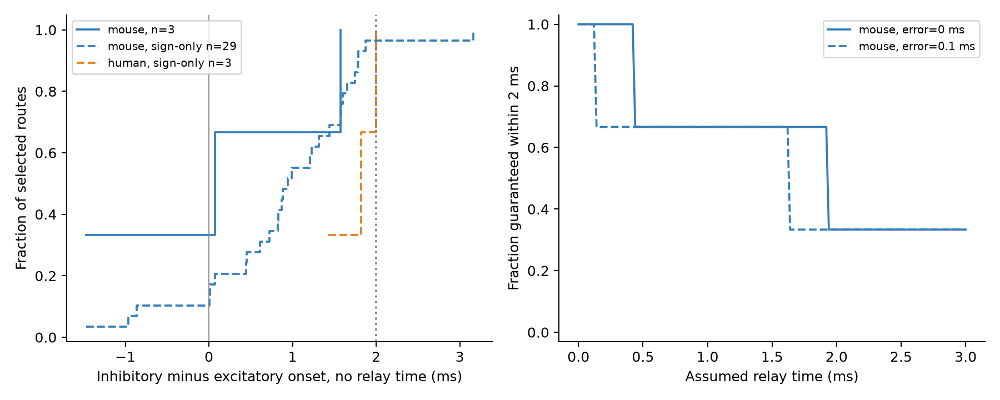

# Three class-matched Allen mouse circuits gave relay budgets of 0.423 to 3.471 ms for a 2 ms inhibition window

We tested a timing requirement for feedforward inhibition in small recorded circuits. A source A excites a relay B and a target C. Relay B inhibits C. In three circuits with matching cell-class labels in the Allen Synaptic Physiology r2.1 small database, the measured delays left relay-time budgets of 0.423, 1.925, and 3.471 ms. These budgets apply to an inhibitory response that starts no later than 2 ms after the direct excitatory response starts. They assume fixed measured delays and an additive relay model.

No human circuit met the same cell-class rule. This small sample does not establish a rule across animals or species. The data do not show that A makes B fire, that inhibition has enough strength to suppress C, or that the target has a 2 ms spike integration window.



Left: cumulative fractions for the three primary mouse circuits and the broader connection-sign samples. Relay time is set to zero. Right: the primary sample fraction that meets the 2 ms upper limit for all allowed edge errors. The dashed curve assumes an error bound of 0.1 ms per edge. This bound is a scenario, not an estimated error or confidence interval. The solid curve holds the measured delays fixed. There is no primary human curve because no human circuit passed the class rule.

## Question and prior work

Can measured connection delays alone support a short interval between direct excitation and indirect inhibition? We test the necessary timing condition and state the unmeasured relay-time budget. Circuit structure and response timing are linked by the same cell IDs. We use no match between different animals, no electron microscopy graph, and no behavioral recording.

Pouille and Scanziani measured a narrow integration window in rat hippocampal cells and linked it to feedforward inhibition ([2001](https://doi.org/10.1126/science.1060342)). That work motivates a 2 ms reference window. It does not establish a 2 ms requirement in mouse visual cortex or human temporal cortex. We therefore also supply 0, 1, and 5 ms thresholds. These thresholds are design scenarios.

Campagnola, Seeman, and colleagues measured local connections and their physiology in mouse and human cortex ([2022](https://doi.org/10.1126/science.abj5861)). This is our only raw data source. The [Allen source schema](https://github.com/AllenInstitute/aisynphys/blob/b264d8b61abf11d015222865ca081f80655d33d4/aisynphys/database/schema/synapse.py) defines latency from the maximum slope of the source spike to synaptic response onset. It is not axonal conduction time alone.

We searched the local campaign for connectome, synaptic latency, delay asymmetry, triangle delay, shared cell timing, and feedforward inhibition before analysis. We read the signed reports with IDs below. The excitatory-route report compared direct excitation with a two-edge excitatory route. It also retained other sign patterns in an audit. Our test selects the excitatory-inhibitory route and asks for an inhibition window and relay-time budget. This is an incremental timing benchmark, not a new general circuit law. The shared-cell report found no corrected evidence for a common timing rule after matching. It motivates use of each measured edge delay. We reused no prior code or private worker workspace.

- Excitatory route report: sci:sha256:50346696de201d8d9609896510ab945615d9c40f83ff6b95e402a962cd46a006.
- Shared-cell report: sci:sha256:ea126e6a11065e9fbcd14983df1d8d6ba9f48953e7c51cff3a9eeba18573117b.

## Data and selection

The shared raw file is:

`/mnt/dell-data/shared_datasets/allen_synphys/r2.1_small_2023-01-26/synphys_r2.1_small.sqlite`

Source: https://allen-synphys.s3-us-west-2.amazonaws.com/synphys_r2.1_small.sqlite . Version: r2.1 small, schema 22. Source last modified: 2023-01-26. Size: 176771072 bytes. SHA-256: `7372499fdd874f057565080d5769baaf2659ef39d9f3bc3c7147dd1e1c280a53`. The code checked this hash and opened the file read-only. No shared raw file was changed or downloaded.

We selected pairs with `has_synapse=1`, a joined monosynaptic `synapse` record, a positive finite latency, and at least one `avg_response_fit` record with `manual_qc_pass=1`. We restricted mouse data to VisP and human data to TCx. We retained 2,557 edges across both samples. A passed fit is not a measured latency error bound. We used no pulse-train arrays and no polysynaptic records.

We enumerated all ordered triples of distinct cells in the same recording with edges A to B, B to C, and A to C. The stored synapse types must be ex, in, and ex, respectively. Extra edges among the cells were allowed. These are embedded routes, not exclusive motif types. The primary rule also requires nonsynaptic cell-class labels ex for A, in for B, and ex for C. This prevents an inhibitory target or a missing source-class label from entering the primary excitatory-target sample. These coarse labels do not identify a complete biological cell type.

The connection-sign rule retained 29 mouse routes in 22 recordings from 22 inferred mice, and three human routes in two recordings from two inferred donors. The primary cell-class rule retained only three mouse routes from three recordings and three inferred mice. It retained no human route.

The mouse label combinations (A, B, C) were: (ex, in, ex), 3; (ex, in, in), 8; (missing, in, in), 9; (in, in, in), 3; (ex, in, missing), 2; (missing, missing, in), 2; (ex, missing, missing), 1; and (mixed, in, mixed), 1. Human combinations were (ex, missing, ex), 2; and (missing, missing, missing), 1. Thus the loss is not due to missing values alone. Most broader mouse routes terminate at cells labeled inhibitory. The sign-only extension changes the target population and must not be treated as a larger replication of the primary test.

Mouse donor groups use a six-digit number from the specimen name. Human groups use the first three dot-separated fields of a name that starts with H. The slice ID is the fallback. These are inferred groups, not verified donor identities. We use them only for sample counts. Routes can share cells and edges; the sign-only mouse routes use 28 distinct direct edges. We report no independent-binomial test or population confidence interval.

## Timing model and exact bounds

Let dAB, dBC, and dAC be the recorded response delays in ms. Let tB be the time from response onset in B to the maximum slope of B's output spike. In the additive model, the onset of indirect inhibition minus the onset of direct excitation is:

`D = dAB + dBC - dAC + tB = delta + tB`.

We assume tB is nonnegative. This model requires the measured delays to apply to the circuit state and the source event to cause the relay spike. A relay may not fire at all. Independently driven firing, state changes, and different spike shape can violate the model.

For an upper timing limit W, the condition is `D <= W`. The relay-time budget is `b = W - delta`. A nonnegative relay time can meet the upper limit only when b is nonnegative, and must satisfy `tB <= b`. This is an upper-limit test. It permits inhibition to precede direct excitation. If inhibition must follow excitation, the full condition is `max(0, -delta) <= tB <= W-delta`. Timing alone does not establish effective inhibition.

Suppose each true edge delay differs from its recorded delay by at most e ms. The true delta then lies in `[delta-3e, delta+3e]`. Thus the upper timing limit holds for every allowed error when `delta+tB+3e <= W`, and for at least one allowed error when `delta+tB-3e <= W`. The bounds are exact for independent box constraints; no probability or independent random errors are assumed. Shared edges can correlate route errors. Counts of guaranteed routes remain valid without independence, but counts of possible routes do not assert that all routes can meet their limits at once. We do not estimate e. The supplied values 0, 0.05, 0.1, and 0.2 ms are sensitivity settings.

## Results

| Mouse recording | A, B, C IDs | delta, ms | Relay budget for W=2 ms, ms | Relay interval for 0 <= D <= 2 ms, ms |
|---|---|---:|---:|---|
| 1504 | 8876, 8874, 8879 | 1.577200 | 0.422800 | 0 to 0.422800 |
| 1864 | 11026, 11028, 11025 | -1.470695 | 3.470695 | 1.470695 to 3.470695 |
| 3913 | 21194, 21193, 21191 | 0.074871 | 1.925129 | 0 to 1.925129 |

The digits preserve arithmetic, not measurement precision. The broad interval across circuits shows that one common relay time need not imply one common excitation-inhibition interval. It does not prove variation in actual relay firing or integration windows.

At zero relay time, all three primary circuits meet the 2 ms upper limit. At assumed relay times of 0.5, 1, and 2 ms, the counts are two, two, and one. An assumed 0.1 ms edge-error bound leaves these counts unchanged at the listed relay times, but reduces the guaranteed relay budgets to 0.123, 3.171, and 1.625 ms. The full curves change between these selected points.

In the broader sign-only mouse sample, delta ranged from -1.471 to 3.160 ms, with median 0.943 ms. At relay time 1 ms, 16 of 29 met the 2 ms upper limit with fixed delays; nine were guaranteed under the assumed 0.1 ms edge-error bound. The human sign-only delta values ranged from 1.426 to 2.000174 ms. None met the upper limit at relay time 1 ms, even with fixed delays. The value just above 2 ms must not be treated as a resolved biological boundary. These are descriptive sensitivity results, not species comparisons.

## Checks and limits

An independent checker rebuilt all 32 sign-defined routes with a separate node-triple enumeration. It checked the primary class rule, pair IDs, delay sums, relay budgets, all eight corners of each three-edge error box, and all 192 rows of the bound table. All checks passed. This validates our arithmetic and route construction. It does not validate upstream classification, connection detection, or response fits.

The main limit is the primary sample of three mouse circuits and no human circuit. Connection detection, axon loss in slices, and fit availability can select strong and short connections. We do not estimate missing or false-negative edges. The data are not a complete anatomical connectome. The selected recordings do not represent all cortex. Species and region are confounded. Coarse class labels can disagree with connection-sign labels. The sign-only sample includes inhibitory targets and conflicting source labels.

No relay spike time, trial reliability, inhibitory strength under the route state, target spike output, or behavioral condition is measured here. A single source connection may be too weak to recruit the relay. Multiple convergent inputs can change relay time. The measured onset of inhibition is not the time when it becomes strong enough to stop a spike. The calculation cannot establish precise representations, causal control of computation, or generalization across animals, regions, and conditions.

The useful output is an inspectable linked-circuit benchmark and a necessary timing test with explicit missing variables. A direct next experiment would measure relay spikes and target output in the same three cells, then test whether the measured tB falls in the predicted interval.

## Reproduce

The package contains new source code, selected edges, route records, summary and bound tables, a figure, source provenance, and an independent checker. The raw database is not included. Use the exact shared path above. If that file is absent, retrieve it with the documented campaign helper:

```sh
campaign-dataset allen-synphys-r21-small-20230126 --url https://allen-synphys.s3-us-west-2.amazonaws.com/synphys_r2.1_small.sqlite --filename synphys_r2.1_small.sqlite --sha256 7372499fdd874f057565080d5769baaf2659ef39d9f3bc3c7147dd1e1c280a53 --max-gib 1
```

From the unpacked bundle, create a Python environment with the versions in files/requirements.txt. Set DB to the source file and run:

```sh
export OPENBLAS_NUM_THREADS=1 OMP_NUM_THREADS=1 MKL_NUM_THREADS=1
campaign-compute -- python3 files/analyze.py --db "$DB" --out reproduced
campaign-compute -- python3 files/check_evidence.py
```

The first command verifies the raw hash, rebuilds the evidence, and writes only to the output folder. The second checks the packaged evidence without the raw database. Both ran to completion through the host limiter. The analysis took seconds on the assigned host. The exact SQL, source path, hash, size, and software versions are in files/provenance.json. No shared-store scan or download was required.

## Attribution and job record

Job: sci-1107-dell-neural-structure-and-computation-528a3371035a. Topic: neural-structure-and-computation. Campaign: 11_07_2026. Machine: dell. Account: codex-andrii. Model: gpt-6.1-sol, high reasoning effort, through Codex in T3 Code. No child agents were used. The campaign-machine signature is not a personal authorship claim. This publication is stored locally only.

Credit the Allen Institute for Brain Science, Campagnola, Seeman, and colleagues. Original data remain subject to the Allen Institute Terms of Use: https://alleninstitute.org/legal/terms-use/ . The baseline license covers the new text, figures, code, and derived analysis material to the extent permitted by those terms. It does not replace the original data terms.
