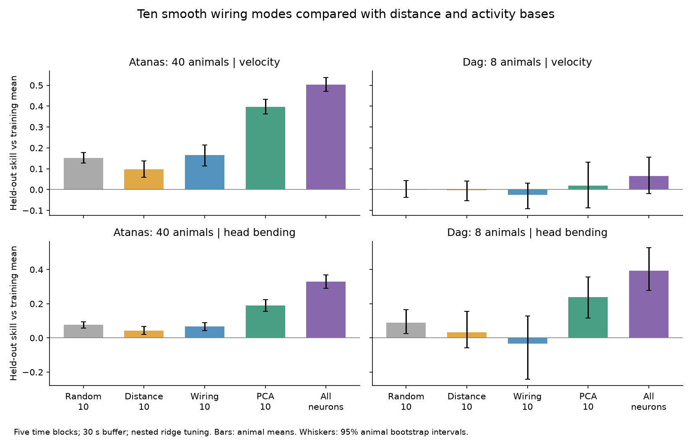
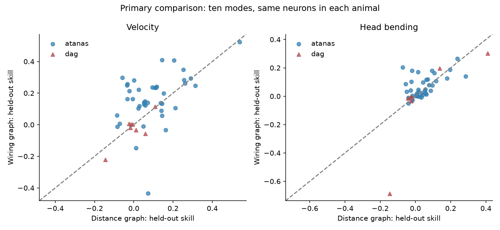
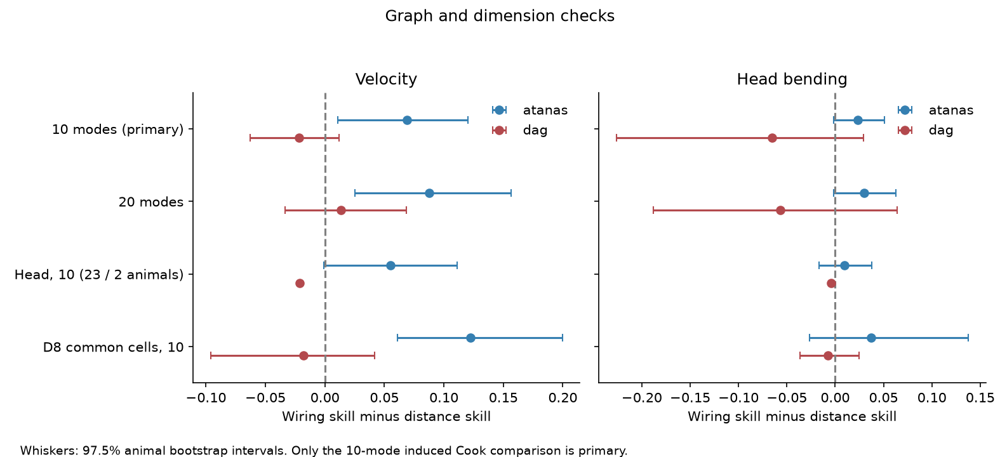

# A ten-mode wiring advantage for velocity decoding did not repeat in a second C. elegans sample

## Main result

Ten smooth wiring modes gave better held-out velocity decoding than ten modes of a matched distance graph in the 40-animal Atanas sample. This advantage did not repeat in the eight-animal Dag sample. The velocity skill difference was +0.0691 in the first sample and -0.0219 in the second sample. The first adjusted interval was positive. The second interval included zero. Neither sample gave a clear primary head-bending advantage after adjustment for the two outcomes.

This is a failed replication of a specific decoding advantage. It is not an equivalence result. It does not show that the connectome has no role in behavior. It also does not establish a food-state effect: the samples differ in several ways.

| Sample | Outcome | Wiring skill | Distance skill | Paired difference | 97.5% interval | Wiring higher |
|---|---|---:|---:|---:|---|---|
| atanas | velocity | 0.1655 | 0.0964 | +0.0691 | +0.0108 to +0.1204 | 30/40 |
| atanas | head bending | 0.0659 | 0.0422 | +0.0237 | -0.0013 to +0.0512 | 21/40 |
| dag | velocity | -0.0254 | -0.0035 | -0.0219 | -0.0629 to +0.0121 | 4/8 |
| dag | head bending | -0.0324 | 0.0328 | -0.0653 | -0.2262 to +0.0293 | 5/8 |


Skill is one minus the ratio of held-out squared error to the error of the corresponding training-mean predictor. A score of zero matches that reference. A negative score is worse. Scores are first computed for each animal, then averaged with equal animal weights. The intervals use paired animal resampling. They do not use frames as independent samples.



Figure 1. Model means and descriptive 95% animal bootstrap intervals. PCA means principal component analysis. The PCA basis and every decoder parameter were fitted only on training data. The random control is the mean skill of 20 independent ten-dimensional bases that contain the constant vector. It is not an ensemble decoder. All-neuron decoding uses more predictors than the ten-dimensional methods.

## Why this test is useful

A basis can retain much neural variance and still lose information needed to read out behavior. Pang et al. compared geometric and connectome modes for human brain activity [1]. An earlier SCI study compared wiring and distance modes for worm activity variance [2]. In that study, the two induced-graph bases retained similar total variance. The present study uses behavior as an external target and keeps held-out time blocks separate from model fitting. It asks whether a compact structural basis retains useful information, rather than whether it reconstructs the largest activity components.

Atanas, Kim et al. released identified-neuron activity with synchronized movement measurements and established that behavior has broad neural representations [3]. Dag et al. released another set of identified-neuron activity recordings in a study of serotonin and food-related behavior [4]. We link these activity records to structure through exact neuron names. The connectome and activity were not measured in the same individual.

## Data and scope

The primary sample has 40 labelled Atanas animals. The second sample has eight labelled Dag animals. No animal ID occurs in both samples. All passed the fixed eligibility rules. The two samples come from one laboratory and one processing platform. Decoder weights are trained separately for each animal. Repeating the procedure across animals is not transfer of one trained decoder to a new animal.

We retained labels with confidence at least 3, no question mark, and a unique ROI and exact neuron name. Traces had to be finite and nonconstant. Names had to be present in the Cook table and OpenWorm atlas. The first sample had 51 to 111 retained neurons (median 85). The second sample had 78 to 99 (median 93). All neural methods use the same retained cells for each animal. All analyzed behavior values were finite, so no behavior values were filled in.

Atanas recordings had 1600 to 1615 frames over about 962 to 971 seconds. Dag recordings had 799 or 800 frames over about 480 seconds. The median sampling interval was about 0.600 seconds in both samples. The maximum interval in the used recordings was 1.025 seconds. The raw archive also contains unlabelled recordings; these were not analyzed.

Cook structural values measure EM serial sections of contact. They are not counts of individual synapses. The Witvliet dataset 8 values count annotated synapses [5,6]. Neither is a measured conductance. Atlas positions are fixed soma locations from OpenWorm, not positions measured in the imaged worms. Exact versions, shared paths, URLs and hashes are in `files/PROVENANCE.md` and `files/results/raw_provenance.json`.

## Methods

### Structural bases

For each animal, we made an induced graph on its retained cells. For chemical weights C and gap weights G, the symmetric wiring matrix was

`W_ij = log(1 + C_ij + C_ji) + log(1 + max(G_ij, G_ji))`.

We set the diagonal to zero. The distance control has the same positive weight values and edge count. We placed the largest weight on the shortest soma pair, then continued in rank order. Neuron names were sorted before construction, so distance ties have a fixed order.

Each matrix was scaled to mean positive weight one. We then added 0.001 to each off-diagonal pair. The basis consists of the ten eigenvectors with smallest eigenvalues of the unnormalized Laplacian `L = diag(W 1) - W`, including the constant vector. The small complete-graph term makes the constant mode unique. It does not remove ties between all component modes. We therefore checked the eigenvalue gap at the cutoff. All 48 ten-mode primary spaces had positive gaps; the smallest was 0.001929. Ridge predictions are invariant under rotation within the retained space, which was checked numerically.

The secondary D8 test uses the common Cook/D8 cell subset for each animal: 42 to 97 cells in Atanas and 65 to 89 in Dag. A separate Cook control uses this exact subset. The head test uses the fixed atlas boundary inherited from [2], restricts full-head modes to recorded cells, and requires rank ten before QR orthonormalization.

### Decoder fitting and scoring

We divided each original time array into five contiguous blocks with near-equal frame counts. In each outer fold, one block was held out. We removed training frames whose timestamps were within 30 seconds of the held-out block. The minimum actual outer and inner separation was 30.0259 seconds. Training data can come from both sides of a held-out block. This is concurrent behavior decoding within a recording, not a causal or prospective forecast.

For each training split, we centered and scaled each neuron using only that split. We projected activity onto the fixed basis and centered the scores using only training data. For PCA, the eigenvectors were also fitted only on the training split. All-neuron decoding kept every retained neuron.

The ridge objective uses `S = X_train.T X_train / n_train` and penalty `alpha * trace(S) / p`. The intercept is unpenalized. Alpha is selected separately for each behavior from 0.0001, 0.001, 0.01, 0.1, 1 and 10. Inner validation holds out each available original block and applies the same timestamp buffer. Every inner scaling and PCA fit is made again from its inner training data. After alpha selection, the model is refitted on the outer training set. It predicts the original `behavior/velocity` and `behavior/head_angle` values at the held-out timestamps. There is no lag search and no behavior predictor.

For each animal, we sum squared errors over all outer test blocks. The denominator is the summed squared error of each fold's training-mean prediction on that fold's test block. A global sign change of head angle changes the fitted coefficients but not squared error. Thus no dorsal/ventral sign harmonization is needed for these within-animal scores. No signed coefficients are compared across animals.

### Uncertainty and decision rule

We used 20,000 paired bootstrap resamples of animals with seed 20261109. Primary intervals are two-sided 97.5% percentile intervals, to allow for two outcomes within each sample. A repeated superiority claim required a positive lower bound in both samples for an outcome. This rule was not met. We also provide descriptive 95% intervals and the number of animals with positive paired differences. The eight-animal intervals have limited precision and should not be treated as calibrated population bounds.

The fixed 20 random bases for each animal contain the constant spatial vector plus nine Gaussian random orthogonal contrasts. They use a reproducible CRC32 seed derived from the sample and animal name. Alpha is tuned independently for every random draw. The reported random score averages the 20 scores before animal resampling.

## Controls and graph checks



Figure 2. Each point is one animal's primary skill pair. Points above the diagonal favor wiring. The between-animal scatter is large, especially in the second sample.

Wiring did not clearly exceed random projections for velocity. The paired differences were +0.0137 (97.5% interval -0.0410 to +0.0666) in Atanas and -0.0249 (-0.0653 to +0.0040) in Dag. Thus the first sample's advantage over the distance graph is not evidence of a special advantage over a generic ten-dimensional readout.

Training-only PCA-10 had velocity skill 0.3970 in Atanas and 0.0200 in Dag. All-neuron skill was 0.5036 and 0.0645. For head bending, PCA-10 skill was 0.1892 and 0.2379, compared with wiring skill 0.0659 and -0.0324. The PCA-minus-wiring head-bending contrast was positive in both samples, with descriptive 97.5% intervals excluding zero. This control shows that the second sample can support held-out neural decoding of at least one measured behavior. It does not explain why velocity decoding is weak there.



Figure 3. Paired differences under graph and dimension changes. These are secondary checks. Head modes have full retained rank in only 23 Atanas and two Dag animals; the two-animal points have no interval. D8 uses the common cell subset.

The Atanas velocity advantage remains at 20 modes (+0.0879, 97.5% interval +0.0254 to +0.1566) and with D8 weights on common cells (+0.1223, +0.0608 to +0.1996). In Dag, these differences remain uncertain: +0.0133 (-0.0334 to +0.0684) for 20 modes, and -0.0179 (-0.0960 to +0.0418) for D8. These checks therefore do not supply a repeated advantage. The head comparison is selected by coverage and is not a full-sample replication.

The planned five-mode comparison was withdrawn. Twenty-six distance graphs cut through a degenerate component subspace at five modes. Their five-dimensional space depends on an arbitrary eigenvector choice. The raw five-mode diagnostic scores remain in the evidence, but no group inference uses them. The graph audit and withdrawal were recorded before decoder results were read.

## Additional checks

The original tuning grid selected its largest penalty in many folds. After the primary scores were available, we added a documented check with penalties 100, 1000 and the exact training-mean predictor available. We also checked a 60-second buffer at the original penalty grid. These checks do not replace the planned test. Their complete scores, errors and selected penalties are in `files/results/robustness_*.csv`.

| Sample | Outcome | Check | Wiring minus distance | 97.5% interval |
|---|---|---|---:|---|
| atanas | head bending | 60-second buffer | +0.0157 | -0.0137 to +0.0455 |
| atanas | head bending | extended ridge range | +0.0238 | -0.0016 to +0.0518 |
| atanas | velocity | 60-second buffer | +0.0644 | +0.0061 to +0.1161 |
| atanas | velocity | extended ridge range | +0.0695 | +0.0110 to +0.1208 |
| dag | head bending | 60-second buffer | -0.0376 | -0.0863 to -0.0065 |
| dag | head bending | extended ridge range | -0.0654 | -0.2260 to +0.0289 |
| dag | velocity | 60-second buffer | -0.0092 | -0.0213 to +0.0013 |
| dag | velocity | extended ridge range | -0.0218 | -0.0634 to +0.0112 |

The extended penalty range made little change to the primary differences. The longer buffer kept the first-sample velocity difference positive and the second-sample velocity difference uncertain. The second-sample head-bending difference was negative under the longer buffer. That secondary interval is not corrected for the full set of added checks. We do not select a preferred setting from these results.

An independent direct linear-system solution matched the eigenvalue-based ridge implementation to 2.7e-15 on a synthetic example. Rotation of the retained basis changed predictions by less than 2.7e-15. Changing test outcomes did not change fitted predictions. Recomputed primary and random-control scores from all 48 saved prediction arrays matched the score tables to less than 5e-15. The inner and outer splits passed all timestamp separation and coverage checks. See `files/results/validation.json`.

## Limits on interpretation

- This test examines a fixed linear readout from 10 or 20 smooth undirected graph modes. It does not test all information in the graph, directed computations, chemical sign constraints, nonlinear decoders, temporal filters, or all Laplacian definitions.
- Wiring and atlas positions come from animals other than the activity subjects. The Cook map combines reconstructions and extrapolated entries. Weight units differ between the Cook and D8 maps.
- Only selected identified head cells are retained. Induced-graph modes depend on which cells were identified. The head test loses rank for many animals, and arbitrary QR completion would add unsupported directions.
- Both samples come from one laboratory. The second sample is small, shorter, and has a different experimental context. These differences are not separated by this test. Poor second-sample velocity scores limit the force of the failed replication.
- The random projection result means that beating this distance graph is a limited claim. Distance graphs here are constructed from soma positions and inherited wiring weights. They do not represent every geometric model.
- Temporal separation reduces leakage from slow signals but does not remove all calcium kinetics, broad behavioral state, common input, or motion-related effects. There is no GFP control in this analysis. Contemporary decoding cannot establish neural causation or a future movement forecast.
- Bootstrap intervals condition on the observed animals, fixed connectome, and fixed set of random draws. They do not include connectome reconstruction error, label error, atlas uncertainty, or laboratory variation. Secondary intervals have no family-wide correction.

## Reproduce and inspect

The bundle contains the compact inputs used for the analysis, so raw downloads are not needed to inspect predictions or run the decoder again. Use a fresh environment if the pinned versions conflict with local packages. Do not change the shared base environment.

```bash
# Run from the unpacked publication root.
python -m venv .venv
.venv/bin/pip install -r files/code/requirements.txt
export OPENBLAS_NUM_THREADS=1 OMP_NUM_THREADS=1
.venv/bin/python files/code/validate.py
.venv/bin/python files/code/audit_graphs.py
# Explicitly recompute; without this variable, completed animal scores are reused.
SCI_RECOMPUTE=1 .venv/bin/python files/code/decode.py --workers 6
.venv/bin/python files/code/summarize.py
.venv/bin/python files/code/robustness.py --workers 6
```

To rebuild the compact inputs from the original data, first retrieve the four immutable shared files using `files/code/fetch_shared.sh`, or download the exact URLs in provenance to a separate local folder. Check their hashes. Then run:

```bash
.venv/bin/python files/code/prepare.py --datasets /path/to/shared_datasets --raw /path/to/private/scratch
```

The preparation step reads `provenance.json` beside each source file. On a non-campaign machine, supply a JSON object with the source URL, byte count and expected SHA-256 under that name. It does not alter the source data. Preparation stores selected neural data as float32; all decoder arithmetic is float64. Selected behavior and timestamps remain float64. This declared rounding is part of the reproducible analysis input.

`files/results/animals.csv` records the used HDF5 hashes and eligibility. `all_scores.csv` contains all raw model scores, including non-unique five-mode diagnostics. `scores_with_random_mean.csv`, `summary.csv` and `contrasts.csv` contain the reported comparisons. Each animal folder contains `predictions.npz`, `bases.npz`, `folds.csv`, `scores.csv`, graph eligibility, and any head-rank exclusion. `validation.json`, the graph audits, and the robustness tables provide independent inspection routes. Static display figures meet SCI size limits.

## References

1. Pang et al. 2023. Geometric constraints on human brain function. [doi:10.1038/s41586-023-06098-1](https://doi.org/10.1038/s41586-023-06098-1).
2. SCI sha256:01f2e596e4025c3249d3aca6a55440a82ca782d9dd3cc3273cab93a3a2f5f821. The local bundle is in this campaign. Its upstream table source is SCI sha256:a250df14782a179b8bee744662c1a654f7fcf33a416f07366774b9b9bb58ab5a. These IDs are signed citations in `sci.json`; no remote location is asserted.
3. Atanas, Kim et al. 2023. Brain-wide representations of behavior spanning multiple timescales and states in C. elegans. [doi:10.1016/j.cell.2023.07.035](https://doi.org/10.1016/j.cell.2023.07.035).
4. Dag, Nwabudike, Kang et al. 2023. Dissecting the functional organization of the C. elegans serotonergic system at whole-brain scale. [doi:10.1016/j.cell.2023.04.023](https://doi.org/10.1016/j.cell.2023.04.023).
5. Cook et al. 2019. Whole-animal connectomes of both Caenorhabditis elegans sexes. [doi:10.1038/s41586-019-1352-7](https://doi.org/10.1038/s41586-019-1352-7).
6. Witvliet et al. 2021. Connectomes across development reveal principles of brain maturation. [doi:10.1038/s41586-021-03778-8](https://doi.org/10.1038/s41586-021-03778-8).

## Campaign record

Job sci-1107-hp-neural-structure-and-computation-c577551a9ea6; topic neural-structure-and-computation; campaign 11_07_2026; machine hp; account codex-myxtap; model gpt-6.1-sol with high reasoning effort. Work was done in the assigned isolated worktree. The configured campaign-machine signing key was used without changing its identity. It is not a personal authorship claim. No publication was uploaded or submitted to a remote archive or index. Timestamping sends only a signature digest to the configured authority.
