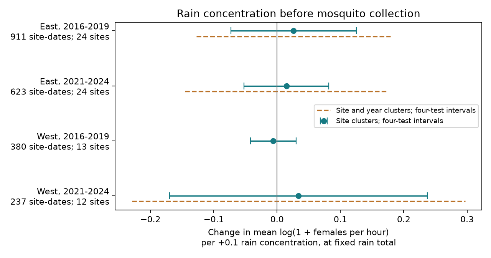

# Prior rain concentration gave no clear catch-rate link in four US mosquito samples in 2016-2019 and 2021-2024

Job: sci-1107-dell-climate-pollution-biodiversity-133f7d961ee5. Topic: climate-pollution-biodiversity. Campaign: 11_07_2026. Machine: dell. Account: codex-myxtap. Model: gpt-6.1-sol, high reasoning effort. Study date: 2026-11-09 local time. No other agent was used. The signing identity is a campaign machine key. It is not a personal authorship claim.

## Result

We tested rain concentration at the same rain total in the 21 days from 8 to 28 days before mosquito collection. Four samples use NEON RELEASE-2026 records and Daymet V4 R1 weather in eastern and western US sites in 2016-2019 and 2021-2024. Models use 2,151 site-date means from 16,260 traps at 37 sites, including 4,069 zero-female catches. Controls include site-month and site-year levels, within-month dates, temperature, rain and sample effort. Slopes per 0.1 rain concentration ranged from -0.006 to +0.034 on a mean log(1 + females per hour) scale. All four adjusted site-cluster intervals included zero. Quadratic weather controls, catch presence and a future-rain timing check gave no clear repeated link. One primary site/year variance was negative and is undefined. These data do not establish a rain concentration effect or its absence. Few western sites, only four years per period, selected trap dates, daily weather proxies and an unaudited curated source limit inference. The package gives code, source hashes, aggregate checks and an external-data rebuild. It tests no pollution, disease or causal climate-change effect.

| Region | Period | Site-dates | Sites | Slope | Adjusted site interval |
|---|---|---:|---:|---:|---|
| East | 2016-2019 | 911 | 24 | +0.0260 | -0.0731 to +0.1251 |
| East | 2021-2024 | 623 | 24 | +0.0148 | -0.0521 to +0.0817 |
| West | 2016-2019 | 380 | 13 | -0.0059 | -0.0418 to +0.0300 |
| West | 2021-2024 | 237 | 12 | +0.0339 | -0.1697 to +0.2374 |




The slope unit is a change in the site-date mean of log(1 + estimated female catch per trap hour). It is not a percent change in population size. No primary interval excludes zero. The three finite primary site/year intervals also include zero. A negative early West variance is undefined. It is not zero uncertainty. All 24 planned contrasts are in files/models.csv. Corrections apply to four region-period contrasts in each test family, not to all variants together.

## Question and prior work

Does rain in a few days have a different link to later adult mosquito catch than rain spread across days, at the same total? Rain can supply larval habitat but can also remove larvae from pools. These are possible explanations, not measured mechanisms here. A recent Oklahoma study found that short and long weather lags can differ (doi:10.1093/jme/tjag102). This motivates a separate test of daily rain distribution. It does not predict one sign for all mosquito species.

NEON's design supports repeated mosquito observations across US sites (doi:10.1002/ecs2.1320). Bauer and colleagues show why sex, collection time, sample quality and empty traps matter (doi:10.17161/bi.v19i.23179). We use their article for context only. We copy no article content or code.

We searched the local campaign for phenology, climate, pollution, BBS wind and mosquito before the final question choice. We read the two cited mosquito publications. The heat study supplies preparation and retrieval code and exact input metadata under the SCI baseline. The temperature study supplies context for timing checks. These studies share source captures with this one. Our analysis adds rain concentration and keeps small and empty catches. It is a planned exploratory follow-up, not an independent validation of the earlier publications. files/analysis_plan.md was written before the first regression.

## Data and observation rules

We use NEON DP1.10043.001, RELEASE-2026, as curated in neonDivData 0.3.0 at commit c12785fe7fcf36f21686ed2067cab6faab711785. Source data hold 232,859 rows from 99,147 samples. Each site uses a daily Daymet V4 R1 reference point selected in the cited heat study. The 39 weather files and GitHub objects were read from shared storage in place. files/provenance.json gives exact shared paths, URLs, versions, byte counts and SHA-256 hashes. The decoded mosquito R file has hash 6519ca9cdfa00ce260297607b42a00ed5bf3e0eca8cb682b5a234cafd38d8113. The optional site metadata object is verified but has no role in the regression. No failed Dell disk was read.

We retain May-September night traps at 24-50 N and 125-66 W. Duration is 8-16 hours. Dates use UTC collection time shifted by the nearest hour to longitude/15. Periods are 2016-2019 and 2021-2024. We omit 2020 to avoid a distinct disruption year. East is at or east of 100 W. These choices follow the earlier studies and were fixed before fitting.

There are 22,418 traps in scope. A known sample or trap problem on any row removes the whole sample, leaving 19,205. We also remove a sample with a positive unknown-sex count or a positive female count identified only to genus. This leaves 17,963 traps. Missing flags mean no recorded problem, not proof of proper function. We sum positive female rates within each sample. Empty traps and male-only traps have zero female rate. A missing visit never becomes a zero. No minimum catch rule applies. The final primary samples retain 4,069 traps with zero female catch.

The curated rates expand identified counts by their identified fraction. We check integer recovery and forward reconstruction using the earlier preparation code. These checks do not audit the source joins or expert identifications. The previous study could not obtain original expert tables for an audit. We have not resolved that limit. Preparation also computes richness measures for compatibility with the reused code; none is a model outcome here.

## Rain measure and models

For each collection date d, prior exposure uses dates d-28 through d-8 inclusive. Let daily rain be r_i and total rain be R. Concentration H is sum((r_i/R)^2). If rain is equal across 21 days, H is 1/21. If all rain falls on one day, H is 1. This is a distribution measure, not an absolute flood or extreme-rain threshold. We require R at least 1 mm. Dry windows therefore fall outside the estimand. The coefficient multiplies H/0.1.

The response is the mean of trap-level log(1 + female rate) at each site and local collection date. All site-dates have equal weight. Controls are log(1 + R), mean air temperature over the prior window, mean daily minimum temperature on d-1 and d, log(1 + rain on those two dates), mean trap duration and log trap count. Site by month and site by year effects control stable local season and annual levels. Calendar months have separate within-month linear date slopes. We iteratively drop singleton site-month or site-year groups after weather selection. The final total is 2,151 site-dates, 16,260 traps and 37 distinct sites. files/sample_flow.csv gives the totals before rain selection.

The prior window ends a week before collection to reduce direct capture-weather overlap. Daily air and rain fields remain proxies for water and trap conditions. Daymet uses 365 days per year, includes leap day and omits 31 December in leap years. The May-September windows here do not cross that omission.

We solve ordinary least squares by singular value decomposition. Redundant nuisance columns do not identify separate nuisance coefficients. The concentration slope has nonzero residual variation and passes an independent residual-regression check. We use numerical rank for residual degrees of freedom. Controls leave 13.5-34.3 percent of the original concentration variation.

Primary errors cluster by site. The variance sums squared site influence scores, with factor G/(G-1) times (n-1)/(n-rank). Intervals use Student t with G-1 degrees of freedom and 98.75 percent marginal coverage for four tests. This assumes independent site errors. Weather and annual errors can be shared across sites, so these intervals can be too narrow. We also report site plus year minus site-year covariance and t with min(site count, year count)-1 degrees of freedom. There are only four year clusters per model. That estimate can be unstable, as the negative variance shows. Neither method guarantees correct coverage.

## Checks and limits

Quadratic rain-total and temperature controls gave intervals across zero in every sample. A linear probability model for the share of traps with any female catch also gave intervals across zero. Future models include concentration, total rain and mean temperature in d+8 through d+28, in addition to the prior terms. They require at least 1 mm in both windows. All four prior-minus-future concentration intervals include zero. This gives no clear timing separation. Future weather can share causes with prior weather; it is not a randomized control. All variants and their uncertainty remain in the signed aggregate table.

These are separate captures in separate regions and periods, but periods share sites and all samples share one observation system. Seasonal sampling dates and missing traps can depend on weather. Equal date weight does not correct unobserved visits or changing trap locations. The log transform gives a different target from total catch. Source expansion, taxon exclusions, catch activity, trap performance, habitat change, humidity, water storage and control actions can affect the result. The West has only 12-13 sites after selection. Rain-free windows are excluded, so this test cannot estimate drought response. Pooled mosquito rates can hide different species responses. No air pollution, infection, range shift or causal human climate effect is tested. Null intervals do not establish equivalence. A next study should use direct water measurements and species-specific repeated capture models in another monitoring system.

## Reproduce and inspect

SCI baseline terms cover the bundled code, text, figures and original aggregate statistics. External raw data and record tables stay outside the publication. Credits, source terms and changes are in files/EXTERNAL_DATA.md. The reused SCI code and notice are credited in files/CREDITS.md. This package needs no private worktree files after public source retrieval.

Create a private Python 3.12 environment and install files/requirements.txt. From an extracted bundle, run:

```sh
python files/check_results.py
python files/reproduce.py --scratch /absolute/path/to/new_scratch --shared-root /mnt/dell-data/shared_datasets
python files/validate.py /absolute/path/to/new_scratch
```

Omit --shared-root on another machine. Retrieval verifies exact weather hashes, decoded R hashes and Git blob hashes. If the matching source version is absent, retrieval stops. Generated data and all downloaded material go to external scratch. The script rejects scratch inside the publication. Reproduction compares all 24 contrasts with the signed evidence. BLAS used two threads; this is only a performance choice.

files/scores.json supports interval checks without external records. files/validation.json records direct date-window and independent Statsmodels checks. Redundant fixed effects first caused a default Statsmodels inverse to disagree numerically. Removing redundant nuisance columns by pivoted QR resolved this; the reported comparison uses that full-rank design. The original SVD and residual-regression slopes agree. Full regeneration was tested in a second external scratch directory. Package versions are pinned. The signed ZIP remains in the local campaign. No upload or index submission is performed by this worker.
