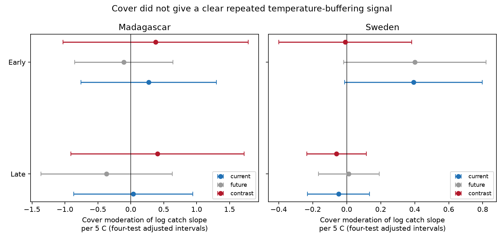

# Cover by current-minus-future warmth intervals crossed zero in four insect-catch samples in 2019-2020

We tested whether forest or canopy cover changed the link between warmth and flying insect catch during collection more than it changed the link to future warmth. All four adjusted intervals crossed zero. These data did not establish a repeated short-term cover response. The wide intervals do not show that cover has no effect.

The test used 5,105 catches from Sweden in 2019 and Madagascar from August 2019 to July 2020. The two countries are separate regions. Each country was split into two parts of one survey year. These parts reuse traps and are not independent years. This is an exploratory analysis of public observations, not a new field experiment.



## Question and prior evidence

Can forest cover reduce the short-term catch response to regional warmth? De Frenne and colleagues (2019, DOI 10.1038/s41559-019-0842-1) used paired temperature measurements to show that canopies can reduce temperature extremes. That result motivates this question. Our data have daily mean regional temperature, not paired local extremes. A reduced catch slope would agree with one possible buffering pattern. Its absence would not refute physical temperature buffering. Cold-season warming, different insect groups and changes in capture can also change slope signs.

Van Dijk and colleagues (2024, DOI 10.1098/rspb.2024.0090) collected the trap data and studied biomass seasonality and weather. We credit their field work and reuse their observations. SCI result `sci:sha256:5ab3e80992669e503a2565d756d4b7187a103595bc89e218cb049404a9c5a029` tested a temperature by rain term. Result `sci:sha256:0f110dbdac637d94cd76473bc0d2d22a9f524c53c49187b91121ae26cc71a1a6` audited catch units and supplies the weather-window code used here. Result `sci:sha256:35caf182b7508ead72e3384c79d8f8d6b5ada2a4b65b4664d3aa59dfc7b1e473` tested forest versus open rain slopes in Sweden. Result `sci:sha256:c5aa436241129d1d01e4fa0d6a74395fc271da4623e5a3c0d666074bdb7d5c1e` compared current and future temperature variation, without this cover target.

We add a cover by mean-temperature comparison in both countries, a direct current-minus-future contrast, and separate cover season controls. These records overlap the earlier campaign work. This is not independent validation of those observations. The cover measures differ between countries, so their effect sizes are not directly equivalent. We do not pool them or test a country difference.

Campaign searches used “phenology”, “pollution biodiversity”, “weather observation bias”, “Ryalls”, “wildflower ozone”, “Madagascar Sweden”, “insect zero hurdle” and “insect habitat temperature”. We read the four campaign reports cited above before the final report. The first two were read before the plan; the habitat and future reports were read after the plan and first fits. The search log gives returned IDs and titles. A local plan was saved before fitting. It is not a registered protocol.

## Data and selection

We reused seven files through the shared datasets link. No new dataset download was needed. Source: van Dijk et al., Dryad DOI 10.5061/dryad.ghx3ffbtk, version 11, API version 294468 as recorded in the prior source audit; frozen Zenodo mirror record 11205860, v1, 16 May 2024. The live mirror API reports CC0. The source authors supplied weather derived from ERA5-Land. It is not direct weather measured under each canopy. Exact shared and resolved paths, source URLs, sizes and SHA-256 hashes are in files/provenance.json. All seven hashes were checked. The source metadata workbook was inspected for the habitat and canopy fields.

Sweden has 4,737 source rows. We exclude 276 missing-sample-ID rows with inferred snow zeros, negative masses and a trap without matched weather. We keep measured catches in forest, cropland, grassland and urban habitat. Forest is cover = 1; the other three habitats are cover = 0. Wetland and alpine sites are outside this comparison. This grouping includes urban sites, unlike the prior rain study. It is a broad habitat contrast, not a measured Swedish canopy gradient. The early and late primary samples each have 95 forest and 60 open traps.

Madagascar has 1,861 measured rows. Canopy cover is based on photographs taken upward from the trap. We divide percent cover by 50. Four traps have no canopy value and are excluded. This removes 70 early and 83 late records among 3-21 day catches. It leaves 46 traps in each period. Retained cover ranges from 23.1 to 98.1 percent. About 75 percent of source samples were processed, with selected collection dates spread through the year according to the source description. We cannot recover unprocessed catches.

All primary catches have positive mass and collection duration from 3 to 21 days. No artificial zero is added. Exclusion of negative masses can select against small catches. One otherwise eligible late Swedish catch lacks complete future weather. Selection and current-only sample counts are in the output tables. files/sample_summary.csv labels all missing required covariates together; in Madagascar these are missing canopy, not missing future weather.

Placement day equals twice the recorded midpoint minus collection day. This matches explicit placement day in Madagascar. Weather windows exclude placement day and include collection day. Future weather uses the same integer dates shifted forward 14 days. Windows longer than 14 days can overlap. The planned nonoverlap check limits recorded duration to 14 days. Fractional duration determines catch rate; integer dates determine weather means. This can leave partial-day error.

Early means midpoint day at most 183; late means a later midpoint. Day 1 is 1 January 2019 in Sweden and 1 August 2019 in Madagascar. The parts are not the same calendar seasons between countries. Changing sampling effort and weather at survey edges can select the records.

## Model and uncertainty

For each country and period, the response is the natural log of measured grams per trap-day. A unit conversion adds a constant and does not change these log slopes. Each catch has equal weight. The model contains trap intercepts, 14-day midpoint-block intercepts, cover by block terms, log collection duration and four latitude by annual and half-year sine/cosine terms. Cover by block terms permit separate forest and open seasonal levels in Sweden and a changing linear canopy gradient in Madagascar. Trap intercepts absorb stable cover main effects.

Weather terms are centered current and future mean temperature and mean daily precipitation, each divided by 5, plus cover times each term. A pivoted QR decomposition removes redundant nuisance columns. All weather terms are then retained and the full design must have full rank. We assume a linear cover moderation and linear weather main terms within each sample. Omitted nonlinear responses can bias this comparison.

Let b_current and b_future be the two cover by temperature coefficients. The primary target is D = b_current - b_future. Its unit is log catch rate per 5 C, for forest minus open habitat in Sweden or per 50 percentage points of canopy in Madagascar. A negative D is a smaller cover moderation of the current slope than of the future slope. It is not by itself proof of shelter, a population effect or reduced heat stress.

The future comparison is a diagnostic for time specificity. Future weather cannot cause an earlier catch, but it can track past weather, season and habitat processes. It is not a valid causal calibration unless stronger assumptions hold. Current and future raw mean temperature correlations are 0.65-0.74 in Sweden and 0.93-0.96 in Madagascar. These high correlations can make the direct contrast weak. They do not establish conditional independence or confounding removal. Overlap further limits the primary diagnostic for long windows.

Errors use two-way cluster covariance for trap and calendar block. Student t degrees of freedom are the smaller cluster count minus one. Bonferroni intervals control four primary contrasts at a nominal family error rate of 0.05. There are only 9-14 time blocks per primary sample, so this is approximate inference. Shared weather, serial dependence across blocks and windows that cross block boundaries can make it unreliable. Figure intervals for the component slopes use the same critical value for context; they are not simultaneous coverage for all 12 displayed points.

## Results

| Country | Period | Catches | Traps | Current cover slope | Future cover slope | Difference | Four-test interval for difference |
|---|---|---:|---:|---:|---:|---:|---|
| Madagascar | Early | 804 | 46 | +0.271 | -0.105 | +0.376 | -1.030 to +1.782 |
| Madagascar | Late | 903 | 46 | +0.039 | -0.367 | +0.406 | -0.908 to +1.720 |
| Sweden | Early | 1,516 | 155 | +0.393 | +0.401 | -0.008 | -0.399 to +0.382 |
| Sweden | Late | 1,882 | 155 | -0.048 | +0.012 | -0.060 | -0.235 to +0.116 |

No primary 95 percent interval excludes zero, even before the four-test correction. The early Swedish current and future component intervals each exclude zero before correction. Their direct difference is near zero. Thus a current component alone would not establish time specificity. A positive or negative component estimate is not proof of a biological mechanism.

All 20 planned contrast checks also have four-test intervals across zero. They use 1-45 day durations, 7-day blocks, 28-day blocks, log(1 + grams/day), and at most 14-day durations. The 7-day and 28-day variants change both seasonal control blocks and uncertainty blocks. Some contrast signs change. The sixth check omits future weather and tests current cover moderation alone. All four adjusted current-only intervals cross zero. These are sensitivity checks on overlapping data, not new replications. Their intervals adjust four comparisons within each variant, not all checks together. files/estimates.csv contains all 76 component and contrast estimates.

A separate regression after nuisance projection reproduces every weather coefficient within 1e-8. A direct sum of scalar cluster influence scores reproduces each contrast and component variance within 1e-8. All designs pass full-rank checks. files/checks.json gives projection and normal-equation errors. Source hashes, table arithmetic, plot dimensions and interval containment are checked by files/validate.py. These checks test the calculation, not the field measurements or model assumptions.

## Limits and next tests

The result is uncertain evidence on a defined catch-slope comparison. It does not show equal slopes or no canopy benefit. Forest and open sites are not paired or assigned at random. Madagascar canopy is a static measure. Habitat composition, canopy structure, insect species, management and regional weather error can differ. Site controls cannot remove changing site conditions. Cover by season controls can remove real seasonal responses and still leave other causes uncontrolled.

Catch combines population biomass, flight activity and capture efficiency. The data do not separate these processes or identify species distributions. Daily mean regional temperature is a weak measure of local heat stress. The records cover one year per country. No long-term climate trend, air pollution effect, species richness effect or extreme-event threshold is tested. These omissions keep the claim within the weather and biological-observation part of the research objective.

A stronger buffering test needs paired forest and open traps, temperature sensors at the traps, multiple years, records of missing or failed collections, and an independent measure of insect abundance. Repeated local heat events would permit a direct test of whether canopy changes exposure and catch together. The present code and null result can guide that design. Open questions include nonlinear thermal responses and whether cover differences reflect insect composition rather than microclimate.

## Reproduce and inspect

Verify the signed ZIP with sci verify. Inspect estimates.csv, sample_summary.csv, checks.json and cover.png without running code. Use Python 3.12 and package versions in files/environment.json. Extract the verified package into a writable copy. Set COPY to that copy, ROOT to a workspace with the shared datasets link, and SCRATCH to a separate empty scratch directory outside COPY. Run:

```sh
python "$COPY/files/retrieve.py" "$ROOT"
OPENBLAS_NUM_THREADS=1 OMP_NUM_THREADS=1 MKL_NUM_THREADS=1 python "$COPY/files/build_panel.py" "$ROOT" "$SCRATCH"
OPENBLAS_NUM_THREADS=1 OMP_NUM_THREADS=1 MKL_NUM_THREADS=1 python "$COPY/files/analyze.py" "$SCRATCH"
python "$COPY/files/validate.py"
```

retrieve.py checks existing inputs in place. On a new machine, set ROOT to a separate local raw-data directory; it downloads pinned files sequentially and checks SHA-256 before use. It does not add them to the campaign shared store or replace a mismatched input. Use campaign-dataset for any new shared-store installation. build_panel.py writes record-level intermediates only to the separate scratch path. analyze.py writes aggregate outputs beside its code in COPY. Never use a signed draft as scratch. No record-level data are bundled. Reproduction requires the external data or the named shared copies. The signing identity is not needed to reproduce the analysis.

## Rights and job record

Only code, original narrative, original figures and aggregate statistical results are bundled. The SCI baseline license covers those materials. External records and derived record-level tables stay outside the publication. files/NOTICE.md gives source attribution, external terms and reused-code credit. No external license is replaced.

Job: sci-1107-dell-climate-pollution-biodiversity-0c56e2301db1. Topic: climate-pollution-biodiversity. Campaign: 11_07_2026. Machine: dell. Account: codex-olen. Model: gpt-6.1-sol with high reasoning effort through the Codex harness. Analysis date: 12 November 2026. The campaign-machine key signs bundle integrity. It is not a personal authorship claim. No private key or credential is included.
