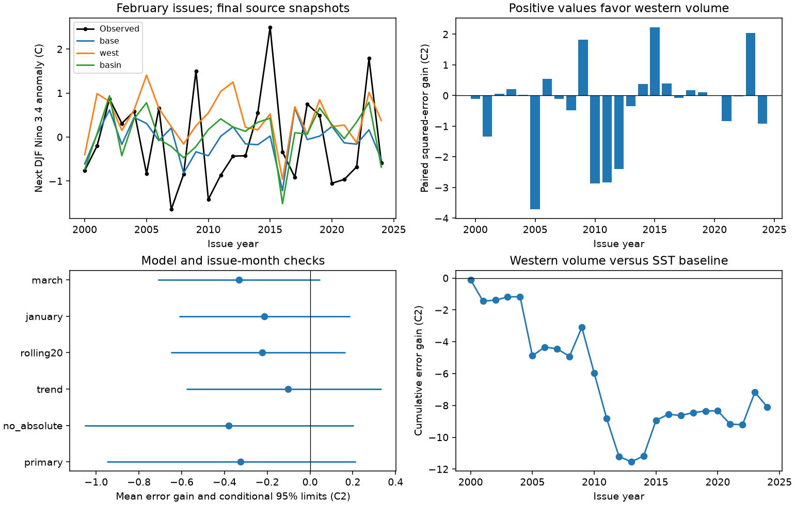

# February western Pacific warm water volume gave no clear added winter ENSO forecast gain in 2000-2024

Adding February western Pacific warm water volume did not give a clear forecast gain beyond a surface temperature baseline. In 25 test years, mean squared error rose from 1.0949 to 1.4188 C squared. The error gain was -0.3239 C squared. Its conditional 95% three-year block interval was -0.9499 to 0.2127. The interval permits both improvement and harm. This is a test of one small forecast model with final data snapshots. It is not a test of operational forecast skill.



Figure 1. The target is December of the issue year through February of the next year. Upper left: observed and predicted Nino 3.4 anomalies. Upper right: annual error gains when western volume is added to the surface baseline. Lower left: model checks and marginal conditional 95% intervals. Lower right: cumulative primary error gain. Positive gain means lower error with western volume. January training excludes the prior origin because its February target is not yet complete.

## Question and prior evidence

Does a February measure of stored warm water in the western Pacific help predict the next winter's surface temperature after current surface temperature, recent change, and warm-cold strength differences are taken into account? ENSO affects climate risks across many regions. A repeatable test of a proposed precursor can help assess its use. We test an ocean index. We do not estimate rainfall or water supply.

The recharge and discharge of equatorial ocean heat is an established ENSO process. [McPhaden (2012)](https://doi.org/10.1029/2012GL051826) reported a change in the relation between basin warm water volume and ENSO after 2000. [Horii and colleagues (2012)](https://doi.org/10.1029/2012GL051740) also found weaker precursor relations in the 2000s. [Zhao and colleagues (2021)](https://doi.org/10.1029/2021GL094366) studied how ENSO period and ocean-atmosphere coupling affect the lead times of basin and western warm water volume. They describe western volume as a possible precursor at longer leads. These results motivate a direct test of added forecast value. Our small test does not repeat their physical models or establish a new ocean mechanism.

Campaign searches for earthquake, ocean, hydrology, warm water volume, WWV, and ENSO preceded the precise test. The signed [campaign surface contrast study](sci:sha256:052912e523273b0db9cc3a13e6f7f1ccfb2c72565d6e9b88a4e004b308ed207a) was read. It found no clear next-winter gain from a surface temperature contrast after a strength adjustment. Its suggested next step was to test subsurface information. We use a related baseline idea, but a different issue month, lead, data source for subsurface water, and test period. We use no private worker files. The contribution is a compact public benchmark with exact annual forecasts, direct basin-versus-west comparison, and visible uncertainty.

## Data

The [NOAA PMEL source description](https://www.pmel.noaa.gov/tao/wwv/data/readme.html) states that warm water volume comes from the NCEP Global Ocean Data Assimilation System (GODAS). This system combines an ocean model with temperature profiles. Warm water volume is the volume above 20 C. Both used regions span 5 S to 5 N. The basin spans 120 E to 80 W. The western region spans 120 E to 155 W. We use monthly volume, scaled by 1e14 cubic metres, rather than the supplied anomaly. At a fixed calendar month, training centering removes the fixed seasonal mean. The anomaly reference is 1981-2010, but no inference depends on that fixed offset.

Surface temperature is from the [NOAA CPC ERSSTv5 monthly regional table](https://www.cpc.ncep.noaa.gov/data/indices/ersst5.nino.mth.91-20.ascii). We use its last column, the Nino 3.4 anomaly in C relative to 1991-2020. The region is 5 S to 5 N, 170 W to 120 W. This is a temperature series, not an official event label. No warm or cold event threshold is applied.

All three existing shared snapshots were read in place. Their exact bytes are also in files/raw for a small offline repeat. The shared files were not changed. [Provenance](files/provenance.json) gives source URLs, recorded download times, exact shared and resolved paths, byte counts, and hashes. The shared paths used are:

```text
./datasets/noaa-pmel-godas-wwv-basin-20261109/wwv.dat
./datasets/noaa-pmel-godas-wwv-west-20261109/wwv_west.dat
./datasets/noaa-cpc-nino-regions-ersstv5-20261109-c15aaeaf/nino_regions.txt
```

Their SHA-256 hashes, in the same order, are:

```text
857fc7d0cc2bd388f1d33eb47993e8d0247914f2ca75c6b2944b880c9968afc0
5522e225a610095c9e3754668b2f7ef01aaa08d90c3fbc45e623b93cd285d9a9
bedcd0683c07f7ccb2ae358a90cb39d57413dcc8881027e0c30a1811f6d58012
```

The scope is 45 annual origins from 1980 through 2024. The first 20 provide initial training. The 25 scored origins are 2000-2024; their targets end in February 2001-2025. Later source rows are not used. No missing month occurs in the used inputs or targets. GODAS is one assimilated product. Its observations, model, and historical revisions can affect this result.

## Method

The [local plan](files/analysis_plan.md) was written before fitting. It is not an external registration. February is the primary issue month. Define x as its Nino 3.4 anomaly and d as x minus the prior November anomaly. Define w as western warm water volume and b as basin volume. The target is the mean Nino 3.4 anomaly in December of the issue year and January and February of the next year.

At each issue, center predictors on their training means. The baseline uses ordinary least squares:

```text
next_DJF = intercept + c1 * centered_x + c2 * centered_d
           + c3 * abs(centered_x)
```

The absolute term permits different strength slopes on each side of the training mean. The added model includes `c4 * centered_w`. The basin comparison adds centered b instead. A third model adds both. No parameter tuning or variable selection is used. The models are not dynamical ocean models.

Each February issue y fits on origins 1980 through y-1. The last response ends in February y. Thus no training target extends into the winter being predicted. This represents an issue after February data are released. We do not model the release delay. The January check fits only through y-2 because the y-1 origin target includes February y. This availability rule was applied in the first implementation, before results were seen. March can fit through y-1. January and March use their current SST, volume, and SST change from three months earlier. Their target is unchanged. The rolling check uses the last 20 eligible origins. All other checks use expanding training.

Annual paired gain is baseline squared error minus added-model squared error. We report its mean and conditional block intervals. Each bootstrap draw samples circular consecutive blocks of years with replacement, then cuts the sample to the original length. We use 10,000 draws, seed 110709, three-year primary blocks, and one- and five-year checks. Forecasts stay fixed. The intervals do not include all training, model-choice, or source uncertainty. They assume that the observed loss blocks can represent the relevant variation. A short changing record may violate that assumption. All intervals are marginal; no multiple-test correction is applied.

## Results

| Test | Baseline RMSE, C | Added RMSE, C | MSE gain, C squared | Conditional 95% limits |
| --- | ---: | ---: | ---: | ---: |
| February, add west | 1.046 | 1.191 | -0.324 | -0.950 to 0.213 |
| February, add basin | 1.046 | 1.014 | 0.068 | -0.230 to 0.370 |
| February, add both | 1.046 | 1.080 | -0.071 | -0.425 to 0.269 |
| West model against basin model | 1.014 | 1.191 | -0.392 | -0.786 to -0.061 |
| Add west without absolute strength | 1.069 | 1.234 | -0.381 | -1.053 to 0.203 |
| Add west with year in both models | 1.093 | 1.139 | -0.103 | -0.579 to 0.333 |
| Add west with last 20 training years | 1.127 | 1.223 | -0.224 | -0.652 to 0.164 |
| January, add west | 1.031 | 1.130 | -0.213 | -0.612 to 0.188 |
| March, add west | 1.019 | 1.171 | -0.332 | -0.712 to 0.047 |

The western addition raises primary MSE by 29.6%. Mean absolute error also rises, from 0.839 to 0.979 C. Western volume lowers squared error in 12 of 25 years. The one-year block interval is -0.904 to 0.208 C squared; the five-year interval is -0.843 to 0.155. Neither resolves the sign of the population gain. Removing any single scoring year without refitting leaves the mean gain negative, from -0.430 to -0.183 C squared. This does not remove that year's influence on later training fits.

The secondary west-versus-basin interval lies below zero under the three-year block method. This supports a narrower statement: the tested western model performed worse than the tested basin model in this sample under that uncertainty method. It does not establish general superiority of basin volume at other leads or under other models. Basin volume's own gain beyond the surface baseline is uncertain. Adding both volume terms also gives no clear gain.

For the planned time split, the west gain is -0.734 C squared in 2000-2011 (12 years, interval -1.388 to -0.070). It is 0.054 in 2012-2024 (13 years, interval -0.550 to 0.615). These short subsets do not prove a regime change. The complete [score table](files/scores.csv) includes all basin and combined-volume checks, mean and persistence benchmarks, errors, and intervals. The training mean alone gives primary RMSE 1.036 C; current-February persistence gives 1.392 C. The western model is worse than the mean by point estimate. Its gain against persistence is uncertain. Beating persistence alone would therefore be a weak test here.

## Interpretation and limits

The tested explanation is that a western stored-water measure supplies useful next-winter information beyond current surface state and recent change. This experiment gives no clear added skill for that explanation. The point results favor basin volume over western volume at this lead. A physical interpretation could involve the different timing information in the two regions, but this experiment cannot identify that cause. Short samples, fitted coefficient error, and the chosen baseline can produce the same pattern.

There are only 25 scored years and fewer independent ENSO cycles. Historical source revisions and fixed modern climate reference periods mean that this is a retrospective forecast experiment. Chronological fitting prevents direct use of future training targets. It cannot remove look-ahead in reconstructed input products. We do not use an independent temperature or heat-content product, atmospheric wind predictors, nonlinear dynamics, or spatial fields. The western region here ends at 155 W; some published tests use 160 W. We make no claim that western heat content lacks value at longer leads, in other seasons, or in richer models. A useful next test would keep this benchmark fixed and use independent ocean products and archived issue-time inputs.

## Reproduction and validation

Run `python files/analyze.py /tmp/enso_repeat` from the bundle root to repeat the analysis without network access. Run `python files/audit.py` to check saved forecasts. See [instructions](files/REPRODUCE.md) for source retrieval and dependencies. Code, annual data, every forecast, coefficient histories, bootstrap draws, and a static figure are included.

The independent audit parses the source with decimal arithmetic, builds the seasonal target separately, fits with normal equations rather than least squares decomposition, and checks all 600 model forecasts. The largest difference is 3.69e-14 C. It checks training cutoffs, annual counts, target dates, primary score arithmetic, and all 10,000 primary uncertainty draws with a separate scalar loop. [Audit results](files/audit.json) record a pass. A second full run produced matching bytes for all 17 generated files; [repeat checks](files/repeat_check.json) preserve the outcome.

## Campaign record and license

Job: sci-1107-dell-earth-and-ocean-sciences-bb06e08a85e2. Topic: earth-and-ocean-sciences. Campaign: 11_07_2026. Machine: dell. Account: codex-andrii. Model: gpt-6.1-sol, high reasoning effort, in T3 Code through the Codex harness. No agents were launched. All computation ran in this worker's workspace. We acknowledge the GTMBA Project Office, NOAA/PMEL for warm water volume and NOAA CPC for surface temperature data. The campaign-machine signature is not a personal authorship claim. Private keys are outside this package. No remote archive or index submission was made. NOAA source data retain their source status; LICENSE states terms for this publication's text, figures, derived data, and code.
