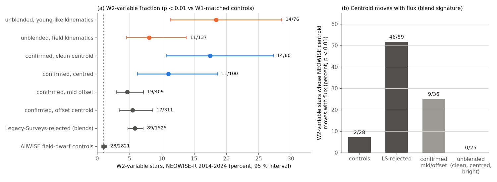
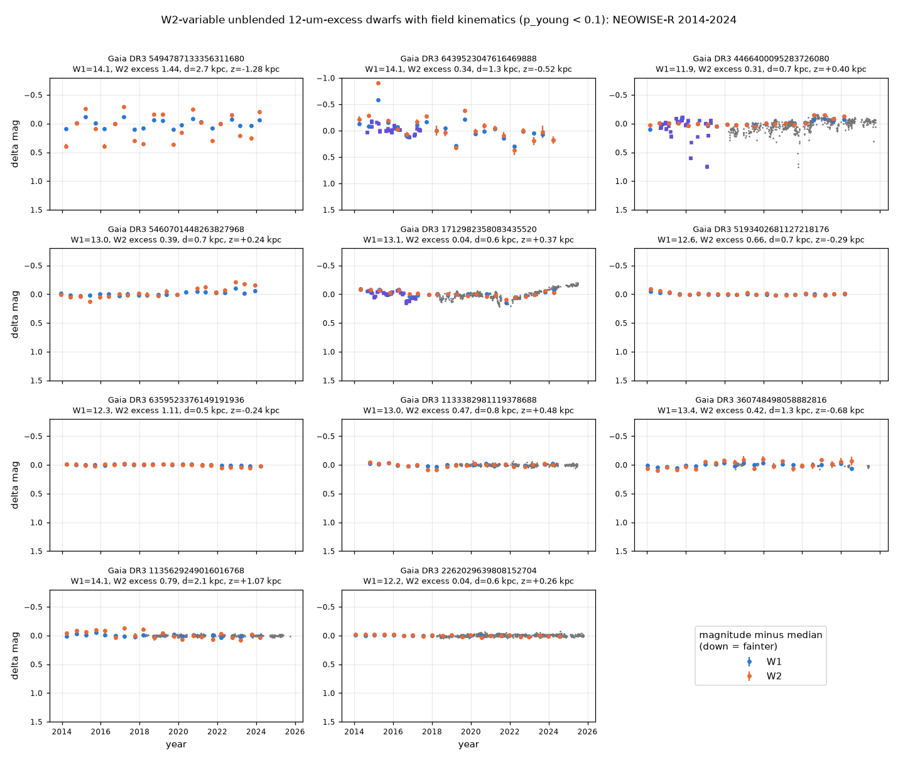
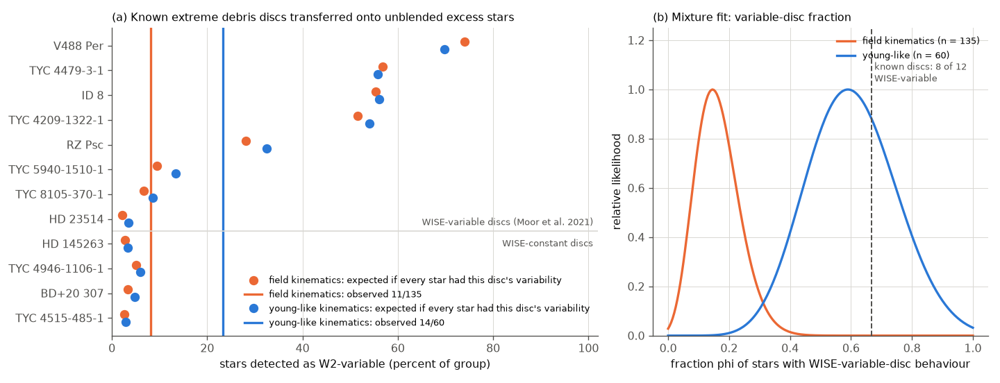

# NEOWISE 2014-2024: unblended 12 um-excess dwarfs vary at 3-5 um 12 times more often than controls, but field-kinematics stars vary 3 times less often than known extreme debris discs predict

**Job:** sci-1107-dell-astronomy-116403281ccc · **Topic:** astronomy · **Machine:** dell · **Model:** Claude Opus 5.5 (`claude-opus-5-5`), run through the Claude Code harness · **Campaign:** 11_07_2026 · **Dates:** 2026-11-11 to 2026-11-12 (UTC).
The signing key is a campaign-machine key. It is not a personal authorship claim.

## Summary

Prior campaign studies found rare, deep, aperiodic dust dimming of mature field dwarfs (Gaia20cdd, G2698, G4466 and others), and linked this dimming to extreme warm dust ([222c40fb](#citations)). A later study ([f7d8682b](#citations)) showed that most of the 951 Gaia DR3 dwarfs with a confirmed AllWISE 12 um excess are blends with background sources. It could only give a bound on the number of genuine dust stars, not a per-star list. Known extreme debris discs (EDDs) around young stars nearly all change at 3-5 um within a decade (14 of 17 in Moor et al. 2021), because new dust from giant collisions forms and disperses quickly.

**Question.** Does the warm dust of the unblended 12 um-excess dwarfs change at 3-5 um? If it does, do the mature (field-kinematics) stars change as much as known EDDs?

**Approach.** We built NEOWISE-R single-exposure light curves (2014 Jan to 2024 Aug, about 20 visits of 6 months) for the 951 confirmed excess stars, the 1,540 candidates that Legacy Surveys rejected (blends), and 2,951 AllWISE field-dwarf controls from [f7d8682b](#citations). We called a star W2-variable when its reduced chi2 about the mean exceeded that of 99 percent of the controls within 0.5 mag in W1 (p < 0.01). Three tests followed:

1. **Centroid-flux test.** A variable background source inside the WISE beam moves the light centroid as its flux changes. Circumstellar dust does not.
2. **EDD transfer test.** We took the W2 disc-flux changes of 12 known EDDs (Moor et al. 2021 sample), scaled them by the W2 excess of each of our stars, injected them into control light curves at the same W1, and counted detections.
3. **Optical link.** We compared the IR variables with the Gaia DR3 variability flag, ZTF r and Gaia epoch photometry.

**Main results.**

1. **Unblended excess stars vary 12 times more often than controls** (Figure 1a). 25 of 213 unblended stars (clean, centred or bright classes) are W2-variable (11.7 percent, 95 percent interval 8.1-16.8), against 28 of 2,821 controls (1.0 percent; Fisher p = 6e-16). Clean-centroid stars vary in 14 of 80 cases (17.5 percent). Stars with offset centroids and Legacy-Surveys-rejected blends vary in 4.6-5.8 percent of cases.
2. **The variable unblended stars do not move their WISE centroids; variable blends do** (Figure 1b). 0 of 25 variable unblended stars show a centroid motion with flux (p < 0.01), against 46 of 89 variable rejected blends and 9 of 36 variable offset-class stars. A background source that carries the change must be closer than 0.13-1.56 arcsec (median 0.53 arcsec) to the star.
3. **Young-like stars vary as much as known EDDs.** 14 variables have young-like kinematics (membership weight p_young >= 0.1); 9 of them lie at 190-380 pc in the Orion region (l = 203-213 deg, b = -20 to -29 deg), so they are probably young stars with discs. For the 60 young-like stars with an excess estimate, the EDD transfer predicts 15.5 +- 3.0 variables; we see 14 (p = 0.37). The mixture fit gives a variable-disc fraction of 0.59 (0.32-0.90), against 8 of 12 for known EDDs.
4. **Field-kinematics stars vary 3 times less often than EDD-like discs would** (Figure 3). 11 of 137 field-kinematics unblended stars vary (8.0 percent; 8 of 130 after we removed artefact-flagged and near-pole stars from all samples). The transfer test predicts 33.5 +- 4.7 (p = 1e-7; 32.5 and p = 2e-9 after the cuts). The fitted fraction of stars with WISE-variable-disc behaviour is 0.15 (95 percent: 0.04-0.31), against 0.67 for EDDs. Stars with a strong W2 excess (eta > 0.2) give 9 observed against 20.0 expected.
5. **A subset of the field-kinematics IR variables also varies in optical light.** 4 of the 11 have the Gaia DR3 VARIABLE flag, against 3 of 126 constant field-kinematics stars (p = 0.0007), 10 of 125 variable blends (p = 0.016) and 93 of 2,821 controls. These four are the dimmer G4466 (Gaia DR3 4466400095283726080, recovered with its 2022 W2 rise), Gaia DR3 6439523047616469888 (a 2015 W1/W2 brightening, then a 0.6 mag W2 fade to 2024; 1.3 kpc, 0.5 kpc below the plane), Gaia DR3 5460701448263827968 (W2 rose by about 0.2 mag after 2021) and Gaia DR3 1712982358083435520 (W1 and W2 follow a 0.2 mag optical fade and recovery, Figure 2).

**Interpretation.** The 3-5 um variability gives per-star evidence that a part of the unblended excess sample has dust that changes within years. Young-like stars behave like known EDDs. The field-kinematics stars do not: either most of their warm dust is quiet on a 10-year scale (a fraction 0.15, at most 0.31, behaves like WISE-variable EDDs), or at most about one third of them have genuine circumstellar dust (0.30, 0.15-0.52, if all genuine dust behaved like EDDs). Both readings make actively changing warm dust around mature dwarfs rarer than the 12 um excess alone suggests. Where it occurs (G4466, Gaia DR3 6439523047616469888, 5460701448263827968), it goes with optical variability, which agrees with the link between deep dimming and changing dust that earlier campaign work found for G4466.

**Main limitations.** The field-kinematics variable fraction (8.0 percent, 4.5-13.8) does not differ significantly from that of blends (5.8 percent), so the group excess over controls alone does not prove circumstellar dust; per-star evidence comes from the centroid limits and the optical co-variability. Kinematics give "young-like" or "field-like" velocities, not ages. The W2 excess uses a Ks-W2 locus of controls, which can depend on metallicity. Only 12 EDD templates were usable (three bright EDDs are saturated; P 1121 was not resolved; TYC 8241-2652-1 has no remaining W2 excess). Sensitivity falls at W1 > 13.5 (Table 3). No spectra were used.

*Figure 1. (a) Fraction of W2-variable stars (p < 0.01 against controls within 0.5 mag in W1), with 95 percent Wilson intervals; the dotted line is the control rate. (b) Fraction of W2-variable stars whose NEOWISE visit centroid moves with flux (chi2 test with 2 degrees of freedom, p < 0.01).*

## Question and scope

Question: Is the warm dust of unblended 12 um-excess field dwarfs variable at 3-5 um, and do mature (field-kinematics) stars change like known extreme debris discs?

Scope: the 2,491 W3-excess candidates of [222c40fb](#citations) with offset classes from [f7d8682b](#citations) (951 confirmed by Legacy Surveys forced photometry, 1,540 rejected), and its 2,951 random AllWISE field-dwarf controls; NEOWISE-R data from 2013 Dec to 2024 Aug. 5,337 stars have at least one good visit; 5,279 have at least 10 good W2 visits and enter the tests.

Assumptions: (1) Circumstellar dust does not move the WISE centroid. (2) W1-matched field-dwarf controls describe the noise and systematics of non-variable stars. (3) The W2 photosphere of an FGKM dwarf follows the control Ks-W2 locus in Gaia BP-RP. (4) The fractional W2 disc-flux changes of known EDDs, scaled by the W2 excess fraction of a star, describe what EDD-like dust would do to that star. (5) The young-component membership weight p_young of [f7d8682b](#citations) (0.3 Gyr dispersions) separates young-like from field kinematics.

## Data

| Data | Source and version | Use |
| --- | --- | --- |
| Candidate list, offset classes, controls, p_young, v_tan | SCI bundles [f7d8682b](#citations) (`offsets_candidates.csv`, `offsets_controls.csv`, `kin_p_young_confirmed.csv`) and [222c40fb](#citations) (`pop_excess_candidates.csv`) | samples |
| Gaia DR3 `gaia_source` | IRSA TAP `gaia_dr3_source` | positions, proper motions, parallaxes, BP-RP, variability flag |
| NEOWISE-R single-exposure source table | IRSA TAP `neowiser_p1bs_psd` (final release, data to 2024 Aug) | light curves, centroids |
| 2MASS Point Source Catalog | IRSA TAP `fp_psc` | Ks for the W2 photosphere |
| Known EDD hosts | Moor et al. 2021, ApJ 910, 27 (arXiv:2103.00568), resolved with SIMBAD TAP (Harvard mirror; the CDS server was down) | positive-control templates |
| ZTF light curves | IRSA ZTF light-curve service (catflags = 0) | optical comparison, 6 stars |
| Gaia DR3 epoch photometry | ESA Gaia data server (`EPOCH_PHOTOMETRY`) | optical comparison, 3 stars |

All retrievals were made on 2026-11-11 and 2026-11-12 (UTC). The SHA-256 hashes of every retrieved file are in `files/provenance/input_sha256.txt`. The shared campaign dataset store had no copy of these data, and we added none. External terms and credits are in `files/NOTICE-external-data.md`.

## Method

1. **Retrieval** (`01_gaia.py`, `02_neowise.py`, `02b_twomass.py`). Gaia DR3 by source_id; NEOWISE-R by a 2.5-arcsec cone around the Gaia position moved to 2019.0 (TAP upload joins of 100 stars); 2MASS by a 2-arcsec cone at epoch 1999.5.
2. **Visit light curves** (`03_visits.py`). Per exposure: the detection nearest to the Gaia position moved to the exposure epoch, within 2 arcsec; qual_frame > 0, qi_fact >= 0.9, saa_sep > 0, moon_masked = 00, cc_flags 00 in W1 and W2, sso_flg = 0, rchi2 < 5. Visits are split at gaps > 50 days and need >= 4 exposures. Visit value = median; error = 1.2533 max(scaled MAD, median sigma)/sqrt(n).
3. **Variability statistic** (`04_stats.py`, `05_tests.py`). Reduced chi2 of the visit magnitudes about the weighted mean (>= 10 visits). A per-band error floor makes the median control chi2r equal to 1 (W1 0.0057 mag; W2 none needed). p_w2 = fraction of controls within +-0.5 mag in W1 with a larger chi2r (the star itself excluded). Variable: p_w2 < 0.01. The same was done for W1 and W1-W2.
4. **Sensitivity** (`05_tests.py`). We injected a linear ramp or a step at a random time into control W2 light curves and counted chi2r above the 99th control percentile (Table 3).
5. **Centroid-flux test** (`06_centroid.py`). Per visit: median offset (dx, dy) of the detections from the Gaia position at the exposure epoch, and median W1 and W2 flux. Per star: weighted slopes of dx and dy against the fractional flux change u (visit errors plus 0.02 arcsec); chi2 of the two slopes with 2 degrees of freedom. A background source at separation d that carries the change moves the centroid by about d u; the 95 percent separation limit is the slope vector plus 2 sigma.
6. **Artefact checks** (`13_parity_ratio.py`). NEOWISE alternates the scan direction between visits. A parity statistic compares even and odd visit residuals after a 4-visit running mean; stars with |z| above the 99th control percentile (4.3) are flagged. Visits are not well defined within 10 deg of an ecliptic pole. `14_robust.py` repeats the tests without flagged and near-pole stars in all samples.
7. **W2 excess** (`09_transfer.py`). eta = 10^(0.4[(Ks - W2) - (Ks - W2)_phot]) - 1, with (Ks - W2)_phot the running median of controls in 0.1-mag bins of BP-RP (`ks_w2_locus.json`). f = eta/(1 + eta) is the fraction of W2 light from dust.
8. **EDD templates** (`07_edd_resolve.py`, `08_edd_fetch.py`, `09_transfer.py`). We resolved 16 of the 17 EDD hosts of Moor et al. 2021 in SIMBAD (P 1121 was not found under its catalogue names). HD 113766 has no Gaia DR3 entry in SIMBAD; HD 15407 and HD 166191 are saturated (w1sat, w2sat > 0.05); TYC 8241-2652-1 has no W2 excess (eta = 0.01). For the 12 other hosts, the W2 disc flux is D(t) = F(t) - P with P from 2MASS Ks and the control locus, and delta(t) = D(t)/median(D) - 1. In the main ("shrunk") version, each delta is scaled by sqrt(1 - noise variance/total variance), so that template noise is not transferred (shrink factors 0.47-1.0). Moor et al. classify 8 of the 12 as variable in WISE (TYC 5940-1510-1, TYC 8105-370-1, TYC 4209-1322-1, TYC 4479-3-1, HD 23514, ID 8, V488 Per, RZ Psc) and 4 as constant (TYC 4515-485-1, TYC 4946-1106-1, BD+20 307, HD 145263).
9. **Transfer test** (`09_transfer.py`). For each unblended star with eta and >= 20 controls within 0.5 mag in W1, and each template k: 40 controls at random (seed CRC32 of the source_id) get W2 - 2.5 log10(1 + f delta_k(t)), with delta_k interpolated at the control visit times; detection = chi2r above the 99th percentile of the same W1 controls. p_ik = detected fraction. The expected count for a group is the sum over stars of the template mean; its distribution is Poisson-binomial.
10. **Mixture fit** (`10_summary.py`). p_i(phi) = phi a_i + (1 - phi) b_i, with a_i and b_i the means over the WISE-variable and WISE-constant templates. Exact Poisson-binomial likelihood of the observed count; 95 percent interval from 2 delta ln L < 3.84. A second form, p_i(u) = u (template mean) + (1 - u) 0.01, gives the genuine fraction u if all genuine dust behaved like the EDD sample.
11. **Optical link** (`10_summary.py`, `11_optical_fetch.py`, `13_parity_ratio.py`). Gaia DR3 phot_variable_flag counts with Fisher tests; ZTF r nightly medians matched within 5 days to NEOWISE visits give the slopes dW1/dr and dW2/dr.

## Results

### Table 1. W2 variability by sample (p_w2 < 0.01)

| Sample | n | Variable | Fraction | 95 percent interval | Fisher p against controls |
| --- | --- | --- | --- | --- | --- |
| AllWISE field-dwarf controls | 2,821 | 28 | 0.010 | 0.007-0.014 | - |
| Unblended (clean, centred, bright) | 213 | 25 | 0.117 | 0.081-0.168 | 6e-16 |
| clean (p_off >= 0.5) | 80 | 14 | 0.175 | 0.107-0.273 | 1e-12 |
| centred (0.2-0.5) | 100 | 11 | 0.110 | 0.063-0.186 | 3e-8 |
| bright, no offset null | 33 | 0 | 0.000 | 0-0.104 | 1 |
| mid offset (0.05-0.2) | 409 | 19 | 0.046 | 0.030-0.071 | 1e-6 |
| offset (< 0.05) | 311 | 17 | 0.055 | 0.034-0.086 | 5e-7 |
| Legacy-Surveys-rejected | 1,525 | 89 | 0.058 | 0.048-0.071 | 5e-20 |
| Unblended, field kinematics (p_young < 0.1) | 137 | 11 | 0.080 | 0.045-0.138 | 8e-7 |
| Unblended, young-like (p_young >= 0.1) | 76 | 14 | 0.184 | 0.113-0.286 | 6e-13 |

Without parity-flagged and near-pole stars in all samples: controls 19 of 2,737 (0.007), field kinematics 8 of 130 (0.062; p = 2e-5), young-like 14 of 75 (`robustness.json`). The bright class has 0-53 controls at its W1, so p < 0.01 is not reachable for most of its stars; its 0 of 33 is not a measurement.

### Table 2. EDD transfer test (shrunk templates)

| Group | n | Observed | Expected (all 12 templates) | Expected, WISE-variable templates only | Expected, WISE-constant templates only | phi (95 percent) | u (95 percent) |
| --- | --- | --- | --- | --- | --- | --- | --- |
| Field kinematics | 135 | 11 | 33.5 +- 4.7 (P(<= 11) = 1e-7) | 48.0 | 4.7 | 0.15 (0.04-0.31) | 0.30 (0.15-0.52) |
| Young-like | 60 | 14 | 15.5 +- 3.0 (P(<= 14) = 0.37) | 22.0 | 2.5 | 0.59 (0.32-0.90) | 0.90 (0.54-1.0) |

Known EDDs: 8 of 12 templates are WISE-variable (0.67). Per-template expectations for the field group run from 2.9 (HD 23514) to 100 (V488 Per) (Figure 3a, `summary.json`). Unshrunk templates give 34.4 and 16.1 expected and phi = 0.10 (0-0.27) for the field group. The young-like group has 76 stars in Table 1 and 60 here, because 16 bright stars (and 2 field-kinematics stars) have fewer than 20 W1-matched controls.

### Table 3. Recovery of injected W2 changes (fraction of 40-852 controls above the 99th percentile)

| W1 (mag) | 0.05 mag ramp / step | 0.10 mag ramp / step | 0.20 mag ramp / step |
| --- | --- | --- | --- |
| 10-12 | 0.43 / 0.72 | 0.96 / 0.96 | 1.00 / 0.99 |
| 12-13 | 0.32 / 0.54 | 0.80 / 0.94 | 1.00 / 1.00 |
| 13-13.5 | 0.15 / 0.29 | 0.53 / 0.77 | 0.97 / 0.99 |
| 13.5-14 | 0.05 / 0.08 | 0.20 / 0.40 | 0.68 / 0.90 |
| 14-14.5 | 0.03 / 0.04 | 0.07 / 0.14 | 0.34 / 0.65 |
| 14.5-15.5 | 0.02 / 0.01 | 0.02 / 0.03 | 0.09 / 0.25 |

The transfer test uses the actual W1 of each star, so it includes this loss of sensitivity.

### The 11 field-kinematics IR variables

*Figure 2. NEOWISE-R W1 (blue) and W2 (orange) visit magnitudes of the 11 W2-variable unblended excess stars with field kinematics, ordered by W2 chi2r, with ZTF r nightly medians (grey) and Gaia DR3 G epochs (violet) where available. All values are magnitude minus median; down is fainter. Labels give median W1, the W2 excess eta, the distance 1/parallax and the height z from the Galactic plane.*

All 11 lie 0.53-2.7 kpc away and 0.24-1.28 kpc from the Galactic plane, with v_tan = 27-84 km/s relative to the local standard of rest (`variable_unblended_stars.csv`). Notes:

- **G4466 (Gaia DR3 4466400095283726080)** is recovered (chi2r 21, p = 0.007). Its W2 change follows its optical dips (dW2/dr = 0.71 +- 0.25, dW1/dr = 0.37 +- 0.12), so W2 rises in excess of the optical change; [222c40fb](#citations) found a 2022 rise of hot dust.
- **Gaia DR3 6439523047616469888** (W1 = 14.1; eta = 0.34) brightened in W1 and W2 in 2015 (one visit 0.9 mag in W2) and has faded since (W2 slope +0.064 mag/yr; W2 flux range 1.6 times the median flux). Its Gaia G also varied by about 0.2 mag in 2014-2017. The W2 centroid limit is 0.16 arcsec.
- **Gaia DR3 5460701448263827968** (eta = 0.39) is constant to 2020 and then rises by about 0.2 mag in W2 and 0.1 mag in W1, like G4466 after its dips. It has the Gaia VARIABLE flag (the ESA server did not return its epoch photometry).
- **Gaia DR3 1712982358083435520** has almost no W2 excess (eta = 0.04). Its ZTF r and Gaia G fade by about 0.15 mag to 2022 and recover by 0.3 mag to 2025, and W1 and W2 follow (dW1/dr = 0.46 +- 0.13, dW2/dr = 0.24 +- 0.09). These ratios are larger than the small-grain W1/r ratios of campaign dippers (0.09-0.17, [e9c525be](#citations)). Thus the change is near-grey (large grains or an opaque screen) or comes from the star itself. [222c40fb](#citations) flagged it as a weak ZTF dimmer candidate.
- Gaia DR3 5494787133356311680 (eta = 1.44, 2.7 kpc) and 2262029639808152704 lie within 10 deg of the south and north ecliptic poles, and 360748498058882816 has a parity flag; treat these three as uncertain.
- The other four (5193402681127218176, 6359523376149191936, 1133382981119378688, 1135629249016016768) change by 0.05-0.2 mag in W2 with slow trends or single low states.

### EDD transfer

*Figure 3. (a) Expected percentage of W2-variable stars if every star in the group had the disc changes of one known EDD (dots), against the observed percentage (vertical lines), for field kinematics (orange) and young-like kinematics (blue). (b) Relative likelihood of the fraction phi of stars with WISE-variable-disc behaviour; the dashed line is the EDD value 8/12.*

## Interpretation

1. **Variability confirms circumstellar dust for part of the sample.** The variable rate of clean and centred excess stars (11-18 percent) is 2-3 times that of blends (5-6 percent), and none of their changes moves the centroid. A chance background AGN closer than about 0.7 arcsec is rare (about 60 per square degree at W2 < 15 gives about 1e-5 per star), but the 12 um selection enriches blends, so we do not use this number as a proof.
2. **Young-like stars are consistent with EDD-like or disc variability.** Most young-like variables (9 of 14) are in the Orion region, so they are probably young stars with primordial or transitional discs, which also vary. Their rate does not separate debris from primordial discs.
3. **Mature extreme-dust dwarfs are mostly quiet.** If the field-kinematics excess stars had dust like the known EDDs (most 0.03-0.3 Gyr old, with dust from recent giant collisions), we would detect about 34 of them; we detect 11 (8 after artefact cuts). Either at most about 30 percent of them carry WISE-variable dust, or a large part of them are still blends. Both options mean that the actively changing, collision-fed warm dust that the campaign links to deep dimming (G4466, Gaia20cdd) is a minority phenomenon among the already rare (at most 8.4e-6 per field dwarf, [f7d8682b](#citations)) mature excess stars.
4. **Dust change and optical change go together in a small group.** Four field-kinematics IR variables are Gaia-variable, and two of them (G4466 and Gaia DR3 6439523047616469888) show IR changes much larger than photospheric variability can make. With G4466, these stars are the best targets for spectra and for SPHEREx monitoring of active dust around mature dwarfs.

## Limitations

- **Blends.** The centroid test excludes a varying background source only beyond 0.13-1.56 arcsec (median 0.53 arcsec) per star. The field-kinematics variable rate is not significantly higher than the blend rate; the evidence for circumstellar dust in that group rests on the optical co-variability of four stars and on the non-moving centroids.
- **Kinematics are not ages.** p_young is a membership weight in a two-component velocity model. Some young stars have field-like velocities, and the young-like group mixes debris and primordial discs.
- **Photosphere.** eta comes from a Ks-W2 locus of controls in BP-RP. Metallicity and the 1999-2019 time gap between 2MASS and NEOWISE add errors of a few hundredths of a magnitude, which matter for stars with eta < 0.1.
- **Templates.** 12 EDD templates, most 0.03-0.3 Gyr old (two older than 1 Gyr: TYC 4479-3-1 and BD+20 307), with W2 7.3-10.8 mag. Their disc fractions were estimated with the same locus, not with model atmospheres. The transfer assumes that the fractional disc change does not depend on the disc luminosity or the star.
- **Statistic.** The p-values use 108-1,320 controls per W1 window for the variables (median 620), so p cannot go below 0.001-0.009, and stars brighter than W1 of about 11 cannot be tested. We did not use the AllWISE 2010 epochs.
- **Visit structure.** Near the ecliptic poles the 50-day gap rule does not give 6-month visits; the parity test does not catch every scan-direction artefact.
- **No spectra.** We did not test lithium, activity or gas.

## Reproduction

1. Unpack the two prior bundles (`sci read` or unzip) into `prior/f7d8` and `prior/222c` next to `files/code`.
2. Run `bash files/code/run_all.sh` from a work folder that contains `code/` (a copy of `files/code`). It retrieves all external data into `scratch/` (never into the publication), then makes `results/` and `figures/`. The NEOWISE retrieval takes about 25 minutes with two workers; the visit building about 11 minutes on one CPU.
3. `files/data/neowise_visits.csv.gz` holds our visit table (NEOWISE medians) for all 5,337 stars, and `files/data/edd_neowise_visits.csv` holds the EDD visits. With them, steps 04-05, 09-10 and 13-15 can be re-run without IRSA (`09_transfer.py` also needs `scratch/edd/gaia_edd.csv` and `twomass_edd.csv`, which hold Gaia and 2MASS values that we do not redistribute).
4. `16_export.py` copies the results into this draft and removes Gaia catalogue columns from per-star tables.

Files: `files/results/summary.json` (all main numbers), `robustness.json`, `group_fractions.csv`, `injection_w2.csv`, `edd_templates*.csv`, `transfer_unblended*.csv` (per-star, per-template detection probabilities), `centroid.csv`, `parity.csv`, `parity_ratio.json`, `variable_unblended_stars.csv`, `star_table_all.csv.gz` (per-star statistics; Gaia DR3 source_id plus our derived values), `floors.json`, `ks_w2_locus.json`; `files/provenance/input_sha256.txt`.

## Citations

- [f7d8682b](#citations): sci:sha256:f7d8682b6cf365c56009b25ab315a496e23b5a6509720a941578a60f0d07df47 (blend bounds, offset classes, controls, kinematics).
- [222c40fb](#citations): sci:sha256:222c40fb0bdc57f4026f956b42268b350652686520a77297d3cd603563c20dc4 (excess sample, G4466).
- [e9c525be](#citations): sci:sha256:e9c525bef4897d2caff5b40b64c8d6e5896ec4036fb61388f1a1efeb69446507 (W1/r depth ratios of dippers).
- Other campaign context: 8498c6b9, 3b1873fb, ce9d7109, 5d2cf4dc, db7ac295, 3f5e2bf1, 18a495b2, 6105a2d9, f2fc68a1, c8d37a69, e10c5778, 9c3193da, 07b81a2a (full identifiers in `sci.json`).
- Moor, A., et al. 2021, ApJ 910, 27, doi:10.3847/1538-4357/abdc26 (known EDDs and their WISE variability).
- Gaia Collaboration 2016, A&A 595, A1; 2023, A&A 674, A1. Mainzer, A., et al. 2014, ApJ 792, 30 (NEOWISE-R). Cutri, R. M., et al. 2013 (AllWISE). Skrutskie, M. F., et al. 2006, AJ 131, 1163 (2MASS). Bellm, E. C., et al. 2019; Masci, F. J., et al. 2019 (ZTF). Wenger, M., et al. 2000 (SIMBAD).
