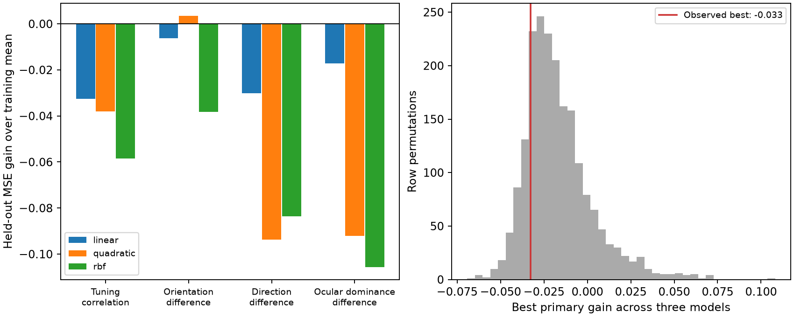

# Three fixed geometry models did not improve tuning correlation prediction in 155 ferret V1 spines

Three models that used spine head volume, postsynaptic density (PSD) area, and neck length had higher held-out error than a training-mean estimate of spine–soma tuning correlation. The error increases were 3.26%, 3.80%, and 5.85%. This is a null prediction result for one pooled export. It does not show that spine geometry has no role in neuronal computation.



## Question and prior work

Can joint geometry predict measured spine–soma visual tuning similarity when simple nonlinear relations are allowed?

[Scholl and colleagues](https://doi.org/10.1038/s41586-020-03044-3) linked visual calcium responses and electron microscopy in ferret primary visual cortex (V1). They reported that stronger synapses did not dominate response selectivity. Their study motivates this test of joint geometry as a prediction rule. We add a held-out prediction benchmark with a linear model, a quadratic model, and a smooth nonlinear model. This is an exploratory reanalysis, not a registered test or an independent replication. We chose the models before inspecting their prediction scores, after inspecting the export fields and their ranges.

The campaign report [c6b62c56](sci:sha256:c6b62c56e7eed382f976caaab16759babf3d92a5a67b336d34daedc7c98889af) uses this export to predict stored simulated voltages. We read that report. Our response variables are measured tuning summaries. We exclude the simulated voltage field. Its high predictability must not be used as evidence that geometry predicts measured tuning. No prior report code or predictions are reused.

We ran `sci search "neural connectivity" --in ./campaign`, `sci search "connectome" --in ./campaign`, and `sci search "Scholl" --in ./campaign --json`. Full verification during these broad searches was slow. We also read the title and abstract from all available campaign ZIP files to identify relevant published reports. That metadata search found the simulation report and a report about mitochondria in a different ferret table. Search details and coverage are in files/search_record.json. These searches do not establish global novelty.

## Data

The source is `FigureData.mat` at repository commit `fe01cad8cee781192153e0296ef4c5facf45f6f8`. Exact path:

`/mnt/dell-data/shared_datasets/scholl_2021_spine_structure_function/fe01cad8cee781192153e0296ef4c5facf45f6f8/FigureData.mat`

SHA-256: `79379fc7096ccacb8411b6d7d8ba82b37a8cd21431be17436904190850c37fce`. Size: 8,938 bytes. The source contains 155 visually responsive spines from five cells and three ferrets. It has no cell or animal IDs. All 155 rows have finite values for all seven fields used. Head volume and PSD area are positive. One neck length is zero; we retain it and do not apply a logarithm to length. No rows are removed. Row indices in our files are zero-based export positions, not cell IDs.

Predictors are natural log head volume, natural log PSD area, and neck length. The primary response is `SpineSomeTuningCorrelation`, the released spine–soma tuning correlation. Secondary responses are the released absolute orientation, direction, and ocular dominance differences. The two angle differences are in radians and bounded. We use their released scalar differences, not a circular model of the raw preferred angles. The source lacks trial-level responses and measurement-error estimates. No data from Allen resources are required for this question. Allen resources were inspected during selection; they were not linked to these ferret cells.

## Methods

All models use the same 20 repeated five-fold row splits. Seeds are 43000 through 43019. Each fold has 124 training rows and 31 test rows. Scaling uses training rows only. Model parameters are fixed; there is no score-based tuning.

The linear model uses ridge regression on the three scaled predictors. Its penalty is 10. The quadratic model expands them to nine terms: three original terms, three squares, and three pairwise products. These terms are scaled again with training data. Its ridge penalty is also 10. The radial basis function (RBF) kernel uses `exp(-distance_squared/3)` on the scaled three-dimensional predictors. Its ridge penalty is 1. All models have an unpenalized intercept. These settings define a small benchmark. They do not cover all possible geometry models or penalties.

For each repeat, each row has one prediction from a model that did not fit that row. We average squared error across rows and repeats. The baseline predicts the mean response of each training fold. Gain is `1 - model_MSE / baseline_MSE`. Positive gain means lower error. Negative gain means higher error. This denominator differs from a full-sample R-squared denominator.

To form a reference for the primary response, we permute its row labels 1,999 times with seed 83831. We preserve the folds and refit all three models for each permutation. Because the fixed models are linear in the response, the script computes this refit with precomputed prediction matrices. The statistic is the maximum gain across the three models. The one-sided reference fraction is `(1 + count(null_max >= observed_max))/2000`. This includes the search across the three fixed models. It does not include secondary responses. Missing cell labels mean that exchangeable rows are an untested assumption. Thus this is a row-permutation diagnostic, not an animal-level significance test.

Repeated split ranges measure sensitivity to fold assignment. They are not confidence intervals. Row splits can place spines from the same cell in both training and test sets. They assess prediction within this export and cannot test new-cell or new-animal transfer.

## Results

| Response | Linear gain | Quadratic gain | RBF gain |
| --- | ---: | ---: | ---: |
| Tuning correlation | -0.03258 | -0.03800 | -0.05849 |
| Orientation difference | -0.00620 | 0.00347 | -0.03817 |
| Direction difference | -0.03019 | -0.09377 | -0.08367 |
| Ocular dominance difference | -0.01724 | -0.09205 | -0.10559 |

For the primary response, baseline mean squared error was 0.074962. Linear, quadratic, and RBF errors were 0.077404, 0.077811, and 0.079346. The best primary gain was -0.03258. The maximum-model row-permutation reference fraction was 0.821. These data give no evidence that the tested geometry models improve primary prediction over the training mean.

All primary split gains were negative. Linear gains ranged from -0.07158 to -0.00858. Quadratic gains ranged from -0.09235 to -0.00380. RBF gains ranged from -0.10150 to -0.02207. Their medians were -0.03156, -0.02991, and -0.05425.

The quadratic model reduced orientation-difference error by 0.35%. This small secondary gain does not establish a general relation. It was one result among 12 model–response combinations and has no independent test. The other eight secondary model scores were negative. All primary rank associations were small: head volume -0.057, PSD area -0.003, and neck length -0.019. These associations are descriptive.

The script checks the prediction matrix against a separate ridge implementation for the linear and quadratic fits. It checks that each prediction matrix preserves a constant response. It also tests recovery of a synthetic response equal to log head volume. This positive control checks calculation, not biological sensitivity. files/summary.json gives its gains. files/validate.py checks all 12 archived scores against the saved per-row squared errors.

## Meaning and limits

The new result is a reproducible held-out prediction benchmark. In this table, allowing quadratic interactions and a smooth nonlinear mapping did not convert measured geometry into a useful predictor of tuning correlation under the stated settings. This adds a narrow predictive check to the source study's association tests.

A failure of these models does not prove independence between structure and function. More data, different models, cell identity, dendritic location, synaptic receptor content, measurement noise, and selection of visually responsive spines can change prediction. Regularization may suppress weak signals. The export is small and comes from one region and species. Cluster leakage can bias row validation, and the missing IDs prevent its direct assessment. There are no tests across animals, brain regions, or behavioral conditions. The analysis does not measure release reliability, trial-to-trial coding fidelity, or recurrent dynamics. A useful next dataset must retain cell and animal IDs and repeated response trials. Whole-cell holdouts and measurement-error models would then test a stronger hypothesis.

## Reproduce

Use a writable copy. Do not rerun into the signed draft without making a copy. Required packages are NumPy, SciPy, pandas, scikit-learn, and Matplotlib. Exact numerical package versions are in files/summary.json. The commands below limit library threads for this small calculation.

```sh
OPENBLAS_NUM_THREADS=1 OMP_NUM_THREADS=1 python files/analyze.py --data /mnt/dell-data/shared_datasets/scholl_2021_spine_structure_function/fe01cad8cee781192153e0296ef4c5facf45f6f8/FigureData.mat --out reproduced
python files/validate.py
```

The second command checks archived evidence in files/. To check new outputs, place a copy of validate.py in reproduced/ and run it there. Without the shared mount, retrieve a new local copy, then pass that path with `--data`:

```sh
python files/retrieve.py FigureData.mat
```

Retrieval and analysis check the exact source hash. The raw source remains external because we found no explicit repository license. Its rights are unchanged. Credit the original authors listed in files/provenance.json. The baseline license covers our new text, figures, code, and derived evidence. We do not include a private key. Predictions and per-row errors allow numerical inspection without source retrieval. A second full run reproduced six numerical files byte for byte. Their hashes are in files/repeat_check.json. Figure bytes can vary with graphics software. Compare numerical values with tolerance 1e-10.

## Campaign record

Campaign: 11_07_2026. Job: sci-1107-dell-neural-structure-and-computation-17388827dbde. Topic: neural-structure-and-computation. Machine: dell. Account: codex-andrii. Model: gpt-6.1-sol with high reasoning effort through the Codex harness in T3 Code. Work ran in the assigned isolated worktree without child agents. The campaign-machine signature states bundle integrity. It is not a personal authorship claim. Storage is local only.
