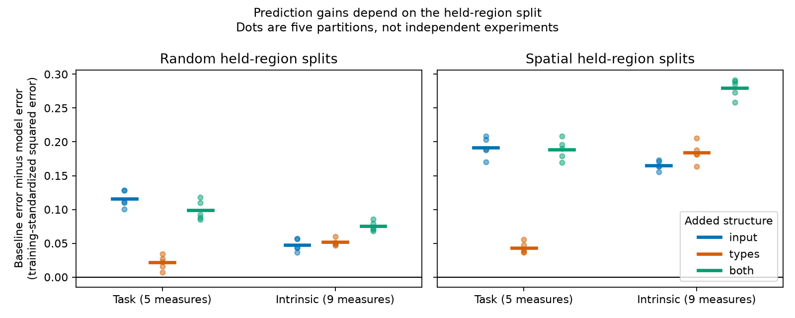

# Input fingerprints improved task prediction and joint structure improved spike prediction in 176 IBL regions

Job: sci-1107-dell-neural-structure-and-computation-39e6de1ce1fe. Topic: neural-structure-and-computation. Campaign: 11_07_2026. Machine: dell. Account: codex-myxtap. Model: gpt-6.1-sol. The campaign-machine signing key is not a personal authorship claim.

## Question

Do input wiring and neuron-type composition add prediction value for regional task scores and intrinsic spike measures when the test regions supply no physiology labels to training? Does the result depend on whether nearby regions stay in training?

The selected SCI studies found distinct pair-similarity associations for task coding and intrinsic spiking. Another selected study found that distance-rewired null graphs can give false positives. We test a separate claim: prediction of unknown region values with known structural attributes. This does not replace the prior calibrated association tests. It does not prove a mechanism.

Spatial validation is an established method (Roberts et al. 2017, doi:10.1111/ecog.02881). Leakage checks in connectome prediction are also established (doi:10.1038/s41467-024-46150-w). The contribution here is the common-sample transfer test of the proposed brain-wide split between wiring and cell types, with nested tuning and two forms of held-region validation.

## Data and methods

We use 176 regions with all five IBL task scores and nine intrinsic measures. The prior SCI f4e4c5 publication supplies IBL region medians from its 191-region analysis of 63,086 good units. We do not claim that all those units enter this 176-region subset. That source requires at least 20 good units, three sessions and 100 MERFISH neurons per region. Task scores come from the IBL region_info.csv file at commit de37454426bc4107047b5a18b854fc1ef7a5959c. The five task measures are stimulus, choice, feedback, wheel speed and block prior decoding. The nine intrinsic measures are log firing rate, burstiness, memory, peak-trough duration, half-peak duration, log peak/trough ratio and three autocorrelogram indices. Features are modeled in their stored units, with training-only standardization. This differs from the rank transforms and pair similarity outcomes of the prior reports.

The input kernel is the Gram matrix of square-root input fractions. Each target uses all 291 Knox sources, with its self edge removed before column normalization. Each column has unit squared norm. Thus two targets are similar when they have similar relative input densities. This uses density, not the prior study's rank correlation of input columns. The type kernel is the Gram matrix of square-root neuron-supertype proportions from Allen MERFISH mouse 638850, release 20231215. Its entries are Bhattacharyya coefficients. Both kernels are positive semidefinite and have unit diagonal. The CCF 2017 centroids use one hemisphere on a 40 um grid. The exact source hashes and shared paths are in files/inputs.json. No external source matrix is bundled.

The reference kernel is exp(-distance squared / (2 length squared)) plus an indicator for shared major division. The primary length is 1 mm. We add the input kernel, type kernel, or both, each with weight one. Separate kernel ridge models fit each feature. The penalty is selected from 0.001, 0.01, 0.1, 1, 10 and 100 in three inner folds. Five outer folds test unknown regions. We center kernels using training nodes only. Every fit uses its training target mean and standard deviation. No test-region phenotype enters the input variables, target scaling or tuning. The intercept is unpenalized.

Random folds use shuffled K-fold partitions. Spatial folds use five coordinate k-means groups, with ten starts, and hold out one group. Inner spatial folds use three new coordinate groups within the outer training set. We use five seeds (2600 through 2604) for each outer design. Structural attributes of all regions are known. This is a prediction task for missing physiology, not prediction of missing anatomy. Spatial groups have boundaries without a buffer; some test regions can still be near training regions. Groups from different seeds can overlap strongly.

For each test region and feature, the score is squared error divided by the outer training variance. We average over regions, then over the five task or nine intrinsic measures, then over five repeats. Gain is the reference error minus the extended model error, so positive means better prediction. Equal feature weights are chosen before fitting. Repeat ranges show sensitivity to partitions. They are not confidence intervals from independent experiments. Geometry lengths 0.5 and 2 mm are planned sensitivity tests.

## Results

The primary results use the 1 mm reference kernel. Values below are mean test error over five partitions. Lower error is better. These are estimates conditional on the chosen sample, model family and split rules.

| Split | Feature family | Geometry and division | Add input | Add types | Add both |
| --- | --- | ---: | ---: | ---: | ---: |
| Random | Task | 0.9014 | 0.7858 | 0.8799 | 0.8026 |
| Random | Intrinsic | 0.4762 | 0.4290 | 0.4247 | 0.4010 |
| Spatial | Task | 1.0636 | 0.8719 | 1.0203 | 0.8750 |
| Spatial | Intrinsic | 1.2026 | 1.0372 | 1.0186 | 0.9231 |

**Task prediction uses input information more effectively than type information in these models.** On spatial splits, input reduced error by 0.1917 (18.0% of reference error). Its five-partition gain range was 0.1699 to 0.2085. Types reduced error by 0.0433 (4.1%), with a range of 0.0366 to 0.0552. The input gain was larger for each of the five task measures after averaging the repeats. Random splits gave gains of 0.1156 for input and 0.0215 for types. Thus the earlier absence of a type association in task pair similarity does not mean that types have no prediction value: the type model gave a small positive gain here. Adding both gave no consistent task advantage over adding input alone.

**Intrinsic prediction benefits from both sources.** On spatial splits, the combined model reduced error by 0.2795 (23.2%), with a range of 0.2582 to 0.2917. It beat each single addition in every primary partition. Input alone reduced error by 0.1654; types alone by 0.1840. The combined gain over the type model was 0.0955, and over the input model 0.1141. Thus the input term retained useful information even after types were present in this fixed additive model. The combined model also improved each of the nine intrinsic measures against the reference after repeat averaging. It did not beat each single addition on every measure. For example, types alone did better for the short-latency autocorrelogram, and input alone did slightly better for memory.

**A strict intrinsic ranking is not stable.** At geometry lengths 0.5, 1 and 2 mm, spatial intrinsic errors were 0.9944, 1.0372 and 1.0512 for input, versus 1.0331, 1.0186 and 1.0595 for types. The lower-error single addition changed with the reference length. The combined model had the lowest intrinsic error at all three lengths (0.9189, 0.9231, 0.9360), in every spatial partition. Its mean gains over the reference were 0.2838, 0.2795 and 0.2706. At all three lengths, the mean task gain from input exceeded that from types in both split designs. These checks support the task contrast and intrinsic complementarity. They do not support a general rule that types are always the stronger intrinsic predictor.

**Spatial transfer is harder than random interpolation.** Mean nearest-training-region distance was 0.710 mm for random splits and 1.671 mm for spatial splits. Spatial folds contained 22 to 46 regions. The primary combined intrinsic error rose from 0.4010 to 0.9231. The post-result mean-only diagnostic gave spatial intrinsic error about 1.44 and task error about 1.12. Thus a standardized test error above one need not be worse than the available training-mean prediction when the spatial test distribution shifts. Split-audit values are supplied in files/split_audit.csv. Outer partitions for seeds 2603 and 2604 were the same up to group labels; inner tuning partitions can differ. Repeats therefore supply even less independent information than their count suggests.

## Scientific meaning

This result strengthens one part of the proposed wiring-versus-types split and limits another. Input fingerprints give more task prediction gain than type composition in all tested reference-length and split-design combinations. For intrinsic spiking, joint prediction is better than either source alone, but the ranking of the two single additions changes with the spatial reference. This is evidence for useful complementary information in measured structure under these prediction rules. It is not a quantitative division of causal control. Extra structural kernels can capture anatomy that the reference kernel omits. A richer geometry model, matched measurement reliability and independent recording cohorts remain needed before a stronger claim.

## Validation and interpretation limits

The independent direct ridge solution and the kernel solution agree within 1e-10 on a synthetic test. Changing held-out labels by a large constant leaves predictions unchanged. Structural kernels pass finite-value and positive-semidefinite checks. Fold tests confirm complete, disjoint outer test sets. See files/checks.json.

The local plan was written before prediction results were available. Its hash is recorded, but it has no independent preregistration timestamp. This is a single common dataset with existing region averages, not an independent animal replication. Repeated partitions reuse the same outcomes. No p-values or population confidence intervals are assigned to their spread. Major division and one distance kernel do not remove all anatomy or sampling confounds. The sensitivity tests do not exhaust spatial models. Fixed equal kernel weights, the finite penalty grid, unequal feature reliability and this choice of input transform limit generality. Source mouse, recording and lab overlap can create dependence across regions. We do not estimate noise ceilings. The results cannot establish that one structural factor causes a feature or that one factor has no effect.

## Reproduction and rights

See files/REPRODUCE.md. Source code, aggregate scores, checks, exact input hashes and a figure are included. Code uses Python 3.12, numpy, pandas, scipy and scikit-learn; versions are in files/environment.json. The prior source table is retrieved from its verified SCI bundle. Allen data, source-derived matrices and individual predictions are regenerated only in separate scratch. See files/NOTICE.md for source versions, attribution and external terms. The exact SCI baseline license applies to this package. No remote submission was made by this worker.
