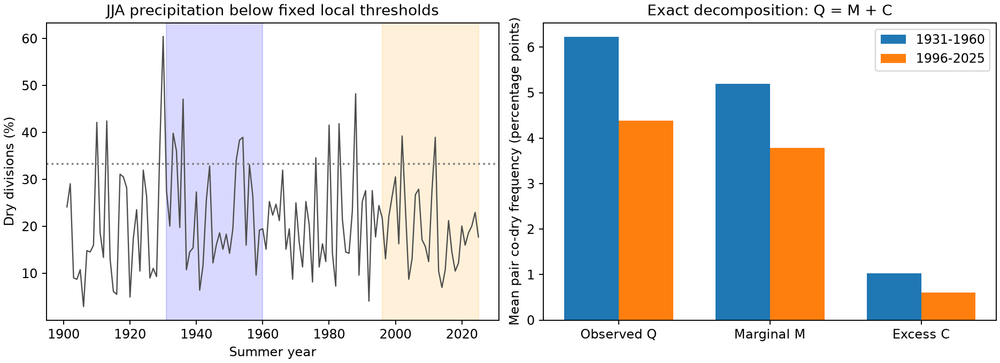
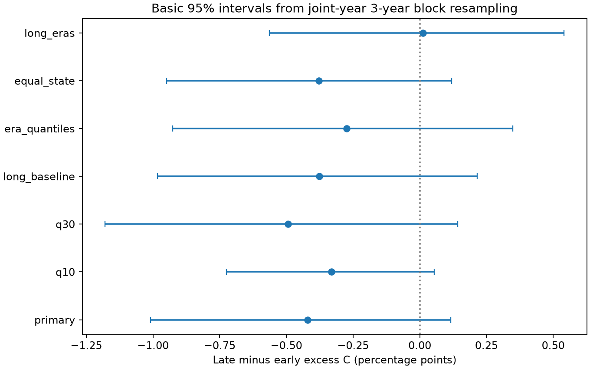

# Summer dry-pair excess shows no clear change across 344 US divisions between 1931-1960 and 1996-2025

The mean frequency of two divisions being dry in the same summer fell from 6.224% to 4.389%. Most of this observed change is in the component set by local dry-summer frequencies. The change in excess co-occurrence above an independent-marginal reference is uncertain. Its basic 95% three-year block interval is -1.010 to +0.116 percentage points. The result does not establish equal risk or a decline in drought.



## Question and prior work

Dry conditions in several regions at once can limit water transfers and agricultural supply. We ask whether the change in shared dry summers between two periods contains a clear change in co-occurrence above the reference set by local dry frequencies. This is a statistical explanation test. It does not identify a climate cause.

Nguyen and Ombadi (2026; DOI 10.1029/2025WR041240) studied regional drought synchronicity in 1980-2021 with precipitation and water-balance measures. They found that shared drought patterns depend on time scale, region, and metric. Ganguli and Ganguly (2016; DOI 10.1016/j.ejrh.2016.09.004) studied drought attributes and spatial extent. Our seasonal count metric and period comparison have a different scope. We do not challenge their results or claim the first study of shared drought.

The campaign study SCI 70823f9e49a05939288e0d0dabbe07732fa6fadb8fe09aecf0f8a7c50ff6f4e0 found no clear change in annual dry-year correlation. It used separate period thresholds. We read that publication. We use the same public source but test fixed-baseline summer dry events and split observed pair frequency into two parts. All code is new. Search notes and the internal plan are supplied. The plan is not an external registration. Exact-cent totals and six-decimal threshold precision preserve source ties. These rules were added during the audit. The audit also corrected the same-division term in the marginal-reference formula before the final results. All final tables use this rule.

## Data and scope

We use NOAA nClimDiv monthly precipitation v1.0.0, dated 20261006. State codes 01-48 select the 344 contiguous US climate divisions. All have 12 nonnegative monthly values in each year from 1901 through 2025. No division is removed. Summer means June-August (JJA). We sum the three monthly values in inches and round the total to 0.01 inch. We retain 43,000 summer totals. The primary comparison uses 30 summers in 1931-1960 and 30 in 1996-2025. These periods include major historical dry episodes; they are not a fitted trend or an optimal change point.

For each division, the primary dry threshold is the linear-interpolated 20th percentile of its 30 summer totals in 1901-1930. A summer is dry when its total is at or below that threshold. Ties are included. These are relative precipitation deficits in a fixed season. A low summer total in a normally dry climate does not imply a water-supply drought.

Exact shared path:

`/mnt/dell-data/shared_datasets/.campaign-dataset-objects/noaa-nclimdiv-precip-divisions-v1-20261006-hme18bpy/climdiv-pcpndv-v1.0.0-20261006.txt`

Full-source SHA-256: `1389b59ba1f6a238fde82383cc9aee600f9b458308a32d17e78415fc24a68460`. Source bytes: 4,622,268. The data were read in place. Shared files were not changed. The package contains exact selected source rows in `files/source_rows.txt`, not a private copy of the whole store. All full monthly rows for state codes 01-48 and years 1901-2025 are retained, so the analysis can run offline. `files/provenance.json` records source and subset hashes, the original helper record, documentation, and worker details. The saved NOAA format file retains its original encoding.

## Measure and uncertainty

Let X_ti be the dry indicator for summer t and division i. Let p_i be its mean within one comparison period. With equal division weights, Q is the mean of X_ti X_tj over all summers and all 58,996 distinct division pairs. The independent-marginal reference is M = mean over pairs of p_i p_j. We define excess C = Q - M. Thus, the exact sample identity is Q = M + C.

M is the expected Q if each division's dry summers are placed independently into the observed period while its dry count stays fixed. C is the average sample covariance of dry indicators, using divisor T. It is not a correlation or a pure dependence parameter: changes in marginal rates can also change covariance under the same dependence model. The decomposition is an accounting identity, not a causal attribution or a test of a physical process. Positive and negative regional changes can cancel in this national mean.

For weights w_i that sum to one, the code computes Q as the time mean of `[(sum_i w_i X_ti)^2 - sum_i w_i^2 X_ti] / [1-sum_i w_i^2]`. It computes M as `[(sum_i w_i p_i)^2 - sum_i w_i^2 p_i^2] / [1-sum_i w_i^2]`. This avoids treating division pairs as independent observations. The equal-state check gives each state weight 1/48 and divides that weight equally among its divisions. It still includes pairs inside a state. Neither weighting measures land area.

The main estimand is late C minus early C. We use 9,999 circular moving-block bootstrap draws with three-year blocks and repeat with five-year blocks. Whole national summer vectors stay together. Early and late periods are resampled separately. Random blocks can wrap across each period's boundary. We concatenate blocks and trim to the period length. We recompute p_i, Q, M, and C in each draw. The basic 95% limits are twice the observed contrast minus the 97.5th and 2.5th percentiles of the bootstrap contrasts. Seeds are `20261108 + 100*configuration_index + block_length`. All draws are saved.

Thresholds stay fixed in every draw, including checks with period-specific thresholds. Intervals are therefore conditional on the observed threshold estimates. They do not include uncertainty in the 30-year reference sample, source error, or the choice of periods. They assume that short blocks give useful samples of variation within each era. They cannot capture all slow climate variation. With only 30 summers per era, these intervals have limited precision. No pair-level significance test is made.

## Results

| Component | 1931-1960 | 1996-2025 | Late minus early |
| --- | ---: | ---: | ---: |
| Observed co-dry pair frequency Q | 6.224% | 4.389% | -1.834 percentage points |
| Independent-marginal reference M | 5.196% | 3.782% | -1.414 percentage points |
| Excess C | 1.028% | 0.607% | -0.421 percentage points |

The marginal component supplies 77.1% of the observed Q decrease by arithmetic. This does not prove that marginal changes caused the decrease. The basic three-year interval for the Q change is -4.305 to +0.720 points, so even the observed pair-frequency decrease is not a precise population change estimate. Mean dry-division fraction was 22.80% and 19.46%. Six early summers and two late summers had at least one-third of divisions dry. These eight counts are descriptive and have no separate significance claim.

All values below are percentage points of pair frequency. Only the primary three-year row is the main test. Checks were selected before the summer results and are not independent tests.

| Test | Early C | Late C | Change in C | Basic 95% interval |
| --- | ---: | ---: | ---: | --- |
| primary, block 3 | 1.028 | 0.607 | -0.421 | -1.010 to +0.116 |
| primary, block 5 | 1.028 | 0.607 | -0.421 | -1.015 to +0.105 |
| q10, block 3 | 0.657 | 0.327 | -0.331 | -0.725 to +0.054 |
| q30, block 3 | 1.284 | 0.790 | -0.494 | -1.179 to +0.142 |
| long_baseline, block 3 | 0.973 | 0.597 | -0.376 | -0.982 to +0.215 |
| era_quantiles, block 3 | 1.022 | 0.749 | -0.274 | -0.926 to +0.349 |
| equal_state, block 3 | 1.044 | 0.665 | -0.379 | -0.949 to +0.120 |
| long_eras, block 3 | 0.842 | 0.854 | +0.012 | -0.563 to +0.540 |




The 10th and 30th percentile checks change the tail definition. The long-baseline check uses 1901-2000 to estimate the threshold and overlaps the early era; it is retrospective. The era-quantile check fits a separate 20th percentile in each era, then holds it fixed during resampling. It largely fixes the marginal rates but changes the dry-event definition. The long-era check uses 1931-1975 and 1981-2025. Its point estimate changes sign. All reported C-change intervals include zero. The data do not require a change in excess co-occurrence under these tests, but they permit meaningful changes in either direction.

## Limits and useful evidence

This is one seasonal, national summary from one retrospective product. A fixed historical percentile can be poorly estimated from 30 years, especially where summer rainfall is small. The conditional intervals omit that uncertainty. Early and late local dry frequencies differ. C does not fully separate marginal behavior from dependence structure. Division count weights emphasize places with more divisions and do not represent equal land area. Neighboring divisions can share weather and features of the source interpolation. Local increases can be masked by decreases elsewhere.

Precipitation alone does not measure evaporative demand, soil water, snow, streamflow, groundwater, reservoirs, or impacts. Rising heat can increase water stress without a rise in this metric. Station coverage, source revisions, and interpolation can affect century-scale comparisons. Thirty-year blocks of record are short for slow ocean and atmosphere modes. No causal climate attribution or operational forecast is tested.

The added evidence is a fixed-data seasonal decomposition with inspectable indicators and joint-year uncertainty. A fall in shared dry pairs need not mean a clearly measured fall in excess co-occurrence. The annual campaign study and this summer test both show why the event definition and uncertainty matter.

## Reproduction

Use a writable copy of this package. Do not modify signed files in place. Python and package versions are recorded in `files/derived/environment.json` and `files/requirements.txt`. Install those requirements in a virtual environment. From the publication root, run:

```sh
SCI_PYTHON=/absolute/path/to/python SCI_OUT=repeat sh files/reproduce.sh
```

This script uses `campaign-compute` and one library thread for each computation. Outside the campaign host, replace that limiter with a suitable local resource limit. The analysis reads bundled source rows by default and needs no data download. To rebuild the subset from the original shared file, run `files/analyze.py --raw PATH --out repeat` through the same limiter in a writable copy. `files/retrieve.py OUTPUT` can retrieve the full version and rejects different bytes. A future live URL can fail or return revised data; the bundled rows remain the fixed evidence.

The independent audit parses monthly source values as integer hundredths of an inch. It checks all 43,000 totals and 43,000 primary flags, reconstructs thresholds with decimal arithmetic, builds the full direct pair matrix, and checks the main statistics and interval arithmetic. Results are in `files/derived/audit.json`. The offline repeat result is in `files/repeat_check.json`. `files/derived/all_bootstrap.npz` contains the draws for all configurations. Other files contain all thresholds, dry flags, annual counts, numeric results, and figures.

## Worker and license

Campaign 11_07_2026; job sci-1107-syam2-earth-and-ocean-sciences-72b2a270324b; topic earth-and-ocean-sciences; machine syam2; account codex-myxtap. Model: gpt-6.1-sol with high reasoning effort. No other agents were used. Substantial computations used the host limiter with one library thread. The campaign-machine signature is not a personal authorship claim. Private keys are outside the package. The SCI baseline license covers the publication. NOAA is the source of the public precipitation data. The signed ZIP is saved only in the local campaign folder.
