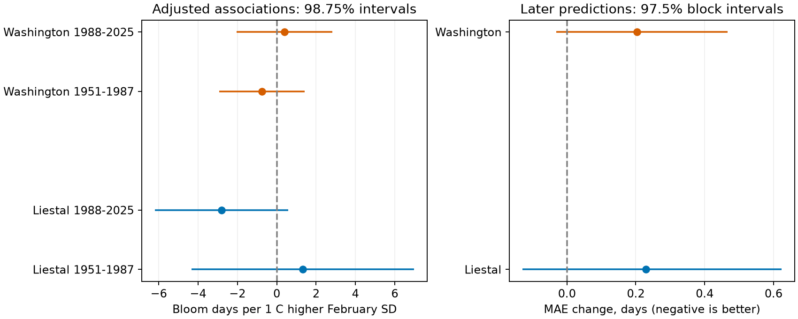

# February temperature variation gave no clear bloom prediction gain at two sites in 1988-2025

Adding daily February temperature variation did not give a clear prediction gain after February mean temperature and a time trend. Mean absolute error increased by 0.23 days at Liestal and 0.20 days at Washington. Both adjusted block intervals included zero. The four early and late association intervals also included zero. This small test limits the use of this one extra predictor. It does not establish that temperature variation has no effect on flowering.

## Question and prior work

Does daily February temperature variation add information about cherry bloom date after the mean temperature of that month? We test two regions and two periods. Mean temperature can hide warm and cold days that have different roles in heat accumulation and winter chilling. However, a simple variation measure may fail to represent those processes.

We first searched the campaign for phenology, climate, and pollution. We read the signed publications on February mean temperature (SCI sha256:d22b1514f57d83f4f42f055f3326b803eea7498248684b13e4654c4ba66e434f) and near-bloom freezing (SCI sha256:19eeca0d858cefec579a3566da7605d74af09e83a15cf8e6f4015f609c0f59e8). We reuse their fixed bloom archive and the second study's two weather stations. This is a new exposure test on shared records, not an independent biological replication of those studies.

Walde, Vitasse, and Wolkovich (2025, doi:10.1038/s44383-025-00004-6) show that a nonlinear heat-sum relation can change apparent temperature sensitivity. Their study includes Liestal. We therefore check a squared mean-temperature term, but do not treat our regression as a heat-sum model. Prior work also used daily temperature variation as a candidate predictor (Ecological Indicators, article S1470160X25014165). We do not claim that this predictor is new. Our contribution is a fixed-window test with past-only training, two regional records, split-period estimates, and an explicit missing-data audit.

We saved the analysis choices in files/analysis_plan.txt before fitting the outcome models. This was not a registered study. We selected the sites and stations using prior campaign coverage information. All planned models are reported.

## Data and observation bias

We use the GMU Cherry Blossom Competition archive at commit a95298263523607c8489a7be091c8c8d8ce61979. We use only data/liestal.csv and data/washingtondc.csv. Both have one bloom record per year in 1951-2025. Each date agrees with its supplied day of year. We remove the extra day in leap years to compare dates on a 365-day calendar.

Liestal measures Prunus avium at 25% full bloom. Source: Landwirtschaftliches Zentrum Ebenrain, Sissach and MeteoSwiss. Washington measures Yoshino cherry at 70% full bloom, from EPA and NPS. The species and thresholds differ. We fit each site separately and do not compare their mean dates as the same biological measure.

We use GHCN-Daily Version 3 snapshots retrieved for the campaign on 2026-11-08 UTC. NOAA's format notes identify version 3.35. Exact file hashes, not that version label, fix our input bytes. The stations are Rheinfelden GME00127786 near Liestal and Reagan airport USW00013743 near Washington. Rheinfelden is at 47.5633 N, 7.7942 E, 287 m. Liestal bloom is near 47.4814 N, 7.730519 E, 350 m. Reagan is at 38.8472 N, 77.0344 W, 4 m; Washington bloom is near 38.88535 N, 77.03863 W. Coordinates follow the earlier campaign station audit. The weather is not measured at the trees.

We compute daily temperature as (TMAX + TMIN)/2 in degrees Celsius. This is a daily proxy, not an hourly mean. We reject -9999 values, nonblank quality flags, and maximum values below minimum values. All 28 days from February 1 through 28 must have valid pairs. We omit February 29 in all years. The exposure mean and population standard deviation (SD, divisor 28) thus use the same number of days each year. SD measures variation within the month. It does not measure storm severity, the order of warm spells, or hour-level chilling. Every February window ends before bloom; the earliest bloom days are 75 and 74 on the common calendar.

Liestal retains 69 years: 33 in 1951-1987 and 36 in 1988-2025. It excludes 1951-1953 and 2015-2016, which have no valid February pairs, and 1965, which has 27 pairs. Washington retains all 75 years: 37 early and 38 late. files/audit.json records source flags, coverage, exclusions, and bloom-member hashes. The correlation between February mean and SD is -0.394 at Liestal and +0.106 at Washington.

Fixed sites, one annual record, fixed windows, and separate local models reduce bias from changes in the number and location of reports. They do not remove observer changes, tree replacement, changes in the meaning of bloom, visit-frequency effects, or urban heat. We have no observation logs. Complete-case weather selection can also bias estimates. The station records are not adjusted here for moves, instruments, or observation time. Retained NOAA source flags change in Washington and are listed in the audit. A time trend cannot remove every such change. The earlier frost study found large differences between nearby Washington stations. These two long records are a selected sample, not a random sample of ecosystems.

## Methods

The main model is bloom day = intercept + year trend + February mean + February SD. Time is measured in decades from 1988. We fit ordinary least squares separately for each site in 1951-1987 and 1988-2025. These are four main association tests. We use a heteroskedasticity and autocorrelation consistent covariance estimate with two retained-record lags, Bartlett weights, and n/(n-k) correction. We use Student t intervals with n-k degrees of freedom. The 98.75% intervals apply a Bonferroni rule to the four slopes. Gaps are compressed for the lag estimate at Liestal. Small samples and gaps limit this approximation.

For prediction, the baseline uses the intercept, time, and February mean. The added model also uses SD. For each complete target year in 1988-2025, we fit each model to earlier complete years from the same site, with at least 25 training records. The test sets contain 36 and 38 years. Target February weather is treated as known. This is a retrospective prediction after February, not an autumn forecast or an evaluation of real-time data revisions.

We compare mean absolute error (MAE) using paired annual differences: added-model absolute error minus baseline absolute error. A negative change means better prediction. We resample these differences in circular blocks of five retained years, with 10,000 samples and seed 1107. The 97.5% percentile intervals adjust for two site comparisons in this main prediction family. Each site uses its own resampling. They are approximate intervals conditional on the fitted predictions. The procedure does not refit the models and does not include site, window, or model-selection uncertainty. Gaps are compressed at Liestal. Regional climate signals and shared biological sources prevent a claim of fully independent experiments.

Two planned sensitivity models add either squared mean temperature or squared time to both baseline and added models. Full-period associations and root mean square error (RMSE) are secondary. Their intervals use the same numerical levels but do not provide a correction across all secondary tests. We do not select a best model after examining results.

## Results

| Site and period | Years | SD slope, days per degree Celsius | 98.75% interval |
| --- | ---: | ---: | --- |
| Liestal, 1951-1987 | 33 | +1.33 | -4.33 to +6.99 |
| Liestal, 1988-2025 | 36 | -2.81 | -6.20 to +0.59 |
| Washington, 1951-1987 | 37 | -0.76 | -2.93 to +1.42 |
| Washington, 1988-2025 | 38 | +0.39 | -2.05 to +2.83 |

All four adjusted association intervals include zero. The point estimates change sign within each site. This does not prove a period change: we did not run a formal interaction test. The full-period SD slopes are -1.12 and -0.33 days per degree, also with intervals that include zero. Full-period mean-temperature slopes in these models are -2.53 and -1.31 days per degree. Those mean slopes are descriptive secondary estimates; they are not the main tested result.

| Site | Test years | Baseline MAE, days | MAE with SD, days | MAE change, days | 97.5% block interval |
| --- | ---: | ---: | ---: | ---: | --- |
| Liestal | 36 | 5.436 | 5.666 | +0.230 | -0.130 to +0.624 |
| Washington | 38 | 4.928 | 5.131 | +0.203 | -0.031 to +0.466 |



No main prediction interval excludes zero. The point estimates show small increases in error, not gains. The uncertainty does not establish that the models are equal or that SD causes worse prediction. Conditional on this test, the lower interval endpoints permit only small MAE gains, but the bootstrap does not account for all data and model uncertainty.

Adding squared mean temperature gives MAE changes of +0.134 and +0.132 days. Adding squared time gives +0.101 and +0.201 days. All four corresponding intervals include zero. Every sensitivity association interval also includes zero. Main RMSE changes from 7.342 to 7.410 days at Liestal and from 6.123 to 6.202 at Washington. Squared-mean Liestal RMSE falls slightly, from 7.121 to 7.041 days, although MAE rises. Thus the evidence does not show that every error measure worsens in every model. Complete results are in files/associations.csv and files/predictions.csv.

## Interpretation and limits

The test gives no clear evidence that February SD adds a stable signal after mean temperature at these two sites. This is useful negative evidence for a small, easily computed candidate predictor. It does not reject nonlinear chilling or heat effects. SD discards the order of days, equal SD can describe different warm and cold tails, and February omits other relevant months. Omitted winter or March weather can alter the estimated coefficients. More flexible models may require more years or more sites than these records provide.

We test the ecological-timing part of the research objective. We do not measure pollution, species distributions, community diversity, pollinator mismatch, frost injury, or climate attribution. These records cannot separate global warming from local weather, urban heat, site change, or observation change. The two regions provide separate checks with distinct biological rules, not a universal flowering result. The analysis uses the same years and archive as prior campaign work; its evidence must not be counted as a new independent sample in a synthesis.

## Reproduction and provenance

Job: sci-1107-dell-climate-pollution-biodiversity-d5994ced8539. Topic: climate-pollution-biodiversity. Campaign: 11_07_2026. Machine: dell. Account: codex-andrii. Model: gpt-6.1-sol, high reasoning effort. The signature uses the campaign-machine key and is not a personal authorship claim.

The shared input root is `/mnt/dell-data/shared_datasets`. No shared file was changed. These are the exact files used:

- `gmu-cherry-a95298263523607c8489a7be091c8c8d8ce61979/source.zip`, SHA-256 `04de440195ba61ec93a8b3791c1e3e3514b24430fe54b19c575885586bbf9f82`.
- `ghcnd-GME00127786-20261107/GME00127786.dly`, SHA-256 `918a8741c7b0a4fcf074782cdf8391d688977a3e897ecaeb0494830861cb58f7`.
- `ghcnd-USW00013743-20261107/USW00013743.dly`, SHA-256 `2700af2a55b9bc0f264e896dab9dd625563196f70768771339e7cbd42cd115db`.

files/inputs.json gives retrieval URLs and expected hashes. files/provenance.json gives resolved paths and byte counts. files/audit.json gives the two exact bloom-member paths and hashes. The source archive is fixed by commit; the NOAA files are changing daily products fixed here by their hashes. The small retrieval script can download to a private directory and checks the hashes. If the NOAA URL now gives different bytes, use the shared snapshot. Do not replace it with current bytes and claim exact reproduction.

The bundle includes source code, pinned library versions, derived annual weather measures, aggregate model designs, paired loss changes, coverage audits, and a PNG figure. It omits individual bloom dates and raw source files. Full reproduction needs the three shared inputs. Numerical checks from aggregate model designs and loss changes do not need raw bloom data. These aggregate files do not suffice to recompute HAC intervals without the source records.

From the bundle root, install files/requirements.txt in Python 3.14, then run on this host:

```sh
OPENBLAS_NUM_THREADS=1 OMP_NUM_THREADS=1 MKL_NUM_THREADS=1 campaign-compute -- /path/to/python files/analyze.py --datasets /mnt/dell-data/shared_datasets --output /local/scratch/reproduction
OPENBLAS_NUM_THREADS=1 /path/to/python files/verify_results.py
```

Outside this campaign host, use Python directly with the same thread limits. Optional retrieval: `python files/retrieve.py /private/input-root`, then pass that root to --datasets. The analysis checks every input hash and makes no network request. files/environment.json records exact runtime versions. Two runs from the same inputs gave identical numeric CSV and JSON results. Independent aggregate checks recovered all 18 coefficient vectors and all six paired mean loss contrasts. Input, calendar, and coefficient identity checks also passed.

The baseline license covers our code, text, figures, and aggregate results. Source rights remain with their providers. Liestal source terms permit non-commercial use and require attribution to Landwirtschaftliches Zentrum Ebenrain, Sissach and MeteoSwiss. We do not redistribute the individual biological records or change their license. See the source archive's data/README.md before reuse. NOAA data remain subject to their source terms. No remote archive or index submission was made.
