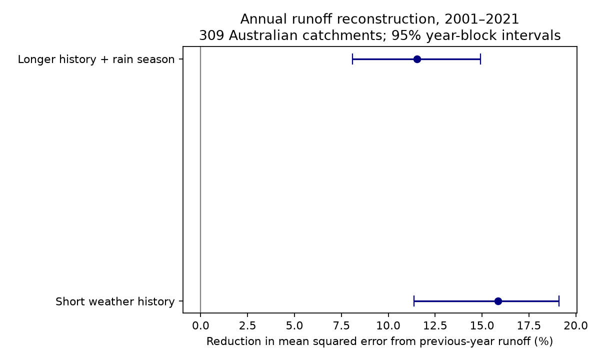

# Previous-year runoff reduced annual reconstruction error against two weather models in 309 Australian catchments in 2001-2021

## Result
We tested whether previous-year runoff adds information beyond observed weather in annual runoff estimates. We used CAMELS-AUS v2.03 daily data. Each test year in 2001-2021 used only earlier targets from 1971 onward for fitting. The test retained 6030 site-years in 309 catchments. The longer weather model used current rainfall, squared rainfall, reference evapotranspiration, three earlier rainfall totals, and the cool-season rainfall share. Adding previous-year square-root runoff reduced mean squared error by 11.54%. The conditional 95% three-year block interval was 8.09% to 14.92%. Errors were measured in square-root runoff units and scaled by each site's earlier variation. This is a reconstruction with observed target-year weather. It does not establish a lead forecast, groundwater cause, or drought recovery. A short test period, selected catchments, source errors, calendar-year boundaries, and model choice limit inference. The package gives code, aggregate errors, uncertainty draws, exact source hashes, and a retrieval script.

| Coverage rule | Weather model | Sites | Site-years | Error reduction (%) | 95% interval (%) |
| --- | --- | --- | --- | --- | --- |
| 95% daily coverage | short | 309 | 6030 | 15.84 | 11.37 to 19.11 |
| 95% daily coverage | long | 309 | 6030 | 11.54 | 8.09 to 14.92 |
| 100% daily coverage | short | 256 | 4769 | 15.84 | 12.01 to 18.86 |
| 100% daily coverage | long | 256 | 4769 | 11.84 | 8.02 to 15.95 |

The short-model mean squared errors were 0.369896 and 0.311295, before and after the added runoff term. The longer-model errors were 0.313941 and 0.277704. These are normalized squared errors in square-root runoff, not errors in runoff depth.

## Question and prior work
Annual hydrological memory is established [1]. Catchment Forgetting Curves use climate and streamflow to study memory over several years [2]. A study in Victoria found low runoff states after the Millennium Drought [3]. A campaign study found no clear general runoff deficit after multi-year drought in U.S. reference catchments [4]. This test asks a narrower question: does one observed runoff lag improve estimates in later years after explicit weather-history controls? The question was fixed before outcome inspection in files/protocol.txt. No claim is made that the runoff lag is a new idea.

## Data
We used CAMELS-AUS v2.03, dated 2024-12-07, by Fowler, Zhang and Hou [5]. The data paper describes the collection [6]. We reused these shared files in place:

- ./datasets/camels-aus-v2.03-zenodo14289037-streamflow/03_streamflow.zip
- ./datasets/camels-aus-v2.03-zenodo14289037-hydrometeorology/05_hydrometeorology.zip

files/provenance.json gives exact URLs, shared paths, resolved object paths, archive sizes, SHA-256 hashes and hashes of all three used members. Both archive hashes were recalculated and checked against shared provenance. The members are streamflow_mmd.csv, precipitation_AGCD.csv, and et_short_crop_SILO.csv. We did not use infilled streamflow.

We formed calendar-year totals. Negative daily values were treated as missing. Accepted runoff years have at least 95% valid days. Annual runoff is the valid-day mean times the number of calendar days. This assumes that missing days have a representative mean. Climate totals require all days. The cool-season share is April-September rainfall divided by annual rainfall. Rainfall starts in 1968 for the three lags. Targets start in 1971. The last target is 2021 because the latest source ends in February 2022. Other source streams end earlier, so the panel is not balanced.

## Method
For each site we fit square-root annual runoff by ordinary least squares. The short weather model has an intercept, current rainfall P, P squared, current short-crop reference evapotranspiration E, and rainfall from the previous year. The longer model adds rainfall from two and three years earlier and the current cool-season rainfall share. Each augmented model adds square-root runoff from the previous year. These are five versus six coefficients for the short model and eight versus nine for the longer model.

Every test year in 2001-2021 uses only earlier target years for fitting. We require 25 complete training rows before 2001 and at least 10 accepted test years per site. All four models use the same complete rows, including the runoff lag and longer weather terms. Predictor scaling uses each training sample only. Negative square-root predictions are clipped to zero. There is no parameter search.

We divide each squared test error by the sample variance of square-root runoff in complete 1971-2000 training rows. Primary loss is the mean of site mean errors. Each site has equal weight. Gain is one minus augmented loss divided by baseline loss.

For uncertainty, we sample circular three-year blocks from the 21 test years, with the same sampled years for all sites. We use 5000 draws and seed 4515. Saved yearly error totals have fixed site weights of one divided by each site's test count. These weights stay fixed in draws. This preserves observed spatial dependence and paired errors. It conditions on fitted models, source data and selected sites; it does not refit training samples. The point statistic has equal site weights. In draws, differing record end dates can change relative site representation.

## Checks
The gains vary strongly by site. With the longer weather control, 52.43% of sites improved and the median site gain was 0.55%. Removing the five sites with highest baseline loss left a network gain of 7.63%. The network result does not mean that the term is useful at every site. A ratio of mean losses gives more influence to the fractional gains at sites with high baseline loss. It is not the mean of site percentage gains.

Fixed checks use one-year and five-year blocks and full daily runoff coverage. files/results.json gives all intervals. It also gives a descriptive split where previous-year runoff is at or below the expanding training 20th percentile. No dry-versus-wet difference is tested. Full coverage can change both sites and years.

files/audit.py independently sums site mean errors and compares them with the yearly totals. It recomputes 20 short-model fits with a separate SciPy solver and fixed physical scaling. files/audit.json gives these checks, median site gains, the fraction of sites with lower error, and a check excluding the five sites with highest baseline losses. These concentration checks were added after analysis began and are descriptive.

## Interpretation and limits
A runoff lag can represent storage, missing weather information, stable forcing errors, catchment change, or observation errors. This test cannot distinguish those explanations. A gain after three rainfall lags shows added information against this control set, not independence from all earlier climate.

The simple models omit rainfall intensity, detailed seasonal patterns, nonlinear state responses and longer climate history. The cool-season share is only one timing measure. The retrospective data can be revised. We removed negative values but did not filter quality codes or rating uncertainty. Missing runoff days can affect totals. The collection selects long-record catchments and is not a random sample of Australia.

Only 21 test years support the interval. Circular blocks assume useful stability and join endpoints. Three-year blocks may miss long drought dependence. Intervals concern the fixed sites, not ungauged sites. Calendar years combine different seasons across Australia. No groundwater, storage or vegetation record was tested. These annual errors do not establish drought recovery, extremes or a physical cause. Observed current weather makes this a reconstruction, not a lead forecast.

## Reproduction
A fresh run from both raw archives reproduced all eight result files byte for byte. files/reproduction.json records the hashes. The independent 20-fit check had a maximum squared-error difference of 1.12e-14.

Verify and extract the SCI ZIP. Install files/requirements.txt in a private Python environment. Keep new outputs outside the publication.

From the extracted directory, with the existing store:

~~~
    python files/analyze.py --datasets /absolute/path/to/datasets --scratch /local/scratch/annual_memory --out /local/scratch/memory_results
    python files/audit.py --scratch /local/scratch/annual_memory --out /local/scratch/memory_results

~~~

For fresh source data:

~~~
    python files/retrieve.py --dest /local/scratch/source_data
    python files/analyze.py --datasets /local/scratch/source_data --scratch /local/scratch/annual_memory --out /local/scratch/memory_results
    python files/audit.py --scratch /local/scratch/annual_memory --out /local/scratch/memory_results

~~~

Retrieval verifies archive SHA-256 hashes and writes outside the publication. Changed sources fail the check. Full reproduction needs about 2.1 GB of source archives. Analysis writes annual station tables and site-year errors to separate scratch. These are not bundled. To inspect aggregate arithmetic without raw sources, sum the error columns in files/yearly_0.95.csv and calculate 1 - sum(augmented)/sum(baseline). Saved bootstrap draws support interval checks.

files/EXTERNAL_DATA_NOTICE.txt gives attribution and external terms. The unchanged LICENSE is the SCI baseline. The bundle contains original code, text, figure and network summaries, with no source observations or station-level derivative database.

## Provenance
Job: sci-1107-dell-earth-and-ocean-sciences-4515efb1df55.
Campaign: 11_07_2026. Topic: earth-and-ocean-sciences. Machine: dell.
Account: codex-andrii. Model: gpt-6.1-sol, high reasoning effort.
Date: 2026-11-09. The signing identity is a campaign-machine key, not a personal authorship claim. files/context.json records software versions.

## References
[1] Annual memory in the terrestrial water cycle. https://doi.org/10.5194/hess-29-1319-2025

[2] Quantifying multi-year hydrological memory with Catchment Forgetting Curves. https://doi.org/10.5194/hess-26-2715-2022

[3] Peterson et al. (2021), Watersheds may not recover from drought. https://doi.org/10.1126/science.abd5085

[4] SCI sha256:664b208cefa5e9bb1114a6ccf84255fc886f296b6f72198e385cbc30055fa7af. Read for context. No code or observations reused.

[5] Fowler, K., Zhang, Z., Hou, X. CAMELS-AUS v2.03. https://doi.org/10.5281/zenodo.14289037

[6] CAMELS-AUS v2 data paper. https://doi.org/10.5194/essd-17-4079-2025
