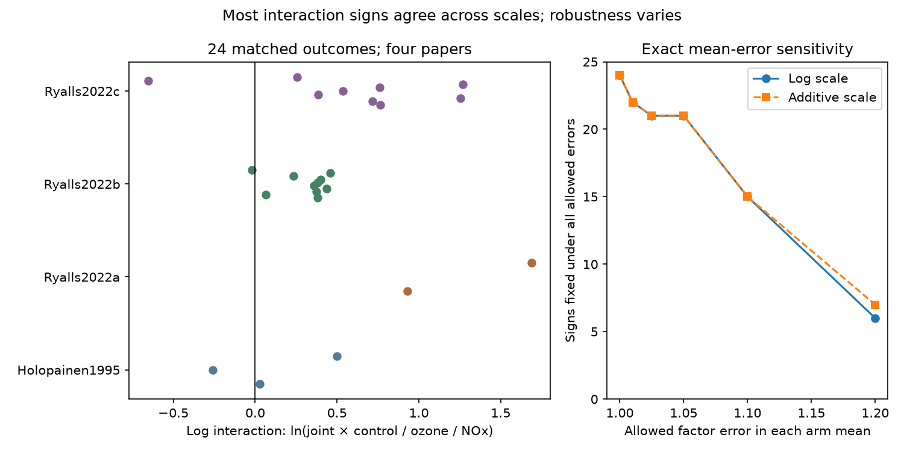

# Twenty-one of 24 matched ozone and nitrogen oxide contrasts were positive on two response scales in a 2024 extract

In 24 matched outcome sets, 21 interaction estimates were positive and three were negative. All signs agreed on additive and log response scales. Four papers supplied these sets. At a factor error of 1.05 in each treatment mean, 21 signs stayed fixed on both scales. At a factor error of 1.10, 14 stayed fixed on both scales. These are exact sensitivity results for the released means. They are not tests of a common biological effect.



## Question and purpose

Does the sign of an ozone and nitrogen oxide interaction depend on the response scale or on small errors in extracted means? Climate and emission changes can alter pollutant mixtures. A useful prediction of their effects on insects must distinguish joint exposure from a true interaction contrast. Our test addresses that measurement problem. It does not test climate trends, temperature interactions, species range shifts or seasonal mismatch.

Ryalls and colleagues (2024; DOI 10.1038/s41467-024-49729-5) assembled a broad invertebrate performance extract. We use that public workbook. A later review (Ryalls, Bishop and Wagstaff, 2026; DOI 10.1002/fee.70076) describes less than additive harm from combined ozone and nitrogen oxides. Our audit asks a separate question about matched four-arm contrasts and their sensitivity. It does not reproduce that review's model or update its search. The newer Dryad metadata were accessible, but the listed CSV download returned HTTP 403 and its API download returned HTTP 401. We therefore used the existing 2024 source. We did not infer missing new data from the review's pooled estimates.

Campaign searches included climate, pollution, biodiversity, ozone, pollinator interactions, nitrogen oxide and multiplicative. We read two relevant signed results. SCI sha256:c1be31cef6ad3d250cc8d182ae702517494fbcd59efbf074ed82c36dad981a43 showed missing CO2-only means in the same extract. This motivates the complete four-arm requirement. SCI sha256:2bde18c96b0ee5bc2514e52a0ac1e2d6c312e58e775a3f68c3acfde621be1d67 audited matched beneficial and pest comparisons. Neither tested the contrasts below. No code or derived data from those works was reused. This analysis was exploratory. We inspected labels and means before fixing the exact sensitivity levels. There was no preregistration.

## Data and matching

We used the first sheet of Supplementary Data 1 from the 2024 review. It contains 981 rows. Within each sharedcontrolcluster, we required one O3 row, one NOx or NO2 row, and one O3xNOx or O3xNO2 row. All 24 clusters that contained one of these joint labels passed. We checked equal control mean, control sample size, control standard deviation, paper, broad outcome and figure or table source. All selected means were positive. The retained sets use 72 spreadsheet rows and supply four distinct arm means per outcome. No deduplication by infoid was applied.

These checks establish agreement in the extract. They do not prove correct extraction, equal achieved doses or independent assignment. Joint-exposure concentrations are absent in these rows. The NOx treatments in the UK papers used diesel exhaust. A treatment labelled NOx is therefore not an isolated nitrogen oxide manipulation. A chemical change in the mixture can contribute to a treatment interaction.

The source country labels are Sweden and the UK. The Swedish paper was published in 1995 and the three UK papers in 2022. Country, era, method, taxa and outcome differ together. This is not a crossed region and time validation. The three UK papers use the FADOE field facility near Reading. The primary studies describe a small number of treatment rings and repeated measurements. They cannot be counted as three independent geographic tests. We retain publication identifiers to show the concentration of support. We do not use publication year as observation year.

The outcomes include aphid growth, pollinator visits and abundance, ground-active invertebrate groups, diversity, parasitoid counts and aphid mass. A positive interaction is an algebraic direction, not a common fitness benefit. Trap catch and visits can change through activity or detection without a population change. Faster growth, more parasitoids and a diversity index also need different ecological interpretations.

## Method and exact bounds

Let C, A, B and J be the positive control, ozone-only, nitrogen-oxide-only and joint means. Define:

- Log interaction L = ln(J C / (A B)). Zero is the multiplicative reference.
- Additive interaction D = (J + C - A - B) / C. Zero is the additive reference in raw outcome units.

Positive means a larger joint outcome than its scale's reference. For two harmful single treatments, this can mean less joint loss than expected. It does not mean that joint exposure is harmless. For example, both pollinator sets have a joint mean below either single-treatment mean, yet positive interactions. The additive reference can be negative for strongly reduced nonnegative outcomes; its sign then has a floor constraint. The log reference remains positive. We check both rather than equate them.

We allow each arm mean m to vary independently between m/f and f m, where f is at least one. This is a diagnostic error model. It is not a measured digitisation error rate. It can represent bounded errors in the extracted means, but does not cover missing outcomes or treatment misclassification.

The exact log interval is [L - 4 ln(f), L + 4 ln(f)]. Its sign first reaches zero at f_log = exp(abs(L)/4). For the additive sign, only the numerator matters because the denominator stays positive. The extreme numerators are (J+C)/f - f(A+B) and f(J+C) - (A+B)/f. The zero threshold is f_add = sqrt(max((J+C)/(A+B), (A+B)/(J+C))). A sign is fixed only for f strictly below its threshold. Corner assignments attain both limits. The bounds are sharp for each outcome separately under the stated error model. Shared means can restrict simultaneous attainment across outcomes. We make no simultaneous sharpness claim.

The primary output counts signs and gives these deterministic bounds. We also give a conditional sampling-error diagnostic. For L, the four delta-method standard error contributions are SD/(sqrt(n) mean). If arm means are independent, the standard error is the square root of their squared sum. With unknown covariance, the largest allowed linearised standard error is their sum. A normal cutoff of 3.078 controls 24 comparisons by a Bonferroni calculation if the marginal approximations and source standard errors are valid. This is not an exact confidence procedure for small, clustered experiments. Source sample sizes can include subsamples or repeated dates. They are not a verified number of independently assigned treatment units. We do not use this diagnostic to claim an established ecological interaction.

## Results

| Paper label | Country label | Matched sets | Positive | Negative | Signs fixed on both scales at f=1.05 | At f=1.10 |
| --- | --- | ---: | ---: | ---: | ---: | ---: |
| Holopainen1995 | Sweden | 3 | 2 | 1 | 2 | 1 |
| Ryalls2022a | UK | 2 | 2 | 0 | 2 | 2 |
| Ryalls2022b | UK | 10 | 9 | 1 | 8 | 3 |
| Ryalls2022c | UK | 9 | 8 | 1 | 9 | 8 |

No sign changed between the two response scales at the released means. Thus response scale alone does not explain the observed sign balance. This is a result for this selected extract, not a general invariance theorem. Across papers, the smallest log-scale reversal factors ranged from 1.0046 to 1.2612. Some small contrasts were sensitive to a change of less than one percent in each mean.

At f=1.05, 21 signs were fixed on each scale and on both scales together. At f=1.10, 15 were fixed on each separate scale, but only 14 were fixed on both. At f=1.20, six were fixed on both. These counts include positive and negative contrasts. They do not estimate the probability that a sign is correct. Four conditional independent-arm log intervals excluded zero after the 24-test correction. None excluded zero when the maximum covariance standard error was used. The latter result shows weak uncertainty support under that broad model. It does not establish that the true effects are zero or that the maximum covariance occurs in the experiments.

The Swedish sets have mixed signs. Twenty-one UK sets have 19 positive and two negative signs, but are concentrated at one facility. There is no independent repeated region by period test here. A claim that positive interactions repeat across regions and time is not supported by this extract.

## Limits and useful next steps

This is a new audit of published means, not a new experiment or an independent re-extraction of the primary figures. Reporting selection, unpublished studies, source transcription, outcome choice and the common field facility can all affect the balance. Shared controls reduce matching errors but do not fix those biases. We did not count outcomes as independent replicates or calculate a binomial test on 24 signs. Our mean-error bounds do not replace uncertainty from experimental units.

The primary papers already reported their own treatment effects. The added result here is that all matched signs agree across two scales, and that exact arm-mean perturbation limits separate fragile from more stable signs. A useful next extraction should retain all four arm means, achieved concentrations, treatment-unit identifiers, year-specific outcomes and their covariance. Independent sites and years with crossed climate and pollution treatments are required to test whether the pattern transfers. The present evidence cannot identify an atmospheric chemical mechanism, a causal climate effect, or a population consequence.

## Reproduce and inspect

The package includes original code, aggregate results, checks and the figure. Raw external data and record-level derivatives remain outside it. Source attribution, exact URL, path, version and hash are in files/EXTERNAL_DATA_NOTICE.md and files/provenance.json. Requirements are Python 3.12 with numpy, pandas, scipy, matplotlib and openpyxl. Exact run versions are in files/checks.json.

From an extracted bundle, choose new output directories outside the publication:

```sh
python files/retrieve.py /absolute/path/to/external_source
python files/analyze.py --raw /absolute/path/to/external_source/supplementary_data_1.xlsx --out /absolute/path/to/aggregate_results --scratch /absolute/path/to/external_records
python files/validate.py /absolute/path/to/external_source/supplementary_data_1.xlsx
```

On this machine, use /mnt/dell-data/shared_datasets/ryalls2024-invertebrate-pollution-moesm4/supplementary_data_1.xlsx in place. Do not download a second copy into the shared store. The analysis checks the exact source hash. The scratch table links each contrast to its source cluster. Compare paper_summary.csv, sensitivity.csv and checks.json with this bundle. Image bytes can depend on the plotting environment.

A separate openpyxl and standard-library calculation confirmed all counts and tested all 16 error-bound corners at four factors. A fresh main run gave identical aggregate CSVs. These checks passed. All computations have completed. No random seed or active service is required.

Campaign: 11_07_2026. Job: sci-1107-dell-climate-pollution-biodiversity-1b4ffbcea0c8. Topic: climate-pollution-biodiversity. Machine: dell. Account: codex-andrii. Model: gpt-6.1-sol, high reasoning effort. Analysis date: 2026-11-09. The campaign-machine signing key is not a personal authorship claim.
