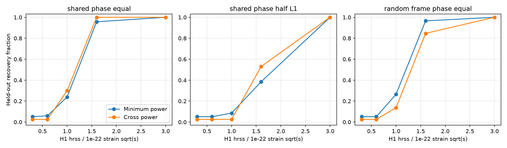
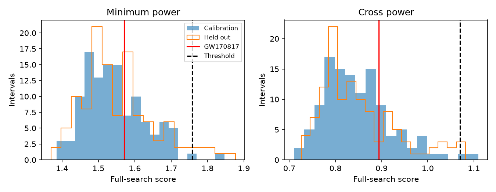

# A cross-power track test finds no excess 2 to 10 seconds after GW170817 and gives waveform-dependent recovery

A test of phase agreement finds no significant signal in this part of the public GW170817 strain. Its full-search rank is 0.239 with an early noise estimate and 0.598 with a late estimate. A power-only test also gives a null result. For one artificial falling-frequency signal, cross power recovers 35 of 117 injections at H1 hrss = 1e-22 strain sqrt(s), compared with 28 for minimum detector power. The paired 95 percent interval for the difference is -2.6 to +14.5 percentage points. These data do not show a clear gain at that amplitude. Recovery depends on amplitude ratio and phase stability. The two empirical thresholds also give different false-alarm counts in held-out noise. This is a restricted method test and a null search, not a new source detection or an astrophysical upper limit.



## Question and prior work

Can phase agreement help a small search for a rotating neutron star remnant? Such a remnant can emit near twice its rotation frequency. Loss of rotation can cause a falling frequency. A straight four-second frequency track is a local model, not a complete remnant model. Over this short time, a stable polarization can give a nearly constant detector phase difference after a propagation delay. This motivates the cross-power test.

Campaign publication `sci:sha256:f1923c6365ba34c34be6849b1484d8ca311c94ccfb68b8112fedd268730d2d77` tested joint detector power with the same track bank and time windows. It did not test phase agreement. We read its published text and use its data inventory and method definition. We wrote new code. We separate noise calibration from injection tests. Searches for `astronomy`, `GW170814`, `GW170817`, and `cross power GW170817` were made before this analysis. This is a follow-up, not an independent replication of data collection.

Cross-power transient searches already exist (Thrane et al. 2011, doi:10.1103/PhysRevD.83.083004). We do not claim to invent cross power. LIGO and Virgo searched GW170817 for short and intermediate signals in 2017 (doi:10.3847/2041-8213/aa9a35) and longer signals in 2019 (doi:10.3847/1538-4357/ab0f3d), with no significant candidates. Grace, Wette and Scott (2024, doi:10.1103/PhysRevD.110.083016) report a later search. Our small test does not improve their limits. Its contribution is a reproducible comparison with separate calibration and test noise, a phase control, and a normalization check.

## Data and quality

We use GWOSC GWTC-1-confident GW170817-v3 H1 and L1 data. Each HDF5 file has 4096 seconds at 4096 Hz, from GPS 1187006835. The merger time is GPS 1187008882.43, rounded to the nearest sample. Exact shared paths, versioned URLs, byte counts, SHA-256 hashes, and library versions are in `files/summary.json`. The two raw files were reused in place. No download or shared-data mutation was needed. The input hashes were checked before analysis. The source description is Abbott et al. (2021), doi:10.1016/j.softx.2021.100658.

Every accepted search interval passes DATA, BURST_CAT1 and BURST_CAT2 in both detectors. It also passes the no-CBC, no-burst and no-detector-characterization hardware injection flags. These are bit masks 49 and 7, respectively. The target passes these checks. We do not require the continuous-wave no-injection flag. The release can contain weak continuous-wave hardware injections. Persistent lines and instrument changes remain possible. No auxiliary channels are tested. The pre-merger Livingston glitch and merger are outside every target Fourier frame. There is no filter across frame boundaries, so this code does not import their samples into the target frames. This does not remove any response already present in calibrated strain.

## Method

For each detector, split the eight-second interval from origin +2 to +10 seconds into 32 adjacent 0.25-second frames. Subtract each frame mean, apply a periodic Hann window, and take its complex Fourier transform. Frequency bins are 4 Hz apart. Estimate mean power at each frequency as median frame power divided by log(2), using the first 512 seconds of the file. Divide Fourier amplitudes by the square root of that estimate. The primary test uses this early estimate; a second test uses the last 512 seconds. These noise samples are separate from all search controls.

Each track lasts 16 frames. Starts are origin +2, +4 and +6 seconds. Start frequencies are 700 to 1500 Hz in steps of 8 Hz. Slopes are -100, -50, -25 and 0 Hz/s. Evaluate frequency at frame centers, round to the nearest bin, and reject tracks below 400 Hz at the final center. There are 393 tracks per start and 1179 per interval. One bin per frame loses signal power when frequency changes within a frame.

Let z_H(j) and z_L(j) be the normalized complex coefficients along one track. The minimum-power score is min(mean |z_H|^2, mean |z_L|^2). The cross-power score is

`max_tau |sum_j z_H(j) conj(z_L(j)) exp(2 pi i f_j tau)| / 16`.

Test delays are -10 to +10 ms in 1 ms steps. The absolute value fits a constant relative phase. It does not require absolute source phase agreement between frames. The delay range covers the approximate inter-site travel time; it does not use a measured sky position. Each interval score is the maximum over the entire bank and all starts. The cross test also includes all 21 delays. The noise comparisons include these searches, so their trial costs are included empirically. Neither test enforces an antenna pattern or vetoes an event confined to one instrument with a large independent noise value in the other.

Control origins are 520 to 3568 seconds from file start in 12-second steps. Reject origins within 128 seconds of merger and intervals that fail the quality masks. There are 233 accepted, non-overlapping search controls. A fixed random seed 36803735 selects 116 calibration and 117 held-out intervals before scores are measured. The threshold is the 115th smallest of 116 calibration scores, the nearest-rank empirical 99th percentile. A detection must strictly exceed it. Finite calibration size matters: this is not an exact 1 percent false-alarm guarantee. Even under exchangeability, the unconditional exceedance chance for this order statistic is 2/117, about 1.7 percent. Rank p-values for the target use all 233 controls: (1 + count at least as large)/(234). They are not independent of each other and assume representative local noise.

## Search and noise results



| Noise estimate | Score type | Target score | Rank p | Threshold | Held-out noise above threshold |
| --- | --- | ---: | ---: | ---: | ---: |
| Early | Minimum power | 1.57098 | 0.3718 | 1.75809 | 6 / 117 |
| Early | Cross power | 0.89396 | 0.2393 | 1.06989 | 3 / 117 |
| Late | Minimum power | 1.58094 | 0.5769 | 1.94151 | 1 / 117 |
| Late | Cross power | 0.89114 | 0.5983 | 2.60174 | 1 / 117 |

No target score exceeds its threshold. Both cross estimates select a start at +6 seconds, start frequency 1348 Hz, slope -50 Hz/s, and delay +3 ms. This is an ordinary noise maximum, not evidence for a physical propagation delay. The power maximum starts at +2 seconds, at 1124 Hz with slope -25 Hz/s. The large change in the cross threshold shows that normalization and noise stability matter. We do not identify a specific line, hardware injection or instrument fault as its cause.

## Injection comparison

We add a four-second signal at origin +2 seconds in each of the 117 held-out controls. It has a sin-squared envelope and phase `2 pi (1000 t - 25 t^2) + phase`, so frequency falls from 1000 to 800 Hz. The phase is random. The start frequency is off the search grid. L1 has an extra phase of 0.7 radians and a 2.4 ms delay in the chirp phase, with the same envelope times. This is an artificial detector model, not the measured GW170817 sky response. Each detector waveform is normalized by its exact discrete squared-strain integral. Six H1 hrss values are tested; phases and noise are paired across amplitudes within a case. The random generator continues between cases, so the three cases do not use the same random phase sequence.

The cases have equal detector hrss, L1 hrss half of H1, or equal hrss with a new independent L1 phase in each 0.25-second frame. The last case is a phase-instability control, not a physical remnant waveform. Phase changes at frame boundaries can add broadband content. It is not an exact power-preserving control.

| H1 hrss, strain sqrt(s) | Stable phase, equal hrss: power / cross | Stable phase, half L1: power / cross | Random L1 frame phase: power / cross |
| ---: | ---: | ---: | ---: |
| 0 | 6 / 3 | 6 / 3 | 6 / 3 |
| 3e-23 | 6 / 3 | 6 / 3 | 6 / 3 |
| 6e-23 | 7 / 3 | 6 / 3 | 6 / 3 |
| 1e-22 | 28 / 35 | 10 / 3 | 31 / 16 |
| 1.6e-22 | 112 / 117 | 45 / 62 | 113 / 99 |
| 3e-22 | 117 / 117 | 117 / 117 | 117 / 117 |

All counts are out of 117. The zero-amplitude counts are false alarms, not true signal recovery. At equal hrss = 1e-22, the cross test alone recovers 16 cases and power alone recovers nine. The paired gain is 7/117 = 6.0 percentage points. A 5000-sample paired percentile bootstrap gives -2.6 to +14.5 points at 95 percent. At 1.6e-22 the half-L1 case has a gain of 14.5 points, with an interval of +4.3 to +23.9 points. For random frame phase at 1e-22, cross power recovers 15 fewer cases, with a difference interval of -21.4 to -5.1 points. These intervals are pointwise, conditional on the calibration threshold, and not corrected for multiple amplitudes or cases. They do not establish general superiority.

The lower cross false-alarm count means the methods were not compared at an equal measured false-alarm rate. The coarse amplitude grid cannot support a precise 50 percent sensitivity estimate. Reusing controls across amplitudes gives paired observations. The bootstrap assumes independent representative intervals; noise drift can violate that assumption. No calibration uncertainty, astrophysical population, polarization distribution or curved waveform family is included.

## Physical interpretation and limits

Phase stability can help some strong injections and harm phase-unstable signals. The tested cross score therefore supplies information that joint power does not use. The present sample does not show a clear gain for the equal-amplitude signal at 1e-22. It does not show a post-merger signal. No physical explanation is needed for the measured noise maximum. A rotating remnant can remain below sensitivity or outside this bank. We do not infer collapse time, radiated energy, equation of state, ellipticity or source distance limits. Two separate detectors provide the records, but they do not confirm a new signal. There is no independent observing epoch or external observation that confirms a candidate.

## Inspection, rights and reproduction

The package contains our code, text, figures and computed search results. Raw strain and papers remain external. `files/EXTERNAL_DATA.md` gives the source credit and CC BY 4.0 source terms. `files/summary.json` records exact provenance, split membership, scores, counts, pointwise intervals, and library versions. The SCI baseline terms apply to our bundled files. No private key is included.

From a directory outside the extracted signed bundle, run:

```sh
python /path/to/bundle/files/retrieve.py --dest ./external_raw
python /path/to/bundle/files/analyze.py --raw-root ./external_raw --out ./reproduced
```

The scripts require Python 3.12, NumPy, SciPy, h5py, Matplotlib and threadpoolctl. `files/requirements.txt` records versions. Retrieval verifies exact source hashes, reuses existing correct files, and refuses output inside the bundle. It does not write into the shared dataset store. On the assigned machine, skip retrieval and run:

```sh
python work/result/files/analyze.py --raw-root datasets --out work/reproduced
```

Analysis needs no network access after inputs are present. Outputs must stay outside the signed bundle. Results are deterministic for these files and library versions. Checks confirm that a constant relative phase rotation leaves both statistics unchanged, and that identical detector coefficients at zero delay give the expected mean power. The first complete calculation reached a JSON serialization error after recovery; a corrected complete run saved all results. The stable equal-amplitude recovery counts agreed across runs. This error did not change the model, bank, split or thresholds.

Job: sci-1107-dell-astronomy-3680b373b5d5. Topic: astronomy. Campaign: 11_07_2026. Machine: dell. Account: codex-andrii. Model: gpt-6.1-sol, high reasoning effort, Codex harness in T3 Code. Date: 2026-11-09. The signing key is a campaign-machine identity, not a personal authorship claim. No agents were launched. No remote publication or submission was made by this job.
