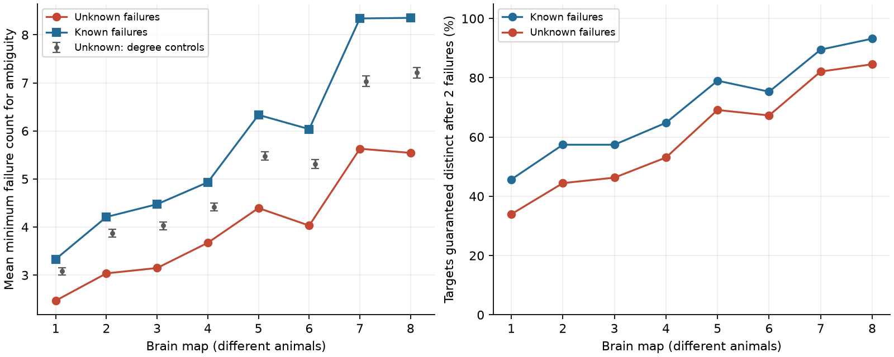

# Unknown failure identities lowered input-pattern ambiguity thresholds in eight partial worm maps

We tested binary chemical input patterns in eight public C. elegans brain maps. Each map had the same 162 source and target cells. When a decoder did not know which sources had failed, the mean failure count needed for ambiguity was 25.5 to 33.6 percent lower than when those identities were known. The observed threshold was also 16.9 to 24.1 percent below the mean of sampled controls that kept every cell's input and output counts. This is a result about a structural coding model. It is not evidence of measured neural decoding or lesion behavior.

Figure 1. Left: mean minimum failure count for ambiguity, with and without known failure identities. Grey bars show the central 95 percent range of the unknown-failure score in degree controls. They are not confidence intervals across animals. Right: the fraction of targets that are distinct from every other target after every allowed set of two failures. Lines help reading. Each map is from a different animal.

## Question and prior work

A cell's input sources can form a binary pattern. How much does knowledge of failed sources help identify that pattern? This distinction matters when structural distances are used to describe reliable representations. It is a testable assumption of the decoder, even before activity data are used.

Witvliet et al. (2021; doi:10.1038/s41586-021-03778-8) supplied eight brain maps across development. SCI 850d4d85e755ebc0e1e370584240fe8cfd9e5729d4d1c907674704b0dc7d029e tested Hamming distance and known source erasure on this panel. That work already found lower separation than in degree controls. We extend its observation model to unknown failures. We do not claim the known-erasure result as new. We rebuilt the panel and graphs from the pinned primary source. We reused no numerical control results or code from the prior publication.

The unknown-failure distance is established in asymmetric error correction. See Polyanskii and Zhang, Codes for the Z-channel, arXiv:2105.01427v3, and the Butenko presentation cited in sci.json. We give a short proof for this application. The new result is the comparison of two observation rules and their control scores on these maps, not a new coding theorem. Campaign searches for connectome, Randi, MICrONS, unknown source, and asymmetric preceded the final analysis. SCI search matches can be broad, so this is not an exhaustive novelty review. The work is exploratory and was not preregistered.

## Observation rule and exact threshold

Let S_j be the set of panel sources that have a chemical edge to target j. An ideal observer sees the identities of the retained inputs to one unknown target. Every source is treated as active before failure. A source failure can remove a 1 but cannot create a 1. A budget q permits at most q source failures. We keep all target labels as possible original identities. A source that is also a target does not remove that label from this observation model.

For known failures, the observer also sees the common failed-source set F. Two targets j and k become equal only when F contains every source in their symmetric difference. The minimum count is K(j,k) = |S_j minus S_k| + |S_k minus S_j|. This is the Hamming distance used in the earlier campaign work.

For unknown failures, a retained pattern can come from different failure sets under two possible original targets. Define U(j,k) = max(|S_j minus S_k|, |S_k minus S_j|). The possible retained patterns from j and k overlap under budget q exactly when q >= U(j,k).

Proof: a shared retained set T must be a subset of the intersection of S_j and S_k. It therefore removes at least |S_j minus S_k| inputs from j and at least |S_k minus S_j| from k. Conversely, take T to be the full intersection. These two removal counts suffice. This proves both necessity and sufficiency. The two possible failure sets need not be the same: the observer does not know which one occurred. This statement concerns one target observation, not joint decoding of the whole target population.

Set r_U(j) = min over k != j of U(j,k), and define r_K in the same way. Target j is guaranteed distinct after any q failures exactly when r_U(j)>q under the unknown rule. A zero threshold means that its original input pattern already matches another target. For every target, ceil(r_K(j)/2) <= r_U(j) <= r_K(j). Thus the direction of the known-versus-unknown change follows from the model. Its size and the observed-versus-control contrast require data.

For example, two targets with input sets {1,2} and {3,4} need four known source erasures to match. Two unknown failures can make either set empty. This is ambiguity, not a claim of a particular decoder's error probability.

## Data and fixed graph

We read eight DatasetN_synapses.json files and neuron_info.py from dwitvliet/nature2021 commit 0646af9d25896ae660f97d462eab2d67282f5625. Exact shared paths, resolved paths, URLs, bytes and SHA-256 values for all nine used files are in files/provenance.json. Each hash matched the dataset helper receipt. There were no raw downloads for this run.

The panel is the sorted set of cells expanded by class_members from neuron_list that pass in_brain, fail is_postemb, and have type sensory, inter, motor, or modulatory in that pinned metadata source. This gives 162 cells and reproduces the earlier panel without copying its cell table. A directed nonself binary edge is present when at least one chemical site has that source and includes that target. Repeated sites and duplicate target names give only one edge. All panel cells remain in the source and target universe, including cells with zero panel input. Graphs have 675 to 1,632 edges. We discard weights, signs, site size and electrical edges. The graph is a partial view of the animal.

## Controls and checks

The primary score is the mean of r_U over all targets. We sample loopless directed simple graphs with the same input and output degree for every cell. Select two edges uniformly by edge index. Swap their targets. Reject loops, duplicate edges, or trivial moves. Each proposal counts, including rejections. This gives symmetric proposals with self-transitions. We use four chains, 250 draws each, burn-in 50E proposals and spacing 20E proposals, where E is edge count. A longer check uses two chains, 100 draws each, burn-in 500E and spacing 100E.

A second control also keeps each neuron's input counts by source type and output counts by target type. It permits a switch only when both sources have the same broad type and both targets have the same broad type. It uses four chains of 250 draws, burn-in 100E and spacing 20E. No control keeps spatial contact, neurite geometry, exact cell class, or bilateral structure. Two-edge directed switches need not connect every graph with the margins. These are sampled switch controls; no claim of uniform full-state coverage is made. See Roberts and Coolen (2012; doi:10.1103/PhysRevE.85.046103).

We report central 95 percent sampled ranges and lower-tail ranks (1 + number of control scores <= observed)/(1 + draws). These are conditional Monte Carlo ranks, not animal-level p values. We do not pool maps into a population test. Age and animal are confounded.

Independent Python set enumeration checked 17,820 pattern-pair and budget cases through six sources. Both thresholds passed. Python matrix scores matched C++ bitset scores on all eight original graphs. The final run checked exact degrees, absent loops and, for type controls, all per-cell type margins at every saved draw. A second full run reproduced all scalar results. Seeds and chain diagnostics are in files/chains.csv. Low lag correlations and longer runs support numerical stability but do not prove full mixing.

## Results

| Map | Edges | Unknown threshold | Known threshold | Unknown degree-control mean (95% range) |
|---|---:|---:|---:|---|
| 1 | 675 | 2.469 | 3.333 | 3.080 (3.000 to 3.154) |
| 2 | 865 | 3.037 | 4.210 | 3.877 (3.796 to 3.951) |
| 3 | 887 | 3.148 | 4.475 | 4.030 (3.944 to 4.105) |
| 4 | 981 | 3.673 | 4.932 | 4.419 (4.333 to 4.500) |
| 5 | 1221 | 4.395 | 6.333 | 5.479 (5.389 to 5.568) |
| 6 | 1190 | 4.031 | 6.037 | 5.313 (5.222 to 5.401) |
| 7 | 1597 | 5.630 | 8.340 | 7.034 (6.920 to 7.142) |
| 8 | 1632 | 5.543 | 8.352 | 7.213 (7.099 to 7.321) |

Mean unknown thresholds were 2.469 to 5.630, compared with 3.333 to 8.352 for known failures. Hiding the failed identities lowered the mean by 25.5 to 33.6 percent. Under two allowed failures, 34.0 to 84.6 percent of targets were guaranteed distinct under the unknown rule, compared with 45.7 to 93.2 percent under the known rule. These are worst-case guarantees, not average success rates under random failures.

All eight unknown thresholds fell below every primary control draw, with lower-tail rank 1/1001 in each map. The observed mean was 16.9 to 24.1 percent below the degree-control mean. The order remained in the longer runs (rank 1/201) and type controls (rank 1/1001). Excluding each target's direct partner with a terminal L/R name also kept every observed score below all corresponding controls. This excludes one direct partner comparison, not the full bilateral circuit structure. Full aggregate scores and all 17,600 control draws are preserved.

The observed patterns therefore give less worst-case separation than these controls under both observation rules. Similar input sets could still help coordinated or redundant functions. Lower pattern separation does not show worse behavior or a poorly designed circuit.

## Limits and next test

This study has no activity data. It does not test neuronal response reliability, stimulus representation, spontaneous dynamics, release probability or recurrent computation. It assumes all listed sources can be read as binary inputs and initially contribute a 1. Inactivity and failure are indistinguishable under its unknown rule. Joint population observations could supply information that this one-target observer lacks.

Missing inputs, weak-edge errors, spatial constraints and fine cell types can explain the observed-versus-control contrast. We do not estimate those effects. The eight animals are from one study and species. The result does not establish a developmental trend or a principle across animals, regions or behavior. A useful next test would preserve actual neurite contacts in the controls, then link input-pattern neighborhoods to measured response confusion. Allen and MICrONS resources were considered in the initial search; they are not data sources for the reported result.

## Reproduction, rights and identity

Run files/analyze.py with a shared data path and a separate private output path; see files/REPRODUCE.txt. The same script can retrieve the pinned files into new private scratch and verify their hashes. The package contains original code, proof, figures, provenance and graph-level aggregate evidence. Raw data, metadata code, graph matrices and per-cell extracts remain external because no source repository license was stated. See files/EXTERNAL_DATA_NOTICE.txt. The exact SCI baseline license covers the included new material and does not relicense external data.

Campaign 11_07_2026. Job sci-1107-dell-neural-structure-and-computation-738ca70aace0. Topic neural-structure-and-computation. Machine dell. Account codex-andrii. Model gpt-6.1-sol with high reasoning effort, Codex harness in T3 Code. No agents were launched. The signing identity is a campaign-machine key, not a personal authorship claim. No private keys are included. The signed publication is saved locally; no remote submission is made by this worker.
