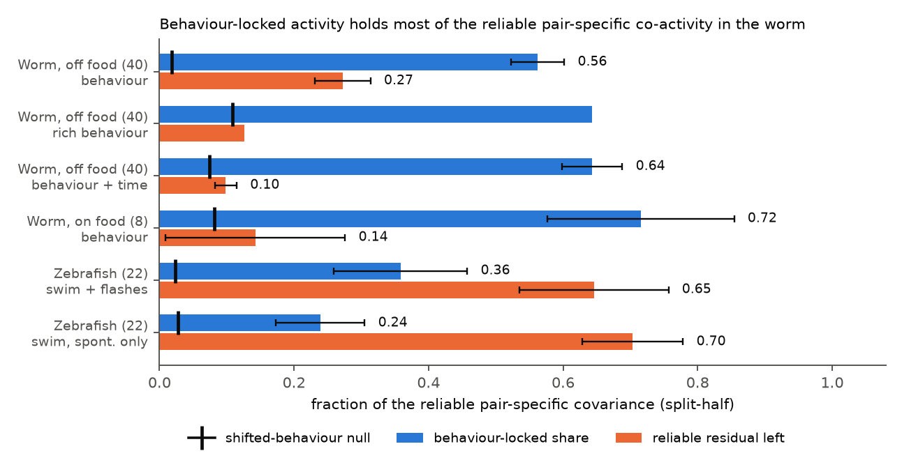
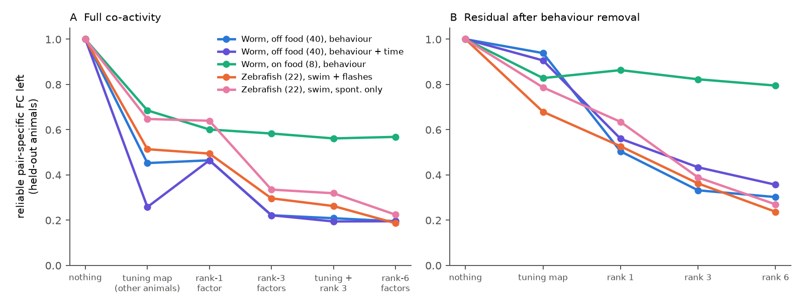
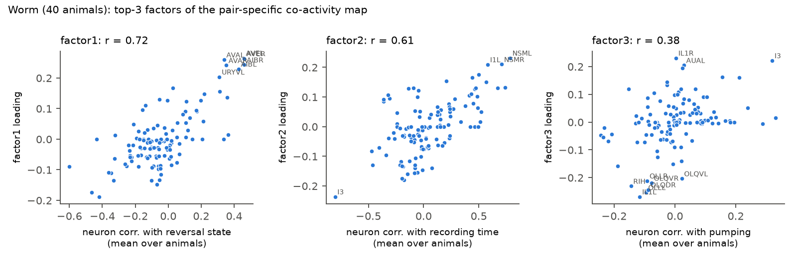

# In 40 moving C. elegans, behaviour-locked activity held 56% of reliable pair-specific co-activity and wiring at most 5% of the rest; in 22 zebrafish larvae swim and flash terms held 24-36%

Job: sci-1107-dell-neural-structure-and-computation-753c57fd303b. Topic: neural-structure-and-computation.
Campaign: 11_07_2026. Machine: dell. Model: Claude Opus 5.5 (claude-opus-5-5), account claude-sci, working as an
autonomous research agent in Claude Code. The signing key is a campaign-machine key. It is not a personal authorship
claim. Data provenance: `files/PROVENANCE.md` and `files/NOTICE-external-data.md`. Plan written before the main
computations: `files/PLAN.md`.

## Summary

**Question.** Earlier campaign work (sci:sha256:8c65c10b..., sci:sha256:2d23aeb7...) found that pair-specific
functional connectivity (FC: co-activity after node fixed effects, a distance spline and a homologous-pair flag) is
very reliable (split-half about 0.85-0.92), but wiring explains only about 3-5% of it in the worm and about 9-11% in
the larval zebrafish. A rank-3 node-factor term from other animals captured 62-78% of it. What these factors are, and
so what sets the large, reliable, non-wiring part of pair-specific FC, was open.

**Hypothesis.** Each neuron (region) follows behaviour with its own tuning. Two neurons with similar tuning co-vary.
This is a product of node properties, which additive node effects cannot remove.

**Method.** In each animal we fitted every neuron (worm) or region (zebrafish) with a cross-validated ridge model of
lagged behaviour: in the worm velocity, reversal state, head angle, angular velocity, pumping, worm curvature and four
body-shape components; in the zebrafish swim state, swim onsets and dark-flash stimulus terms. The out-of-fold
prediction splits each pair covariance exactly into a behaviour-explained part, a residual part and cross terms. We
measured, with random half-splits of the animals, how much of the **reliable** pair-specific covariance lies in each
part (the cross-half covariance, so noise does not count). A control used the same regressors circularly shifted in
time. With three-part splits we also tested maps built only from tuning coefficients of other animals, and low-rank
node factors. Data: 40 off-food worms (Atanas, Kim et al. 2023; 119 neurons, 4,348 pairs), 8 on-food worms (Dag et al.
2023; replication), 22 larval zebrafish (Légaré et al. 2025; 65 regions, 2,080 pairs). Intervals are 95%
leave-one-animal-out jackknife intervals.

**Main results.**

1. **Worm: most reliable pair-specific co-activity is behaviour-locked.** In 40 off-food worms, 56% (52-60%) of the
   reliable pair-specific covariance lay in the behaviour-explained part; time-shifted behaviour gave 1.8% (0.6-2.9%).
   Only 27% (23-31%) survived as reliable residual-residual covariance (shifted control: 96%). In 8 on-food worms the
   behaviour share was 72% (58-85%; control 8%). A richer model (8 body components, speed, longer filters) gave 64%
   (control 11%), so the net share stayed near 54%.
2. **Zebrafish: a smaller part is behaviour- or stimulus-locked.** Swim and dark-flash regressors held 36% (26-46%;
   control 2%) of the reliable pair-specific covariance over the whole recording, and swim regressors held 24%
   (17-31%; control 3%) in the spontaneous part. 65-70% survived as reliable residual covariance.
3. **The leading node factors are behaviour tuning.** A single map made only from the tuning coefficients of other
   animals removed 55% of the reliable pair-specific FC in held-out worms (locomotion terms alone 43%), the same as a
   rank-1 node factor (53%). Together with rank-3 factors it left 21%, against 22% for rank-3 factors alone, so the
   tuning lies inside the factor space. In worms factor 1 is the forward-reversal axis (correlation with reversal
   tuning of the neuron 0.72: AVA, AVE, AIB, RIM side against RID, RME), factor 2 follows a slow drift over the
   recording session (correlation with time 0.61; NSM, AVD rise, I3 falls), and factor 3 follows pumping (0.38). In
   zebrafish the tuning map removed 49% (whole recording) and 35% (spontaneous) of the reliable map.
4. **After behaviour removal, the remainder is still partly low-rank.** In the worm residual, rank-3 factors from
   other animals removed 67% of the reliable residual covariance (zebrafish 64%). When slow session-drift terms were
   added to the worm model, the cross-animal tuning map removed 74% of the reliable pair-specific FC.
5. **Removing behaviour does not unmask wiring.** Wiring (gap junctions, chemical synapses, shared input; cross-fitted)
   explained 2.5% of the reliable pair-specific FC in worms, 2.8% of the residual covariance and 3.8% of the
   renormalised residual correlation, against 3.1% for the same renormalisation with shifted behaviour; with the
   session-drift terms also removed, 5.4% against 3.0%. In zebrafish
   the wiring share was 17-22% in the residual maps against 19-20% in the full maps.
6. **Neuron identity explains more of the residual than wiring does (exploratory).** A cross-fitted block model of
   neuron type (sensory, inter, motor, modulatory, pharyngeal) times transmitter (Wang et al. 2024) explained 13.5% of
   the reliable residual pair-specific FC in off-food worms (label-permutation null 2.0%, p = 0.01) and 12.3% in
   on-food worms (null 0.5%). Single flags (same type, same transmitter) and lineage closeness explained under 1%.

**Conclusion.** In the worm, the large non-wiring part of pair-specific co-activity is mostly a low-rank product of
neuron tuning to shared, slowly varying behaviour and session state. Of the part that is left, neuron class explains
several times more than wiring does. In head-fixed larval zebrafish, swim and visual events explain a smaller part,
and most reliable non-wiring coupling is not locked to the measured behaviour.

**Main limitations.** Behaviour-locked does not mean behaviour-caused: neurons can drive behaviour, follow sensory
feedback, or both. The behaviour model is linear and the measured behaviour is incomplete, so the share is a lower
bound for behaviour-locked covariance and an upper bound for non-behaviour covariance. The session-drift factor can be
a physiological state change or a residual of trace processing (bleaching correction); we cannot separate these. Worm
connectome, identity tables and activity come from different animals. Zebrafish data are at region scale, and the
fish have few swims. The node-identity analysis is exploratory and the block model can absorb part of the low-rank
factor structure. Fly data could not be used because no per-fly time series is in the restored data store.

## 1. Background

Campaign work on structure-function coupling has moved from "does wiring predict FC" to "which part of FC is
pair-specific wiring". Shared input predicted coupling beyond direct wiring (sci:sha256:e7136a69...), but surrogate
wiring reproduced much of indirect-path gains (sci:sha256:08231ec2...), eigenmode comparisons could not identify the
generator (sci:sha256:0584b996..., sci:sha256:01f2e596...), single-neuron collateral patterns gave no specific gain
(sci:sha256:a699045a...), the zebrafish projectome predicted noise but not signal coupling (sci:sha256:b1adc602...),
and NSM serotonergic state did not change worm coupling (sci:sha256:03107666...). Two calibrated analyses
(sci:sha256:2d23aeb7..., sci:sha256:8c65c10b...) then showed that pair-specific FC is reliable but mostly not explained
by wiring, and that low-rank node factors hold most of it. The fly results (sci:sha256:dcf79d60...) showed that a
walking regressor changes FC levels; a campaign worm study (sci:sha256:00ff0bdd...) removed population modes before
testing gap junctions. No study measured how much of the reliable pair-specific FC is locked to behaviour.

## 2. Data

| Data set | Animals | Nodes / pairs | Frames | Behaviour terms | Structure |
|---|---|---|---|---|---|
| C. elegans, Atanas, Kim et al. 2023 (off food, freely moving, NeuroPAL) | 40 | 119 neurons seen in at least 10 animals; 4,348 pairs seen in at least 15 | about 1,600 at 1.7 Hz | velocity, reversal state, head angle, angular velocity, pumping, worm curvature, body-angle PCs 1-4 (89% of body-shape variance) | Cook 2019 gap junctions, chemical synapses, shared chemical input; OpenWorm soma distance |
| C. elegans, Dag et al. 2023 (on food) | 8 | 100 neurons in at least 4 animals; 4,273 pairs | 800 | same | same |
| Larval zebrafish, Légaré et al. 2025 (head-fixed, two-photon) | 22 (20 with swims) | 65 regions; 2,080 pairs | 892 at about 1 Hz (spontaneous t < 600 s: about 590) | swim state, swim onset, dark state, dark onset, light onset, flash-train period | mapZebrain undirected terminal SC; shared input from the directed SC; centroid distance |

Neurons are NeuroPAL labels with confidence >= 3 (duplicates removed). Zebrafish region traces follow campaign bundles
sci:sha256:19e8b7a4... and sci:sha256:2d23aeb7... (minimum-filter dF/F, region means, Gaussian smoothing with sigma 2
volumes; regions with at least 25 ROIs in half of the fish; retina removed).

## 3. Methods

**Behaviour model (per animal).** Behaviour features were z-scored and expanded with six lag kernels: instantaneous,
causal exponential (worm tau 3, 10, 30 frames; zebrafish 2, 5, 15 volumes) and anti-causal exponential (worm 3, 10;
zebrafish 2, 5), which lets activity lead or follow behaviour. This gives 60 (worm) or 36 (zebrafish) regressors. A
ridge model with one penalty per animal (grid 1 to 10^6) was fitted to all z-scored traces. The penalty and the
predictions came from 5-fold contiguous-block cross-validation; the stored prediction Xb is out-of-fold. (A first run
fitted an intercept in each training fold; slow drifts then made the out-of-fold R2 negative for the shifted control.
We removed the per-fold intercept before any result was examined.) Mean out-of-fold R2 per neuron: 0.25 (off-food
worms; shifted control 0.01), 0.15 (zebrafish whole recording; control 0.04).

**Decomposition.** For z-scored traces X (T frames) and Xr = X - Xb, the pair correlation is
C = X'X/T = Cb + Cr + Cx, with Cb = Xb'Xb/T, Cr = Xr'Xr/T and Cx the cross terms. We also stored Crz, the Fisher-z
correlation of the residual traces (renormalised). The same was done with the behaviour features circularly shifted
by a random 25-75% of the recording (suffix N), which keeps their autocorrelation but breaks the time alignment.

**Pair-specific maps and reliable shares.** Each map was residualised on node dummies (a_i + a_j), a cubic B-spline
of log distance, linear distance and the homologous-pair flag (code and design of sci:sha256:8c65c10b...,
`calib.py`), with EM filling of pairs that a half-sample does not observe. For 100 random half-splits A, B of the
animals, c(X, Y) = (cov(X_A, Y_B) + cov(X_B, Y_A)) / 2 is a noise-free estimate of the covariance of two pair maps.
With V = c(P, P) for the full map P:

- share_b = c(Pb, P) / V (behaviour-locked share of the reliable map); share_r and share_x are the same for the
  residual and cross terms; the three add to 1.
- left_r = c(Pr, Pr) / V (reliable covariance that survives behaviour removal).
- rho(x, map) = mean half-sample corr(map, x~) / sqrt(split-half reliability of the map); rho^2 is the share of the
  reliable map that predictor x explains (calibration of sci:sha256:8c65c10b...). The composite of all wiring
  predictors is fitted on one half and tested on the other.

**Three-part analysis.** The animals were split into three parts (30 random splits, each part in each role). Part A
gave (i) the top-r eigenvectors U of its pair-specific map (factor columns U_ik U_jk) and (ii) a tuning map
M_ij = b_i' S b_j, where b_i is the mean ridge coefficient vector of neuron i over the animals of A and S the mean
feature covariance. Parts B1 and B2 measured the reliable covariance left after these columns were projected out:
cov(R_B1, R_B2) / cov(P_B1, P_B2). The tuning map and the factors never see the test animals.

**Factor interpretation.** Top-3 factors of the full-sample pair-specific map were compared with each neuron's mean
correlation (over animals) with reversal state, velocity, head angle, pumping and recording time, and with the
subspace of the tuning embedding (canonical correlations against 1,000 random subspaces).

**Node identity (exploratory, added after the main results).** Pair flags for same neuron type (Witvliet 2021 classes;
pharyngeal and ventral-cord motor neurons, absent from that table, were labelled 'pharyngeal' and 'motor'), same main
transmitter (Wang et al. 2024 supplementary file 2: ACh, Glu, GABA, monoamine, unknown) and lineage closeness
(-log(1 + number of divisions to the last common ancestor)). Block models fit the mean of the pair-specific map in each
(class, class) block on one half and test on the other. The null shuffles node labels (same group sizes; 100
permutations, 10 splits each).

**Robustness variants.** RICH: 8 body-shape components, speed, and longer kernels (causal 100, anti-causal 30 frames).
TIME: Legendre polynomials of degree 1-3 of recording time added as features (session drift). For the TIME variant the
shifted control is weak, because a shifted slow polynomial is still slow; in the 8 on-food worms (800 frames) it removed
35% of the reliable map, so we do not interpret the on-food TIME shares.

## 4. Results

### 4.1 Decomposition of the reliable pair-specific map

| Data set | Split-half rel. of P | share_b (95% CI) | shifted control | left_r (95% CI) | shifted control | rel. of residual map |
|---|---|---|---|---|---|---|
| Worm off food, behaviour (40) | 0.869 | **0.562** (0.523-0.602) | 0.018 | **0.272** (0.231-0.314) | 0.963 | 0.789 |
| Worm off food, rich behaviour | 0.869 | 0.643 | 0.109 | 0.126 | 0.897 | 0.749 |
| Worm off food, behaviour + time | 0.869 | 0.643 (0.599-0.688) | 0.074 | 0.098 (0.082-0.115) | 0.921 | 0.763 |
| Worm on food, behaviour (8) | 0.452 | **0.716** (0.577-0.854) | 0.082 | 0.142 (0.009-0.276) | 0.920 | 0.270 |
| Zebrafish, swim + flashes (22) | 0.889 | **0.359** (0.259-0.458) | 0.024 | 0.646 (0.535-0.757) | 0.969 | 0.847 |
| Zebrafish, swim, spontaneous (22) | 0.844 | **0.239** (0.173-0.305) | 0.028 | 0.703 (0.629-0.778) | 0.991 | 0.810 |

The residual map stays reliable (0.79 worm, 0.85 zebrafish), so the part that is not behaviour-locked is a real,
repeatable pattern, not noise. In zebrafish the cross terms were negative (share_x -0.14 and -0.06), so share_b and
left_r do not add to 1 there. Full tables: `files/results/decomposition_summary.csv`; per-statistic jackknife values:
`files/results/raw/`.

### 4.2 Tuning maps and low-rank factors in held-out animals

Reliable pair-specific FC left in held-out animals (`files/results/threepart_lowrank_tuning.csv`):

| Removed (from other animals) | Worm off food | Worm off food, + time terms | Worm on food | Zebrafish all | Zebrafish spont. |
|---|---|---|---|---|---|
| tuning map (one column) | 0.452 | 0.258 | 0.685 | 0.514 | 0.647 |
| locomotion / swim tuning only | 0.570 | 0.560 | 0.889 | 0.599 | 0.647 |
| rank-1 factor | 0.465 | 0.465 | 0.601 | 0.494 | 0.639 |
| rank-3 factors | 0.222 | 0.222 | 0.583 | 0.296 | 0.335 |
| tuning map + rank-3 factors | 0.208 | 0.194 | 0.561 | 0.262 | 0.319 |
| rank-6 factors | 0.195 | 0.195 | 0.568 | 0.187 | 0.224 |

Other worm tuning subsets: body shape 0.853, pumping 0.946, head angle 0.970 left. In the model with session-drift
terms, the time terms alone left 0.711 and the behaviour terms alone 0.511; together they left 0.258, which is below
the rank-1 (0.465) and rank-2 (0.272) factors from the same animals. (The subspace-overlap step of this variant stopped
on a Cholesky error of the singular feature covariance after all tables were written; the code now uses an eigen
square root, which gives the same subspace.) With only 2-3 animals per part, the
on-food factors are noisy, so that column underestimates the low-rank share. The top-1 factor subspace matched the
tuning embedding with canonical correlation 0.78 (worm), 0.94 (on-food worm), 0.87 (zebrafish), against a random-
subspace 95th percentile of 0.17-0.24 (`files/results/*_factor_tuning_overlap.csv`).

### 4.3 What the worm factors are

| Factor | corr. with reversal tuning | velocity | head angle | pumping | recording time |
|---|---|---|---|---|---|
| 1 | 0.715 | -0.671 | 0.494 | 0.265 | -0.637 |
| 2 | 0.469 | -0.475 | -0.050 | -0.244 | 0.612 |
| 3 | -0.043 | 0.091 | -0.076 | 0.381 | -0.250 |

Correlations across 119 neurons (`files/results/worm_node_profile.csv`). Factor 1 puts the reversal neurons (AVA, AVE,
AIB, RIM, URY) against forward and head-motor neurons (RID, RME, IL1). Factor 2 follows the slow drift over the
16-minute session: NSM and AVD activity rise with time in most animals, I3 activity falls. Factor 3 aligns with
pharyngeal pumping (I3, AUA, IL1R against OLQ, OLL, RIH).

### 4.4 Wiring before and after behaviour removal

| Data set | rho, full map | residual covariance | residual correlation | shifted-control residual correlation |
|---|---|---|---|---|
| Worm off food (all wiring) | 0.157 (0.141-0.173) | 0.166 (0.143-0.189) | 0.195 (0.177-0.213) | 0.175 (0.160-0.190) |
| Worm off food (gap junctions) | 0.120 | 0.125 | 0.160 | 0.142 |
| Worm off food, behaviour + time (all wiring) | 0.157 | 0.191 (0.167-0.216) | 0.233 (0.215-0.251) | 0.173 (0.158-0.188) |
| Worm on food (all wiring) | 0.194 | 0.190 | 0.225 | 0.214 |
| Zebrafish all (SC + shared input) | 0.446 (0.410-0.481) | 0.468 | 0.436 | 0.429 |
| Zebrafish spont. | 0.437 | 0.412 | 0.409 | 0.425 |

Most of the small rise in the worm residual correlation comes from renormalisation (the shifted control also rises).
The behaviour-specific gain is 0.020 in rho (0.7 percentage points of share). When the session-drift terms are also
removed, the residual-correlation rho rises to 0.233 against 0.173 for the control: the wiring share becomes 5.4%
instead of 3.0%. This is the largest unmasking we found, and it is still small. Note that rho here uses raw-correlation
maps over all frames; it is not identical to the Fisher-z, quiet-state values of earlier bundles (for example
zebrafish 0.29 in sci:sha256:8c65c10b...).

### 4.5 Node identity and the residual (exploratory)

| Predictor (residual covariance map) | Off food, rho^2 | label null | On food, rho^2 | label null |
|---|---|---|---|---|
| all wiring (composite) | 0.028 | - | 0.036 | - |
| gap junction | 0.016 | - | 0.021 | - |
| same type | 0.008 | - | 0.009 | - |
| same transmitter | 0.002 | - | 0.010 | - |
| lineage closeness | 0.000 | - | 0.003 | - |
| type blocks | 0.030 | 0.002 | 0.027 | 0.000 |
| transmitter blocks | 0.025 | 0.002 | 0.011 | 0.001 |
| type x transmitter blocks | **0.135** | 0.020 | **0.123** | 0.005 |

On the residual maps, every block model was above all 100 label permutations (p = 0.01). On the full on-food map,
the transmitter blocks were not (p = 0.15). `files/results/identity_vs_wiring.csv`.

## 5. Interpretation

1. The "large, reliable, non-wiring part" of pair-specific coupling in freely moving worms is mostly not pair-specific
   at all in a mechanistic sense. It is a product of node tuning to a few shared, slow signals: the forward-reversal
   state, the session drift and feeding. Additive node effects do not remove products of node properties, so these
   signals appear as reliable "pair-specific" FC.
2. The calibrated wiring share is therefore low for two reasons: the behaviour-locked part is large, and even inside
   the residual, wiring explains only about 3-4%. Removing behaviour does not unmask a hidden wiring signal.
3. In the residual, neuron class (type x transmitter) explains about four times more than wiring. This is consistent
   with class-specific intrinsic properties or class-wide modulatory inputs, but the block model also absorbs part of
   the low-rank structure, so it does not prove a mechanism.
4. The zebrafish pattern is different: swim and flash events explain a smaller share and the wiring share (shared input)
   is much higher. Head fixation, region averaging and few swims all lower the behaviour share there.
5. For future structure-function tests: remove behaviour-tuning products (or low-rank node factors from other
   animals) before wiring tests, and report the reliable share, not only per-animal coupling.

## 6. Limitations

- Behaviour-locked is not behaviour-caused. Command neurons drive reversals; proprioceptive feedback follows them.
  The decomposition cannot separate the two.
- The behaviour model is linear with fixed kernels and only the measured variables; it gives a lower bound on the
  behaviour-locked covariance.
- The session-drift factor could be a slow physiological state change (time off food) or a trace-processing residual.
- Out-of-fold ridge predictions are slightly noisy; the cross terms carry the mismatch (worm share_x 0.02;
  zebrafish -0.14).
- Worm connectome, identity tables and activity come from different animals; the Dag replication has only 8 animals
  and low split-half reliability (0.45).
- Zebrafish data are region averages at about 1 Hz; 2 fish have no swims and several have few.
- The node-identity analysis and the TIME and RICH variants were added after the first results. The PLAN.md
  hypotheses: H1 (behaviour > 50% in worms) supported (56%, CI 52-60%); H2 (tuning map comparable to rank-3 factors)
  partly supported (comparable to rank 1, not rank 3); H3 (wiring share rises after behaviour removal) not supported;
  H4 (smaller zebrafish share) supported.
- Fly data were not analysed: the restored data store has no per-fly time series.

## 7. Reproduction

All inputs are in the shared campaign dataset store or in earlier signed bundles; nothing new was downloaded.
`files/code/run_all.sh WORKSPACE` regenerates all intermediates in `WORKSPACE/work/scratch` and writes the figures and
tables into `files/`. Python 3.12 with numpy, scipy, pandas, matplotlib, h5py, scikit-learn and openpyxl. Seeds are
fixed. Wall time about 1.5 h on a loaded 24-CPU host.

| File | Role |
|---|---|
| `code/worm_decomp.py`, `code/worm_decomp_core.py` | per-animal behaviour model and covariance decomposition (worm) |
| `code/zf_01_regions.py` | zebrafish region traces (from sci:sha256:2d23aeb7..., unchanged) |
| `code/zf_decomp.py` | zebrafish decomposition |
| `code/calib.py` | design matrix and split-half calibration (from sci:sha256:8c65c10b..., unchanged) |
| `code/worm_analysis.py` | split-half shares, wiring rho, jackknife, three-part factor and tuning maps (worm and zebrafish) |
| `code/worm_identity.py` | node-identity predictors and label-permutation null |
| `code/worm_node_profile.py` | factor loadings against neuron behaviour and time correlations |
| `code/figures.py` | figures and summary tables |
| `results/` | aggregate statistics only (no per-animal traces or matrices) |
