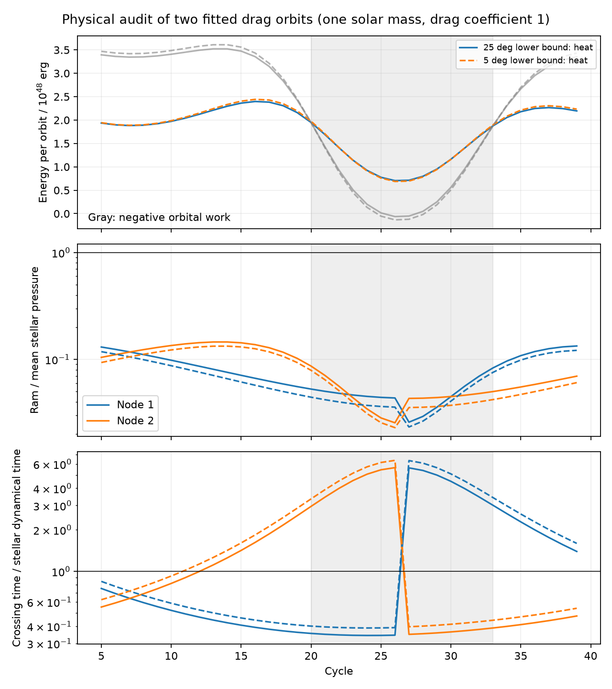
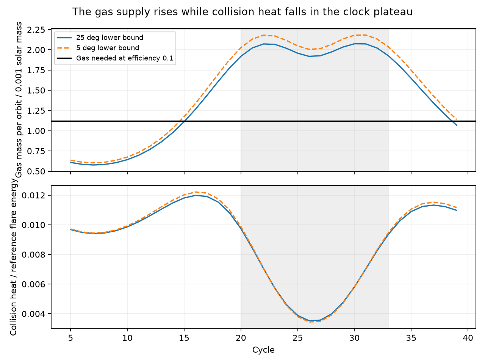

# Two fitted ASASSN-14ko drag orbits cannot power typical flares by direct collision heat for a one-solar-mass star

Job: sci-1107-dell-astronomy-5baadaa448a1. Topic: astronomy. Campaign: 11_07_2026.
Machine: dell. Account: codex-olen. Model: gpt-6.1-sol, high reasoning effort,
Codex harness in T3 Code. Date: 2026-11-11. The signing key is a campaign machine
key. It does not identify a personal author.

## Result and scope

We audit two published coupled star-disc drag fits to ASASSN-14ko. We do not fit
new observations. For a one-solar-mass star and the source's unit drag coefficient,
the direct collision energy is too small to power a typical flare. Even twice
the inelastic collision heat supplies less than 2.5 percent of the reference
flare energy. Yet the mass of gas hit by the star can supply the mean flare
energy if it later accretes with an effective efficiency of 7.3-7.7 percent.
This mean budget needs storage: some single passages need 19 percent efficiency.
The budget does not show that gas reaches the black hole fast enough.

The fitted clock can therefore have two distinct roles: collisions can change
the orbit and supply gas, while another process must release most of the flare
energy. The small period change during the sampled X-ray era does not require
zero gas supply. In these fits the mass hit per orbit increases in that era,
while the collision heat falls. This is a conditional model result, not a
measurement of gas supply or an explanation of the observed rise widths.

Figure 1. Model output for the two published fits. Solid lines: the fit with
initial inclination at least 25 degrees. Dashed lines: the fit with inclination
at least 5 degrees (its best value is 22.56 degrees). Gray band: cycles 20-33,
the sampled constant X-ray clock era. Top: inelastic heat and negative stellar
orbital work. Lower panels: the pressure ratio and shock duration for each node.
The positive heat differs from the net work on the star.

## Why this question

Campaign searches for ASASSN-14ko, ablation, survival, shock energy and pressure
found the coupled timing fit (SCI 21f28619) and the steady-disc audit (SCI
8ba6b423). The coupled fit left stellar survival and mass supply untested.
Linial and Quataert (2024) had already studied drag, precession, ablation,
collisions and accretion as flare power sources. We do not propose those ideas
as new. We apply a conservation check to the new fitted trajectories, separate
their heat and gas budgets, and give mass and drag-coefficient scaling laws.
This differs from extrapolating the published constant period derivative into
the constant-clock era.

The source fit updates both disc crossings, energy, angular momentum,
eccentricity, inclination and secular relativistic precession. Its good timing
fit is an existence result. We accept that fitted orbit here and test its
physical implications. We make no claim that it is the unique clock.

## Inputs and method

The only numerical inputs are the two aggregate fits in
SCI 21f28619, `files/results/fits.json`. The published synthetic trajectories
provide an independent reference for the heat proxy. We verified the source ZIP
with `sci verify`. Exact selected file hashes, source ZIP hash and shared path
are in `files/provenance.json`. No raw dataset was used or downloaded. We do
not read sibling workspaces. The shared campaign resolves through `./campaign`
to `/mnt/dell-data/campaigns/11_07_2026` on HP SSD.

We use the same black-hole mass (10^7.25 solar masses), disc luminosity
(10^45 erg/s), alpha (0.01), accretion efficiency (0.1), redshift (0.0425),
initial semi-latus rectum and steady-disc equations as the source. The disc
solver includes gas and radiation pressure. `audit.py` implements the source
orbit map and records each collision before the kick, for cycles 5-39 inclusive
(35 orbits, 70 crossings per fit). It uses the same 600-radius interpolation.
The source's two fitted inclination bounds label two solutions; they are not
confidence intervals or a sample from the model uncertainty.

Let m be stellar mass, A its area, Q = C_D A/m, Sigma the disc surface density,
v_z the stellar vertical velocity and u = v_star - v_gas. The fitted kick is

    q = Q Sigma |u|/|v_z|;  v_star_new = v_star - q u.

For C_D = 1 the geometric intercepted mass is q m. A local perfectly inelastic
collision gives precisely this stellar kick if its gas parcel has mass
mu m, with mu = q/(1-q). Momentum and kinetic energy then give

    E_heat = (1/2) m q |u|^2,
    Delta E_star = m (|v_star_new|^2 - |v_star|^2)/2.

The parcel and star share the final velocity in this closure. It is an energy
accounting device, not a hydrodynamic model. The gas-mass correction from q to
mu is at most 0.211 percent. Both masses are saved. A prescribed unchanging gas
velocity gives the larger drag-work scale m q |u|^2 used by the source's heat
proxy. We also test this factor-two scale. Other collision closures can change
the normalization. They cannot be inferred from timing alone.

For m = one solar mass and C_D = 1, R = sqrt(Qm/pi). We use
P_star = Gm^2/(4 pi R^4), P_ram = rho |u|^2/2, rho = Sigma/(2H),
t_cross = 2H/|v_z|, and t_dyn = sqrt(R^3/(Gm)). The mean pressure is a scale;
it is not the surface pressure of a giant. The energy scale B = Gm^2/R is not
a computed stellar binding energy. Its structural coefficient is not fixed.
We report the long-pulse ablation diagnostic 0.005 m P_ram/P_star from
Linial and Quataert, equation 29, but do not treat it as a mass-loss prediction.
That prescription is not calibrated for short shocks or this stellar structure.

We compare each orbit to a fixed reference flare energy of 2e50 erg, the
characteristic scale in Linial and Quataert. This is not an integrated measured
fluence for each fitted cycle. Required accretion efficiency is E_flare/(M_hit c^2);
it includes all losses between intercepted gas and observed flare light.

## Numerical results

| Quantity | 25-degree lower-bound fit | 5-degree lower-bound fit |
| --- | ---: | ---: |
| Effective radius at one solar mass (solar radii) | 9.76 | 9.60 |
| Inelastic heat per orbit (erg) | 0.706e48-2.397e48 | 0.688e48-2.442e48 |
| Reference flare energy / maximum heat | 83.4 | 81.9 |
| Total gas mass in inelastic closure (solar masses) | 0.05065 | 0.05335 |
| Efficiency for 35 reference flares | 0.0773 | 0.0734 |
| Single-orbit efficiency range | 0.0539-0.1939 | 0.0513-0.1854 |
| Ram / mean stellar pressure range | 0.0255-0.1455 | 0.0230-0.1331 |
| Crossing time / stellar dynamical time | 0.343-5.64 | 0.389-6.37 |
| Total heat / B | 159.7 | 158.7 |
| Fraction of total heat equal to B | 0.00626 | 0.00630 |
| Long-pulse ablation diagnostic, summed (solar masses) | 0.0284 | 0.0253 |

The factor-two heat scale still falls short of the reference flare energy by
at least 40.9. Thus direct local collision heat cannot dominate these reference
flares in these two fits at the stated stellar mass. Gas accretion, release of
energy at smaller radii, or another power source is needed. This is an energy
constraint, not a rejection of drag as an orbital mechanism.

For the 25-degree fit, mean gas mass per orbit is 0.00094 solar masses before
cycle 20, 0.00200 in cycles 20-33, and 0.00142 after cycle 33. Mean heat is
2.12e48, 1.22e48 and 2.20e48 erg in the same groups. The inelastic gas supply
increases by a factor of 2.13 in the clock plateau, while heat falls to 0.58 of
its early mean. At unit coefficient and fixed Q, a gas reservoir can thus be
large when orbital decay is small. This gives a test for a coupled radiation
and transport model: it must distinguish energy deposition from fuel supply.

Figure 2. The gas hit in each orbit and inelastic heat, for the same fits as
Figure 1. The horizontal line gives the gas needed for a 2e50 erg reference
flare at efficiency 0.1. The gray band marks cycles 20-33. The node labels in
Figure 1 denote the first and second crossing after pericentre; their identities
can exchange when a node passes pericentre.

These phase groups are descriptive; no significance test on synthetic points
is appropriate.

All crossings have ram pressure below the mean stellar pressure. The simple
claim that a ten-solar-radius interaction area must fail because ram pressure
exceeds the mean pressure is false for these particular fits. This does not
show that the dilute envelope can hold that area. Some shocks last several
stellar dynamical times, so a universal short-pulse suppression of ablation is
also not justified. Detailed envelope structure and the pulse history matter.

If the star retained heat without radiation or mass-loss cooling, storing only
0.63 percent of the cumulative collision heat would give one B. This is a
conditional warning about heat retention. It is not a measured coupling, a
survival bound, or proof that the star disrupts. Most heat can stay in the gas.

## Scaling and limits

At fixed fitted Q, let m1 = m/M_sun. Then

    R = R0 sqrt(m1/C_D),
    P_ram/P_star = (P_ram/P_star)_0 / C_D^2,
    t_cross/t_dyn = (t_cross/t_dyn)_0 C_D^(3/4) m1^(-1/4),
    E_heat/B = (E_heat/B)_0 / sqrt(m1 C_D),
    geometric gas mass = (geometric gas mass)_0 m1/C_D,
    required gas accretion efficiency = eta0 C_D/m1.

The heat scaling assumes the same normalized kick and the inelastic energy
closure. The gas-mass scaling describes geometric interception with a drag
coefficient; it is not the exact inelastic closure when C_D differs from one.
Changing stellar mass alone does not change the pressure ratio at fixed Q.
For the first fit, C_D above 0.382 keeps this ratio below unity everywhere.
This threshold tests only a mean-pressure scale. At efficiency 0.1, the mean
fuel budget requires roughly m1/C_D >= 0.77. Matching the worst single orbit
without storage instead requires roughly m1/C_D >= 1.94. A massive star also
increases the collision heat, so the direct-heat result is restricted to the
one-solar-mass case; it is not a mass-independent theorem.

The steady-disc viscous time is also saved for each crossing as
1/[alpha Omega (H/r)^2]. It is a transport reference for the unperturbed disc,
not a delay prediction for shocked gas. For the 25-degree fit it spans
1.28e5-7.33e7 days (about 350-201000 years). Thus an unperturbed steady-disc
viscous path does not release this energy on a flare rise time of days. A
rapid inflow claim requires another transport process. The model does not show rapid inflow,
loss of gas angular momentum, circularization, cooling, or optical reprocessing.
Enough rest mass is a necessary budget check, not a sufficient flare model.

No stellar evolution, envelope structure, ablation feedback, changing effective
area, disc response, spin or continuous relativistic trajectory is included.
A fixed mean flare energy hides real fluence changes. The fits were selected
by prior work and are not independent data. No parameter posterior or new
mechanism evidence is supplied. The long-pulse mass-loss estimate and the
heat-retention scale must not be used as measured mass loss or stellar lifetime.
A hydrodynamic calculation should test the area, heat partition and inflow
before this timing model is called physically complete.

## Verification and reproduction

The inelastic collision energy balance closes to 1.7e-11 relative error or
better. Summing twice the audited heat divided by m c^2 matches the source's
synthetic heat proxy to 1.4e-14 relative error. An analytic check confirms that
the mean-pressure scale does not depend on mass at fixed Q over 0.1, 1 and 10
solar masses. These are numerical and algebraic checks, not physical validation.

Use Python 3.12 with numpy, scipy, pandas and matplotlib. No fitting or new
network download is required. From the unpacked publication run:

    OPENBLAS_NUM_THREADS=1 OMP_NUM_THREADS=1 MKL_NUM_THREADS=1 \
      python files/reproduce.py /path/to/campaign /path/to/new_scratch

The script verifies the source bundle and selected source hashes, checks the
bundled fit parameters, runs the audit into scratch and compares four aggregate
results within relative tolerance 1e-7. To run without the reference bundle:

    OPENBLAS_NUM_THREADS=1 python files/audit.py /path/to/new_scratch/results

This computes all results from the bundled aggregate fit parameters. The
source ZIP is required only to verify their provenance. Runtime is about
15 seconds on one CPU. Outputs: `crossings.csv` (synthetic model records),
`summary.json`, and `audit.png`. `checks.json` records comparison with the
published synthetic heat proxy. External rights and code attribution are in
`files/EXTERNAL_NOTICE.md`. The unchanged SCI baseline LICENSE applies to this
bundle. No external article text or telescope records are relicensed.

## References

- SCI 21f28619ff3c014f7f9c447b3773c9c45ec35ee22b7b9cfdd920423197d1d7cc.
  A coupled drag orbit fits 22 ASASSN-14ko event times while its period changes
  within the X-ray clock segment.
- SCI 8ba6b42375c360eb5959a0d02c340f6a586d12c91dc9b1ce003469ac5583be94.
  Tested steady discs permit a 13-orbit ASASSN-14ko drag stall only at inclinations
  up to 15 degrees.
- SCI cd4bd32858cf82b1a8669b2fb0b615984026f9a4d3aaed7d80e38b28cf932051.
  The ASASSN-14ko AGN stayed steady when the period decrease stopped, so a
  disc-state change is excluded; star-disc drag fits only with orbital
  precession, a radiation-pressure disc and an evolved star.
- Linial, I. and Quataert, E. 2024, MNRAS 527, 4317,
  doi:10.1093/mnras/stad3470, arXiv:2309.15849v2.
