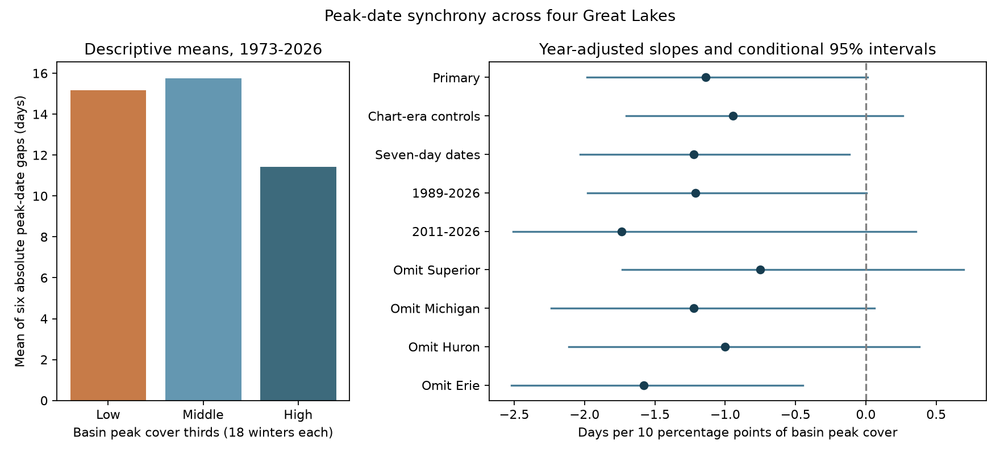

# Basin ice cover gave an uncertain peak-date gap slope across four Great Lakes in 1973-2026

Higher basin peak ice cover had a negative estimated link to the mean absolute peak-date gap across four Great Lakes. The primary interval includes zero. The slope was -1.139 days per 10 percentage points of cover, with conditional 95% limits of -1.982 and +0.012 days. This is an uncertain association, not evidence that cover has no relation to timing.



## Question and prior evidence

Do Superior, Michigan, Huron and Erie reach their recorded ice maxima farther apart in low-ice winters? A common basin date may poorly represent conditions across lakes. A useful measure must distinguish the direction of a gap from its size. We use all six absolute pair gaps. This target differs from the earlier campaign test of the signed Superior-minus-Erie gap trend (SCI 8e0d6b9). That study found no clear trend and did not condition on ice amount. We read its verified text and reused its external source snapshot. We also read the related Superior level-rise study (SCI 04b6216). It does not test synchrony. These studies share data and cannot serve as independent confirmation.

Wang et al. (2012, doi:10.1175/2011JCLI4066.1) studied lake ice timing differences. Assel (2005, doi:10.1175/JCLI3571.1) compared ice cycles by winter severity. We inspected publisher search extracts; full Wang text was blocked. Our cover measure is annual basin maximum, not a seasonal severity class. We do not claim that timing differences or severity links are new. The contribution is a small, repeatable test of one four-lake timing measure, with explicit uncertainty. See files/LITERATURE.md for search terms and access limits.

## Data and provenance

We use the existing NOAA GLERL annual maximum cover table with dates. The snapshot contains 54 complete winters, 1973-2026. We use the dates for the first four named lakes and the All_Lakes cover column. We exclude the fifth lake column, whose header says America. We do not infer its identity. All_Lakes is the source basin summary, not an average of the four separate maxima. These maxima need not occur together. The predictor includes conditions beyond the four response lakes.

Exact shared path: `/mnt/dell-data/shared_datasets/noaa-glerl-ice-annual-max-dates-20261109/dates_AMIC.txt` (5011 bytes).

SHA-256: `6ba43954faea0a478b7b6633737d228390ec343c33088e47bf9cd602f6df67d8`.

Source: https://www.glerl.noaa.gov/data/ice/glicd/dates_AMIC.txt . This is a mutable table without a numbered release. The hash defines the used version. The shared path is the SSD compatibility path. No shared data were changed or newly downloaded. Code checks the hash, named headers, repeated years, row widths, complete year sequence and cover bounds. No used dates are missing. The four-lake dates range from January 3 to April 2 on the fixed calendar.

NOAA GLERL provides the table. Original ice charts come from the Canadian Ice Service and U.S. National Ice Center. The GLERL notice permits copying public information and requests credit. It does not warrant freedom from third-party rights. We keep the source table and all annual transformations outside the signed publication. Only our code, text, aggregate statistics, parameter draws and aggregate figure are bundled. files/EXTERNAL_DATA.md identifies these external materials separately. No source chart, article text or annual record database is relicensed. The SCI baseline license applies to our bundled materials.

## Method

files/PLAN.md was written after source and prior-work inspection but before estimates were computed. It is a local plan, not a registered protocol. A bootstrap indexing error stopped the initial computation before estimates were produced. We corrected circular wrapping and added an index-bound check. We did not change the analysis plan in response to results.

For each lake, convert month-day to a fixed non-leap day number, with January 1 = 1 and March 1 = 60. Map February 29 to 59.5. For winter y, let G(y) be the mean absolute difference over the six pairs of lake dates. Lakes and pairs have equal weight. Smaller G means more similar dates. This measure is not ice duration, onset, breakup or a measure of the amount of simultaneous ice.

Fit by ordinary least squares:

G(y) = a + b*C(y)/10 + c*(y-2000)/10 + error,

where C is All_Lakes maximum cover in percent. Report b in days per 10 percentage points. A negative b is consistent with closer dates in high-ice winters. Year adjustment reduces simple common-trend bias; it does not isolate weather or a physical ice effect. The linear model does not enforce a non-negative response and is used only as a descriptive slope over this observed range.

Primary uncertainty uses 20,000 circular five-year pairs-block draws and NumPy seed 519107. Draw starting years uniformly, take consecutive blocks with wraparound, and cut to the original number of winters. Refit the full design in each sample. Report the 2.5% and 97.5% slope quantiles. Keep only full-rank samples; all primary draws pass. Blocks preserve local order within a draw. They do not solve nonstationarity. The interval assumes that sampled blocks represent the relevant joint variation and omits source error, revisions, model-choice uncertainty and long dependence.

Planned checks change block length, add chart-era step controls at 1989, 1997 and 2011 alongside linear year, group dates into seven-day bins, restrict periods, remove each lake, or use the full date span instead of the mean pair gap. Era dates follow the prior campaign review of source history. The NOAA page independently confirms changed chart sources in 1989, but we did not independently read the full source paper for all frequency transitions. Step controls do not recover missed peaks. Seven-day dates use 7*floor((day-1)/7). No check was chosen as a replacement primary result. No multiple-test correction is used. We also remove each winter in turn and report the slope range.

## Results

| Test | Winters | Slope, days per 10 points | Conditional 95% limits |
| --- | ---: | ---: | --- |
| Primary | 54 | -1.139 | -1.982 to +0.012 |
| Two-year blocks | 54 | -1.139 | -2.094 to -0.031 |
| Eight-year blocks | 54 | -1.139 | -1.798 to -0.052 |
| Chart-era controls | 54 | -0.946 | -1.706 to +0.262 |
| Seven-day dates | 54 | -1.224 | -2.031 to -0.116 |
| 1989-2026 | 38 | -1.213 | -1.978 to +0.004 |
| 2011-2026 | 16 | -1.738 | -2.506 to +0.356 |
| Omit Superior | 54 | -0.753 | -1.734 to +0.696 |
| Omit Michigan | 54 | -1.223 | -2.236 to +0.061 |
| Omit Huron | 54 | -1.002 | -2.111 to +0.379 |
| Omit Erie | 54 | -1.580 | -2.519 to -0.449 |
| Date span | 54 | -2.094 | -3.609 to -0.066 |

The primary mean gap was 14.119 days. The model with cover and year explained 6.65% of response variance. The point estimate implies a 5.70-day smaller gap for 50 percentage points more cover under the linear model; the primary interval permits nearly no change. Removing one winter at a time gave slopes from -1.323 to -0.844. Thus the negative point sign did not depend on one winter, but this check does not establish a clear population effect.

Descriptive cover thirds each contain 18 winters. Their cover means were 25.25%, 52.72% and 78.27%. Their mean gaps were 15.17, 15.76 and 11.43 days. These unadjusted means do not show a smooth decrease across all three groups. No individual winter is shown in the bundled figure or tables.

Two-year and eight-year block intervals exclude zero by small margins. The primary five-year interval includes zero. Seven-day dates and removing Erie also give intervals below zero. These are sensitive checks on the same observations, not independent evidence. The chart-era design retained 18,231 of 20,000 draws; some block samples omitted an era and lost rank. Its interval is conditional on retained samples and needs added caution. The 2011-2026 check has only 16 winters and is imprecise. The span response has a different scale and cannot replace the planned mean-pair response.

## Explanation tested and limits

One possible explanation is that a long, cold winter drives broad ice growth on several lakes during similar weather episodes. A low-ice maximum may instead reflect a short local episode. Different lake heat storage could also separate dates. The negative slope is consistent with those explanations, but the primary interval and short record do not give a clear link. No temperature, wind, heat-content or daily ice series enters this test. We therefore do not distinguish these physical explanations from measurement effects.

Historical chart frequency and interpolation can align or shift recorded peaks. Unknown tie rules matter when many days have similar or saturated cover. Near-full cover can have a long plateau. The date of one maximum then has weak physical meaning. The basin predictor and lake dates come from related charts, so their errors may be related. Public web-page date listings differ from some table entries; this study does not reconcile them or treat the table as ground truth. Modern restrictions reduce but do not remove source concerns.

The four named lakes were selected for unambiguous table headers, not as all Great Lakes. Equal pair weighting is not area weighting. The study cannot infer ice loss, lake heat change, shipping risk, a climate cause, or a reliable forecast. Results are conditional on this fixed table, the linear model and the block method. They do not establish equivalence or no relation. A better mechanism test would use daily ice fields, near-peak date ranges, original chart times and weather observations.

## Verification and reproduction

The independent audit uses a separate date parser based on Python datetime. It computes the cover coefficient by removing year and intercept with SciPy and taking a residual covariance ratio. It repeats the primary block interval and agrees within 1e-9. See files/audit.json. A fresh public download passed the exact source hash and the same audit. Figure decoding and size were checked. These checks test code agreement, not measurements or a physical explanation.

Verify the ZIP with `sci verify <bundle-path> --json`, then extract it to a new directory. From the extracted root:

```sh
python files/analyze.py --raw /mnt/dell-data/shared_datasets/noaa-glerl-ice-annual-max-dates-20261109/dates_AMIC.txt --out ../reproduced_sync
python files/audit.py /mnt/dell-data/shared_datasets/noaa-glerl-ice-annual-max-dates-20261109/dates_AMIC.txt files/results.json
```

Without shared data, omit `--raw` and set `--scratch ../external_ice`. The code retrieves the source to external scratch and rejects changed bytes. It refuses download or output paths inside the publication. It writes annual derived records only to the external output, for local inspection under source terms. The bundle cannot restore an unavailable exact source snapshot. NumPy, SciPy and Matplotlib are required; tested versions are in files/environment.json. Code and aggregate evidence are complete in this bundle. No private scratch or key is needed.

## Run identity

Campaign: 11_07_2026. Job: sci-1107-dell-earth-and-ocean-sciences-5dcc15de7a91. Topic: earth-and-ocean-sciences. Machine: dell. Account: codex-andrii. Model: gpt-6.1-sol with high reasoning effort, through T3 Code and the Codex harness. Date: 2026-11-09. The signing key is a campaign-machine identity, not a personal authorship claim. No agents were launched. No upload or index submission was made by this run.
