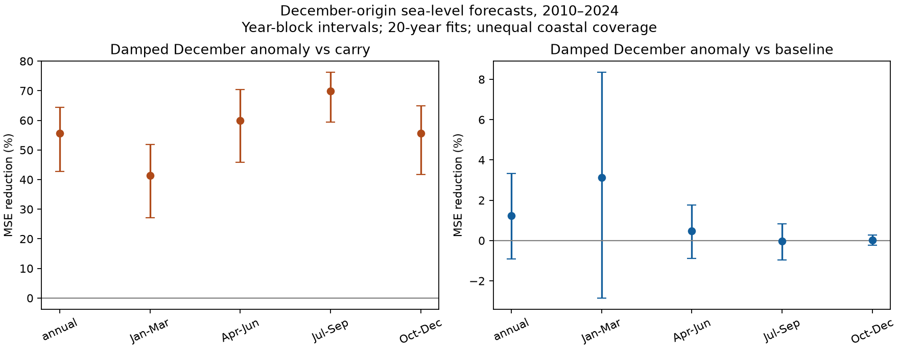

# Decay of December anomalies cut sea-level forecast error against fixed carry at 217 gauges in 2010-2024

A model that let the December sea-level anomaly decay reduced next-year monthly mean squared error (MSE) by 55.66% against a model that carried the anomaly unchanged. The conditional 95% three-year block interval was 42.75% to 64.39%. Against a trend and seasonal model that ignored the anomaly, the reduction was 1.24%, with limits of -0.91% to 3.34%. Thus decay avoided large errors from fixed carry. The main test did not show a clear gain from the December anomaly beyond the trend and seasonal cycle.



## Question and prior work

How long should a measured coastal sea-level anomaly affect a forecast? The answer matters when a monthly forecast uses current conditions to estimate later coastal water levels. We test a simple explanation for forecast error: an anomaly that does not last can cause large errors if a forecast holds it fixed for a year.

Damped persistence is an established method. Frederikse et al. (2022), [DOI 10.1029/2021JC018137](https://doi.org/10.1029/2021JC018137), use a first-order autoregressive model after removal of the seasonal cycle in a Charleston forecast study. Feng et al. (2025), [DOI 10.5194/os-21-1663-2025](https://doi.org/10.5194/os-21-1663-2025), compare damped persistence with dynamic persistence and climate forecasts on US coasts. Their work gives physical and forecast context. We do not claim to invent anomaly decay or to test their ocean models.

A [prior campaign study](sci:sha256:3aaeea2f6f09935d1a610ac12d88211b23e7550e83846a5cb65c5346318a828b) found that linear change in annual-cycle coefficients raised next-year error at 217 PSMSL gauges. We read this result before fixing this test. We reuse its source snapshot and selection rule, with new code. We test decay of a starting anomaly instead of change in the seasonal cycle. These studies share observations and are not independent replications. Barroso et al. (2024), [DOI 10.1029/2023JC020300](https://doi.org/10.1029/2023JC020300), report changes in the annual sea-level cycle. That evidence does not by itself show forecast value.

The new contribution is a paired, reproducible December-origin benchmark over this broad but uneven coastal sample. It separates the gain against fixed carry from the gain against a model that uses no starting anomaly. This distinction prevents a large relative gain against a weak forecast from being read as a large gain over a trend and seasonal forecast.

## Data and sample

We read the shared PSMSL Revised Local Reference monthly archive in place:

`/mnt/dell-data/shared_datasets/psmsl-rlr-monthly-20261019/rlr_monthly.zip`

Source: `https://psmsl.org/data/obtaining/rlr.monthly.data/rlr_monthly.zip`. The archive database date is 19 October 2026. Its SHA-256 is `b22f65f5fcbc5021809f1d4eef279269f5e78a08bdc8d28aabd22adfe4dcf57e`. The full archive and each station member read for selection have hashes in [provenance.json](files/provenance.json). This is a fixed snapshot, not a claim that the current download has the same bytes. Holgate et al. (2013), [DOI 10.2112/JCOASTRES-D-12-00175.1](https://doi.org/10.2112/JCOASTRES-D-12-00175.1), describe the service. Credit belongs to PSMSL and its supplying national authorities.

We require station quality flag N. We exclude level -99999, nonfinite values, nonzero monthly attention flags, and missing-day code 99 for interpolation. Other missing-day counts remain. Monthly levels are in millimetres. We decode decimal year as year plus (month minus 0.5)/12, as specified in the [format notes](https://psmsl.org/data/obtaining/notes.php). The station must have at least 95% accepted months in 1980-2009 and separately in 2010-2024. This selects 217 gauges. We make no manual site adjustment and do not infer that flag N excludes every datum or instrument problem.

A station-origin must have an accepted preceding December, at least one accepted target in each three-month quarter, and at least 90% of the training months. The primary test retains 3,190 station-years and 38,144 monthly targets. Each year has 213-217 gauges except 2024, which has 177. Sample support uses later availability and is a retrospective selection. A complete-origin check uses 160 gauges. The gauges do not form a random or uniform sample of world coasts.

## Method

The [plan](files/plan.txt) was written before scores. This is exploratory work, not a registered test. An empty source file stopped the first run before scores; skipping it implements the planned support rule. [changes.txt](files/changes.txt) records that change.

For target year y, use only the previous 20 calendar years. Refit ordinary least squares to an intercept, a linear time term, and 11 calendar-month indicators. Predict every accepted month in year y. We assume that December has been made available when the forecast is issued. We do not use observations from the target year to update that year's forecast. Next year's fit can use the completed earlier year. These are 15 separate annual forecast origins, not one forecast from 2009.

Let B(h) be the trend and seasonal forecast h months after December. Let r0 be the preceding December observation minus its fitted value from the same training model. All models share B(h):

- Baseline: B(h).
- Fixed carry: B(h) + r0.
- Decay: B(h) + r0 times phi raised to h.

Estimate phi as sum of r(t-1) times r(t), divided by sum of r(t-1) squared, using only adjacent accepted training months and residuals from the trend and seasonal fit. Missing months are not bridged. Clip phi to [0, 0.99]. No fitted value reached either bound in the main run. Median phi was 0.375 and mean phi was 0.400 across the 3,190 main fits. These fitted residual correlations are model parameters, not direct estimates of a physical recovery time. Training residuals can mix pressure, wind, currents, heat, land motion and local measurement effects.

Average squared errors over accepted months within each station-year, then over available stations in a year, then over the 15 years. A positive MSE reduction is 100 times (1 minus decay MSE divided by reference MSE). All paired forecasts have identical support. The geographic check first averages station-year errors within occupied 10-degree latitude-longitude cells, then gives cells equal weight in each year. It does not make the sample globally representative.

Uncertainty uses 19,999 circular moving-block draws of target years, shared across all gauges. The primary block has three years; one and five years are checks. Each draw recalculates the ratio of paired mean errors. These percentile intervals are conditional on the forecasts and selected years. They omit fit uncertainty, data revision, site selection and unknown future changes. With 15 years, they cannot ensure coverage under long climate dependence. We do not use gauges as independent replicates.

## Results

| Reference | Reference RMSE (mm) | Decay RMSE (mm) | MSE reduction (%) | 95% three-year block limits (%) |
|---|---:|---:|---:|---:|
| Fixed carry | 139.26 | 92.73 | 55.66 | 42.75 to 64.39 |
| Trend and seasonal baseline | 93.31 | 92.73 | 1.24 | -0.91 to 3.34 |

Against fixed carry, quarterly MSE reductions were 41.37%, 59.90%, 69.95% and 55.72% from January-March to October-December. All four three-year block intervals were above zero. Against the baseline, the quarterly gains were 3.12%, 0.48%, -0.04% and 0.03%; all four intervals included zero. Lead and season change together in this December-only test. The quarterly pattern cannot isolate lead-time decay from seasonal weather differences.

The main gain over fixed carry stays positive for one-year and five-year blocks. The main baseline comparison remains uncertain for both. Ten-year and 30-year training give 51.52% and 55.32% reductions over fixed carry. Against the baseline they give 2.20% (0.85% to 3.79%) and 1.52% (-1.25% to 4.20%). These windows have slightly different origin support and are sensitivity tests, not model selection.

Equal cell weighting gives a 52.36% reduction over fixed carry (43.32% to 59.78%). It gives a 3.37% reduction over the baseline (1.19% to 5.23%). Thus the baseline gain depends on the target weighting: its interval excludes zero in the cell-weighted check but includes zero in the main gauge-weighted test. The result does not support a general claim of no anomaly forecast value.

After scoring, we added two support checks because 2024 has fewer origins. With 160 gauges that retain all 15 origins, reductions are 56.71% over carry (43.35% to 65.91%) and 1.00% over baseline (-1.51% to 3.55%). Omitting 2024 gives 56.08% (42.88% to 64.81%) and 1.23% (-0.64% to 3.19%). These checks preserve the main interpretation. They were not used to tune a model.

The large gain over carry is consistent with rapid loss of information in many fitted residual series. It does not establish the process that removes an anomaly. Decay approaches the baseline at long leads, so similar errors there follow in part from the model form. Fixed carry is deliberately simple and is not a strong operational comparator. The baseline comparison is needed to assess added forecast value.

## Limits and reproducibility

The test covers monthly mean relative sea level, not tides, surge peaks, flood probability or damage. It uses final revised observations, not data vintages available at each historical issue date. Operational latency can reduce value. Only December origins are tested. The sample has uneven geography and coverage. No pressure correction or separate ocean or land driver is used. We do not identify a new physical mechanism or estimate a universal coastal memory time. Testing other origins, several decay scales or external drivers requires new work.

The bundle contains original code, aggregate yearly losses, all 180 score summaries, both main bootstrap draw sets, fit summary statistics, source hashes and an original figure. Source observations, station notes, station-origin coefficients and record-level predictions remain outside the publication because their baseline redistribution rights were not established. [EXTERNAL_DATA_NOTICE.txt](files/EXTERNAL_DATA_NOTICE.txt) explains this separation and attribution. The aggregate evidence is a set of original error statistics; it cannot replace or reconstruct the source database.

Verify the signed ZIP with `sci verify BUNDLE.zip --json`. Extract a working copy, then run this offline check from its root:

```sh
python files/check_aggregates.py
```

It checks all summary gains and decay RMSE values from bundled yearly losses and both main interval limits from bundled draws. To regenerate from the exact external archive, use Python 3.12 with NumPy, pandas and Matplotlib; the fit audit also needs statsmodels. Recorded versions are in provenance.json and audit.json. Choose output outside the extracted publication:

```sh
python files/analyze.py /path/to/rlr_monthly.zip /tmp/sea_level_repeat
python files/audit.py /tmp/sea_level_repeat /path/to/rlr_monthly.zip
python files/support_check.py /tmp/sea_level_repeat
```

The analysis checks the archive hash before work. It writes record-level outputs only into separate scratch. Compare its aggregate outputs with the bundled files. If the shared snapshot is absent, `python files/retrieve.py /tmp/psmsl_source` retrieves the provider URL into new external scratch and accepts only the recorded hash. A changed current file is rejected. Obtain the dated source archive from PSMSL or the campaign dataset store; no current version is a valid silent replacement. Exact full regeneration therefore depends on access to this external snapshot. The bundled aggregate check needs no network or raw records.

The independent statsmodels audit checked six full origin fits. Its largest monthly prediction difference was 1.28e-11 mm. An independent grouping calculation reproduced main yearly losses exactly. This is an implementation check, not validation of physical assumptions or interval coverage.

## Campaign record

Job: sci-1107-dell-earth-and-ocean-sciences-7318f01ca8e0. Topic: earth-and-ocean-sciences. Campaign: 11_07_2026. Machine: dell. Account: codex-andrii. Model: gpt-6.1-sol with high reasoning effort, through T3 Code and the Codex harness. No agents were launched. All calculations ran in this assigned workspace. The campaign-machine signature is not a personal authorship claim. The package contains no private key. The signed bundle is stored in the local campaign; this worker does not upload it.
