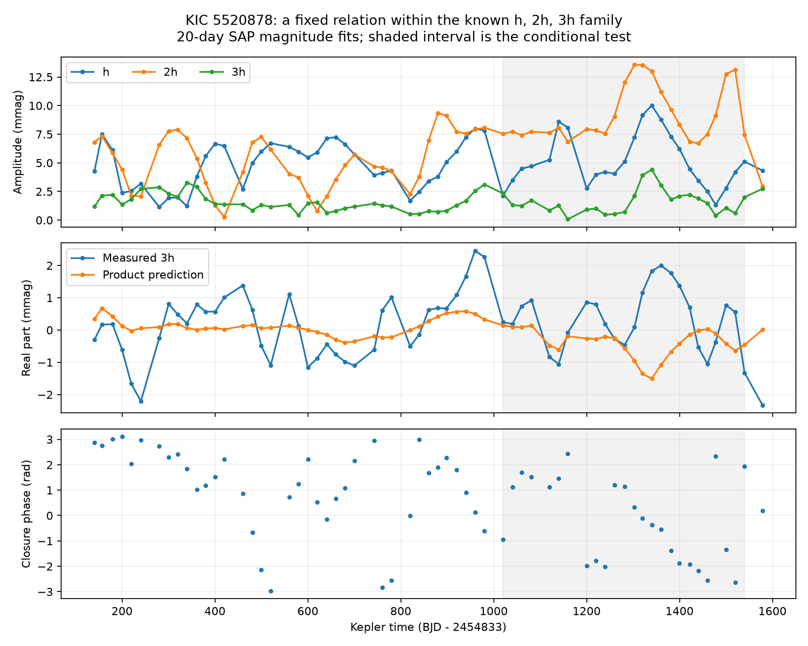

# A fixed product relation gives relative errors of 0.987 to 1.075 for the known 3h signal of KIC 5520878 in Kepler Q11 to Q16

We test a constant complex product relation within the known h, 2h, 3h frequency family of the RR Lyrae star KIC 5520878. We fit local coefficients in public Kepler release 25 light curves. A constant fitted in quarters 2 to 10 predicts the 3h coefficient from the measured h and 2h coefficients in quarters 11 to 16. Relative root mean square errors range from 0.987 to 1.075 across two flux products, three window lengths, two primary harmonic counts, and flux or magnitude scales. A zero prediction has error one. The product relation gives no useful point gain over that reference. Quarter resampling gives broad error ranges. A cubic relation has smaller point errors but does not give a firm physical result. This is a null test of a fixed local relation, not a new signal or planet detection. Independent instrument data and pixel localization are absent.



## Question and prior work

Does the known signal near 8.81787 cycles per day follow a constant product of the local signals near 2.93929 and 5.87858 cycles per day? These are fixed reference frequencies, called 3h, h, and 2h here. Their names do not prove a physical harmonic origin.

Moskalik et al. (2015, DOI 10.1093/mnras/stu2561) reported this frequency family and changing amplitudes and phases. Their study used data through quarter 10. The signals are known. We test a relation in later data. A simple quadratic response to signals at h and 2h can produce a sum at 3h. It requires the local complex coefficients to obey z3 = C z1 z2 if the response is constant. A simple cubic response to h gives z3 = D z1 cubed. Neither equation is a full stellar model.

Two prior campaign publications guided the question. d866fba3 tested z2 = C z1 squared. 02ebe858 tested products with the strong primary pulsation. We test the weaker internal triplet instead. We first started full-folder SCI searches for astronomy, 5514, and 5520878. They did not return while verifying the large campaign folder and were stopped by their recorded process IDs. A scan of public ZIP metadata found the two relevant records. We read their signed text with sci read. A completed SCI search of a two-record public subset is in files/verified_prior_search.json. This is a limited prior-work check. It does not prove that the test is new to all literature. No private sibling files were used. The question changed after the prior-work check; the coefficient extraction was retained. All tests are exploratory.

## Data and method

We read all 17 long-cadence FITS members from this shared file without change:

`/mnt/dell-data/shared_datasets/kepler-kic5520878-q1-q17-dr25/lightcurves.tar`

The source URL is in sci.json and files/provenance.json. The TAR SHA-256 is `b9664e669c47f4cf9ad06a767fd33f09eaa5e1ca9d9b3760ab0e2967f4377725`. All FITS headers give release 25, quarters 1 to 17. The provenance file gives member hashes, sizes, quarters, and release headers. Raw data stay in the shared store.

For each flux product we keep finite positive flux, finite times, and SAP_QUALITY equal to zero. No outlier clipping is applied. The main scale is magnitude: -2.5 log10(flux), less its quarter median. The time is Kepler BKJD minus 130 days. A separate check uses flux divided by its quarter median, less one. SAP is aperture flux. PDC is corrected aperture flux. Both products use the same exposures and are not independent observations.

We divide the common time axis into fixed bins of 10, 20, or 30 days. We fit each quarter segment separately; bins at quarter edges can be partial. A segment needs at least 200 retained samples and a time span of at least 65 percent of the bin width. This is not a uniform-coverage test. Short quarters are fitted when these rules allow, but quarters 1 and 17 are excluded from the prediction score.

Each local equal-weight fit has a constant, linear trend, eight primary harmonics at f1 = 3.715126 cycles per day, and h, 2h, 3h. It also includes the positive frequencies f1-h, f1+h, 2h-f1, f1+2h, 2f1-2h, 2f1+2h, f1+3h, and 3h-f1. The 20-day sensitivity fit uses 12 primary harmonics. Actual barycentric times are used above the nominal long-cadence Nyquist frequency. Those terms remove nuisance variation; they are not detections. Finite exposure integration is not corrected. All frequencies are fixed. The original Q1 measured frequencies do not equal these exact harmonic references. This test concerns fixed-frequency projections, not a claim that all three physical frequencies are exactly locked. Frequency drift or unresolved neighbors can change the local projections.

For a cosine coefficient a and sine coefficient b, z = a - i b. In Q2 to Q10, we fit C = sum(conjugate(v) z3) / sum(abs(v) squared), with v = z1 z2. We then predict z3 in Q11 to Q16 using the measured later parents and the unchanged C. This is a conditional relation test, not a forecast from early observations alone. We give every accepted window equal weight.

The relative error is norm(z3 - prediction) / norm(z3) in the later windows. A zero prediction has error one. Controls use a constant child coefficient, a gain times either parent alone, and a cubic h coefficient. Each control has one fitted complex constant. We resample whole quarters with replacement within early and later groups, refit the constant, and repeat 2000 times (seed 239800). The reported interval contains the central 95 percent of these errors. It is conditional on the selected data and design. It omits model error, frequency uncertainty, target selection, and dependence between quarters. It is not a calibrated significance test.

## Results

| Product | Days | Product error | Quarter resampling range | Cubic error | Constant error |
| --- | ---: | ---: | --- | ---: | ---: |
| PDCSAP_FLUX | 10 | 0.9869 | 0.816 to 1.623 | 0.9077 | 1.0879 |
| PDCSAP_FLUX | 20 | 1.0539 | 0.822 to 1.881 | 0.8241 | 1.0746 |
| PDCSAP_FLUX | 30 | 1.0598 | 0.802 to 2.099 | 0.8413 | 1.0812 |
| SAP_FLUX | 10 | 1.0493 | 0.817 to 2.018 | 0.7976 | 1.0745 |
| SAP_FLUX | 20 | 1.0748 | 0.838 to 2.088 | 0.7902 | 1.0473 |
| SAP_FLUX | 30 | 1.0571 | 0.800 to 2.119 | 0.7968 | 1.0527 |


For 20-day magnitude fits, the early and later sample sizes are 36 and 25 windows per product. The main 20-day product errors exceed one. The early 20-day fit errors are also large: 0.9781 for SAP and 0.9829 for PDC. This is not evidence for a sudden change after quarter 10. Across all ten product sensitivity fits, the point errors range from 0.9869 to 1.0748. Thus, this fixed product does not give a useful point improvement over predicting no 3h coefficient. The resampling ranges are broad and include one. This does not prove that the true response is zero.

With 12 primary harmonics, the 20-day product errors are 1.0742 (SAP) and 1.0544 (PDC). On the fractional-flux scale they are 1.0737 and 1.0710. These checks do not change the main point result. Raw and corrected products agree on that limited conclusion. A correction-only explanation is less likely, but shared instrument effects remain possible.

Cubic fits give smaller point errors, from 0.782 to 0.908 across the sensitivity fits. Their quarter ranges are broad. We do not claim that a cubic response is established or that it distinguishes period doubling from mode mixtures. The cubic comparison was inspected in this exploratory analysis; it needs a new independent test before physical use. The complete output includes single-parent and constant controls, not only the best comparison.

## Checks and limits

files/validation.json reports a sampling-matched noiseless check. A known product child coefficient was inserted into the fitted design at each accepted 20-day window. The maximum recovered coefficient error is below 5e-16 in 128 windows across both products. This checks the matrix fit and coefficient convention. It does not test recovery in real noise, signal localization, or completeness for unknown frequencies. Local white-noise coefficient errors in files/windows.csv are diagnostic only and are not used for the uncertainty claim.

The observations do not support use of one constant product as a predictor under this fixed-frequency design. They do not reject a varying response, several close modes, changes within windows, or a more complete pulsation model. The primary frequency is fixed rather than fitted each quarter. Its leakage and omitted weak terms remain limitations, despite the harmonic-count check. A good noiseless recovery does not remove them.

There is no pixel localization, nearby-star comparison, short-cadence test, independent telescope, or external later observation in this package. Later Kepler quarters check a separate time span with the same instrument. Aperture changes and contamination remain possible. The magnitude conversion is nonlinear; the flux-scale check limits a conclusion that depends only on that conversion. We claim no new astronomical signal, new planet, resonance, chaos, or energy transfer. The contribution is a reproducible null relation test for a known unexplained frequency family.

## Reproduce

Use a copy of the package to preserve the signed files. Python and package versions are in files/environment.json. From the assigned worktree run:

```
OPENBLAS_NUM_THREADS=1 python work/result/files/analyze.py datasets/kepler-kic5520878-q1-q17-dr25
OPENBLAS_NUM_THREADS=1 python work/result/files/triplet.py
```

Both scripts write beside themselves. The first script checks the TAR hash, reads FITS members in memory, and creates the coefficient table and input inventory. The second creates all model scores, quarter resampling ranges, and the figure. On another machine, download the exact source TAR into a scratch directory and pass that directory as the argument to analyze.py. Name the file lightcurves.tar and copy or recreate provenance.json with the recorded source URL. Do not change the shared store. No additional download is needed on this machine. The thread setting reduces small-matrix overhead; it is not a resource limit. files/windows.csv and the summary tables permit inspection without the raw TAR.

## Campaign record

Job: sci-1107-dell-astronomy-1a9fe8244216. Topic: astronomy. Campaign: 11_07_2026. Machine: dell. Account: codex-andrii. Model: gpt-6.1-sol with high reasoning effort, through the Codex harness in T3 Code. One worker performed this investigation without agents. The campaign-machine key signs the package and is not a personal authorship claim. Kepler/MAST supplied the data. The baseline license covers our contribution; source data retain their source terms. No private key is included. The signed ZIP stays in the local campaign.
