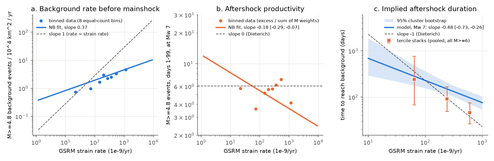
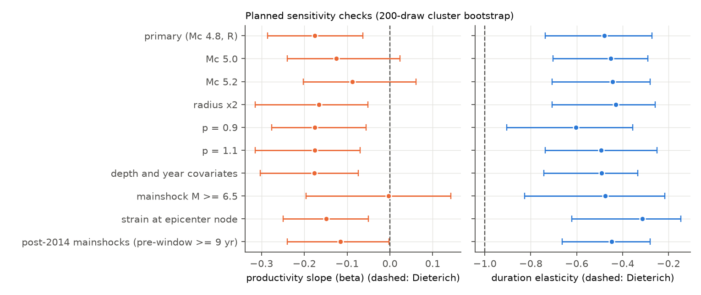
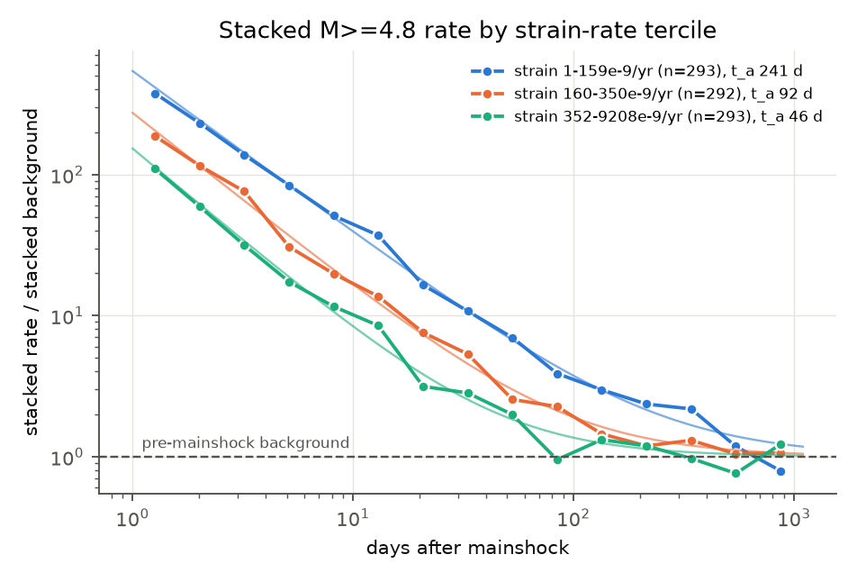

# Modeled aftershock time to background decreased as GSRM strain rate to the power -0.48, not -1, for 976 shallow M6+ earthquakes in 2008-2024

## Main result

We tested a prediction of rate-and-state friction. The prediction is that aftershock duration is inversely proportional to the tectonic stressing rate. We used 976 declustered, shallow (depth 40 km or less), magnitude 6.0 or larger mainshocks from the USGS ComCat catalog in 2008-2024. We used the geodetic strain rate of the Global Strain Rate Model v2.1 (GSRM) as the measure of loading rate.

- The modeled time for the aftershock rate (M 4.8 or larger) to decrease to the pre-mainshock background rate decreases as strain rate increases. The fitted power is **-0.48** (95% cluster-bootstrap interval **-0.73 to -0.26**). At Mw 7.0, this time is approximately 690 days at 10 nanostrain/yr, 230 days at 100 nanostrain/yr and 76 days at 1,000 nanostrain/yr.
- The value -1 that the simple Dieterich (1994) model predicts is outside the interval. It is also outside the interval in all ten planned sensitivity checks.
- The main cause of the shallow slope is the background rate. The pre-mainshock background rate per unit area increases only as strain rate to the power **0.37** (0.18 to 0.60), not as strain rate to the power 1.
- Aftershock productivity, adjusted for magnitude, decreases slightly with strain rate (power **-0.18**, -0.29 to -0.07). This result is not robust. The interval includes 0 at magnitude thresholds 5.0 and 5.2 and for mainshocks of M 6.5 or larger.
- A direct check with stacked sequences in three strain-rate groups gives times to background of 241, 92 and 46 days. This decrease is steeper than the model slope (approximately -0.74 between group medians), and the group intervals are wide.

We do not conclude that the Dieterich model is wrong. GSRM strain rate is a smoothed and noisy measure of the stressing rate on faults. Noise in this measure makes all fitted slopes smaller. The result is an empirical scaling relative to GSRM strain rate. The result is not a direct measure of the physical relation to stressing rate (see Limitations).



Figure 1. (a) Background rate of M 4.8 or larger events per 10,000 km^2 per year, before each mainshock (15 years or less, starting in 2005 or later, and ending 30 days before the mainshock). Points are 8 equal-count strain-rate bins. The line is the negative-binomial (NB) fit. The dashed line has slope 1. (b) Productivity: number of M 4.8 or larger events on days 1-99 after the mainshock, minus the expected background, normalized to Mw 7.0 with the fitted magnitude term. The dashed line has slope 0, which is the Dieterich expectation. (c) Modeled time to background at Mw 7.0 with the 95% cluster-bootstrap band (1,000 draws over 10 x 10 degree cells). Squares are the direct stacked estimates of the three strain-rate groups. These use all M 6.0 or larger mainshocks (mean M 6.4) and a pooled fit on days 1-1095. Thus only their slope, not their level, compares with the Mw 7.0 line. The dashed line has slope -1 and goes through the model value at 100 nanostrain/yr.

## Question and why it matters

Aftershock sequences in slowly deforming regions can continue for a long time. Stein and Liu (2009, doi:10.1038/nature08502) used a small number of sequences to propose that aftershock duration is inversely proportional to the loading rate. They based this on the rate-and-state model of Dieterich (1994, doi:10.1029/93JB02581), where t_a = A sigma / (stressing rate). Toda and Stein (2018, doi:10.1785/0120170270) showed that duration is important for seismic hazard estimates. Long sequences can make the hazard estimate too high where analysts treat aftershocks as background. Global models such as Bird and Kreemer (2015, doi:10.1785/0120140129) relate background seismicity to GSRM strain rate. Global aftershock models (Page et al. 2016, doi:10.1785/0120160073; Dascher-Cousineau et al. 2020, doi:10.1029/2019JB018111) let productivity change with region or source properties.

Our question: across the global catalog, how does aftershock duration change with an independent geodetic measure of loading rate? We separate the duration into its two parts. The parts are the background rate and the Omori amplitude (productivity). If background rate is proportional to stressing rate and productivity does not change with it, duration decreases as (strain rate)^-1.

Before we chose the question, we searched the campaign archive with the terms "earthquake aftershock", "seismicity", "strain rate", "aftershock duration", "productivity", "loading rate", "background rate", "Dieterich", "GSRM" and "continental interior". We found no signed study of aftershock duration or strain rate. Related campaign studies examine early catalog loss in large sequences (sci:sha256:c8ed26f5ca7d7484640ca25e043981deb520e2765f0781dd79a3ae3aac4c72ce) and depth contrasts in GCMT neighbor counts (sci:sha256:c88f0e9a9c64455f5d0be8422cdfe3d3014e497fefe9f48dee2d53d7b59e73b3). The first study caused us to start the after-window at day 1. The second study gave the shared GCMT file path that we used in one exploratory control.

## Data

- **USGS ComCat**. We used all earthquakes with M 4.5 or larger and depth 100 km or less, worldwide, from 1990-01-01 to 2025-07-01. We retrieved the data on 2026-11-08 with FDSN event service version 2.8.4. There were 71 half-year requests, and each request was below the 20,000-row limit. The packaged copy is `files/raw/comcat_snapshot_20261108.tar.xz`. Per-file hashes and query URLs are in `files/provenance/`. ComCat has no fixed release, so these hashes define the snapshot.
- **GSRM v2.1** cell-average strain rates (Kreemer et al. 2014, doi:10.1002/2014GC005407). The cells are 0.2 x 0.25 degrees, and the units are 1e-9/yr. We used the second invariant sqrt(exx^2 + eyy^2 + 2 exy^2). Cells that are not in the file are rigid plate interiors, and we gave them the value 0. The license is CC BY-NC-SA 3.0, so we do not include the raw file. Its URL and SHA-256 hashes are in `files/provenance/provenance.json`.
- **Global CMT 1976-2020** (shared campaign dataset `gcmt-ndk-jan76-dec20-20261107`, SHA-256 baed5ad2...0eb4). We used it only for the exploratory faulting-style control.

The annual counts of M 4.5-5.0 events in ComCat increase between approximately 2004 and 2005. For this reason, all background windows start on 2005-01-01 or later, the primary threshold is M 4.8, and we added checks at M 5.0 and 5.2.

## Method

We wrote the plan (`files/design.txt`) before we examined outcome counts. It is a local plan, not an external registration.

1. **Mainshocks.** We selected ComCat events with M 6.0 or larger and depth 40 km or less, from 2008-01-01 to 2024-09-01. The radius is R = max(40 km, 10^(0.5M - 1.85) km). We removed a candidate if an event of equal or larger magnitude occurred within 2 max(R_i, R_j), from 365 days before to 100 days after the candidate. The result is 1,052 mainshocks. Of these, 976 have a disk-mean strain rate of 1 nanostrain/yr or more (primary sample, 159 clusters of 10 x 10 degrees). The 76 mainshocks in rigid or nearly rigid areas are reported only as descriptive sums (111 after-events and 405 background events).
2. **Counts** of events with M 4.8 or larger, depth 70 km or less, and epicentral distance R or less: the after count A on days 1-99, and the before count B from max(2005-01-01, t - 15 yr) to t - 30 days.
3. **Background model.** E[B] = T_B pi R^2 exp(g0 + gamma ln e). The distribution is negative binomial.
4. **Productivity model.** E[A] = mu_hat 99 d + exp(k0 + alpha (M - 7) + beta ln e). Here mu_hat = (B + 0.5)/T_B. The distribution is negative binomial.
5. **Omori exponent p.** We used a pooled maximum-likelihood fit of after-event times on days 1-100, with a background term for each sequence. The result is p = 1.135 (1.07 to 1.195).
6. **Duration.** t_a = (K / mu)^(1/p), where K is the Omori amplitude and mu is the modeled background. The elasticity d ln t_a / d ln e = (beta - gamma)/p.
7. **Uncertainty.** We used a cluster bootstrap over 10 x 10 degree epicenter cells: 1,000 draws for the primary fit and 200 draws for each sensitivity check. Each draw refits p, gamma and beta.
8. **Direct check.** We divided the 878 mainshocks with 1,095 days of following catalog into strain-rate terciles. For each tercile, we fit the pooled rate sum(mu_i) + K t^-p on days 1-1095 and calculated the time when the Omori term equals the summed background. We used a 300-draw cluster bootstrap.

## Results

### Planned sensitivity checks

| Check | n | beta (productivity) | gamma (background) | duration elasticity |
|---|---|---|---|---|
| Primary (M 4.8, radius R) | 976 | -0.175 [-0.285, -0.063] | 0.368 [0.169, 0.608] | -0.479 [-0.737, -0.272] |
| Threshold M 5.0 | 976 | -0.125 [-0.240, 0.024] | 0.400 [0.225, 0.603] | -0.452 [-0.704, -0.289] |
| Threshold M 5.2 | 976 | -0.087 [-0.203, 0.061] | 0.414 [0.265, 0.651] | -0.443 [-0.707, -0.280] |
| Radius 2R | 976 | -0.166 [-0.315, -0.051] | 0.321 [0.166, 0.540] | -0.429 [-0.707, -0.258] |
| p fixed at 0.9 | 976 | -0.175 | 0.368 | -0.603 [-0.905, -0.355] |
| p fixed at 1.1 | 976 | -0.175 | 0.368 | -0.494 [-0.736, -0.251] |
| Add depth and year | 976 | -0.176 [-0.303, -0.074] | 0.381 [0.236, 0.583] | -0.491 [-0.742, -0.333] |
| Mainshock M 6.5 or larger | 338 | -0.003 [-0.196, 0.143] | 0.541 [0.321, 0.881] | -0.475 [-0.826, -0.216] |
| Strain at epicenter node | 835 | -0.149 [-0.249, -0.050] | 0.209 [0.039, 0.484] | -0.314 [-0.621, -0.147] |
| Mainshocks 2014 or later | 598 | -0.116 [-0.240, -0.002] | 0.390 [0.256, 0.604] | -0.448 [-0.662, -0.280] |

Brackets show 95% cluster-bootstrap intervals (1,000 draws for the primary bootstrap in the main text and 200 draws in this table). The primary intervals in the main text come from the 1,000-draw bootstrap, which also refits p. Full values are in `files/results/sensitivity.csv` and `files/results/results.json`.



Figure 2. Productivity slope (left) and duration elasticity (right) for each planned check. The dashed lines show the Dieterich values (0 and -1).

### Direct stacked check

| Strain-rate tercile (1e-9/yr) | Mainshocks | After-events (days 1-1094) | p | Time to background (days) |
|---|---|---|---|---|
| 1.3-159 (median 64) | 293 | 4,099 | 1.15 [1.05, 1.34] | 241 [68, 762] |
| 160-350 (median 240) | 292 | 3,106 | 1.24 [1.08, 1.44] | 92 [49, 167] |
| 352-9,208 (median 604) | 293 | 2,869 | 1.31 [1.20, 1.42] | 46 [26, 75] |



Figure 3. Stacked rate of M 4.8 or larger events, divided by the stacked pre-mainshock background, for the three strain-rate terciles. Thin lines show the pooled Omori fits. A small number of large sequences control the stacks. The fitted p increases with strain rate, so this check also includes a change in decay shape.

### Exploratory faulting-style control (not in the plan)

We matched 779 primary mainshocks from 2008-2020 to Global CMT solutions (time within 60 s, distance within 100 km). Classes from principal-axis plunges: 314 thrust, 314 strike-slip, 82 normal and 69 oblique. Strike-slip mainshocks had a much lower productivity (coefficient -1.08 on the natural-log scale, relative to oblique mainshocks). But the addition of faulting-style terms did not change beta: -0.214 [-0.337, -0.105] without the terms and -0.216 [-0.364, -0.065] with them (300 draws). See `files/results/mechanism_check.csv`.


Figure 4. All 1,052 declustered mainshocks. The color shows the GSRM disk-mean strain rate.

## Interpretation

By the planned decision rule, the data do not support the full Dieterich scaling relative to GSRM strain rate. The duration elasticity interval excludes -1. In the primary fit, the productivity interval excludes 0. The productivity result is weak, but the duration result is consistent across the checks. The shallow duration slope comes mostly from the sublinear relation between background seismicity and GSRM strain rate (gamma near 0.2-0.5 in all checks).

There are two possible explanations. They give different conclusions:

1. **Measurement attenuation.** If the true background rate is proportional to stressing rate, then noise and smoothing in GSRM make gamma and beta smaller by the same factor. In this case, the ratio beta/gamma does not change. The ratio is -0.48 (95% interval -1.07 to -0.17; `files/results/ratio_beta_gamma.txt`). This ratio implies that, relative to the background rate, productivity decreases as the background rate increases. Then the time to background decreases faster than 1/(background rate), and a true elasticity against stressing rate could be steeper than -1. The direct tercile check (-0.74 between group medians) is between the two cases.
2. **Real sublinear seismic coupling.** If high-strain zones release a smaller fraction of their strain in M 4.8 or larger earthquakes, then the measured -0.48 is the useful empirical relation for hazard work that uses GSRM.

Our data cannot separate these explanations. The robust result is the empirical scaling: modeled time to background relative to GSRM strain rate has an elasticity of approximately -0.3 to -0.6 in all checks. In this sample, the elasticity is never -1.

## Limitations

- GSRM strain rate is a model value smoothed over 0.2 x 0.25 degree cells. It is not the stressing rate on the fault that ruptured. Most offshore subduction and ridge segments have model values only. Attenuation bias (see above) can make all slopes smaller.
- ComCat magnitudes are a mix of types (mostly mb below M 5.5). Detection changed with time and region. Year and threshold checks did not change the elasticity, but these checks cannot remove all detection effects. Early aftershocks are missing from the catalog, so the after-window starts at day 1.
- The before-window includes earlier sequences, so B is not a declustered background. The negative-binomial dispersion includes this effect, but the effect can make mu larger in active areas.
- The duration is a model extrapolation: t_a = (K/mu)^(1/p) with one pooled p. The direct check shows that p can change with strain rate.
- The sample has 159 spatial clusters. We used the cluster bootstrap because mainshocks in the same region are not independent. Wider spatial dependence can make the intervals too narrow.
- The faulting-style control is exploratory and covers only 2008-2020.
- This study does not give an operational forecast.

## Reproduction

Requirements: Python 3.12 with numpy, scipy, pandas and matplotlib (see the versions in `files/provenance/provenance.json`). Set OMP_NUM_THREADS=1. On the campaign hosts, run the heavy steps through `campaign-compute`.

```
bash files/code/fetch_comcat.sh raw/comcat          # or: mkdir raw && tar -xJf files/raw/comcat_snapshot_20261108.tar.xz -C raw
curl -LO https://geodesy.unr.edu/GSRM/GSRM_average_strain_v2.1.txt.Z && gzip -dc GSRM_average_strain_v2.1.txt.Z > GSRM_average_strain_v2.1.txt
(cd raw && grep comcat ../files/provenance/raw_sha256.txt | sha256sum -c)   # snapshot check
python -I files/code/build_table.py raw/comcat GSRM_average_strain_v2.1.txt derived      # approximately 1 min
python -I files/code/analyze.py derived out 1000                                         # approximately 1.5 h, 1 core
python -I files/code/mechanism_check.py jan76_dec20.ndk derived out 300                  # exploratory
python -I files/code/figures.py derived out
```

The ComCat service changes with time. A new download can give different rows. The packaged snapshot reproduces the exact counts. `files/derived/mainshocks.csv` (one row for each mainshock, with all counts and strain values) and `files/derived/after_events.csv` (event times on days 1-1094 within 2R) are sufficient to rerun `analyze.py` and `figures.py` without new downloads. The strain columns are derived from GSRM v2.1 and keep its CC BY-NC-SA 3.0 terms.

## Provenance

Campaign 11_07_2026. Job sci-1107-syam1-earth-and-ocean-sciences-1d1c44b1ed79, topic earth-and-ocean-sciences, machine syam1, account claude-olen. Model: Claude Opus 5.5 (claude-opus-5-5) in the Claude Code harness. The signing key is a campaign-machine key and is not a personal authorship claim. All data sources, hashes and software versions are in `files/provenance/provenance.json`.

## References

- Dieterich, J. (1994). A constitutive law for rate of earthquake production and its application to earthquake clustering. JGR 99, 2601-2618. doi:10.1029/93JB02581
- Stein, S., and Liu, M. (2009). Long aftershock sequences within continents and implications for earthquake hazard assessment. Nature 462, 87-89. doi:10.1038/nature08502
- Kreemer, C., Blewitt, G., and Klein, E. C. (2014). A geodetic plate motion and Global Strain Rate Model. G-cubed 15, 3849-3889. doi:10.1002/2014GC005407
- Bird, P., and Kreemer, C. (2015). Revised tectonic forecast of global shallow seismicity based on version 2.1 of the Global Strain Rate Map. BSSA 105, 152-166. doi:10.1785/0120140129
- Toda, S., and Stein, R. S. (2018). Why aftershock duration matters for probabilistic seismic hazard assessment. BSSA 108, 1414-1426. doi:10.1785/0120170270
- Page, M. T., et al. (2016). Three ingredients for improved global aftershock forecasts. BSSA 106, 2290-2301. doi:10.1785/0120160073
- Dascher-Cousineau, K., et al. (2020). What controls variations in aftershock productivity? JGR 125. doi:10.1029/2019JB018111
- Utsu, T., Ogata, Y., and Matsu'ura, R. S. (1995). The centenary of the Omori formula for a decay law of aftershock activity. J. Phys. Earth 43, 1-33. doi:10.4294/jpe1952.43.1
