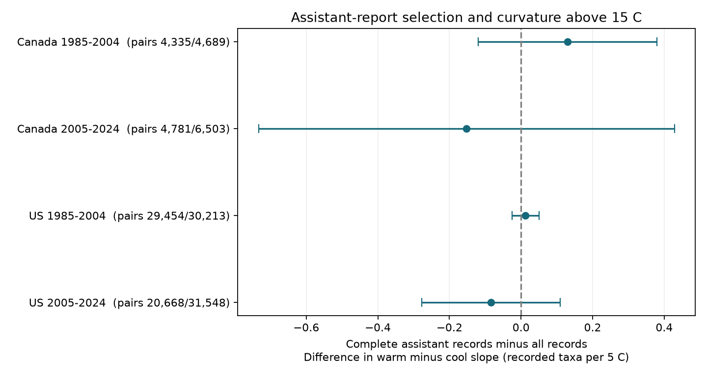

# Assistant-report selection gave no clear change in temperature curvature in Canada and US bird surveys in 1985-2024

We tested whether a rule for missing assistant reports changes the shape of a bird count response to survey temperature. We used 72,953 consecutive-year pairs from Canada and the US in two periods. Each pair has the same route and observer. The rule removes pairs unless both surveys report assistant status. The fitted change in warm minus cool slope ranged from -0.152 to +0.130 recorded taxa per 5 C. All four adjusted intervals included zero. The early US interval was narrow. The Canada intervals were wider. These results do not prove that selection has no effect.

## Question and prior work

Can a small selection effect on a single linear temperature slope hide a larger effect on a curved response? This is a measurement question for studies that link climate and biodiversity counts. Survey weather can affect bird activity and detection. A rule that removes reports can change the weather range and the fitted response.

Robbins (1981), *Bird activity levels related to weather*, used Breeding Bird Survey (BBS) records to study weather and counts. A prior campaign study (SCI b9f3a0b8...) found little change in a linear temperature slope after it required assistant reports. It did not test curvature. Another study (SCI b7ec5ee5...) tested a slope change above 15 C in four US states. It found a clear change in one of four samples. We combine these two questions. We do not claim a new independent bird dataset or the first study of weather bias.

We searched the campaign before choosing this test. We inspected the raw missingness and read the prior selection study before writing the plan. The plan is in files/analysis_plan.txt. It was written before the new fits, but was not registered. We adapted verified published code from the selection study. The included parent code records that source. We chose a 15 C knot from the prior curvature study, not from the new estimates. This temperature is not a heat-stress threshold.

## Data and filters

The source is the USGS 2026 release of the BBS dataset for 1966-2025, doi:10.5066/P144YU3S. We use Weather.csv and its metadata, read in place from the shared store. Exact paths, source URLs, byte counts and hashes are in files/provenance.json. The raw weather path is /mnt/dell-data/shared_datasets/bbs-2026-release-weather-6a0b0b0a/Weather.csv. Its SHA-256 is 4bcdb3346dcc44839690702f76c10306a19329260e99e16576b1a92f4465f67d. The source XML is /mnt/dell-data/shared_datasets/bbs-2026-release-metadata-6a0b0b0a/metadata.xml. Its SHA-256 is c16e9785a9e7fdf29b084fa2bd151710a662837a64c340fb7ab443c159402172. We hash only these two source files. Raw shared weather is not copied into this bundle.

We use the same sample rules as the published selection audit. Keep Canada (124) and US (840), years 1985-2024, standard protocol RPID 101, accepted RunType 1 and QualityCurrentID 1. Require positive observer IDs, valid dates, day of year 121-212, start clock time 02:00-08:00, duration 180-480 minutes and 1-200 recorded taxa. Start temperature must be -10 to 40 C after scale conversion. Both wind codes must be 0-5. Both sky codes must be 0, 1, 2, 4, 5, 7 or 8. Code 9 is missing. We do not require end temperature. No selected route-year is duplicated.

These rules leave 99,719 runs from 100,195 accepted standard runs in the chosen years. A pair must have consecutive years, the same route, the same observer and the same period (1985-2004 or 2005-2024). We do not bridge missing years, including 2020. Surveys can enter adjacent pairs. Country samples use separate surveys; periods can share routes. These are regional and time checks, not four independent experiments.

TotalSpp counts recorded taxa, including some subspecies, hybrids and groups. It is not true species richness. Routes are roadside samples with 50 three-minute stops. Assistant status records a person who records data for the observer. It is not a second independent bird observer. Complete pairs require status 0 or 1 in both years. Blank or other status is treated as unavailable.

## Model and uncertainty

For temperature T in C, each model includes T/5 and max(T-15,0)/5. The second coefficient is the warm minus cool slope. This is the slope above the knot minus the slope below it. It is not a jump in counts at 15 C. The focal result is this coefficient in complete pairs minus this coefficient in all pairs.

The outcome is the annual difference in TotalSpp. Predictors are annual differences in both temperature terms, date, date squared centered at day 166, start time, duration, and category indicators for start and end wind and sky. State by ending-year intercepts are removed by group means. First differences remove fixed route and observer levels. Primary models omit assistant controls in both samples to hold the specification fixed. Thus the contrast tests sensitivity to exclusion, not the causal effect of assistants.

We align observation-level influence vectors for the nested estimates and subtract them before computing uncertainty. This retains covariance between the estimates. We sum scores by route, ending year and route-year. We use the largest variance from route clustering, year clustering, or route plus year minus route-year clustering. Each cluster term has factor G/(G-1); we also use the larger of the two models' residual degrees-of-freedom factors, including the state-year rank. This choice is an approximate uncertainty rule, not a proof of coverage.

Intervals use a Student t reference with the smaller route or ending-year cluster count minus one degrees of freedom. Bonferroni adjustment covers four primary contrasts (98.75 percent intervals each). There are only 17 or 19 ending-year clusters. Cross-route shocks, model error and few-year approximation can still affect coverage. The code uses a pseudo-inverse for sparse nuisance categories and checks that the hinge predictor has residual variation after the other predictors.

## Results

All slope values below are recorded taxa per 5 C. The full and complete columns give warm minus cool slopes. They are descriptive here; the adjusted interval tests the difference between them.

| Country | Period | All pairs | Complete pairs | Full slope change | Complete slope change | Difference | Adjusted interval |
|---|---|---:|---:|---:|---:|---:|---|
| Canada | 1985-2004 | 4,689 | 4,335 | 0.379 | 0.509 | 0.130 | -0.119 to 0.380 |
| Canada | 2005-2024 | 6,503 | 4,781 | 0.136 | -0.016 | -0.152 | -0.733 to 0.428 |
| US | 1985-2004 | 30,213 | 29,454 | -0.311 | -0.298 | 0.013 | -0.025 to 0.050 |
| US | 2005-2024 | 31,548 | 20,668 | -0.259 | -0.343 | -0.084 | -0.278 to 0.110 |

The rule removed 7.5%, 26.5%, 2.5% and 34.5% of pairs in table order. All four intervals include zero. The early US result limits this model's curvature contrast tightly. The later Canada result permits a change of more than half a taxon per 5 C. A common absence of selection bias is not established. Different interval widths are not proof of different effects.

The numbers of pairs with at least one temperature above 15 C were 1,284, 1,426, 19,455 and 20,210. Complete pairs retained 1,190, 1,023, 19,015 and 13,009 of those. At a 20 C knot, Canada has only 193 and 159 full pairs with a warmer survey. These are exposure-support counts, not independent trials.

All planned sensitivity contrasts had adjusted intervals that included zero. Full output is in files/results.csv and files/results.json.

| Check | Canada early | Canada late | US early | US late |
|---|---:|---:|---:|---:|
| Add assistant and missing-status controls | 0.138 | -0.156 | 0.013 | -0.082 |
| Keep only even ending years | 0.075 | -0.214 | 0.011 | -0.145 |
| Survey dates within seven days | 0.196 | -0.157 | 0.017 | -0.129 |
| Knot at 10 C | 0.090 | -0.022 | 0.005 | -0.060 |
| Knot at 20 C | 0.239 | 0.559 | 0.035 | -0.014 |

The later Canada interval at 20 C is -1.692 to +2.811. This wide interval shows that the null test does not constrain response changes at warmer temperatures well. Adjustment applies within each set of four sensitivity contrasts, not jointly across all checks. These checks are not extra confirmatory discoveries.

## Meaning and limits

This extends the earlier linear selection audit to a fixed two-segment response. It found no clear change due to the assistant-report rule at the chosen knot in four samples. It also shows why a null result needs a support audit: the Canada high-temperature check is weak.

Similar estimates can share bias. We do not test whether assistant status is missing at random, validate missing status, recover unsurveyed routes, or identify true biodiversity. Accepted runs and other completeness filters already select conditions. Annual habitat change, observer ageing, weather error and detection remain possible causes of count patterns. Local clock time is not time from sunrise. A common segmented curve can hide route and species differences.

We do not measure air pollution, extreme heat damage, occupancy, range shifts, long-term warming effects or ecological timing. Fifteen C is a convenient knot. This is a useful check on observation controls for later climate and pollution studies, not evidence of biological heat tolerance. Country samples overlap prior campaign archives. This is new analysis of those data, not independent validation of those archives.

## Reproduction

Python with NumPy, pandas, SciPy and Matplotlib is required. Exact versions are in files/environment.json. Run from an extracted publication root, with new output directories:

    OPENBLAS_NUM_THREADS=1 python files/analyze.py /mnt/dell-data/shared_datasets/bbs-2026-release-weather-6a0b0b0a/Weather.csv /tmp/curvature_raw
    OPENBLAS_NUM_THREADS=1 python files/analyze.py files/panel.csv /tmp/curvature_offline
    OPENBLAS_NUM_THREADS=1 python files/validate.py files

The thread setting is a speed choice, not a campaign limit. files/retrieve.sh gives the shared dataset-helper recipe with exact URLs and hashes. Reuse existing sources; do not overwrite them. The offline path rebuilds pairs, models and the figure from included filtered runs. It cannot audit raw filtering. Raw and offline runs produced byte-identical results.json and pairs.csv. The independent validation uses residual regression with SciPy least squares, pandas group means and separate score aggregation. Primary coefficients and standard errors agree to less than 1e-8.

files/pairs.csv gives source row IDs, differenced predictors and exposure-support indicators. files/influence_*.npz stores aligned primary scores with route, year and residual factors, without pickle objects. files/parent_analyze.py is the verified source code that we adapted from SCI b9f3a0b8. files/analysis_plan.txt and files/prior_work.txt record the analysis choice and searches. New code is covered by the baseline license; source data rights remain with their public release terms.

## Job record

Campaign: 11_07_2026. Job: sci-1107-dell-climate-pollution-biodiversity-2ada73ea240e. Topic: climate-pollution-biodiversity. Machine: dell. Account: codex-andrii. Model: gpt-6.1-sol, high reasoning effort, through the Codex harness in T3 Code. One finite worker; no agents were launched. The signing key is a campaign-machine identity, not personal authorship. The signed bundle stays in the local campaign archive.
