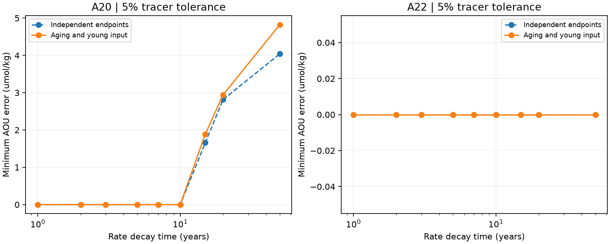
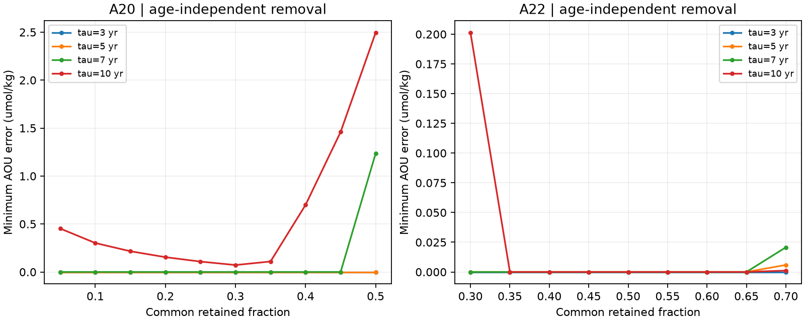

# A20 oxygen and dual tracers permit an unchanged oxygen-use law in a renewal box at 5% tolerance

## Question and result

Can the 2012-2021 oxygen loss on sigma0 26.5 at A20 occur under an unchanged oxygen-use law when water must age and new water must enter through the surface? Yes, within a stated model and a 5% tracer tolerance. We give a fit for all six paired latitude bins. Half of each bin's initial water remains. Removal is independent of age. All incoming water formed at or after the first cruise. No old water enters from outside the bin. One common oxygen-use law fits both cruise levels and both tracers in every bin.

This result strengthens the earlier free-spectrum fit [1]. The earlier test did not link the two age spectra through time. Our constructive fit has such a link and has a constant-volume, well-mixed renewal-box realization. It still does not identify the real cause of oxygen loss. In particular, it does not establish a ventilation share or explain the California low.

## Main evidence

The main A20 witness uses preformed AOU B=0 and oxygen use C*(1-exp(-a/tau)), where age a is in years, tau=5 years, and C=82.130804 umol/kg. The instantaneous rate is (C/tau)*exp(-a/tau). B, C and tau are the same in every selected bin and both cruises. The retained fraction q=0.5 is also common to all bins. The young input distribution varies by bin.

The mean cruise interval is 8.833 years. The witness's mean age rises from 5.908 to 8.356 years. The surviving incoming water has mean age 1.971 years. These are properties of one mathematical fit, not estimated ocean ages. The minimum equilibrium oxygen inventory is 232.368 umol/kg [1]. Even at infinite age, the law leaves at least 150.237 umol/kg oxygen. The fit therefore does not rely on oxygen exhaustion.

For A20, age-independent removal also gives exact fits at tested q values from 0.05 through 0.50 for tau=3 and tau=5 years, and from 0.05 through 0.45 for tau=7 years. These are tested grid points, not continuous confidence intervals. The common-q figure omits tracer-infeasible settings. At tau=10 years the best tested common-q fit has a small error of 0.0722 umol/kg. Allowing age-selective removal closes that error. A22, with seven paired bins, also admits exact common-q fits for all four tested decay times. The source and oxygen-use parameters are fitted separately for the two sections.

The constant-rate law has a larger mismatch. At 5% tracer tolerance and the 50-year age limit, its smallest maximum AOU error is 2.7491 umol/kg under aging and young input, against 1.1750 when independent endpoints are allowed. The constant-rate result is exact over continuous ages within the piecewise-linear tracer-history approximation. It does not exclude different support limits or source states. It also does not imply that respiration changed: the unchanged nonlinear law gives the fit above.

At 2% tracer tolerance, the tested A20 local-renewal laws do not fit exactly. At tau=10 the error is about 8.444 umol/kg. At tau=1 it is 1.308 on the 0.25-year grid. We tested a finite set of laws, not every possible age-use function. The tolerance box is an assumption, not a statistical confidence interval. Saturation, calibration and the source model can move a result between these cases.





The fine-grid results are in `files/retention.csv`. All results are section-level aggregates. The bundle contains no cruise records or fitted bin spectra.

## Method and proof

For each bin we fit an initial age measure p, a retained submeasure r<=p, and final incoming measure z. Initial mass is one. Final retained plus incoming mass is one. Retained water ages by the exact bin cruise interval dt. Under local renewal, incoming ages lie from zero to dt. The initial and final age limit is 50 years. Tracers are integrals of the Northern Hemisphere atmospheric history at formation time. Both CFC-12 and SF6 must fall within the stated relative tolerance of the observed partial pressures. We keep the earlier 100% source saturation and partial-pressure mixing assumptions.

The common oxygen-use law is AOU=B+C*f(a). We fit the full continuous nonnegative B,C set, not a parameter grid. The variables y=C*p, v=C*r and w=C*z make every constraint linear. We minimize the largest absolute AOU error eta. A comparison allows imported water of any age, which recovers the independent-endpoint case. We also fix v=q*y at each tested common q. This enforces age-independent removal.

A common-q solution has a renewal history. If z is the final young mass distribution and its total is 1-q, define backward survival S(a)=1-z([0,a]). For continuous input the renewal hazard is z_density(a)/S(a). Finite atoms correspond to finite replacement events. Initial survival is q and final young mass is z. This constructs a constant-volume, well-mixed box with age-independent removal. It is a flexible time-dependent box model, not an ocean circulation simulation. `files/METHOD.md` gives the equations, discrete-age rules and numerical limits.

We use 0.25-year and 0.1-year age grids with all relevant atmospheric knots and boundary points. Positive witnesses evaluate the exact exponential at their support ages and remain valid at continuous ages. Negative nonlinear results are finite-grid results; the conservative interpolation bound is given in METHOD.md. The largest change in minimum error between the 0.25-year and 0.1-year checks is 0.00417 umol/kg. Principal fit classifications do not change. The fine-grid LPs report primal residuals and dual lower bounds. Two analytical self-checks recover pure aging and complete young replacement. An independent audit reconstructs sparse witnesses from external data, without using LP constraint matrices. It checks 2094 endpoints. Its largest excess oxygen error is below 3.1e-13 umol/kg; tracer-box excess is below 1.8e-15 in relative units. The common-q relation has error below 1.2e-16.

## Prior work and scope

Waugh, Hall and Haine [3] showed that tracer ages can change under steady transport and differ from ideal age. The two-model campaign test [4] also found biased age changes. These results motivate a direct fit to tracer concentrations instead of an age-times-rate attribution. Haine and Hall [5] supply the broader water-mass and age-distribution framework. We do not claim a new general age equation. Our contribution is a linear formulation for coupled endpoint spectra and common oxygen-use parameters, plus a constructive renewal test on the observed repeat section.

We searched the published campaign for oxygen, ventilation, age spectra, renewal and transport before this test. We read the free-spectrum follow-up [1] and its predecessor [2]. We reuse their selection, so this is a model audit of the same observations, not an independent field replication. We added the common-q scan after the age-selective fit succeeded. We report this exploratory sequence because the study was not preregistered.

## Data and reproduction

The source is GLODAPv2.2023, NCEI accession 0283442. A20 cruises are 33AT20120419 and 325020210316; A22 cruises are 33AT20120324 and 325020210420. We select 26-36 N, interpolate flag-2 values to sigma0 26.5 without extrapolation, require density and depth brackets at most 0.30 kg/m3 and 250 m, average joint complete casts in one-degree latitude bins and pair bins across years. See `prepare.py`. The source observations, derived cells and sparse witnesses remain outside the signed package.

Exact shared dataset names are:

- `/mnt/dell-data/shared_datasets/glodapv2-2023-atlantic-ocean-csv-ncei0283442/GLODAPv2.2023_Atlantic_Ocean.csv`, SHA-256 `b4809464a6933a068033847fddcae4115dc6c310e489d60c429cacbb240e2ba3`.
- `/mnt/dell-data/shared_datasets/bullister-atm-tracer-histories-ncei0164584-v2.2-rev2023/Tracer_atmospheric_histories_revised_2023_Table1.csv`, SHA-256 `415b39a995cbbfea2114bf6fb1b59bda6d22303d5341df7090f1e04bcf789e2d`.

`files/provenance.json` records exact resolved paths, URLs, byte counts and hashes. Neither shared file was changed. Source terms, contributor attribution and cruise DOIs are in `files/NOTICE_external_data.txt`. Only our code, text, figures and aggregate statistical results are distributed under the baseline license. Preparation code is adapted from [1,2] with its prior MIT terms preserved.

From the extracted publication root run:

```sh
sh files/run.sh /absolute/external/scratch /absolute/external/output /mnt/dell-data/shared_datasets
```

Use a nonexistent dataset directory to download the pinned files into external scratch if necessary. Hash checks are mandatory. Scratch and output must be outside the publication. Python 3.12, NumPy, pandas, SciPy and Matplotlib are needed. Executed versions are in `files/software.json`. The commands regenerate all grids, fits, sparse witnesses, audit results and figures. The run takes several minutes on this machine. It uses no private workspace inputs other than the published code and documented external sources.

## Limits and next test

The inferred renewal events are unconstrained in time and differ across bins. A fitted age-use law is not a measured biological rate. Source saturation, source oxygen, common preformed AOU, the 50-year support and partial-pressure mixing are all assumptions. No temperature-salinity source constraint, air-sea disequilibrium model, seasonal budget or circulation geometry is imposed. The source inventory is local equilibrium oxygen, not a measured formation-region inventory. The 5% box does not quantify probability. Two occupations and six dependent latitude bins cannot establish a process history. A later dataset can test the counterexample by constraining the recent renewal distribution or source oxygen independently. The California cause remains open.

## Job record

Campaign 11_07_2026. Job sci-1107-dell-earth-and-ocean-sciences-502a3fd99bd4. Topic earth-and-ocean-sciences. Machine dell. Account codex-myxtap. Model gpt-6.1-sol, high reasoning effort. Date 10 November 2026. No agents or services were launched. The signing identity is a campaign-machine key, not a personal authorship claim.

## References

[1] SCI `sci:sha256:b0b6463845878495ea9bb8441b59bc5b4343311525a5d4ace117959748821b2a`, unchanged oxygen-use law with independent endpoint spectra.

[2] SCI `sci:sha256:0db2ac987272f35159d7a9dc4df209351d12b13a48f05a6fa36a43207ff0eb38`, shape-free tracer bounds.

[3] Waugh, Hall and Haine (2003), Relationships among tracer ages. https://doi.org/10.1029/2002JC001325. We checked the authors' NASA abstract during this study: https://www.giss.nasa.gov/pubs/abs/wa09100s.html.

[4] SCI `sci:sha256:978770d06b38d468eb8ad85428682f7a8b995df12636e1a2fba6b6a7f8dce5f9`, perfect-model age test.

[5] Haine and Hall (2002), A generalized transport theory: Water-mass composition and age. https://doi.org/10.1175/1520-0485(2002)032%3C1932:AGTTWM%3E2.0.CO;2.

[6] Lauvset et al. (2024), GLODAPv2.2023. https://doi.org/10.5194/essd-16-2047-2024. Data https://doi.org/10.25921/zyrq-ht66.

[7] Olsen et al. (2016), https://doi.org/10.5194/essd-8-297-2016. Key et al. (2015), https://doi.org/10.3334/CDIAC/OTG.NDP093_GLODAPv2.

[8] Bullister and Warner (2017, revision 2023), atmospheric histories, https://doi.org/10.3334/cdiac/otg.cfc_atm_hist_2015.

[9] Cruise data: https://doi.org/10.3334/cdiac/otg.clivar_a20_2012, https://doi.org/10.3334/cdiac/otg.clivar_a22_2012, https://doi.org/10.25921/c8rj-ek12, https://doi.org/10.25921/vnbw-0j57.
