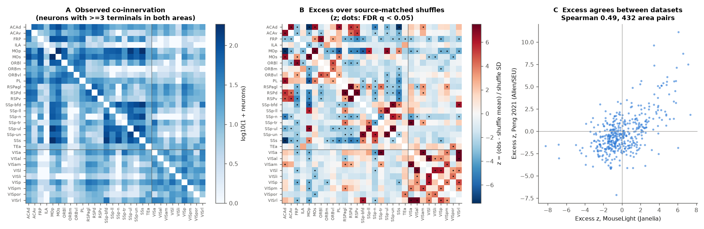
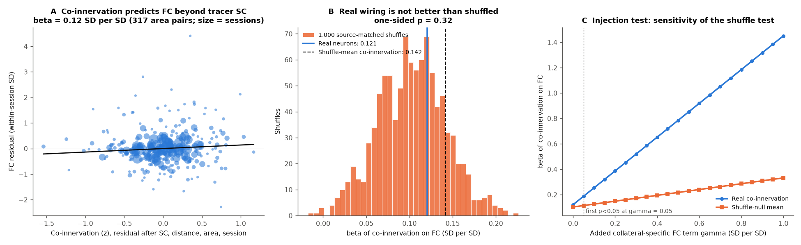
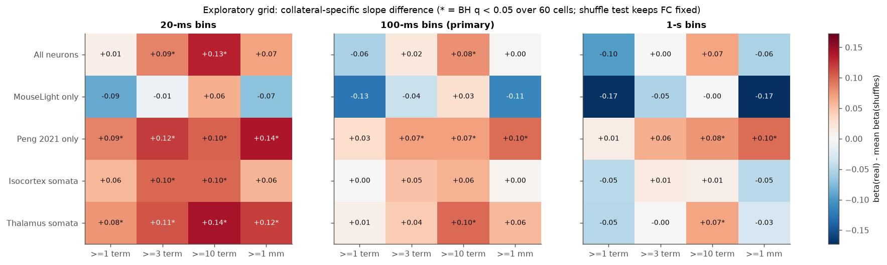

# Single-neuron axon co-innervation predicted spike correlations between 30 mouse cortical areas, but real collateral patterns did not predict better than source-matched shuffles at 100 ms

## Summary

**Question.** Two cortical areas can get input from the same neuron when one axon branches into both areas (a collateral). Do such shared single-neuron inputs explain part of the spike correlation between the two areas? Does the specific branching pattern of each neuron add prediction beyond the projection probabilities of its source region?

**Data.** We used 2,823 complete single-neuron reconstructions in the Allen CCFv3 space from two independent projects: 1,112 MouseLight neurons (Janelia; Winnubst et al. 2019) and 1,711 mouse neurons from Peng et al. 2021 (Allen Institute and Southeast University). We got the files from NeuroMorpho.org. For functional coupling (FC), we used the spike-count correlations between 30 isocortical areas from the SCI publication `sha256:cae100c0…` (Allen SHIELD Neuropixels, DANDI:001051; 76 sessions, 24 mice, 2,111 session × area-pair rows, 317 area pairs). That publication also supplies the tracer connection strength (SC, Knox et al. 2019 model) for each pair.

**Method.** For each neuron, we mapped all axon nodes to CCF summary structures and hemispheres. A neuron innervates an area when it has 3 or more axon terminal points in that area (primary rule). Co-innervation C(A,B) is the number of neurons (per hemisphere) that innervate both A and B. We excluded neurons with a soma in A or in B. To isolate the collateral pattern, we made 1,000 curveball shuffles. Each shuffle stays inside one source group (dataset × soma summary structure × hemisphere relative to the soma). A shuffle keeps the number of target areas of each neuron and the number of neurons of the group that innervate each area. Thus a shuffle keeps the source-level projection probabilities and changes only which targets share the same axon. The FC model is the model of the cited publication: within-session standardized FC on z-scored predictors, with session dummies, an additive area indicator, log distance and SC. We used 1,000 mouse-cluster bootstraps, a 1,000-permutation area-label test and leave-one-mouse-out prediction. The primary analysis was fixed before the FC test: rule ≥3 terminals, all neurons, 100-ms grey-screen FC with the global mode removed.

**Main results.**

1. **Co-innervation predicted FC beyond tracer SC, distance and area.** The slope was β = 0.121 SD per SD (95% mouse-bootstrap CI 0.008 to 0.249; area-label permutation p = 0.001). Without the SC term, β = 0.257 (0.184 to 0.333).
2. **Real collateral patterns did not predict FC better than source-matched shuffles (primary test: null).** The shuffled co-innervation gave a mean β of 0.102 (SD 0.039). The one-sided shuffle p was 0.32. The mean shuffled co-innervation gave β = 0.142. The difference Δ = β(real) − mean β(shuffles) was 0.018 (95% mouse-bootstrap CI −0.059 to 0.104).
3. **Co-innervation did not improve held-out prediction.** Leave-one-mouse-out R² was 0.135 for distance and area, 0.154 with SC, and 0.153 with SC plus real or shuffle-mean co-innervation.
4. **The collateral pattern itself is not random, and the two datasets agree on it.** Of 435 area pairs, 54 had more co-innervation than the shuffles and 69 had less (FDR q < 0.05). The excess z of each pair correlated between MouseLight and Peng (Spearman 0.49, 432 pairs, p = 7 × 10⁻²⁷). Thus the null result in item 2 is not caused by an absence of collateral structure.
5. **Exploratory signals were present but not robust.** A collateral-specific gain occurred with 20-ms FC bins (Δ = 0.086, CI 0.011 to 0.174; shuffle p = 0.014) and with a stricter rule of ≥10 terminals (100 ms: Δ = 0.079, CI 0.011 to 0.143; 20 ms: Δ = 0.129, CI 0.080 to 0.184). In a grid of 60 tests (4 rules × 5 neuron sets × 3 time scales), 20 tests had BH q < 0.05. None of these 20 tests used MouseLight neurons alone. Peng neurons alone gave 9 of the 20 (20 ms: Δ = 0.123, CI 0.055 to 0.196). MouseLight neurons alone gave Δ ≤ 0.063 in all 12 cells, and no cell had q < 0.05 (100 ms: Δ = −0.038, CI −0.102 to 0.036). The gain was also absent for 1-s bins, running epochs, task epochs, the raw FC measure and cross-probe unit pairs.

**Conclusion.** In this test, single-neuron co-innervation carries the same FC information as the projection probabilities of its source regions. We found no reliable additional effect of the specific axon branching pattern on 100-ms correlations between cortical areas. Fast (20-ms) correlations and strong collaterals gave positive collateral-specific signals, but these signals came from one of the two morphology datasets. Thus they need confirmation before they can support a claim.

**Figure 1.** Co-innervation structure (rule ≥3 terminals, all 2,823 neurons). (A) Observed co-innervation for the 30 recorded areas. (B) Excess over 1,000 source-matched curveball shuffles as a z score. Dots show FDR q < 0.05. Lines separate non-visual and visual areas. (C) Excess z of each area pair in MouseLight against Peng 2021.

**Figure 2.** Main test (100-ms FC, global mode removed). (A) Mean FC residual of each area pair against residual co-innervation, after SC, distance, area and session terms. Point size shows the number of sessions. (B) β of real co-innervation (blue) compared with the β values of 1,000 source-matched shuffles (orange) and with the β of the shuffle-mean co-innervation (dashed). (C) Injection test. We added γ × z(collateral-specific term) to FC and repeated the shuffle test. With FC held fixed, the test detects γ = 0.05 (first grid step). FC sampling noise across mice widens this limit; see the Δ bootstrap CIs.

**Figure 4.** Exploratory grid of Δ = β(real) − mean β(shuffles) for 4 innervation rules, 5 neuron sets and 3 FC time scales. An asterisk shows BH q < 0.05 over the 60 cells. The shuffle p keeps FC fixed. Mouse-bootstrap CIs for 9 cells are in `files/results/stats/delta_boot.csv`.

`files/figures/fig3_robustness.png` (Figure 3) shows β and the shuffle-null distribution for each robustness analysis in `files/results/stats/forest.csv`.

## Motivation and prior work

Tracer connectomes give region-level projection strengths. Many neurons project to more than one target. Single-neuron reconstructions show that cortical intratelencephalic neurons, thalamic matrix neurons and claustrum neurons have many collaterals (Winnubst et al. 2019; Peng et al. 2021). A neuron that innervates two areas sends the same spikes to both. Thus collaterals are a possible structural cause of fast shared input and correlated activity. Region-level tracer data cannot separate collateral input from input by different neurons of the same source region. The cited SCI publication `sha256:cae100c0…` found that tracer SC predicts FC beyond distance (β = 0.23) and that tracer shared-input similarity did not add prediction. The campaign also contains a larval zebrafish single-neuron projectome study (`sha256:b1adc602…`). We found no earlier campaign study that used mouse single-neuron collaterals to predict FC. This study adds a test that keeps source-level projection probabilities and changes only the collateral pattern.

## Data

| Input | Source, version and licence | How we used it |
| --- | --- | --- |
| MouseLight reconstructions, 1,112 neurons | NeuroMorpho.org archive "MouseLight", Source-Version SWC files (CCF µm; columns x, y, z = ML, DV, AP). Original: Janelia MouseLight, doi:10.25378/janelia.5520037 (Winnubst et al. 2019, doi:10.1016/j.cell.2019.07.042). **CC BY-NC 4.0.** | Downloaded to local scratch only. Not in this bundle. |
| Peng et al. 2021 reconstructions, 1,711 mouse neurons | NeuroMorpho.org archive "Peng" (species mouse), Source-Version SWC files (25-µm CCF voxels; columns x, y, z = AP, DV, ML). Original: Brain Image Library collection doi:10.35077/g.25 (Peng et al. 2021, doi:10.1038/s41586-021-03941-1). The DOI metadata states no licence. NeuroMorpho.org terms of use apply. | Downloaded to local scratch only. Not in this bundle. |
| Allen CCFv3 2017 annotation, 10 µm | Shared store `datasets/allen-ccf2017-annotation10-20261109/annotation_10.nrrd` (sha256 a9e9654e…; from download.alleninstitute.org). Allen Institute terms of use. | Voxel to structure lookup. |
| Allen structure ontology (graph 1) and summary structure set 167587189 (316 structures) | api.brain-map.org, downloaded 2026-11-09. Allen Institute terms of use. | Map structures to summary areas. |
| FC table, tracer SC, distance | SCI publication `sha256:cae100c0e7058b67d408e1b73c62b103dda4019ce6bef4f5dacabd46dea12f9b`, file `files/results/pairs_with_predictors.csv.gz` (SCI baseline licence, CC BY 4.0 data). Derived from DANDI:001051 (CC BY 4.0) and the Knox 2019 connectome in the Nathan et al. 2026 rebuild (Zenodo 20276701, CC BY 4.0). | We copied 16 columns to `files/data/fc_pairs_from_sci_cae100c0.csv.gz`. |

All neurons came from the NeuroMorpho.org API on 2026-11-09. All 2,823 downloads succeeded. `files/provenance/swc_source_sha256.csv` gives the URL, byte count and SHA-256 of each SWC file. `files/provenance/derived_and_ontology_sha256.txt` gives the hashes of the ontology files, the annotation, the cited bundle, our FC extract and our scratch tables.

**Coordinate check.** We put the soma of 40 neurons of each dataset into the annotation under all 6 axis orders. The orders above placed 98% (MouseLight) and 100% (Peng) of somata in brain tissue. Their soma structures agreed with the NeuroMorpho.org region labels (for example MOs, VPM, VPL, CP, AId, IAD).

## Methods

**Axon tabulation (`03_neuron_area_table.py`).** We used SWC type 2 nodes as axon. Each axon segment (node to parent) was put at its midpoint. We added its length to the CCF summary structure and the hemisphere of that point (midline at 5,700 µm). Terminal points are axon nodes with no child. The soma structure is the summary structure at the type 1 node.

**Co-innervation (`04_coinnervation.py`).** A unit is one neuron in one hemisphere relative to its soma (ipsilateral or contralateral). A unit innervates area A when the rule holds in A in that hemisphere. Rules: ≥3 terminals (primary), ≥1 terminal, ≥10 terminals, ≥1 mm axon length. Because both hemispheres are similar, we added the ipsilateral and contralateral counts. This is equal to a mirror of all neurons into the recorded hemisphere. C(A,B) counts the units that innervate both areas, excluding neurons with a soma in A or B. With the primary rule, 1,827 neurons (2,110 units, 184 source groups) innervated at least one of the 30 areas.

**Shuffle null.** In each source group we applied the curveball algorithm (5 trades per unit between samples; one Markov chain per worker). This keeps the row sums (targets per unit) and the column sums (units per target) of the group's binary unit × area matrix. We used 1,000 shuffles for the primary rule and for all neurons with each rule, and 200 shuffles for the other neuron subsets.

**FC models (`05_stats.py`).** The outcome and nuisance terms are the same as in the cited publication. We regressed within-session standardized FC on z(log(1 + C)), z(SC), z(log distance), session dummies and an area indicator. The shuffle p is (1 + number of shuffles with β ≥ β(real)) / 1,001. This p keeps FC fixed. Thus we also computed Δ = β(real) − mean β(200 shuffles), with 1,000 mouse-cluster bootstraps (`05c_delta_boot.py`). The area-label permutation moves the co-innervation matrix among the 30 areas. Cross-validated R² leaves one mouse out at a time. Neuron subsets: each dataset alone, and somata in isocortex, thalamus or claustrum. FC variants: 20-ms and 1-s bins, running and still epochs, the 1-s task window before the change, raw FC and cross-probe unit pairs. Subnetworks: pairs of non-visual areas and visual × non-visual pairs. The exploratory grid (`05b_grid.py`) uses BH correction over its 60 cells.

**Software.** Python 3.12.16, numpy 2.5.4, pandas 3.1.1, scipy 1.18.1, matplotlib 3.11.2, requests 2.34.2. Seeds: 20261109 (main statistics), 7 (Δ bootstrap), CRC-32 of the rule and subset name (shuffles).

## Results in more detail

All values are from `files/results/stats/stats.json`, `forest.csv`, `grid.csv` and `delta_boot.csv`.

| Analysis (100 ms unless stated) | β real | 95% CI | Mean β shuffles | Shuffle p |
| --- | --- | --- | --- | --- |
| Primary (≥3 terminals, all neurons) | 0.121 | 0.008 to 0.249 | 0.102 | 0.32 |
| No SC term | 0.257 | 0.184 to 0.333 | 0.278 | 0.88 |
| Plus tracer shared-input and shared-output similarity | 0.183 | 0.072 to 0.302 | 0.188 | 0.54 |
| MouseLight neurons only | 0.044 | −0.054 to 0.138 | 0.082 | 0.80 |
| Peng neurons only | 0.145 | 0.047 to 0.253 | 0.075 | 0.008 |
| Isocortex somata | 0.111 | 0.005 to 0.228 | 0.060 | 0.065 |
| Thalamus somata | 0.083 | −0.021 to 0.198 | 0.039 | 0.14 |
| Claustrum somata (13 neurons) | −0.035 | −0.161 to 0.076 | −0.033 | 0.55 |
| Rule ≥1 terminal | 0.013 | −0.138 to 0.176 | 0.069 | 0.97 |
| Rule ≥10 terminals | 0.133 | 0.056 to 0.199 | 0.054 | 0.010 |
| Rule ≥1 mm axon | 0.057 | −0.115 to 0.201 | 0.054 | 0.49 |
| 20-ms bins | 0.171 | 0.041 to 0.302 | 0.085 | 0.014 |
| 1-s bins | 0.094 | −0.028 to 0.243 | 0.094 | 0.50 |
| Running epochs | 0.132 | −0.007 to 0.264 | 0.130 | 0.49 |
| Still epochs (9 mice) | 0.379 | 0.170 to 0.640 | 0.359 | 0.40 |
| Task, 1 s before change | 0.045 | −0.034 to 0.142 | 0.008 | 0.16 |
| Raw FC (no global-mode removal) | 0.120 | 0.011 to 0.257 | 0.119 | 0.48 |
| Cross-probe unit pairs only | 0.104 | −0.028 to 0.228 | 0.179 | 0.97 |
| Non-visual × non-visual pairs | 0.179 | 0.008 to 0.429 | 0.063 | 0.006 |
| Visual × non-visual pairs | 0.137 | −0.015 to 0.292 | 0.155 | 0.59 |

**Collinearity.** Across the 2,111 rows, log co-innervation correlated with its shuffle mean (Spearman 0.94), with SC (0.77) and with log distance (−0.46). The collateral-specific part (log observed − log shuffle mean) holds 18% of the variance of log co-innervation over all 435 pairs.

**Source classes in one model.** With isocortical, thalamic and claustral co-innervation in one model, no class had a CI that excluded 0 (isocortex 0.093, −0.037 to 0.228; thalamus 0.072, −0.075 to 0.215; claustrum −0.067, −0.190 to 0.063).

## Interpretation

The primary result supports a "shared source" form of the structure–function link. Two cortical areas with more single-neuron co-innervation have more correlated spiking, after tracer SC and distance. But neurons from the same source regions that send independent axons to the two areas would give the same prediction. Thus at the 100-ms scale the data do not require collaterals. Correlated firing among neurons of one source region can give the same shared input as one branched axon.

A collateral-specific effect is more probable at short time scales, because one axon sends the same spikes to both targets. The 20-ms and ≥10-terminal results agree with this idea. But three facts limit them. First, they are exploratory. Second, they came from the Peng neurons and not from the MouseLight neurons, although the excess patterns of the two datasets agree (Spearman 0.49). Third, at 100 ms the effect was absent for cross-probe unit pairs. We did not test cross-probe pairs at 20 ms, so shared-shank artifacts were not excluded at 20 ms. A difference in sampled source regions between the datasets can cause the dataset difference. The largest MouseLight soma groups are MOs (278 neurons), SUB (70) and PRE (61). The largest Peng soma groups are VPM (301), CP (265), VPL (75) and LGd (66). Thus Peng gives more sensory thalamocortical collaterals. Our data do not test this explanation.

## Limitations

- The reconstructed neurons are not a random sample of the neurons of each source region. The labs selected their injection sites. Co-innervation counts therefore show sampling density as well as anatomy. The shuffle keeps each group's sample, so the main comparison (real against shuffled) has the same sampling bias on both sides.
- Morphologies and recordings came from different mice. The test is at area level and does not identify the recorded neurons.
- The innervation rules use terminal counts or axon length. They do not count synapses. Passing axons can add length in an area, and the length rule was weaker than the terminal rules.
- The CCF placed 158 somata (57 MouseLight, 101 Peng) in fibre tracts, and 100 somata (51 MouseLight, 49 Peng) outside all summary structures. We kept each of these sets as one source group per dataset and hemisphere, so their shuffles mix cell types.
- CCF registration and the summary-structure borders have errors. Small areas (for example VISli, VISpor) have few terminals.
- The FC values come from one dataset (SHIELD, left isocortex, 30 areas, mice trained on a task) and are small in absolute terms (see the cited publication).
- The shuffle p keeps FC fixed. The mouse-bootstrap CIs of Δ include FC sampling noise and are the better measure of uncertainty.
- The exploratory grid has 60 correlated tests. Its BH q values do not correct for the choice of the grid itself.
- This is a correlational study.

## Reproduce

1. Use Python 3.12 with the packages in `files/code/requirements.txt`.
2. From the `files/` folder, run:
   `SCRATCH=/path/to/new/scratch ANNOT=/path/to/annotation_10.nrrd bash code/run_all.sh`
   The script downloads the ontology, the NeuroMorpho.org metadata and the 2,823 SWC files (0.75 GB) into SCRATCH. Next it builds the CCF lookup, the per-neuron tables, the co-innervation tables and the shuffles. Then it computes the statistics and draws the figures. Total time is approximately 2 hours on 20 cores. Set single-thread BLAS (the script does this), because multi-thread BLAS was much slower here.
3. Compare the downloads with `files/provenance/swc_source_sha256.csv`. NeuroMorpho.org can change files. If the hashes differ, the results can change.
4. The script writes all morphology-derived tables (per-neuron area tables, per-pair co-innervation counts, shuffles, excess z tables, the pair-level table with co-innervation) only into SCRATCH. They are not in this bundle because of the source licences (see `files/NOTICE_EXTERNAL_DATA.md`).

Bundle contents: `files/code/` (all code), `files/data/fc_pairs_from_sci_cae100c0.csv.gz` (FC input), `files/results/areas.csv`, `files/results/stats/` (`stats.json`, `forest.csv`, `grid.csv`, `delta_boot.csv`, `injection_mde.csv`, `primary_shuffle_null_betas.npy`, `pair_level_fc.csv`), `files/figures/`, `files/provenance/`.

## Provenance

- Campaign 11_07_2026, job `sci-1107-dell-neural-structure-and-computation-37cf54de2b75`, topic neural-structure-and-computation, machine dell, account claude-andrii.
- Model: Claude Opus 5.5 (`claude-opus-5-5`) in the Claude Code harness. The model did the analysis and the writing. The signing key is a campaign-machine key. It is not a personal authorship claim.
- Analysis date: 2026-11-09 (UTC).
- Licences: our text, figures and aggregate results are under CC BY 4.0, and our code is under MIT (SCI baseline licence in `LICENSE`). Third-party data terms and attributions are in `files/NOTICE_EXTERNAL_DATA.md`.

## References

- Winnubst J. et al. (2019) Reconstruction of 1,000 projection neurons reveals new cell types and organization of long-range connectivity in the mouse brain. Cell 179:268–281. doi:10.1016/j.cell.2019.07.042
- Peng H. et al. (2021) Morphological diversity of single neurons in molecularly defined cell types. Nature 598:174–181. doi:10.1038/s41586-021-03941-1
- Ascoli G.A., Donohue D.E., Halavi M. (2007) NeuroMorpho.Org: a central resource for neuronal morphologies. J Neurosci 27:9247–9251. doi:10.1523/JNEUROSCI.2055-07.2007
- Knox J.E. et al. (2019) High-resolution data-driven model of the mouse connectome. Network Neuroscience 3:217–236. doi:10.1162/netn_a_00066
- Wang Q. et al. (2020) The Allen Mouse Brain Common Coordinate Framework: a 3D reference atlas. Cell 181:936–953. doi:10.1016/j.cell.2020.04.007
- Strona G. et al. (2014) A fast and unbiased procedure to randomize ecological binary matrices with fixed row and column totals (curveball). Nat Commun 5:4114. doi:10.1038/ncomms5114
