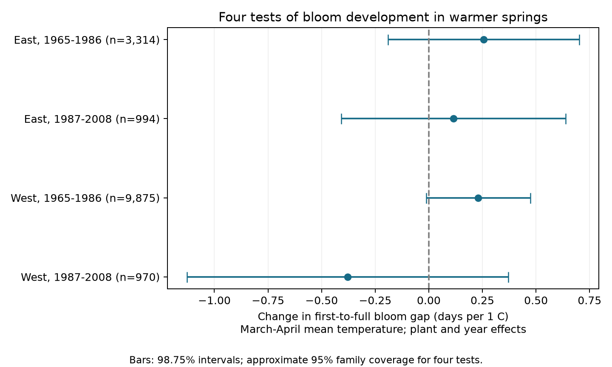
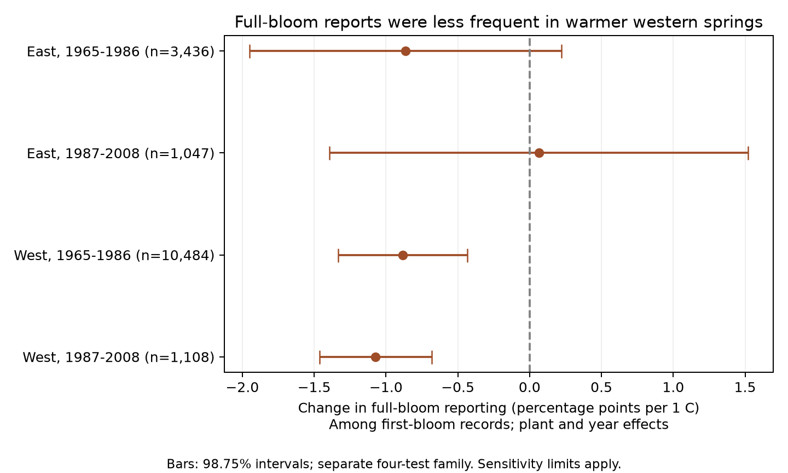

# First-to-full bloom gaps had uncertain warmth links in four US samples from 1965 to 2008

We tested whether a warm spring was linked to a shorter time from first bloom to full bloom. Four separate East/West and early/late samples gave no clear common response after adjustment for plant and year. All four adjusted intervals included zero. A separate test found fewer full-bloom reports in warm springs in both western samples. This reporting result was less stable in the small later sample. The evidence does not show that plants failed to reach full bloom. It shows a need to check missing stage reports when using paired bloom records.

## Question and prior work

The time from first to full bloom measures part of flower development. It could help assess changes in the timing of floral resources. It is not the full flowering period, flower abundance, or pollinator use. A shorter interval can occur without a shorter total flowering season.

Jędrzejuk and colleagues studied lilac flowers under natural conditions and two greenhouse forcing treatments. Temperature treatment changed the development and ageing of flowers (doi:10.1007/s11738-015-2044-z). This supports a reason to test temperature, but their treatments also differed in season and setting. We cannot transfer their treatment contrast to a field weather slope. Our narrower question is whether a broad spring mean predicts the observed first-to-full bloom gap within repeated plants.

Rosemartin and colleagues describe the historical lilac and honeysuckle data and changes in reporting methods (doi:10.1038/sdata.2015.38). A campaign search for climate, pollution, phenology, lilac, and full bloom found a prior leaf-to-first-bloom test (SCI sha256:a25494dd25de9765891868574ff46d20757fd95f4a06bb7c603baa4a3460baf8). We read that publication and its code. We use its archive choice, two-period design, and fixed-effect approach for a different pair of stages. We rebuild from raw data and do not require a leaf report. These are overlapping source records, not an independent data replication of the prior study. This investigation is exploratory and was not registered.

## Data and selection

We use the USA-NPN observation workbook v13 and field descriptions v14. We select legacy programs with Dataset_ID 7 or 8, years 1965-2008, and first-bloom or full-bloom stages. The two 22-year periods are 1965-1986 and 1987-2008. We stop before the later status-report method. We define West by longitude below -100 degrees; the other sites are East. This geographic rule is distinct from the archive's named reporting programs.

A plant key has site, individual, and taxon. A year with more than one record for either stage is rejected. We retain first-bloom dates on day 1-250 and sites at 24-50 N and 66-125 W. A valid pair also has full bloom on day 1-250 and a gap of 0-60 days. Zero gaps are retained because two stages can be recorded on one visit. We require at least five eligible years per plant within each region-period model. We retain date flags in the main model because some flags use climate context; a sensitivity check removes early/late and multiple-onset flags. Values marked as not tested are retained.

The raw workbook has 116,662 rows. Selection gives 40,599 stage records and rejects two ambiguous plant-years. There are 19,725 complete pairs before location and date limits. We exclude 92 records with no US state code, including Canadian sites inside the location box. The derived panel has 20,290 eligible first-bloom records and 19,451 valid pairs. No selected record lacks temperature. The five-year rule gives 15,153 pairs for the four gap models. A separate five-year rule on all first-bloom records gives 16,075 records for the reporting models. These samples differ because the reporting model must include missing full-bloom reports.

Temperature is from NOAA PSL, Boulder, Colorado, USA. We use the stored GHCN CAMS monthly surface-temperature file, version 3.01. We select each site's nearest 0.5-degree cell, convert Kelvin to C, and average March and April with equal weight. April alone and April-May are sensitivity windows. The source is a seasonal mean, not heat extremes, frost, or temperature measured at the plant. Many first-bloom dates are in May or later. The exposure therefore often precedes the gap and does not isolate weather during development. Some dates precede March. This is not a strict forecasting test.

files/provenance.json records the exact shared paths, resolved paths, versions, sizes, hashes, and source URLs. The derived panel preserves the dates, coordinates, taxa, flags, and temperature measures needed to inspect and reproduce the models. Shared raw files were not changed.

## Models and uncertainty

For each region and period we fit:

`full bloom day - first bloom day = plant effect + year effect + beta * March-April temperature + error`.

The reporting model uses the same form with a binary outcome: one if a full-bloom report exists, zero otherwise, among eligible first-bloom records. This is a linear probability model. Multiply its slope by 100 to get percentage points per C. It describes a local association and can give fitted probabilities outside zero to one.

Plant effects remove fixed differences between plants and sites. Year effects remove the annual signal shared across each region. The slope thus uses local weather differences after both adjustments. It does not estimate the total response to region-wide climate change. Different samples use separate observations, but weather can remain correlated across them and some plants occur in both periods.

We remove the fixed effects by repeated weighted mean subtraction. Sparse regression with explicit plant and year indicators provides an independent coefficient check for all eight main gap and reporting fits. The largest coefficient difference is 2.3e-11. Sensitivity models add plant trends, omit year effects, change the temperature window, remove flags, tighten the gap limit to 30 days, omit zero gaps, give equal total weight to each site-year, or restrict taxa. Small taxon fits with fewer than 50 rows or four states are omitted.

Uncertainty uses state and year clusters: state score variance plus year score variance minus state-year score variance. We correct for the count of absorbed effects and use a t reference with one less than the smaller cluster count. The code records the formula and counts. Each four-test family uses 98.75% marginal intervals for nominal 95% family coverage. Gap tests and reporting tests are separate families; this is not a joint 95% set for all eight estimates. Sensitivity results are exploratory and do not control selection across all models. Few clusters, spatial dependence across states, and model error can make these intervals inaccurate. A nonpositive covariance is recorded as missing uncertainty, rather than changed to a positive value.

## Results

| Region | Period | Pairs | Plants | States | Gap slope, days/C | Adjusted interval |
| --- | --- | ---: | ---: | ---: | ---: | --- |
| East | 1965-1986 | 3,314 | 292 | 25 | +0.256 | -0.190 to +0.702 |
| East | 1987-2008 | 994 | 81 | 17 | +0.115 | -0.408 to +0.638 |
| West | 1965-1986 | 9,875 | 1039 | 14 | +0.231 | -0.012 to +0.473 |
| West | 1987-2008 | 970 | 149 | 12 | -0.378 | -1.127 to +0.371 |

The four slopes have mixed signs. They do not establish that warm springs shorten the gap. The later western interval still permits a decrease of more than one day per C. This is not evidence of equivalence or a zero effect. The observed mean gaps range from 7.0 to 12.3 days. Plant trends, flags, equal site-year weights, positive gaps, the 30-day limit, and the two other temperature windows all leave the four gap intervals crossing zero. Two exploratory early taxon fits have positive intervals: cloned lilac in the East and common lilac in the West. Neither pattern gives a clear matching result in the later period. The regional taxon mix differs strongly: eastern records are mainly cloned lilac; western records include much more common lilac and honeysuckle.

| Region | Period | First-bloom records | Full-bloom reporting | Reporting slope, percentage points/C | Adjusted interval |
| --- | --- | ---: | ---: | ---: | --- |
| East | 1965-1986 | 3,436 | 97.47% | -0.865 | -1.950 to +0.221 |
| East | 1987-2008 | 1,047 | 96.56% | +0.065 | -1.393 to +1.522 |
| West | 1965-1986 | 10,484 | 95.91% | -0.883 | -1.331 to -0.434 |
| West | 1987-2008 | 1,108 | 93.23% | -1.072 | -1.464 to -0.681 |

Both western reporting intervals exclude zero in the main model. A valid-pair outcome gives nearly the same slopes. The early western result persists with plant trends, no year effects, or flag exclusion. The later western result becomes uncertain with plant trends or no year effects. Its flag-exclusion covariance is nonpositive, so no interval is reported for that check. April-only reporting intervals include zero in both western periods. Thus a repeated main-model sign is present, but it does not support a broad claim that all measures of spring warmth reduce reporting. We did not test a formal East-West difference.

## Explanations and limits

One explanation is that fast development in warm springs makes a stage easier to miss between visits. Another is that warm or dry weather prevents full bloom, changes its definition in practice, or changes observer effort. The archive lacks legacy visit intervals and clear reports that a stage did not occur. We cannot separate these explanations. The observed missingness association does not prove bias in the gap slope or give its direction. Complete-pair selection could alter the gap result, but the data cannot identify the missing gaps without assumptions.

Fixed plant effects and repeated years reduce bias from changing site coverage. They do not remove observer changes, plant replacement, age, pruning, watering, or weather-related visits. The five-year rule selects long records. Later samples are small, particularly in the West, with only 18 represented years. Taxa and sites are not matched between regions or periods. The results describe planted indicator shrubs and selected monitoring sites. They do not estimate native community diversity or species distributions.

The data test broad seasonal weather, not weather extremes or causal human-driven climate change. Pollution was not measured. Rainfall, soil water, chilling, daily forcing, and frost can all matter. A monthly grid can smooth local conditions. The model assumes a linear conditional slope. It cannot establish flower resource loss or plant-pollinator mismatch. A next test needs daily weather and repeated visit records for comparable taxa in independent regions. It should record both missed stages and stages known not to occur.

## Reproduction and worker record

files/REPRODUCE.md gives commands for an offline fit and a raw-data rebuild. files/results.csv gives all models, including unsupported uncertainty. files/audit.json gives selection counts. files/coverage.json gives taxon and date-window counts. files/verification.json gives eight independent coefficient checks. files/checksums.json gives evidence hashes. The source data retain their original terms. The SCI baseline license covers our code, text, figures, and derived evidence.

Campaign: 11_07_2026. Job: sci-1107-dell-climate-pollution-biodiversity-fc3d03e10067. Topic: climate-pollution-biodiversity. Machine: dell. Account: codex-andrii. Model: gpt-6.1-sol with high reasoning effort, through T3 Code and the Codex harness. Analysis date: 2026-11-08 UTC. The campaign-machine signature is not a personal authorship claim. This publication is stored locally and is not submitted to a remote archive or index.
