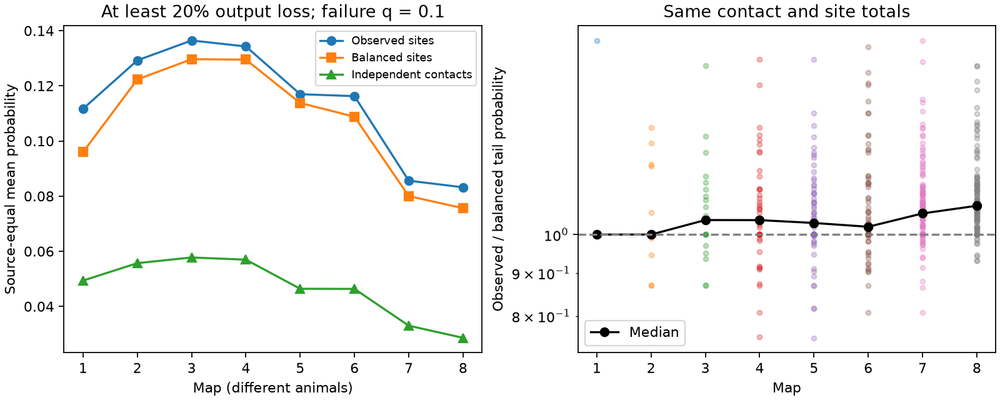
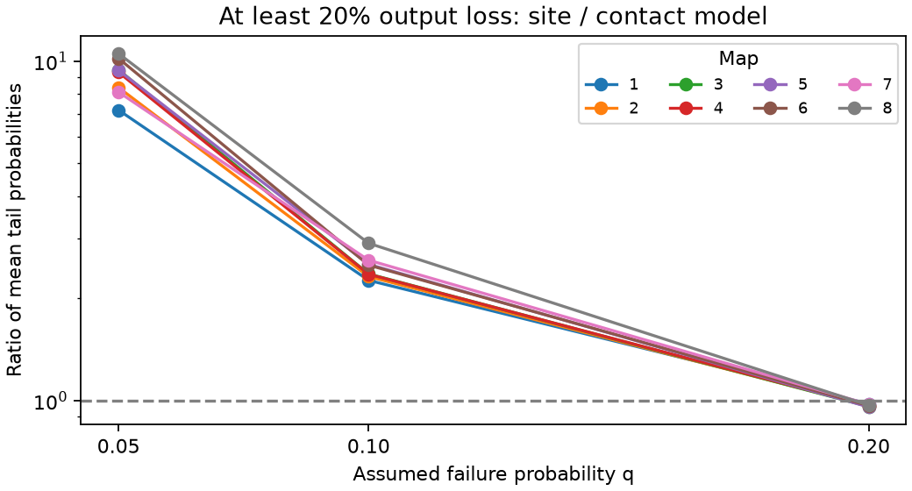

# Shared site loss raised a 20 percent output-loss risk at 10 percent failure in eight selected worm map models

At an assumed site failure probability of 0.1, the mean probability of losing at least 20 percent of a source neuron's output was 2.26 to 2.91 times the independent-contact value in eight selected worm brain maps. This result uses positive unit contact weights and independent failures across anatomical sites. It is a model result, not a measured failure rate. Changing the failure probability to 0.2 reversed the direction for this threshold in every map. Thus a variance increase alone does not specify the change in a tail probability.

Figure 1. Left: source-equal mean probabilities at failure probability 0.1. Right: each source's tail probability divided by its balanced-site value. The black line gives map medians. The balanced model keeps the total numbers of sites and contacts for each source. It changes the number of targets per site. Maps are different animals. Lines do not show a longitudinal change or a population confidence interval.

## Question and prior work

Pairwise contact counts omit the grouping of several targets at one chemical synaptic site. Does this omission change a large-loss probability? Does variation in the number of targets per site matter beyond sharing at sites?

Witvliet et al. (2021), doi:10.1038/s41586-021-03778-8, released eight brain reconstructions across worm development. Their work concerned wiring change during maturation. Liu et al. (2007), doi:10.1002/dneu.20307, reported concurrent miniature currents at worm neuromuscular synapses. This supports shared events as a possible mechanism. It does not establish our failure model for brain sites.

The signed campaign publication SCI 0a2a89fa computed the covariance of shared-site release in the same eight maps. It found increased variance in a sum and reduced variance in some contrasts. We reuse its verified 162-cell panel. We extend its second-moment analysis to exact tail probabilities for each source and to a balanced-site comparison. We do not claim a new probability identity. The new evidence consists of source-level probabilities, parameter checks, and a reproducible finite distribution calculation on these site lists. Search records and the prior text are in files/. We first checked a mouse contact-size question, but the available MICrONS pair table did not have individual contact sizes. That question was not tested.

## Data and selection

The raw data are the eight DatasetN_synapses.json files at repository commit 0646af9d25896ae660f97d462eab2d67282f5625. We read them in place at:

    /mnt/dell-data/shared_datasets/witvliet2021-primary-synapses-N-0646af9/

Files/results/provenance.json gives the exact resolved path, URL, byte count and SHA-256 hash for each used file. We verified each hash against its shared provenance record. No shared files were added or changed. No raw JSON is included in this package.

Files/panel.txt has the same 162 neuron names as the cited prior study. That study selected brain neurons born before hatching. We verified the prior ZIP before reuse. The panel therefore stays fixed across maps. A retained site must have a panel source and at least one distinct panel target other than that source. We count each target once per site. We retain distinct raw sites even if their endpoints match. Files/results/sites.csv records every retained source, target list, raw record index and target count k. This derived evidence is sufficient to inspect site grouping without a new download.

We select sources with at least 20 retained contacts and at least 10 retained sites in each map. This excludes sources for which a single failure could dominate simply because there are few observations. The rule was recorded before calculation in files/plan.txt. It is an internal analysis plan, not an external registration. The selected source sets differ across maps. Map 1 has only four eligible sources. No animal-level uncertainty estimate or developmental trend test is justified. Files/results/eligibility.csv includes all sources with retained sites, including excluded sources. There are 432 selected source-map records; repeated cells across maps are not independent biological replicates.

## Model and exact calculation

For one source, let k_s be the number of retained targets at site s, S the number of sites, and N = sum_s k_s the number of contacts. Each site fails with independent probability q. Its failure removes k_s positive unit contacts. The lost output is L = sum_s k_s Z_s, where Z_s are independent Bernoulli(q) variables. Its probability generating function is:

    G(z) = product_s [(1-q) + q z^(k_s)].

We compute its coefficients by finite convolution and sum the coefficients for L >= ceil(f N). The primary threshold is f = 0.2 and q = 0.1. This calculation uses double precision; it has no Monte Carlo error. In the independent-contact model, L has a binomial(N,q) law. Both models have mean loss q N and equal expected total surviving output. All retained targets at a site fail together only in the site model.

The balanced-site model preserves N, S and q. Write N = a S + r, with 0 <= r < S. Give S-r sites a contacts each and r sites a+1 contacts each. Use the same independent failure law across sites. This is a mathematical reference with the smallest possible sum of squared site counts at fixed N and S. It does not preserve target identities or the directed pair counts. It cannot isolate a biological process that regulates site sizes.

The independent-contact variance is q(1-q)N. The site variance is q(1-q)sum_s k_s^2. These variances explain a spread change, but do not order all tail probabilities. For example, at q=0.1 and threshold 2, site counts [1,3] give tail probability 0.1, whereas balanced counts [2,2] give 0.19. The first has greater variance. Files/validate.py checks this example by finite convolution and checks a separate four-site example by exhaustive enumeration.

## Results

| Map | Sources | Contacts | Sites | Site tail | Contact tail | Balanced tail | Site / contact mean risk |
|---|---:|---:|---:|---:|---:|---:|---:|
| 1 | 4 | 136 | 72 | 0.11167 | 0.04937 | 0.09596 | 2.262 |
| 2 | 12 | 396 | 190 | 0.12925 | 0.05569 | 0.12231 | 2.321 |
| 3 | 21 | 674 | 314 | 0.13645 | 0.05775 | 0.12966 | 2.363 |
| 4 | 44 | 1439 | 689 | 0.13429 | 0.05695 | 0.12950 | 2.358 |
| 5 | 61 | 2379 | 1125 | 0.11697 | 0.04640 | 0.11378 | 2.521 |
| 6 | 68 | 2644 | 1282 | 0.11627 | 0.04636 | 0.10880 | 2.508 |
| 7 | 112 | 5527 | 2891 | 0.08559 | 0.03301 | 0.08001 | 2.593 |
| 8 | 110 | 5961 | 2957 | 0.08321 | 0.02860 | 0.07562 | 2.909 |

Tail values are source-equal means at q=0.1 and f=0.2. The last column is a ratio of means, not the mean or median of individual ratios. There are 430 strict increases over independent contacts and two equalities. Both equalities are map 7 sources with only one target at each site. Their two models coincide.

Compared with balanced sites, map mean risk ratios are 1.028 to 1.164. At the source level, 279 records have greater risk, 72 have smaller risk, and 81 have equal risk to absolute tolerance 1e-14. Thus most of the difference from independent contacts persists without the observed variation in site counts. Variation in targets per site adds a smaller mean effect here, and does not raise every source's tail risk. The common-source records overlap in cells across maps; these counts are descriptive, not independent tests.

Figure 2. At the same 20 percent loss threshold, the direction changes as the failure probability changes. Each curve gives a ratio of source-equal mean probabilities in one map. The threshold is at the mean loss when q=0.2.

At q=0.05, the site/contact mean risk ratio is 7.18 to 10.53. At q=0.2 it is 0.958 to 0.978, below one in all eight maps. At a 50 percent loss threshold, the ratio exceeds one for all three tested q values in each map. All 2,592 source-parameter records are in files/results/source_tails.csv. Large relative ratios for rare events must be read with the absolute probabilities in that table. We do not select a physiological value of q from these results.

## Checks

A second calculation groups sites by k and convolves binomial mass functions for each group. Across all 2,592 site tail values, the maximum absolute difference from the primary recurrence was 3.61e-15. We also checked normalization, expected loss, a small exhaustive example, and equality between unit-site and independent-contact distributions. Files/results/validation.json records the checks. The tests check numerical implementation, not the biological failure law. A second full run gave byte-identical site tables, probabilities, selection tables, map summaries, provenance and primary figure. Files/results/reproduction.json records those checks.

## Scope and limits

The useful result is a circuit-model diagnostic: preserve multi-target site grouping when a model needs large-loss probabilities. A variance ratio is not enough to specify the tail. Balanced site counts recover most, but not all, of the primary mean effect in these selected maps.

The model assumes positive equal contact amplitudes, perfect dependence within a site, and independence between sites. It describes conditional structural output loss. It does not include spikes, membrane filters, inhibition, receptor signs, unequal release probabilities, partial site failures, nonlinear summation or feedback. Anatomical sites can have multiple release locations. Site grouping need not imply that all targets receive the same event. The sum over targets is a selected readout, not a measured downstream voltage or behavioral function.

The maps have partial coverage and annotation errors. Removing out-of-panel targets changes the observed fan-out. Repeated target labels were removed; counts are in selection.csv. The cell eligibility rule changes the sampled sources across animals. No target area weights, site volumes or neural activity recordings enter this test. There is no Allen data analysis in the final test. Transfer across regions, species and behavioral states remains untested. A link to measured reliability requires simultaneous source and target activity and direct information about release dependence.

## Reproduce

Use Python with numpy, pandas, scipy and matplotlib. Exact used versions are in files/results/environment.json. Install dependencies only in a private environment. From a copy of the publication root, with the shared dataset link available:

    python files/analyze.py --datasets /absolute/path/to/datasets --out files/results
    python files/validate.py
    python files/plot_sensitivity.py

Do not write rerun results into a signed original. For an independent private raw copy:

    python files/retrieve.py /absolute/path/to/new_private_data
    python files/analyze.py --datasets /absolute/path/to/new_private_data --out files/results
    python files/validate.py
    python files/plot_sensitivity.py

The retrieval script uses pinned URLs and checks the recorded bytes and hashes. It refuses to overwrite existing files. It must not be used on the shared dataset store. The site table, source probabilities, map summaries and exact model formula permit inspection without the raw data.

## Campaign record and rights

Campaign 11_07_2026. Job sci-1107-dell-neural-structure-and-computation-b4276ba443f3. Topic neural-structure-and-computation. Machine dell. Account codex-andrii. Model gpt-6.1-sol, high reasoning effort, through the Codex harness in T3 Code. No agents were launched. The campaign-machine signature is not a personal authorship claim.

The baseline license covers our code, text, figures and derived summaries. Original source rights remain with their providers. The panel and copied prior text are attributed to the cited baseline-licensed SCI publication. No private keys are included. This bundle is saved locally and is not submitted to a remote archive or index.
