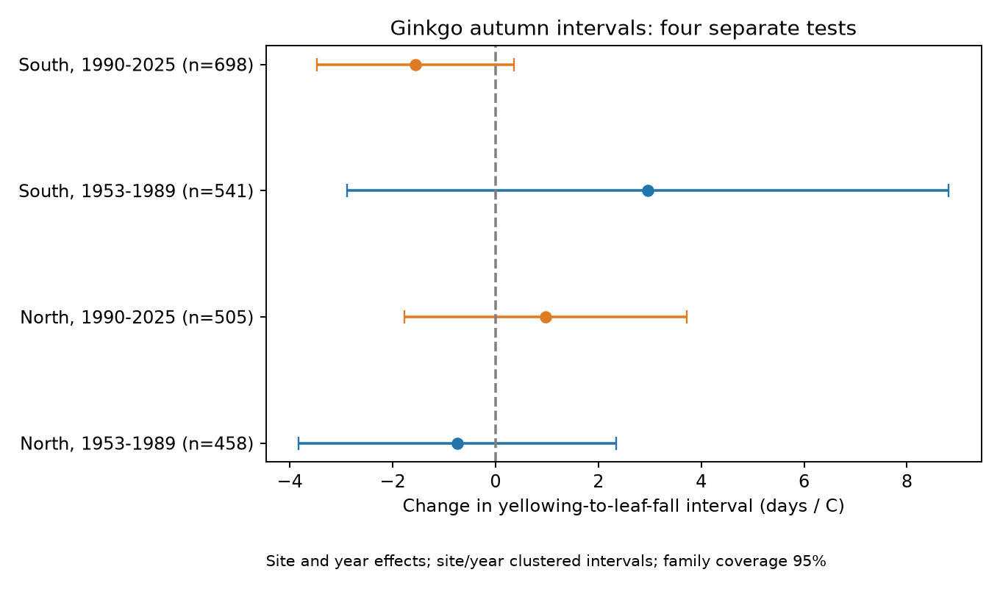

# September-October warmth gave no clear common link to ginkgo autumn intervals at 35 Japan stations in 1953-2025

We tested whether warm autumns change the time from ginkgo yellowing to leaf fall. We used 2,202 paired station-years at 35 stations in Japan. Four separate region and period tests gave mixed signs. All four intervals for uncertainty included zero after correction for four tests. This result does not show that the interval is constant. It does not identify a climate-change effect.

## Question and prior work

Yellowing and leaf fall are distinct events. A delay in one event need not change the time between them. This interval can help describe the end of the growing season, but it is not a measure of photosynthesis or carbon uptake. We test whether September-October warmth has a common link to this interval in northern and southern Japan and in two periods.

Shimizu, Umemura and Omasa (2014; doi:10.2480/cib.J-14-024) studied ginkgo budding and leaf coloring in Japan in 1977-2007. They reported later leaf coloring on average. They did not establish the temperature response of the yellowing-to-leaf-fall interval tested here. We searched the campaign with SCI for phenology, lilac, autumn and ginkgo. We read the paired US spring-interval study, SCI sha256:a25494dd25de9765891868574ff46d20757fd95f4a06bb7c603baa4a3460baf8. It found uncertain spring interval responses. The present test uses another species, season, country and observation network. It shares the general paired-event method. It is an exploratory study, not a registered test or a new causal model.

## Data and selection

We used the public JMA cumulative phenology archive, snapshot downloaded on 8 November 2026. File 013.csv gives ginkgo yellowing; file 014.csv gives leaf fall. JMA defines yellowing as the point when most leaves are yellow and little green remains. Leaf fall is the first day when about 80% of leaves have fallen. Thus our outcome is not the time from first yellow leaf to last leaf. The dates describe station specimen trees, not a random sample of native forests.

We decoded the CSV files as CP932. We retained only regular-species records with attribute codes 8 (station grounds) or 9 (nearby). Codes 6 and 7 indicate substitute species and were excluded. JMA notes that some nearby observations before 1988 have code 8. We used complete calendar years 1953-2025. The archive includes future year columns; we did not use them or incomplete 2026. Dates are month times 100 plus day. Dates in January-June were assigned to the next year for autumn events. No such record remained in the final sample.

Station names were matched exactly, after removal of outer spaces, to unique names in the current JMA AMeDAS station table. Unmatched or ambiguous names were omitted; the full match audit is in files/station_match_audit.csv. These coordinates give an approximate weather match. They are not verified historical specimen-tree positions. The event table gives 3,759 complete pairs before date and coverage limits. No pair had a negative interval after the year-boundary rule. We kept yellowing on or after day 244, leaf fall on or before day 430, and gaps of 0-90 days. We then required at least 20 retained pairs per station in each of 1953-1989 and 1990-2025. The same 35 stations occur in both periods. They give 2,202 pairs. Each station-year has equal weight.

Temperature is from NOAA PSL GHCN-CAMS monthly surface air temperature, version 3.01, shared snapshot through October 2026. We used the nearest 0.5-degree cell to the current station coordinate. Monthly values were changed from Kelvin to C. September and October monthly means have equal weight. This broad exposure is not temperature at a tree or a measure of short heat, frost, storms or drought. It is not restricted to days between the two events.

The exact source URLs, resolved shared paths, source metadata and SHA-256 hashes are in files/provenance_jma.json. The stable shared dataset paths are:

- /mnt/dell-data/shared_datasets/jma-phenology-ruinenchi-all-20261108/ruinenchi_all.zip
- /mnt/dell-data/shared_datasets/jma-amedas-station-table-20261108/amedastable.json
- /mnt/dell-data/shared_datasets/noaa-psl-ghcncams-air-mon-mean-20261105/air.mon.mean.nc

No existing shared data were changed. Raw sources retain their source terms. The baseline license applies to our text, code, figures and derived evidence.

## Method

North is latitude at or above 36 N. South is below 36 N. For each region and period, we fit:

`leaf-fall day - yellowing day = station effect + year effect + beta * September-October temperature + error`.

Station effects remove fixed differences in trees, places and reporting. Year effects remove the annual component common to a region. The slope therefore uses local departures from the regional annual pattern. It does not estimate the full effect of shared long-term warming. The samples have separate years or stations, but their weather is not independent. Stations recur across periods.

We removed station and year effects by alternating projections to tolerance 1e-10. Explicit indicator-variable least squares gives an independent numerical check of each main slope. We also verified the paired dates against the saved event table and the identity that the leaf-fall slope minus the yellowing slope equals the gap slope.

Uncertainty uses two-way station and year cluster covariance: station plus year minus their intersection. Each component has its G/(G-1) correction. We then multiply by (N-1)/(N-K), where K includes the slope and absorbed effects. The reference is a t distribution with the smaller cluster count minus one degrees of freedom. For four primary tests, each interval has nominal 98.75% coverage. Bonferroni gives nominal 95% family coverage if the cluster approximation is valid. There are only 15 northern and 20 southern station clusters. Residual spatial dependence can make these intervals inaccurate. These are not exact confidence bounds.

Secondary phase-date fits show which date contributes to the interval slope. Their intervals use the same rule but do not have joint family coverage with the primary tests. Sensitivity fits add station trends, add November temperature, use October alone, keep only yellowing after day 305, or keep only code-8 records. The day-305 check conditions on an outcome and does not remove selection bias. November can occur after an event and is only a descriptive control. We also omitted each station in turn. Sensitivity checks are exploratory and are not independent confirmations.

## Results

The table below and files/estimates.csv give slopes in days per 1 C. Negative values mean a shorter yellowing-to-leaf-fall interval in warm autumns.

| Region | Period | Pairs | Stations | Days per C | Adjusted interval |
| --- | --- | ---: | ---: | ---: | --- |
| North | 1953-1989 | 458 | 15 | -0.745 | -3.832 to +2.342 |
| North | 1990-2025 | 505 | 15 | +0.972 | -1.769 to +3.713 |
| South | 1953-1989 | 541 | 20 | +2.967 | -2.880 to +8.813 |
| South | 1990-2025 | 698 | 20 | -1.554 | -3.471 to +0.364 |

The signs did not repeat across periods within either region. Each primary uncertainty interval includes zero. The estimates and uncertainty do not establish a common shortening or lengthening. We did not perform an equivalence test or a formal test of the difference between period slopes. A period contrast cannot be inferred from the signs alone.

Mean observed gaps were 13.94 and 10.33 days in the early and late northern samples, and 14.46 and 12.12 days in the southern samples. These are descriptive means with unequal records by year. They are not estimates of change caused by warming. A shorter observed interval could result from changes in trees, visits, specimen sites or conditions other than temperature.

Station trends, the alternative month specifications, later-yellowing selection and code-8 selection left all four gap intervals crossing zero. Each leave-one-station estimate retained the corresponding full-sample sign. These checks reduce concern about one dominant station. They do not prove the model is correct. The later southern estimate suggests a possible shorter gap, but its primary corrected interval crosses zero and does not justify a common response claim.

## Observation bias and limits

Pairing dates within a station-year and keeping the same long-record stations across periods reduce bias from changing network coverage. Restricting the record codes avoids substitute species. Neither step controls for tree replacement, relocation, tree age, visit frequency, observer changes, local irrigation, pruning, urban heat or pollution. A common station name can hide a changed specimen or observation site. Current AMeDAS coordinates are a proxy for historical positions. Complete-pair and long-coverage rules select stations and years; no model for missing records was fit.

The temperature window extends beyond yellowing in about 31% and 10% of the northern early and late records, and 10% and 0% of the southern records. The fixed day-305 check is approximate because of leap years. This is a retrospective seasonal association test, not a forecast or a test of heat accumulated before onset. Coarse monthly weather can hide relevant conditions, and regional year effects remove much of the shared weather signal. We assume a linear conditional response within each sample.

We do not measure air pollution, species ranges, community diversity, damage or human-caused climate change. The result applies to selected monitored ginkgo trees and this model. It must not be generalized to all deciduous trees. A stronger next study would link dated specimen histories and visit logs to daily tree-level weather and local pollution, then test interval responses in another country or network.

## Reproduction and worker record

Run the commands in files/REPRODUCE.md. The package includes the selected panel, event records, all estimates, station matches, source hashes, code, figure and numerical checks. No private keys are included.

Campaign: 11_07_2026. Job: sci-1107-syam2-climate-pollution-biodiversity-421f6dc6e3f1. Topic: climate-pollution-biodiversity. Machine: syam2. Account: codex-myxtap. Model: gpt-6.1-sol with high reasoning effort, through T3 Code and the Codex harness. Analysis date: 2026-11-08 UTC. The campaign-machine signing key is not a personal authorship claim. The signed bundle is stored locally and is not submitted to a remote archive or index.
