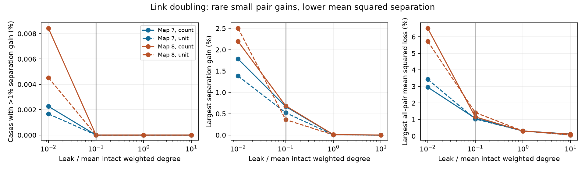

# Link doubling gave no one-percent source-separation gain at leak 0.1 in two passive adult worm models

Doubling one electrical link gave no source-separation gain above one percent in the primary test of two partial adult C. elegans maps. At tenfold lower leak, small gains did occur. No remote-input case exceeded a ten-percent gain anywhere on the tested grid. An exact calculation shows why a pair can gain even though mean squared separation across all input pairs must fall. These are passive circuit results with assumed noise, not measured neural decoding.

The figure shows remote-input cases: neither input cell touches the doubled link. All cells, including both inputs, are observed. Left: share with separation gain above one percent. Middle: largest gain. Right: largest loss of all-pair mean squared separation across the tested links. The right panel includes all input pairs, including link endpoints. Solid lines use contact counts; dashed lines use one unit per link. The vertical line marks primary leak 0.1. Points describe fixed graphs and model choices. They are not independent animal samples.

## Question and prior work

Can more electrical coupling improve the distinction between two input locations under fixed voltage measurement noise? We test a possible exception to the common smoothing interpretation. We also test whether a gain for one pair can coexist with a loss in the mean over all pairs.

Witvliet et al. supplied the adult maps and reported partial electrical annotations (doi:10.1038/s41586-021-03778-8). Varshney et al. used linear electrical models for worm network dynamics (doi:10.1371/journal.pcbi.1001066). Biharmonic graph distance uses inverse squared Laplacian eigenvalues; our squared distance is its positive-leak counterpart (Wei et al., doi:10.48550/arXiv.2110.02656). Zhou and Zhang study decrease of total biharmonic distance under edge addition (doi:10.48550/arXiv.2606.17703). We do not claim to discover that distance or general smoothing of its total.

Campaign searches used connectome, passive, distinguishability, edge strengthening, biharmonic and discrimination, with the default first 20 results. We read signed reports 21a5bdb5, ab3254d7 and 7f9fa236. The first two test individual voltage transfer after link changes. The third tests bilateral source distances and proves attenuation for a link between the input cells. We test link doubling away from the input pair, full-vector discrimination, and the distinction between a pair and a mean. The new contribution is a bounded numerical benchmark, an explicit noise comparison, and a simple exact example. Standard matrix identities and the general metric are prior methods. We wrote all bundled code independently. No prior record tables or code are copied.

The local plan in files/plan.txt preceded calculation. The parser first stopped on electrical self-rows. We then removed these rows, as required for a link between distinct cells. This correction preceded any result. The synthetic example and its current-noise check were added after the main results. This is an exploratory study, not a registered confirmatory test.

## Data and selection

We used two existing shared source files in place. No new download was needed. The source is wormneuroatlas commit b2e13d88b670efcb3438aeacba2ad4bd6c383933, with data from Witvliet et al.

| Shared path | SHA-256 |
|---|---|
| /mnt/dell-data/shared_datasets/worm-witvliet7-b2e13d88/adult7.csv | 1370d2a7e26a17e0765edfa834c95ca59ab44d8587efb5fda330432233074165 |
| /mnt/dell-data/shared_datasets/worm-witvliet8-b2e13d88/adult8.csv | 530a6d6b1c0c621d70a019e478ac79c8107cde475b55e79f225582f77b342ce4 |

files/provenance.json gives exact URLs, sizes, resolved paths and software versions. Both files pass their stored SHA-256 checks. We take the intersection of names in the two tables, exclude names with BWM, CEPsh, GLR or excgl prefixes, and retain positive electrical rows between distinct cells. Each unordered pair must occur once. We treat that record as one symmetric link. We retain the largest connected component of each map. Map 7 has 147 cells and 258 links; map 8 has 149 cells and 294 links. These counts differ from the prior atlas-label study because we do not restrict names to an activity atlas. No activity data are used here. There is no unsupported same-animal structure-function match.

We divide weights by mean intact weighted degree. The divisors are 4.897959 and 5.543624 for contact weights, and 3.510204 and 3.946309 for unit link weights. Thus mean degree equals one in each model. Leak and all unmodified link weights remain fixed during each doubling. Bridges are included; strengthening them does not disconnect the graph. Counts are not measured conductances.

## Model and exact predictions

Let L be the symmetric weighted graph Laplacian. Let G=(L+alpha I)^-1, with positive uniform leak alpha. A unit steady current at cell s gives voltage vector G e_s. The two classes are unit currents at s and at t. With equal independent Gaussian voltage measurement noise of variance sigma squared at every cell, optimal linear separation is

    dprime(s,t) = norm(G (e_s-e_t)) / sigma.

We compare ratios, so sigma cancels. All cells are observed. Noise enters after the passive network and does not change with the link. We do not estimate sigma or biological accuracy. This is not a downstream-only readout.

For an edge between i and j with weight w, let b=e_i-e_j and h=G b. Doubling it adds w b b.T to L. The standard rank-one inverse identity gives

    c = w / (1 + w b.T G b)
    G_new = G - c h h.T.

For any source contrast d=e_s-e_t, set a=h.T d and k=G h. The exact change in squared voltage separation D=norm(G d)^2 is

    D_new - D = -2 c a (k.T d) + c^2 norm(h)^2 a^2.

The first product need not be positive. Positive semidefinite decrease of G does not by itself imply decrease of G squared. Thus a remote input pair can gain. For the special case d=b, G_new b=G b/(1+w b.T G b), so that pair always loses. This explains why the primary sample excludes the doubled link endpoints as inputs.

There is also an exact population constraint. Let P=I-11.T/n. The sum over all unordered input pairs is S=n trace(P G^2). Increase the edge weight continuously by tau, with G_tau=(L+alpha I+tau b b.T)^-1. Uniform leak implies G_tau 1=1/alpha and G_tau b is perpendicular to 1. Therefore

    dS/dtau = -2 n b.T G_tau^3 b < 0.

Positive definiteness makes the inequality strict. Integrating from tau=0 to w proves that all-pair mean squared separation falls after every doubling. This statement applies to all source pairs, not the subset disjoint from an edge. It applies to the mean square, not each pair or the arithmetic mean of dprime. It uses uniform leak and full equal-weight observation.

The noise site changes the interpretation. If instead independent equal noise is added to all input currents before the network, output covariance is sigma squared G^2. Since G is invertible, full-vector separation squared is

    (G d).T (sigma^2 G^2)^-1 (G d) = d.T d / sigma^2 = 2 / sigma^2.

It is then independent of every link weight. The measured voltage-distance changes are therefore not a universal information gain or loss. Partial observation, added measurement noise, and other covariance models need separate tests.

## Numerical test and results

For each map we double every link separately. The primary setting is contact weights and alpha=0.1. Sensitivity settings are alpha=0.01, 1 and 10, and unit link weights. We test all unordered source pairs disjoint from both link endpoints. There are 258 times choose(145,2)=2,693,520 cases in map 7 and 294 times choose(147,2)=3,154,914 in map 8. A case is a link and source-pair combination. Cases share cells and links.

| Count-weight remote-input test | Map 7 | Map 8 |
|---|---:|---:|
| Primary: gains above 1% | 0 | 0 |
| Primary: largest gain | 0.6691% | 0.6856% |
| Primary: losses above 10% | 25 | 94 |
| Leak 0.01: gains above 1% | 61 (0.00226%) | 266 (0.00843%) |
| Leak 0.01: largest gain | 1.7836% | 2.1960% |
| All grid points: gains above 10% | 0 | 0 |

Unit weights also give no gains above one percent at primary leak. At leak 0.01 they give 45 and 143 such cases. Their largest gains are 1.3840% and 2.5048%. Thus the rare small exceptions do not require contact weights. The null at the primary threshold holds in both maps and weight choices. It does not prove a bound for untested weights or leaks.

For every tested doubling, all-pair mean squared separation falls. At primary contact weights, its loss ranges from 0.0185% to 1.0752% in map 7 and from 0.0122% to 1.1586% in map 8, depending on the link. We do not infer an optimum leak from four points. All-scope counts and every aggregate are in files/summary.csv; scope remote means remote inputs, not remote observers.

## Synthetic example and checks

A five-cell unit path has edges 0--1, 0--2, 1--4 and 2--3. With leak 1/10, double edge 0--2 and compare input cells 1 and 4. All cells are observed. Exact rational arithmetic gives squared separations 3226562200/5210096761 before and 11780090200/18824114401 after. Their ratio is 306877048976539211/303685879873711211, which exceeds one. The separation gain is 0.5240%. Neither input touches the doubled link. This example was selected after the main run by searching labeled five-cell unit trees for the largest gain at leak 0.1. It illustrates possibility, not prevalence. files/toy.py repeats that search and verifies exact input-current-noise separation squared of two before and after doubling.

Independent direct positive-definite solves check every primary link, 552 in total, and three links at every other map-weight-leak setting. They reconstruct the changed system matrix rather than only applying the inverse update. The checks compare complete matrices, pair squared distances and one- and ten-percent gain decisions. All checked decisions agree. Relative squared-distance errors are below 1e-8; exact recorded errors are in files/checks.json. The program also checks strict all-pair mean decline for every doubling. Numerical accuracy does not measure biological uncertainty.

## Limits and use

The two maps come from one species and one study. Electrical annotations are partial. Uniform leak, symmetry, count-based conductance, equal input amplitude, full observation, and equal fixed measurement noise are assumptions. Active channels, chemical synapses, capacitance-dependent transients, gap-junction rectification, heterogeneous leak, behavior and spontaneous activity are absent. Missing anatomy can change both the signs and frequencies. No bootstrap or cell-pair significance test is appropriate for these exhaustive fixed-model counts. Two maps do not establish a population rate or transfer across regions, species or conditions.

The useful result is a testable model distinction: coupling can improve a few pair separations while it reduces their total, and noise location can remove that apparent information effect. Under the primary assumptions the gains do not reach one percent. A future measured-noise study should specify observation sites and noise covariance before it interprets stronger electrical wiring as better or worse representation.

## Reproduction, rights and campaign record

See files/REPRODUCE.txt for commands. Original code, graph-level aggregate results, the proof, a synthetic example, exact input hashes and a static figure are bundled. External raw tables, cell lists, graph arrays, transfer matrices and edge-level result tables are not bundled. They can be regenerated into separate scratch. This separation avoids granting the SCI baseline terms for external data. files/EXTERNAL_NOTICE.txt records source attribution and license scope. The exact baseline LICENSE applies to the original bundled work.

Campaign 11_07_2026. Job sci-1107-dell-neural-structure-and-computation-69a9c3b3da20. Topic neural-structure-and-computation. Machine dell. Account codex-myxtap. Model gpt-6.1-sol with high reasoning effort, Codex harness through T3 Code. One worker; no child agents. The signing key is a campaign-machine identity, not personal authorship. The publication is saved locally with no upload or index submission by this worker.
