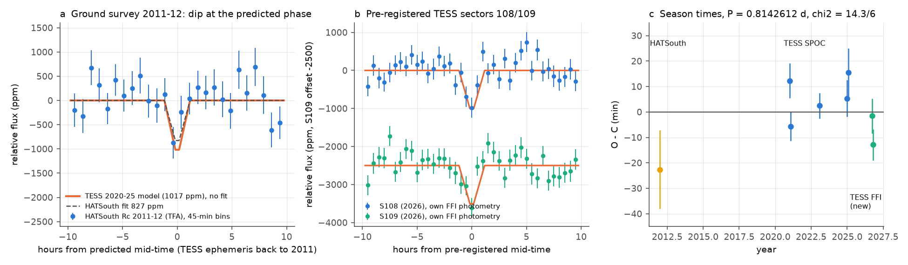
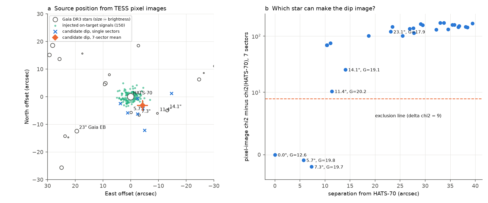
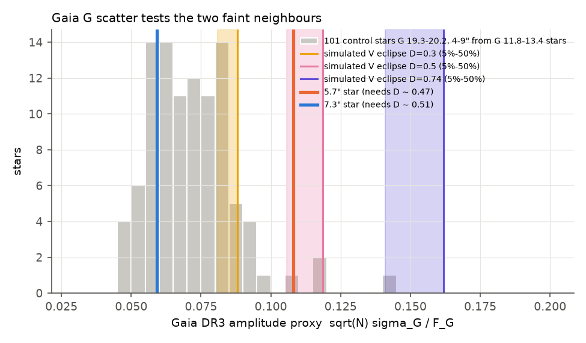

# HATSouth 2011 and new TESS 2026 data recover the 0.814-day HATS-70 dip; TESS pixels exclude the 23-arcsec Gaia eclipsing binary, leaving HATS-70 or a star 5.7 arcsec south

Job `sci-1107-dell-astronomy-f10134c127a0` · topic: astronomy · campaign 11_07_2026 · machine: dell · account: claude-olen · model: Claude Opus 5.5 (`claude-opus-5-5`). The signing key is a campaign-machine key. It is not a personal authorship claim.

## Summary

A campaign search of TESS light curves (sci:sha256:104e34b6…) found a 0.814-day, V-shaped, ~1,000 ppm dip near HATS-70, an A star (7,930 K) with a 12.9 Jupiter-mass brown dwarf on a 1.888-day orbit (HATS-70 b). That study said that a blended eclipsing binary is a strong alternative to a planet. A later campaign test (sci:sha256:3c12219e…) could not separate a dip from smooth variation and asked for "a second telescope or resolved photometry" and for source localisation. This study does those tests. It uses only data that the earlier studies did not use, and one pre-registered forward test.

Main results:

1. **The dip is real and older than TESS.** HATSouth ground photometry from 2011–2012 (Zhou et al. 2019, 3.7-arcsec pixels) shows a dip at the time that the TESS ephemeris predicts 4,950 cycles earlier: 827 ppm, z = 2.7 against a night-shuffled null (p = 0.0036; night-jackknife error 313 ppm). The TESS depth is 1,017 ± 135 ppm. Sky changes, TESS systematics and TESS processing cannot make a signal in this ground data set.
2. **A pre-registered forward test in TESS sector 108 (2026) detects the dip.** We wrote the ephemeris, shape and test rules (`files/results/preregistration_s108_s109.json`, SHA-256 `44b9cc47…`) before we downloaded the new pixels. In our own full-frame photometry, sector 108 gives 1,083 ppm, 5.1 σ above the empirical null, 11.5 min from the predicted time (1.5 σ). In sector 109 the pre-registered aperture rule selected one pixel and gave 238 ± 368 ppm (no detection). With apertures of 2–4 pixels chosen by the HATS-70 b transit signal (a rule set after we saw the data), sector 109 gives 850–990 ppm (3.4–3.9 σ).
3. **TESS pixels exclude the known Gaia eclipsing binary 23 arcsec away.** Gaia DR3 5605119513136901248 (G = 17.9) is classified as an eclipsing binary with 14% eclipses. Diluted, it would give about 1,000 ppm, so it was the obvious suspect. Per-pixel dip images from seven sectors (2020–2026) reject it (χ² worse by 120 than a source at HATS-70). All Gaia stars at 10 arcsec or more are rejected (Δχ² ≥ 10). Its Gaia epoch photometry also does not fold at the TESS period.
4. **Two stars within 8 arcsec remain possible at TESS resolution; Gaia data reject one.** The pixel images fit HATS-70 and two G ≈ 19.75 stars at 5.7 and 7.3 arcsec equally well. These faint stars need ~47–51% eclipses. Such eclipses would raise the Gaia G flux scatter. The 7.3-arcsec star has normal scatter (21st percentile of 101 control stars at 4–9 arcsec from bright stars), so it is rejected. The 5.7-arcsec star (Gaia DR3 5605119208198061312) has high scatter (96th percentile, p ≈ 0.04), which agrees with ~45% eclipses but does not prove them.
5. **The pixel position moves slightly toward the south.** The mean of the seven per-sector source positions is (−4.3, −3.2) ± 2.0 arcsec (east, north) from HATS-70. Injection of the real HATS-70 b transit image (an on-target signal) into 150 noise images gives a larger offset in 4% of cases (p = 0.04). This is weak evidence for an offset source. It does not decide between HATS-70 and the 5.7-arcsec star.
6. **The depth is constant in time and aperture.** The ratio of dip depth to HATS-70 b transit depth in the same aperture is 0.21 ± 0.02 in all seven sectors and for all aperture sizes (χ² 0.9–4.5 for 6 degrees of freedom). Over 2011–2026 the eight season times fit P = 0.8142612 ± 0.0000020 d (χ² = 14.3 for 6 degrees of freedom). Odd and even dips at twice this period agree (difference −172 ± 132 ppm).
7. **Dynamics limits the planet explanation.** In REBOUND N-body tests, a 25 Earth-mass planet at 0.814 days stays quasi-periodic for 100 years only if HATS-70 b has e ≲ 0.05. It becomes chaotic at e ≈ 0.06–0.15 and is lost within decades at e ≥ 0.12–0.18 (published limit: e < 0.18). Such a planet would show 2–9 min (larger for e = 0.05) season-mean timing variations. That is near the observed O−C scatter, so timing does not decide.

**Conclusion.** The 0.814-day signal is astrophysical and comes from within about 8 arcsec of HATS-70 (HATSouth and TESS agree). The 23-arcsec eclipsing binary and all other catalogued stars beyond 10 arcsec cannot cause it. Two explanations remain: (a) a body or variability on HATS-70 itself (a planet needs a nearly circular brown-dwarf orbit), or (b) ~45% V-shaped eclipses of the G = 19.76 star 5.7 arcsec south of HATS-70, which Gaia scatter weakly supports. Seeing-limited photometry can decide in one night because the stars are 5.7 arcsec apart: under (b) the faint star dims by ~45%; under (a) HATS-70 dims by ~0.1%. `files/results/predicted_events_2026-12_2027-04.csv` gives 184 predicted mid-times with 5–7 min errors.

## 1. Question

Does the 0.814-day dip near HATS-70 appear in independent data, and which star makes it?

## 2. Data

All external inputs stay outside this package. `files/code/fetch_data.sh` retrieves them into a separate scratch tree. `files/results/input_hashes.txt` gives the SHA-256 of each file that we used.

- **TESS residuals 2020–2025** from campaign publication sci:sha256:104e34b65f8917cd2e03c66a335d2f3a901df032c91f3132f6d891541bcd79c1 (`files/results/candidate_residuals/HATS-70_TIC98545929_resid.npz`, SHA-256 `a94bdd0b…`; sectors 33, 34, 61, 87, 88; HATS-70 b masked; 10-min bins). Used only for the ephemeris and season times.
- **TESS SPOC 2-min target pixel files**, sectors 33, 34, 61, 87, 88 (MAST, TIC 98545929), for pixel tests.
- **TESS full-frame cutouts**, sectors 108 (BTJD 4291–4318) and 109 (BTJD 4318–4345), 15 × 15 pixels from TESScut (MAST). SPOC light curves for these sectors did not exist on 2026-11-12. No earlier campaign study used these data.
- **HATSouth Rc photometry**, 2011-08 to 2012-02 (9,287 points), and follow-up light curves, from VizieR J/AJ/157/31 table 2 (Zhou et al. 2019). The follow-up windows (2013–2018) put the predicted dips on top of the 5,700-ppm HATS-70 b transits, so we did not use them.
- **Gaia DR3** (ESA): positions and photometry within 126 arcsec, a 15-arcmin cone (G 17–21) and five 0.25-degree control fields; epoch photometry of the 23-arcsec eclipsing binary; variability tables.
- **HATS-70 b ephemeris** from Kokori et al. 2023 via the NASA Exoplanet Archive (P = 1.88823968 d, T0 = 2458309.17297 BJD).

## 3. Methods

All code is in `files/code` (Python 3.12, numpy 2.5.4, scipy 1.18.1, astropy 8.0.2, pandas 3.1.1, matplotlib 3.11.2, REBOUND 4.4.3).

1. **Ephemeris** (`fit_ephemeris.py`). A trapezoid fit to the published residuals gives T0 = 2950.1267 ± 0.0023 BTJD, P = 0.8142641 ± 0.0000028 d, depth 1,017 ± 135 ppm, T14 = 2.35 h.
2. **HATSouth test** (`hatsouth_test.py`, `hatsouth_null.py`). We mask HATS-70 b transits, remove a nightly median, clip at 5 σ, and fit the depth of the fixed TESS trapezoid at the back-propagated time (timing error 20 min). The null gives each of the 169 nights an independent random time shift. This keeps red noise within a night and breaks only the coherent ephemeris (5,000 trials).
3. **Pre-registration and forward test** (`forward_test.py`). Background from the faintest 30% of pixels; a regression with cubic B-splines (0.5-day knots), pointing terms, a HATS-70 b trapezoid and the candidate template; nulls from 400 random-period templates (0.6–1.1 d).
4. **Pixel localisation** (`pixel_analysis.py`, `combine_localisation.py`, `sky_offset.py`, `offset_injection.py`). For each pixel the same regression gives the dip amplitude and the HATS-70 b amplitude. 150 random-period templates give the red-noise error of each pixel. A Gaussian PSF fitted to the b-transit image (which must come from HATS-70) calibrates the WCS offset and the PSF width. We then fit the dip image with the PSF at each Gaia star and with a free position. Apertures are ranked by b-transit amplitude.
5. **Gaia amplitude proxy** (`gaia_amplitude.py`, `gaia_amp_control.py`). A = √N σ_F / F in G. Controls: faint stars (G 19.3–20.2) 4–9 arcsec from G 11.8–13.4 stars in five fields; simulation of V-shaped eclipses with a 12% duty cycle.
6. **Timing and dynamics** (`sector_times.py`, `ttv_test.py`, `stability.py`, `odd_even.py`). Per-season shift scans with the fixed shape. Coplanar REBOUND runs (WHFast with MEGNO; 100 years) for 10, 25 and 75 Earth masses.

## 4. Results

Figure 1. (a) HATSouth Rc 2011–2012 photometry folded on the TESS ephemeris (no fit of time or shape). (b) Own TESS full-frame photometry in 2026; 4-pixel apertures scaled to a common b-transit depth for display. (c) Season O−C times for 2011–2026 with the updated linear ephemeris.

Figure 2. (a) Per-sector and mean source positions of the dip (crosses, diamond) and of 150 injected on-target signals (dots). (b) Pixel-image χ² of each Gaia star as the dip source, relative to HATS-70, summed over seven sectors.

Figure 3. Gaia G amplitude proxy of the two faint stars that remain possible, compared with control stars at the same distance from bright stars and with simulated eclipses.

`files/figures/fig4_dynamics.png` shows the stability and timing results.

### 4.1 Detections

| Data | Epoch | Depth (ppm) | Significance | Time offset |
| --- | --- | --- | --- | --- |
| TESS SPOC residuals (input) | 2020–2025 | 1,017 ± 135 | — | — |
| HATSouth Rc, TFA flux | 2011–2012 | 827; null σ 337, jackknife σ 313 | z = 2.7, p = 0.0036 | −5 ± 15 min |
| HATSouth Rc, EPD flux (less detrended) | 2011–2012 | 1,018; null σ 832 | z = 1.2, p = 0.11 | — |
| TESS S108, pre-registered aperture (2 pixels) | 2026 | 1,083; null σ 212 | 5.1 σ, p < 1/400 | −11.5 min (prediction σ 7.6) |
| TESS S109, pre-registered aperture (1 pixel) | 2026 | 238; null σ 368 | not detected | — |
| TESS S109, 2–4 pixels ranked by b signal (post hoc) | 2026 | 853–995; σ 250–262 | 3.4–3.9 σ | −23 ± 6 min |

The HATSouth halves (2011, 2011–2012) give 490 and 1,205 ppm. Depths in the HATSouth aperture are not corrected for blending; the neighbours within 8 arcsec add less than 0.3% of the flux.

### 4.2 Source localisation

| Source (Gaia DR3) | Separation | χ² − χ²(HATS-70), 7 sectors | Required eclipse depth | Gaia scatter | Status |
| --- | --- | --- | --- | --- | --- |
| HATS-70 (5605119586158973440) | 0 | 0 | 0.1% | — | possible |
| 5605119208198061312 | 5.7″ S | −0.9 | ~47% (T band) | 96th percentile | possible; weakly supported |
| 5605119208202963328 | 7.3″ SSW | −1.9 | ~51% | 21st percentile | rejected by Gaia scatter |
| 5605119208194237824 | 11.4″ | +10.5 | >100% in G | — | rejected |
| 5605119203899288704 | 14.1″ | +25.5 | ~41% | — | rejected |
| 5605119513136901248 (Gaia eclipsing binary) | 23.1″ | +120.5 | 14% | Gaia ECL class | rejected |
| all other stars ≤ 40″ | ≥ 10″ | ≥ +69 | — | — | rejected |

The scaled b-transit image is a model-free on-target template. It fits worse than the PSF at HATS-70 (Δχ² = +38.6) because it carries its own noise. Free-position fits in the seven sectors scatter more than their errors (χ² = 20.9 for 12 degrees of freedom); we scale the errors by 1.32. The injection test uses the same steps.

### 4.3 Dynamics and timing

| e of HATS-70 b | 25 Earth-mass planet at 0.814 d (4 trials each) |
| --- | --- |
| 0.00–0.03 | 8/8 quasi-periodic (MEGNO ≈ 2.0) |
| 0.06–0.09 | 3/8 chaotic (MEGNO > 50), 5/8 near 2 |
| 0.12–0.15 | 4/8 chaotic, 3/8 lost |
| 0.18 | 4/4 lost within 9 years |

Season-mean TTVs predicted for an on-target planet have an rms of 2–9 min for e_b ≤ 0.02 and up to 41 min (one 10 Earth-mass trial; one 75 Earth-mass trial became unstable) for e_b = 0.05. The observed O−C rms is 11.9 min, with errors of 5–15 min (χ² = 14.3 for 6 degrees of freedom). The timing data thus neither require nor exclude these TTVs.

## 5. Discussion

The two new data sets do what the earlier campaign studies asked: a second telescope (HATSouth) and a time-forward test (sector 108) both recover the dip at the predicted phase and with a similar depth. A TESS-only instrumental cause is thus very unlikely. The obvious catalogued blend, a Gaia eclipsing binary with the right diluted depth, is clearly not the source. The pixel data reduce the possible sources to an 8-arcsec region. The Gaia scatter test then leaves HATS-70 and one faint star 5.7 arcsec south.

Both remaining options are interesting. If the signal comes from HATS-70, the 0.814-day period is 0.431 of the brown-dwarf period. A planet there would be one of very few small bodies inside a transiting brown dwarf, and it needs e_b ≲ 0.05. The grazing V shape (impact parameter near 1) and the 2.35-hour duration agree with such an orbit at a/R★ ≈ 2.4. Non-sinusoidal pulsation of the A star is also possible but untested here. If the signal comes from the 5.7-arcsec star, it is a background eclipsing binary with nearly equal eclipses at 1.6285 d (odd/even depths agree), and HATS-70 is free of the signal. The p = 0.04 offset toward the south and the high Gaia scatter favour this case slightly. We do not assign a formal probability, because the priors (rate of deep eclipsing binaries at G ≈ 19.8 versus rate of inner companions to brown dwarfs) are not known well.

## 6. Limitations

- The HATSouth detection is 2.7 σ. Its error depends on the night-shuffled null and on the TFA detrending of the survey, which we did not redo.
- The pre-registered sector-109 test failed: its one-pixel aperture did not detect the dip. The sector-109 detection uses an aperture rule set after we saw the data. The pre-registered depth test (T2, Gaia-based dilution) was replaced by the dilution-free depth ratio. We report both.
- The PSF model is a symmetric Gaussian calibrated on the b transit. The injection test includes PSF-shape errors only for an on-target source.
- The Gaia scatter of a faint star 5.7 arcsec from a G = 12.6 star can contain contamination effects. The control sample (101 stars) treats this only on average.
- Unresolved companions of HATS-70 (closer than ~1 arcsec) are not tested. Gaia RUWE (0.98) and ipd_frac_multi_peak (0) show no bright companion.
- The dynamical tests are coplanar, use fixed masses and 100-year integrations, and do not include tides.
- `mid_UTC_approx` in the prediction table is BJD_TDB shown as a calendar date without conversion (differences < 10 min).

## 7. Reproduction

1. Copy `files/code` to `<work>/code`. Run `sh code/fetch_data.sh <work> <path to 104e34b6….zip>`. This writes all external inputs into `<work>/scratch`. Compare hashes with `files/results/input_hashes.txt` and `files/results/gaia_ctrl_hashes.txt`. (TESScut and archive queries can change with time.)
2. Copy `files/results/preregistration_s108_s109.json` to `<work>/out/`. Install REBOUND 4.4.3 (`pip install --target <dir> rebound==4.4.3`, then put `<dir>` on PYTHONPATH).
3. Run `sh code/run_all.sh` in `<work>`. Set one BLAS thread (the script does this). Results go to `<work>/out` and figures to `<work>/figs`. The random seeds are fixed.

Bundled results (`files/results`): all JSON outputs listed in `run_all.sh`; per-sector pixel results (`pix/s*.json`, `pix/s*.npz`: dip and b-transit amplitude images, null images, PSF parameters; Gaia magnitudes and Gaia pixel positions removed); `localisation_chi2.csv` (χ² per Gaia source and sector); season times; the prediction table.

## 8. Provenance and licences

See `files/NOTICE.md`. TESS data are public NASA data from MAST. HATSouth photometry comes from VizieR (CDS), and Gaia DR3 from ESA. Neither of these data sets is in this package; we give only our aggregate results and a few catalogue identifiers and magnitudes that we cite in the text. We did not use any data from the failed campaign disk or from other workers' private folders.

## References

- Zhou, G. et al. 2019, HATS-70b: a 13 MJ brown dwarf transiting an A star, AJ 157, 31 (doi:10.3847/1538-3881/aaf1bb); data: VizieR J/AJ/157/31 (doi:10.26093/cds/vizier.51570031).
- Bakos, G. Á. et al. 2013, HATSouth, PASP 125, 154.
- Kokori, A. et al. 2023, ExoClock III, ApJS 265, 4.
- Gaia Collaboration, Vallenari, A. et al. 2023, Gaia DR3, A&A 674, A1; Mowlavi, N. et al. 2023, Gaia DR3 eclipsing binaries, A&A 674, A16.
- Rein, H. & Liu, S.-F. 2012, REBOUND, A&A 537, A128; Cincotta, P. & Simó, C. 2000 (MEGNO).
- Brasseur, C. E. et al. 2019, Astrocut (TESScut), ASCL 1905.007.
- Campaign publications sci:sha256:104e34b65f8917cd2e03c66a335d2f3a901df032c91f3132f6d891541bcd79c1 and sci:sha256:3c12219ea8219e62f199aa052ad9c2a893dcae83820b28508c60cd3e75fbc388.
