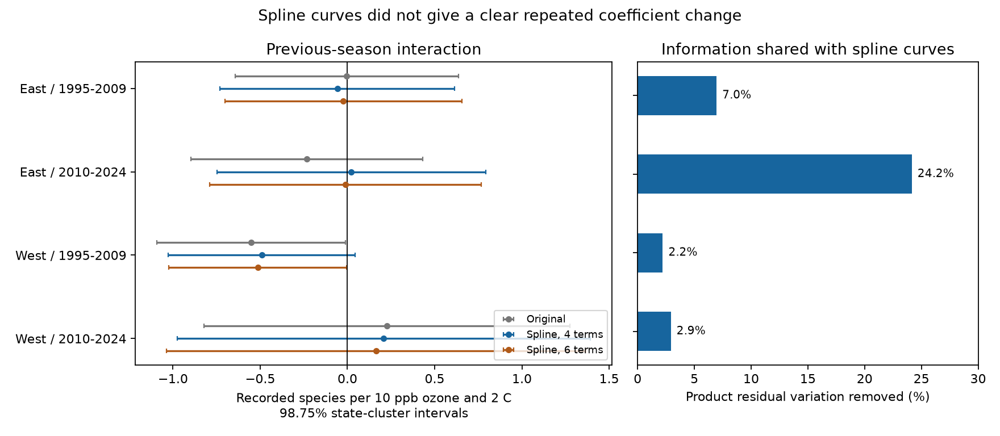

# Spline curves gave no clear change in prior ozone by warmth slopes in four US bird samples in 1995-2024

We tested whether curved responses to previous-season ozone and temperature changed their estimated interaction with recorded bird richness. Four spline terms for each exposure gave interaction estimates of -0.058, +0.023, -0.491 and +0.208 recorded species per 10 ppb ozone and 2 C. All four corrected intervals included zero. No paired change from the original model was clear. Six spline terms kept the early western corrected interval below zero. Thus, that threshold result depends on curve choice. These data do not establish that curves explain the early western association. This is an exploratory model check on reused observations.



## Question and prior work

Can a curved response to each exposure account for a previous ozone by warmth estimate? Correlated exposures and omitted curves can produce a product coefficient without a biological interaction. Duncan and Kefford explain this model problem (doi:10.1111/2041-210X.13714). Liang et al. studied bird abundance and air quality rules with a different design (doi:10.1073/pnas.2013568117). We do not test their policy estimate.

We searched the campaign for phenology, climate, ozone, birds, curves and splines. SCI 2603c41c supplied a bird and ozone panel. SCI 1476b687 added survey controls and tested previous-season ozone by warmth. It found a negative early western coefficient that did not repeat in the other cells. SCI c0d5d145 separated linear exposure trends from annual residuals. That study did not test flexible exposure curves. A refined search after code launch found SCI 144f0ef0, which tested squared and cubic curves with current-season exposures. We read it before the full results were available. Our saved plan did not change. The present test uses previous-season exposures and adds spline curves. It shares biological records and is not independent field validation or a new statistical method.

files/PLAN.txt records the choices made before new fits. files/PLAN_addendum.txt records the later search. The question was chosen with knowledge of campaign results. Intervals do not account for all campaign searches.

## Data and observation bias

We verified the SCI 1476b687 ZIP and reused its exact files/analysis_panel.csv.gz. It has 32,458 eligible surveys before model-specific singleton removal. No shared raw dataset was read or downloaded. We checked shared dataset names. The available 2026 BBS release was not substituted for the source's 2025 release. files/provenance.json records the exact shared campaign path, resolved bundle path, bundle hash and input hash. The parent verification record is included. Inherited provenance gives raw shared paths, source URLs, versions and hashes. Those historical raw paths may no longer exist after the disk failure. We do not claim to have rechecked their bytes. No private sibling workspace or failed disk was read.

The source combines accepted standard US Breeding Bird Survey runs, EPA AQS ozone, NOAA county climate and Census county points. The biological source is the BBS 2025 release for 1966-2024, doi:10.5066/P14SNUV4. Richness counts recorded species using the inherited species-name filter. It is not true richness, occupancy or extinction.

Previous ozone is the mean daily maximum eight-hour ozone in May-September of year t-1. Monitors within 50 km of route starts enter a distance-weighted mean. The inherited coverage rule requires site-day rows on at least 75% of calendar days and averages nonmissing concentrations. We did not audit raw missingness. Previous temperature is the May-June mean daily maximum in t-1, from approximate county assignment. These are seasonal means with partial window overlap. They are not extreme heat or ozone episodes. Both windows precede the survey.

O is prior ozone minus its inherited full-period eligible route mean, divided by 10 ppb. H is the corresponding temperature anomaly divided by 2 C. Route means stay fixed across samples and models. The 10 ppb unit is a coefficient scale, not a typical observed anomaly. Inputs are inherited at five significant digits.

East is longitude greater than -100 degrees; West is at or below -100. Periods are 1995-2009 and 2010-2024. There are no 2020 surveys. We remove singleton route-observer and Bird Conservation Region-year groups until stable within each cell. The four fits use 30,986 surveys in total. Their records do not overlap, but routes recur across periods. Broad climate and source methods also link samples. They are not four independent experiments.

The parent requires valid observers, survey dates, clock times, duration, temperatures, wind and sky fields. Its exposure and survey filters retain only 19-33% of accepted western records and 63-65% of eastern records. Our target is that selected sample. Fixed effects and survey controls reduce some observation bias. They cannot separate abundance, movement, activity and detection, or repair missing visits and nonrandom monitor coverage.

## Model and uncertainty

The original model contains O, H, OH, H squared, current temperature and its square, current and prior rainfall, current ozone, survey day and its square, start time, duration, start and end temperature, wind and sky classes, assistant class and first-observer-year status. It has route-observer and Bird Conservation Region-year intercepts. These are conditional associations. Some survey conditions could respond to exposure, so adjustment does not identify a total causal effect.

We keep those terms and identical rows in every model comparison. The quadratic check adds O squared. The primary extension adds cubic B-spline basis functions with four terms for each of O and H. The sensitivity extension uses six terms for each. The spline boundaries are the empirical minimum and maximum in each cell. Internal knots use equally spaced quantiles: the median for four terms, and the quartiles for six. files/knots.json gives their numeric values. Basis terms can overlap with the retained main terms. Singular-value least squares handles that overlap; rank, not column count, enters the error correction. Curves describe anomaly responses, not a universal response to absolute temperature.

After removal of the two intercept sets, we regress OH and richness separately on the nuisance terms. The product coefficient is their residual cross-product divided by the residual product sum of squares. This is the Frisch-Waugh-Lovell calculation. Adding curves leaves a bilinear interaction coefficient; it does not test all nonlinear interactions. The product coefficient is the change in the conditional ozone slope for 2 C more warmth, on the recorded-richness scale. It is not the total change from raising both exposures.

State-cluster CRV1 errors use G/(G-1) times (N-1)/(N-K). K includes the exact intercept rank and regressor rank. The intercept rank comes from connected components in the two-effect graph. Student t intervals use G-1 degrees of freedom. Primary interaction intervals are 98.75% intervals for a four-test family. For paired model changes we subtract state coefficient score contributions from the two fits, including each fit's finite-sample correction. Their vector norm gives the paired standard error. We use Holm correction across the four primary spline-minus-original tests. This preserves covariance between fits. Other checks are exploratory.

The fraction of product information removed is one minus the ratio of residual OH sums of squares in the spline and original models. It measures overlap between model columns. It is not the share of richness explained or an estimate of biological confounding. It is conditional on the observed exposure design.

## Results

| Sample | Surveys | Routes | States | Original | Four-term spline | Corrected spline interval | Product information removed |
|---|---:|---:|---:|---:|---:|---|---:|
| East 1995-2009 | 12,839 | 1,348 | 36 | -0.003 | -0.058 | -0.731 to +0.615 | 7.0% |
| East 2010-2024 | 12,826 | 1,339 | 36 | -0.234 | +0.023 | -0.747 to +0.793 | 24.2% |
| West 1995-2009 | 2,074 | 291 | 13 | -0.551 | -0.491 | -1.027 to +0.045 | 2.2% |
| West 2010-2024 | 3,247 | 414 | 14 | +0.225 | +0.208 | -0.976 to +1.393 | 2.9% |

All coefficient units are recorded species per 10 ppb ozone and 2 C. The early western 95% spline interval is -0.889 to -0.093. Its four-test interval includes zero. This change in a threshold result is not evidence of a clear change between models.

| Sample | Spline minus original | Paired 95% interval | Holm p |
|---|---:|---|---:|
| East 1995-2009 | -0.055 | -0.167 to +0.057 | 0.906 |
| East 2010-2024 | +0.257 | -0.069 to +0.582 | 0.475 |
| West 1995-2009 | +0.060 | -0.061 to +0.181 | 0.906 |
| West 2010-2024 | -0.017 | -0.378 to +0.344 | 0.921 |

No paired change is clear even before correction. The curves share most product information in the later eastern cell, but this does not establish an ecological cause or a coefficient difference across regions.

The six-term spline coefficients are -0.023, -0.011, -0.514 and +0.164 in table order. The early western corrected interval is -1.023 to -0.004. The other three corrected intervals include zero. The quadratic-only coefficients are -0.037, -0.062, -0.526 and +0.264; all four corrected intervals include zero. The findings do not support a repeated negative interaction across regions and periods. They also do not establish that the true interaction is zero. The small early western information loss and uncertain paired changes do not support attributing that association to curves.

files/results.csv gives all 16 fits, uncertainty, paired changes, ranks and information fractions. The four NPZ evidence files preserve survey IDs, states, residual products, outcome residuals and state score contributions for original and primary spline fits. They permit inspection of the contrasts without refitting the full models.

## Numerical checks

Original coefficients and standard errors match the signed parent table to its saved precision. Independent sparse LSMR projections agree with all four primary spline coefficients within 1.5e-15. Projection matrices agree within 4.7e-10. Target residuals are orthogonal to nuisance columns within 2.1e-11 in the sparse check. Nested models never increase residual product information. A seeded synthetic test compares the coefficient, cluster error and paired-change error with complete dummy-variable calculations. Maximum error is below 1.2e-15. A second complete run reproduced the results table and every saved evidence array within 1e-10 tolerance; files/reproduction_check.json records this check. These checks validate computation, not ecological identification. The code runs these checks again during reproduction.

## Limits and use

This result extends an earlier curve audit to previous-season exposures and spline terms. It gives a reproducible check of a proposed explanation. It does not show that either model is correct. Null paired tests do not show equivalence. Few western state clusters, shared weather across states and changing exposure support limit interval reliability. Spline knots and degree are choices. More flexible surfaces can find patterns that this bilinear test misses, and can also overfit sparse joint exposure support.

Monitor changes, route-start exposure error, county climate error, habitat change, rainfall, other pollutants and changing observer skill remain possible causes of bias. Controls can remove useful ecological variation as well as bias. We did not test daily extremes, climate-change attribution, policy effects, species range limits or ecological timing. Seasonal mean temperature is a weather measure here. No result shows that pollution or warming is safe for biodiversity. New regions, longer independent records and measured detection are needed for stronger inference.

## Reproduce and inspect

With Python 3.12 and files/requirements.txt, run from an unpacked copy:

```sh
sh files/REPRODUCE.sh /new/local/output
```

Give a new output directory outside the signed publication. No network or shared raw store is needed. It writes results.csv, validation files, knots.json, NPZ evidence and splines.png. Compare numeric outputs with this package. files/environment.json records the actual versions. The one-thread setting is a local performance choice. Do not write generated outputs into the signed draft.

For raw reconstruction, inspect files/raw_recipe/source_README.md, the build and retrieval scripts, and both inherited provenance files. The raw pipeline comes from the cited signed parent and its source. Follow their original path assumptions in a separate working directory. Match every raw hash. Some server URLs are mutable and historical shared paths were lost; exact reproduction from current raw servers is not guaranteed. The included verified panel is the supported offline reproduction input. To retrieve a missing source bundle entry, use sci read on the cited ZIP with --file and --output. New reusable downloads must use the campaign dataset helper with a new immutable name; no download is required for this result.

## Work provenance and rights

Job: sci-1107-dell-climate-pollution-biodiversity-6753d897e55c. Topic: climate-pollution-biodiversity. Campaign: 11_07_2026. Machine: dell. Account: codex-andrii. Model: gpt-6.1-sol, high reasoning effort, through the T3 Code Codex harness. No child agents were used. Work ran in the assigned isolated workspace. No shared dataset was changed. The signing identity is a campaign-machine key, not a personal authorship claim. Private keys remain outside the publication. The signed result is saved locally without remote submission.

The exact SCI baseline license covers the new code, text, figures and evidence. Reused baseline code and evidence retain attribution to their signed sources. USGS, EPA, NOAA and Census facts retain source attribution and their public-domain status. files/EXTERNAL_DATA_NOTICE.txt records source rights and the specific derived-file assessment. External papers are cited, not reproduced or relicensed.
