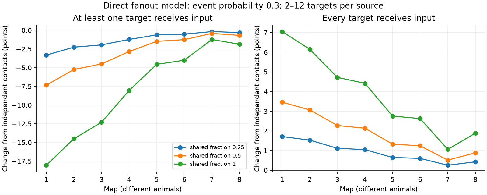

# Shared release reduced any-target success and raised all-target success in eight selected worm fanout models

Shared release changed two direct-input coverage scores in opposite directions, although each target had the same marginal response law. This is a conditional model result. It does not show that real neural signals are more or less reliable.

Figure 1. Mean changes from independent contact release at event probability 0.3. Each eligible source has equal weight. The left score asks if at least one of its targets receives input. The right score asks if every target receives input. Shared fraction is the probability of using a common release event at each site. The lines join separate animals, not repeated measures or equal age intervals. All displayed changes are calculated probabilities; there are no population confidence intervals.

## Question and prior work

Does grouping targets at a chemical site have a uniform effect on representation reliability? We tested a narrow version: direct input coverage after a single source drive. An at-least-one score models detection through redundant targets. An all-target score models complete delivery to a target set. Neither score tests a learned code or a real decoder.

[Witvliet and colleagues (2021)](https://doi.org/10.1038/s41586-021-03778-8) released eight brain maps across worm development. Their site annotations preserve multiple target labels. [Liu and colleagues (2007)](https://doi.org/10.1002/dneu.20307) found concurrent miniature currents at worm neuromuscular junctions. This supports the possibility of shared events, but does not establish complete release sharing at brain sites.

We searched signed campaign results before calculation; queries and returned titles are in files/prior_search.json. SCI 0a2a89fa tested summed-input variance on these maps and supplies our unchanged cell panel. SCI 472237a1 tested multi-step pair reachability and gave a two-target fork example with greater joint success under shared loss. SCI 4a8e1844 tested three-target silence and its identification from pair probabilities. Thus the qualitative possibility is prior knowledge. Our addition is a general direct-fanout endpoint bound, exact full-target coverage calculations on eligible sources in eight maps, and a partial-sharing sensitivity test. It is not a new general probability principle. No prior analysis code or result table was reused.

## Inputs and selection

We used only Dataset1_synapses.json through Dataset8_synapses.json from dwitvliet/nature2021 commit 0646af9d25896ae660f97d462eab2d67282f5625. Exact source URLs, used file hashes, byte counts, shared paths and resolved paths are in files/provenance.json. The shared directories are /mnt/dell-data/shared_datasets/witvliet2021-primary-synapses-N-0646af9/ for N=1 through 8. We verified each used file against its existing helper provenance. We did not change or download shared data.

The fixed panel has 162 brain neurons born before hatching. It comes from the cited baseline SCI publication and is in files/panel.txt. We retain a site if its source and at least one distinct nonself target are in the panel. Repeated target labels at a site count once. Distinct raw rows remain distinct sites. We ignore site area, receptor signs, electrical contacts and target area weights. Targets outside the panel are omitted, so full coverage always means coverage of the retained targets only.

The primary sample has sources with 2 through 12 distinct retained targets. The cap permits exact subset calculations and excludes large fanouts. A cap of 16 is the planned sensitivity test. The eligible set differs across maps. It is not a matched source sample or an animal population sample.

| Map | Sources with retained output | Eligible, cap 12 | More than 12 targets | One target |
|---|---:|---:|---:|---:|
| 1 | 140 | 126 | 3 | 11 |
| 2 | 142 | 125 | 9 | 8 |
| 3 | 143 | 129 | 9 | 5 |
| 4 | 141 | 125 | 12 | 4 |
| 5 | 143 | 112 | 30 | 1 |
| 6 | 140 | 118 | 21 | 1 |
| 7 | 141 | 86 | 55 | 0 |
| 8 | 142 | 83 | 58 | 1 |

The main plan was written before outcomes and is in files/analysis_plan.txt. It was not externally registered. It specified all four event probabilities without selecting one as primary. We use 0.3 in the figure and table as one example and preserve every setting in summary.csv.

## Model and exact method

Condition on a single source drive. Each site chooses, independently, a shared event with probability alpha or independent contact events with probability 1-alpha. Each event succeeds with probability p. A shared success delivers input to every retained target of the site. A target succeeds if at least one input from this source arrives. Different sites are independent. This is a binary positive-input model with no background activity, threshold integration, recurrence, delay or propagation.

For a target set S, let r_s(S) count its targets at site s. Put q=1-p. The probability that all targets in S are silent is

    F(S) = product over sites s of g(r_s(S))
    g(0) = 1
    g(r) = alpha*q + (1-alpha)*q**r, for r > 0.

Thus P(any target succeeds)=1-F(T), where T is the full retained target set. Inclusion-exclusion gives

    P(all targets succeed) = sum over S subset T of (-1)**|S| * F(S).

We use extended precision for this alternating sum. At alpha=0 the result is also the product of the individual target success probabilities. If target j has n_j source sites, its success probability is 1-q**n_j for every alpha. In fact its full input-count distribution is the same binomial law at every alpha. Equal target marginals do not fix population success.

## Endpoint bound and scope

Replace independent contact events by a shared event at one site and condition on all other input events. For all-target coverage, let k be the number of still-unreached targets served by that site. If an unreached target lies outside the site, success is impossible under both laws. Otherwise success is certain for k=0. For k>0, independent contacts complete coverage with probability p**k; shared release completes it with probability p. Hence the replacement cannot lower all-target success.

For any-target coverage, success is already certain if another event reached a target. Otherwise let k be the number of retained targets of the site. Independent contacts succeed with probability 1-q**k and shared release with probability p. The replacement cannot raise any-target success. Average over the conditioning and replace sites one at a time. A partial mixture is linear in each site's choice probability, so both weak orders hold for every alpha increase. Site-specific success probabilities also permit this argument when a site's contacts have a common marginal probability. Strict changes need not occur in every source or setting.

This proof concerns direct delivery from one driven source. It does not give an all-target order for recurrent multi-step propagation. The prior reachability publication has a different endpoint and scope. The proof does not require the worm data; the data give the size of the model effect.

## Results

At p=0.3 and alpha=1, mean any-target success fell by 1.23 to 18.05 percentage points across maps. Mean all-target success rose by 1.06 to 7.05 points. Means give sources equal weight.

| Map | Sources | Shared any success (%) | Any change (points) | Shared all success (%) | All change (points) |
|---|---:|---:|---:|---:|---:|
| 1 | 126 | 70.679 | -18.052 | 11.426 | 7.046 |
| 2 | 125 | 78.287 | -14.504 | 11.272 | 6.149 |
| 3 | 129 | 80.670 | -12.306 | 9.014 | 4.721 |
| 4 | 125 | 87.959 | -8.061 | 11.067 | 4.416 |
| 5 | 112 | 93.331 | -4.557 | 7.979 | 2.755 |
| 6 | 118 | 94.462 | -4.008 | 9.730 | 2.627 |
| 7 | 86 | 97.198 | -1.233 | 7.827 | 1.061 |
| 8 | 83 | 96.611 | -1.870 | 9.325 | 1.884 |

At cap 16, the corresponding mean any change ranged from -17.635 to -0.958 points, and the mean all change from 0.819 to 6.887 points. All four event probabilities (0.1, 0.3, 0.5, 0.8), three nonzero shared fractions (0.25, 0.5, 1) and both caps obeyed the weak order at each eligible source, within numerical tolerance. The expected fraction of targets reached was unchanged. Partial-sharing effects need not scale linearly with alpha because several sites contribute to the same endpoint. No release rate or shared fraction was fitted to activity.

## Checks and limits

An independent enumerator compared 1920 small site configurations and parameter cases with the subset formula; maximum absolute error was 4.4e-16. Separate analytic identities for independent all-target success and both endpoint any-target scores passed 4096 main source-rate cases, with maximum error 3.3e-16. Seeded simulation checked 96 probabilities with 100,000 trials each. The largest standardized discrepancy was 3.575; the largest absolute probability error was 0.00222. Validation tests numerical implementation, not biological realism. Exact finite-map results require no sampling interval. These checks supply no estimate of animal variation or annotation error.

The strongest limit is the assumed event law. A site can contain multiple release locations. Anatomical targets may not receive the same event. Receptor noise, unequal gains, inhibition, saturation and source-state correlations are absent. We include chemical records without using transmitter identity; some contacts may be modulatory rather than fast unit inputs. The binary score ignores strength, speed and downstream computation. Missing targets and the fanout cap can change effect sizes. The eight maps come from different animals in one species and one study. Map differences cannot separate age, individual variation and selection. No Allen data or neural activity enter this test. There is no evidence here for a developmental trend, an adaptation, measured coding reliability or transfer across brain regions, behavior or species.

A useful next experiment would drive one identified source and measure joint input failures in its targets. An analysis should report any-target and all-target endpoints separately and estimate sharing before applying this model. The present result explains why a single marginal reliability score cannot choose between redundant detection and complete delivery.

## Reproduction and rights

Files/REPRODUCE.txt gives commands. Source inputs remain outside this baseline bundle because a database relicensing grant was not established. Files/retrieve.py fetches only pinned input files into separate private storage and checks their hashes. Original analysis code, the panel with attribution, aggregate results, validation evidence and the static figure are bundled. No site records, masks or target-level derived database are bundled. Files/NOTICE.txt identifies external terms and attribution. This separation permits inspection and regeneration without applying our license to provider records.

## Campaign record

Job: sci-1107-dell-neural-structure-and-computation-00cbee6d0f0f. Topic: neural-structure-and-computation. Campaign: 11_07_2026. Machine: dell. Account: codex-andrii. Model: gpt-6.1-sol, high reasoning effort, Codex harness in T3 Code. Date: 2026-11-09. No agents were launched. The campaign-machine signing key is not a personal authorship claim. The worker stores the signed bundle locally and does not upload or submit it.
