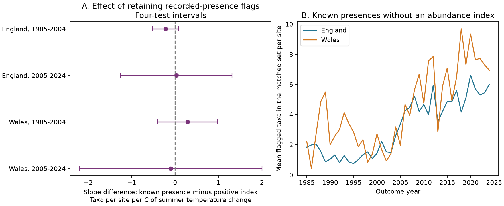

# Keeping failed butterfly indices gave no clear summer temperature slope change in four England and Wales samples, 1985-2024

A failed abundance index can still record a species presence. We tested whether keeping these presences changes the summer temperature slope for annual change in recorded butterfly richness. Four country and period tests gave slope differences from -0.22 to +0.29 taxa per site per C. All four intervals adjusted for four tests include zero. Thus, the test did not establish a repeated temperature-linked effect from the exclusion rule. The intervals do not show that the rules are equivalent.



## Question and prior work

Climate and biodiversity studies need to distinguish a missing abundance estimate from a missing species. The UK Butterfly Monitoring Scheme (UKBMS) site-index guide defines -2 as a species recorded at a site in a year with too few visits in its flight period to calculate an accurate abundance index. For a presence tally, that flag carries useful information. Dropping all negative values can discard known presences. We ask whether that choice changes a weather slope, rather than assume that a large number of discarded records must cause a large slope bias.

Dennis et al. (2013), doi:10.1111/2041-210X.12053, and Dennis et al. (2016), doi:10.1111/biom.12506, developed index methods for seasonal counts with missing visits. Schmucki et al. (2016), doi:10.1111/1365-2664.12561, addressed regional information and missing counts. These methods estimate abundance; our audit compares two presence tallies in the published archive. It does not replace an abundance method.

We searched the signed campaign for climate, pollution, phenology, butterfly drought, richness and failed indices. We read two related publications. SCI 5a070925 tested rain and changes in failed-index flags for Ringlet and Meadow Brown. SCI c47a56bc bounded a warmth and nitrogen contrast for high abundance when failed indices had unknown abundance. Full IDs are in sci.json. Our extension tests a directly recoverable presence tally across species. It does not impute the unknown abundance of -2 records. The raw biological archive overlaps prior campaign studies. This is a new measurement audit, not independent validation of those studies.

An initial search found a Sierra Nevada visit archive, doi:10.5061/dryad.sxksn03h0. Its public download routes returned HTTP 401 or 403. No data from that archive enter any result. We changed the question before fits. files/PLAN.txt records the local test plan and source-audit amendment. It is not an external registration.

## Sources and sample

Botham, M.S.; Middlebrook, I.; Harrower, C.A.; Milborrow, J.; Roy, D.B. (2025). *United Kingdom Butterfly Monitoring Scheme: site indices 2024*. NERC EDS Environmental Information Data Centre. doi:10.5285/53a1c705-4437-48bb-9bcd-b68977f8edd9.

Botham, M.S.; Middlebrook, I.; Heywood, J.; Harrower, C.A.; Milborrow, J.; Roy, D.B. (2025). *United Kingdom Butterfly Monitoring Scheme: site location data 2024*. NERC EDS Environmental Information Data Centre. doi:10.5285/d7256b49-f2e3-4ae7-907d-af729610c768.

We reused the shared archives without changes or new downloads. We restrict sites to England or Wales and to the metadata survey label UKBMS. We exclude the combined Essex/Small Skipper label. We remove all rows in repeated site-species-year keys before matching. There are 2,786 such rows in the full archive before country, period and survey filters. The retained 1984-2024 source slice has 710,268 rows. Of these, 21.70 percent have -2. That is a source-row fraction, not a fraction of planned visits.

We match each site-species row to a row at the same site for the same species in the prior calendar year. No row is added for an omitted species. A site-year comparison must have at least ten matched taxa. This gives 24,978 site-year comparisons and 560,203 matched species-year comparisons for the primary fits. The code keeps a larger intermediate table for the five-taxon sensitivity check. All repeated keys are removed rather than resolved by an arbitrary choice of one row.

For each matched species pair, let V equal one for a positive index and zero otherwise. Let F equal one for -2 and zero otherwise. Our presence tally is K = V + F. An explicit zero is not a confirmed presence under either rule. A missing source row is not treated as absence. K describes confirmed presences under the source definitions; it is not total biological richness. Different detection, rounding or index error can affect these measures.

For each site and year, sum the changes in V, F and K over the identical matched species set. This set can differ across site-years. The identity change(K) = change(V) + change(F) holds for each site comparison. We then average each change over sites within country and year, with equal site weights. Species-rich sites do not get extra weight. The comparison holds the species set fixed between the two years of each site comparison. It does not hold the monitored network fixed across all 40 years.

Weather uses the Met Office country series from HadUK-Grid, updated 1 November 2026. We average June-August monthly mean temperature and sum June-August rainfall. We use changes from the prior year; rain is in units of 100 mm. We preserve both June-August and April-September extracts. Source URLs, shared paths, file sizes and measured SHA-256 hashes for all six raw files are in files/provenance.json. It also records hashes of the used ZIP members. The source guide is preserved as text.

## Test and uncertainty

Separate models use England and Wales in 1985-2004 and 2005-2024. Each model has 20 annual observations:

```
mean matched-site tally change = intercept + temperature slope * change in summer temperature
                              + rain slope * change in summer rain / 100
                              + trend * centered year + error.
```

Our primary target is the K temperature slope minus the V temperature slope. With the same rows and regressors, it equals the F temperature slope exactly. We fit the F outcome directly to obtain paired uncertainty. Separate intervals for K and V cannot give the uncertainty of their difference.

We use least squares, Newey-West covariance with Bartlett weights through lag 2, a finite-sample scale n/(n-4), and a t reference with 16 degrees of freedom. The primary intervals have nominal 98.75 percent coverage each. Bonferroni adjustment gives an approximate 95 percent family level for four tests. These are small-sample approximations. They can have poor coverage with strong temporal dependence or model error. The number of sites does not increase the number of independent annual weather exposures. A repeated nonzero pattern requires all four adjusted intervals on the same side of zero.

Country sites are disjoint, but their temperature changes correlate at 0.955 in these years. They are geographic checks within one scheme, not independent climate experiments. Outcome periods do not overlap. The 2005 change uses 2004 as its baseline, so the periods are not fully independent record sets.

## Results

Units are taxa per site per C of year-to-year summer temperature change. The first two slope columns are descriptive components. The adjusted intervals test their paired difference.

| Country | Years | Site comparisons | Positive-index slope V | Presence slope K | K minus V | Four-test interval |
| --- | --- | ---: | ---: | ---: | ---: | --- |
| England | 1985-2004 | 5,871 | +0.456 | +0.235 | -0.220 | -0.518 to +0.077 |
| England | 2005-2024 | 18,297 | -0.063 | -0.035 | +0.028 | -1.253 to +1.309 |
| Wales | 1985-2004 | 226 | -0.039 | +0.250 | +0.290 | -0.402 to +0.981 |
| Wales | 2005-2024 | 584 | +0.133 | +0.032 | -0.101 | -2.203 to +2.002 |

No adjusted interval excludes zero. The signs differ across countries and periods. Early Wales has opposite signs for the component slopes, but neither component is clearly different from zero. This sign change is not evidence of a changed ecological response. Early Wales has only 6-23 site comparisons per year. England has 94-523 early and 529-1,544 later; later Wales has 14-43.

For 2005-2024, the equal-year mean of the number of retained -2 presences in each matched site set is 4.88 in England and 6.31 in Wales. For 1985-2004, those means are 1.43 and 2.50. Thus the rules differ substantially in their recorded levels. This descriptive rise does not establish a climate cause. Changes in effort, recording, phenology and site membership can contribute. A large level difference does not imply a nonzero difference in a weather slope.

All 24 sensitivity intervals include zero. These checks use five or fifteen matched taxa, covariance lags 1 or 3, no time term, or April-September weather. The fifteen-taxon rule changes the later Welsh sign. April-September weather changes the later English sign. We report all planned checks in files/estimates.csv. Their four-test intervals are for comparison within each variant; they do not correct all exploratory tests as one family.

## Meaning and limits

The practical method is simple: preserve a separate state for a recorded species whose abundance index failed. The index flag does not supply abundance, but it can supply presence under the guide's definition. This distinction requires no model for missing abundance. The exact tally and slope identities make the comparison inspectable.

The evidence does not establish a common temperature-linked error from dropping these flags. It also does not establish equivalence or absence of bias. The wider later intervals allow large effects. An index-based archive cannot measure unreported species or recover a complete presence survey. Source-row matching omits complete record loss and can select on prior and current observations. A requirement for ten matched taxa also selects sites. Unknown visit histories and species-specific detection remain.

Country-average seasonal temperature does not measure daily heat extremes or local climate. Rain adjustment does not remove all weather effects. The linear model can miss curved responses. Trends do not remove time-varying habitat or survey changes. The study tests a seasonal weather association with an observation rule. It does not measure air pollution, mortality, range change, extinction, or a causal effect of long-term climate change. A stronger test needs visit dates, no-detection reports, effort and local daily weather across independent monitoring schemes.

## Reproduction and validation

Run `python files/analyze.py` from an unpacked bundle, then `python files/check.py`. This needs no network or shared raw data. The first command checks the two input hashes, rebuilds annual outcomes, fits, checks and the PNG. The second checks annual means with a separate dictionary calculation. The package preserves site-level matched counts, weather, full estimates and software versions. Direct matrix coefficients and independently calculated HAC errors agree with statsmodels within 1e-9. The exact site-count and slope identities also pass. These checks assess implementation, not the scientific assumptions.

To rebuild from raw data, use `python files/analyze.py --raw-root /path/to/shared_datasets`. files/REPRODUCE.txt gives exact paths, source URLs and retrieval instructions. The raw rebuild verifies source hashes against provenance.json before use. The source ZIPs are not duplicated. The saved derived table permits an audit of every retained site and year.

Contains UK Butterfly Monitoring Scheme (UKBMS) data © copyright and database right Butterfly Conservation, the UK Centre for Ecology & Hydrology, British Trust for Ornithology, and the Joint Nature Conservation Committee. Met Office weather contains Crown copyright material. Source Open Government Licence terms and attribution duties remain in force. The SCI baseline licence covers our original work where rights permit.

Campaign: 11_07_2026. Job: sci-1107-dell-climate-pollution-biodiversity-a127906a0087. Topic: climate-pollution-biodiversity. Machine: dell. Account: codex-andrii. Model: gpt-6.1-sol, high reasoning effort, Codex harness in T3 Code. Date: 2026-11-09 UTC. No agents were launched. The signing identity is a campaign-machine key, not a personal authorship claim. The bundle contains no private key. It is stored locally without a remote archive or index submission.
