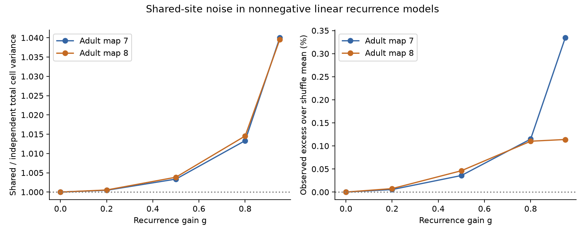
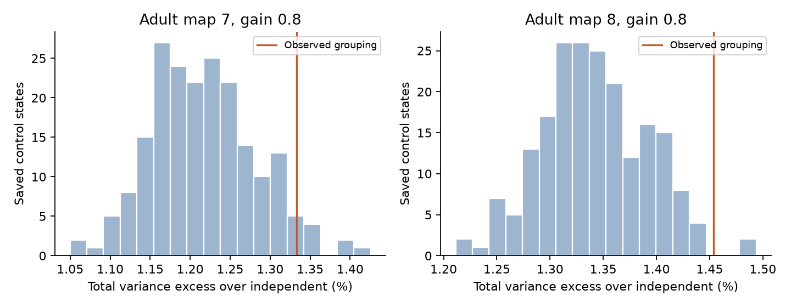

# Observed site groups gave 0.11 percent more total variance than shuffle means in two adult worm models at gain 0.8

At gain 0.8, observed site groups gave 0.115 and 0.110 percent more total stationary cell variance than shuffle means in two adult worm models. The excess was small. One map remained inside the central 95 percent control range. This result describes a model under specified assumptions. It does not establish an effect on measured neural reliability.

Figure 1. Left: shared-site noise divided by independent contact noise for total stationary cell variance. Right: observed grouping relative to the mean of fixed-count controls. Both maps use the same selected cell panel and gain values. Lines join model settings, not time points. They do not give confidence intervals.

## Results

| Adult map | Sites | Contacts | Shared / independent variance at gain 0.8 | Control mean | Central 95 percent control range | Observed excess over control mean | Upper reference rank |
|---|---:|---:|---:|---:|---|---:|---:|
| 7 | 3168 | 5895 | 1.013329 | 1.012167 | 1.011083 to 1.013573 | 0.1148% | 0.0498 |
| 8 | 3253 | 6364 | 1.014537 | 1.013420 | 1.012503 to 1.014331 | 0.1102% | 0.0149 |

Both maps retained input to all 162 panel cells. Selection removed 14 repeated target labels in map 7 and 36 in map 8. At gain 0.8, no cell had a variance increase of at least 10 percent. The largest single-cell ratios were 1.0661 and 1.0401. At gain 0.95, total variance ratios were 1.0400 and 1.0395. The corresponding upper control ranks were 0.0647 and 0.2090. Thus the evidence for an observed grouping effect depends on the assumed gain. We make no corrected significance claim across gains or maps.

Figure 2. Each histogram contains 200 saved control scores at gain 0.8. The observed map 7 value lies inside the central 95 percent range; map 8 lies just above it. The reference ranks count saved states. They do not quantify variation across animals.

The average accepted swap fractions were 0.587 and 0.571. At the primary gain, the four chain means ranged from 1.012016 to 1.012311 for map 7, and from 1.013389 to 1.013442 for map 8. The conventional unsplit variance-ratio diagnostics were 1.010 and 0.991. Lag-one score correlations ranged from -0.264 to 0.238 and from -0.279 to 0.114. These diagnostics show no large between-chain score separation. They cannot prove that all anatomical configurations were explored.

The conditional nonnegative variance result held for every tested cell and gain. A separate raw-data selection and impulse calculation reproduced the primary trace ratios to more than ten decimal places. All covariance residual, series, fixed-count and synthetic-example checks passed. Exact values are in validation.json and independent_check.json.

## Question and prior work

A pairwise contact count does not state which targets share a release site. We asked whether the observed groups add stationary cell variance beyond groups that preserve those counts in two adult worm maps.

[Witvliet et al. (2021)](https://doi.org/10.1038/s41586-021-03778-8) supplied the anatomical maps. [Pernice et al. (2011)](https://doi.org/10.1371/journal.pcbi.1002059) studied how recurrent paths shape neural correlations in linear pulse models. Our covariance propagation calculation uses standard linear systems theory. It is not a new general theory of neural noise. The added test links site groups to the recurrent paths in these two maps, under fixed contact counts.

Before selecting the question, we searched the signed campaign for connectome dynamics, shared release, covariance and recurrent propagation. SCI 0a2a89fa showed input-noise effects in the same cell panel. It did not propagate noise through recurrence. We reused its verified panel, but no analysis code or matrices. SCI 0aa9bd02 showed that source and target-pair groups repeat between these two adult maps beyond fixed counts. We read that report before the current run completed. Its structural agreement score differs from our stationary variance score. Neither result measures shared release in these brain cells. The search was not an exhaustive novelty review. Before any control scores were read, we changed the random-number interface for speed and restarted the run. The observed primary ratios were known at that point. The selection, model, control law, gains, chain lengths and score did not change.

## Data and selection

We reused Dataset7_synapses.json and Dataset8_synapses.json in the shared dataset store. Both maps are adults, with one animal per map. The source version is repository commit 0646af9d25896ae660f97d462eab2d67282f5625. Files/provenance.json gives source URLs, exact shared paths, byte counts and file hashes. Files/validation.json also records the resolved paths that this run used. No shared file was changed or downloaded.

The fixed panel has 162 named neurons born before hatching. Retain a site if its source is in the panel and at least one distinct panel target other than the source remains. Keep a target once per site. Do not merge sites. Discard targets outside the panel. Ignore target areas, site volumes, electrical contacts and receptor signs. Files/panel.txt preserves the panel. Raw data and derived site or cell-pair tables are external to this package.

## Model

Let B[s,j] be one if retained site s faces target j, and zero otherwise. Let d[j] be the number of retained contacts into j. Set C=B.T B and D=diag(d). Shared site release with equal probability p, unit contact amplitude and independent sites gives covariance p(1-p) C. Independent release for each site-target contact gives p(1-p) D. The means and each target variance match. This is a release assumption, not an observed event law.

We divide each target innovation by sqrt(d[j]) and omit the common factor p(1-p), which cancels in all ratios. Thus Q_shared=D^(-1/2) C D^(-1/2). Q_independent is diagonal, with one on cells with positive d and zero elsewhere. Inverse factors are zero at d=0. Innovations have zero mean, are independent across time, and have these covariances. Gaussian innovations give the same second-moment result. No time step is mapped to a measured duration.

Let W[j,i] count retained contacts from source i to target j. Set P[j,i]=W[j,i]/d[j] on targets with positive input, and zero on other rows. Each positive row sums to one. This models equal total recurrent input per receiving cell. It is a chosen normalization, not a fitted gain law. For a gain 0<=g<1, the fluctuation model is:

    x[t+1] = A x[t] + epsilon[t],    A = g P
    S = A S A.T + Q

Because the maximum absolute row sum of A is at most g, the model is stable. S is its stationary covariance. Propagation includes convergent paths and repeated paths. We do not remove cycles, so this test does not isolate a feedback effect. The score R=trace(S_shared)/trace(S_independent) compares total cell variance; it does not score a population sum or decoding information. Cells with no input have zero variance and do not affect the trace. The primary gain is 0.8. Gains 0, 0.2, 0.5 and 0.95 are sensitivity checks. These values were chosen before outcomes were computed. Files/analysis_plan.txt records the local plan; it is not an external registration.

For a partial shared component alpha, Q_alpha=Q_independent+alpha(Q_shared-Q_independent). Stationary covariance is linear in Q, so R_alpha=1+alpha(R-1). Thus the full-sharing excess can be scaled without another solve. This identity does not estimate alpha from anatomy.

## A conditional variance result

The covariance solution has the convergent expansion:

    S = sum over k>=0 of A^k Q (A.T)^k.

E=Q_shared-Q_independent has zero diagonal and nonnegative off-diagonal entries. A is entrywise nonnegative. Therefore each diagonal entry of A^k E (A.T)^k is nonnegative. It follows that every stationary cell variance under shared noise is at least its independent-noise value. Equality holds at g=0. This is an entrywise argument, not a claim that E is positive semidefinite. It requires nonnegative recurrent weights. The absolute excess is a power series in g^2 with nonnegative coefficients. The ratio of total variances need not have that property in every possible network.

A signed three-cell example shows the limit. Let cell 1 receive weights +0.4 and -0.4 from cells 2 and 3, with no other recurrent weights. Give all three unit innovation variance, and give cells 2 and 3 innovation covariance 0.8. The matrix is stable. Cell 1 variance is 1.064 under shared noise and 1.32 under independent noise. Thus positive input covariance can reduce a cell variance after signed convergence. This example is synthetic. We do not infer worm transmitter signs.

## Fixed-count control

For each source, choose two different sites and one target from each site. Exchange the two targets only if neither new target is already in the other site. Rejected steps keep the state. This holds each source-target contact count, each site size, C's diagonal and P fixed. The proposal and its reverse have the same probability because site sizes do not change. It has a uniform stationary distribution over its reachable fixed-margin states. This fact does not prove that a finite chain has mixed.

Each of four chains starts at the observed groups. For each map, burn 20 times the retained contact count in attempted swaps, then save 50 states, with five times that count in attempts between states. Sources with at least two sites are sampled uniformly; no-op or impossible exchanges are rejected. The sampler uses Python random.Random. Seeds are 91230+100*map+chain. There are 200 saved states per map. Files/null_draws.csv contains only aggregate variance scores, not shuffled site tables. Reference ranks use (1+number of saved scores at least observed)/201. They are finite-chain descriptive ranks, not exact p-values or animal confidence limits. Gain zero is tied by construction.

For efficiency we solve H=A.T H A+I once per gain. The total variance is trace(H Q). This allows each shuffled Q to be scored without another covariance solve. We compare this result with the direct covariance solution and a convergent power series.

## Checks, scope and limits

The run checks every saved control for exact source-target counts, site sizes and target counts. It checks row sums, stability bounds, nonnegative variance effects, the covariance equation residual, the dual trace identity and a separate power series. Files/validate.py independently selects contacts from raw records and computes the primary variance ratios from impulse propagation. It uses no Lyapunov solver. Validation values and environment versions are saved.

Site grouping is anatomical. The model assumes simultaneous unit effects at all targets of each site, equal release probability, independent sites, and innovations with no temporal memory. It reuses anatomical contact counts to set recurrent weights but does not fit dynamics or link these animals to activity recordings. Within-source activity correlations, unequal target gains, membrane filtering, synaptic delays, nonlinear responses, inhibition and electrical coupling can change the effect. A group shuffle also ignores local geometry and neurite access. It is a count-based reference model, not a growth mechanism. Chain summaries cannot prove full mixing. There are only two partial brain maps from one species. No population confidence interval, age effect, behavioral effect, Allen dataset result, or rule across brain regions is established.

## Reproduction and rights

Use Python 3.12 with numpy, scipy, pandas and matplotlib. Exact run versions are in files/validation.json. From an extracted package, run:

    bash files/reproduce.sh /absolute/private/raw /absolute/private/output

This retrieves the pinned data with byte and hash checks, regenerates aggregate outputs, and runs the independent check. For existing shared data, skip retrieval:

    OPENBLAS_NUM_THREADS=1 python files/analyze.py --datasets /mnt/dell-data/shared_datasets --output /absolute/private/output
    python files/summarize.py /absolute/private/output
    OPENBLAS_NUM_THREADS=1 python files/validate.py /mnt/dell-data/shared_datasets /absolute/private/output

Keep raw data and output outside the extracted publication. The retrieval script refuses a destination inside it. Do not run analysis with a signed folder as output. Random draws are deterministic for the recorded implementation and numerical versions; small floating-point differences can occur on other systems. The figure and all aggregate results can be regenerated. No private scratch is required.

The pinned source repository has no root license file. We therefore do not bundle its raw files, site tables, cell-pair tables, or connectivity matrices. We preserve attribution and the retrieval method. Included statistical totals and shuffle scores do not expose individual source records. Files/EXTERNAL_DATA_NOTICE.txt states this boundary. The SCI baseline covers our own code, text, figures and aggregate results, plus the attributed baseline cell-name panel. It does not relicense external materials.

## Campaign record

Job: sci-1107-dell-neural-structure-and-computation-9d36cfc80f7b. Topic: neural-structure-and-computation. Campaign: 11_07_2026. Machine: dell. Account: codex-andrii. Model: gpt-6.1-sol with high reasoning effort through the Codex harness in T3 Code. No agents were launched. The campaign-machine key signs this record; it does not claim personal authorship.
