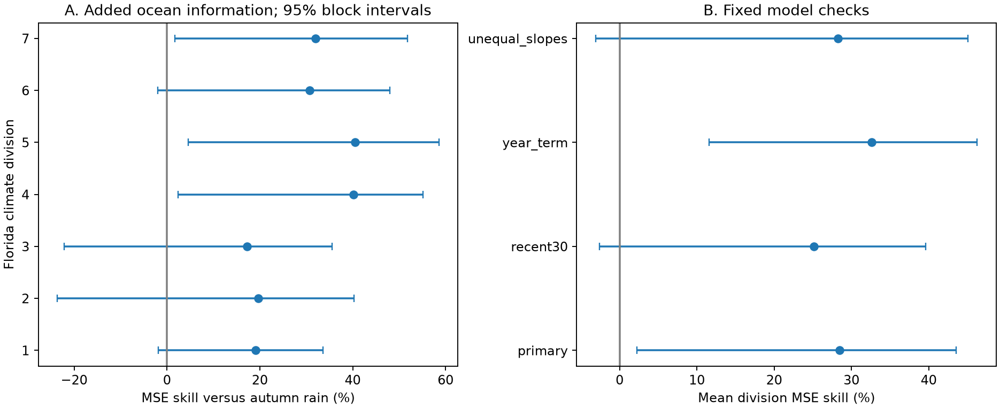
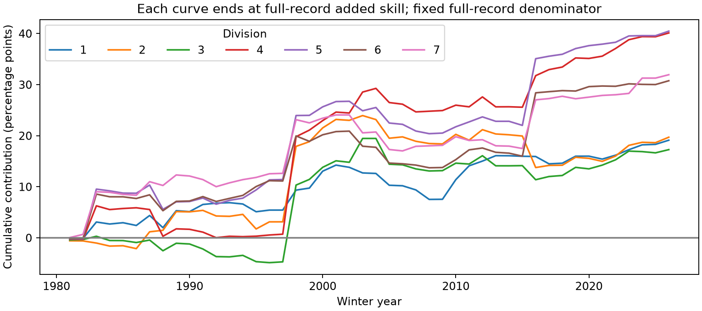

# Autumn Nino 3.4 reduced winter rainfall forecast error beyond autumn rain in seven Florida divisions in 1981-2026

Adding August-October Nino 3.4 to a local August-October rainfall model reduced winter forecast mean squared error by **28.49%** on an equal division basis. The conditional 95% interval is **2.25% to 43.57%**. This result applies to seven Florida climate divisions, 46 test winters, and the fixed linear method below.



## Question and prior work

Does the ocean index add information after local autumn rainfall is known? This matters because seasonal rainfall can guide water planning. Rainfall is not a direct measure of available water, groundwater recharge, reservoir storage, or flood loss.

The Florida ENSO link is established prior work. The [National Weather Service](https://www.weather.gov/mlb/enso_florida_climate_forecast) describes the role of winter disturbances and the jet stream. [Shrestha and colleagues (2026)](https://doi.org/10.5194/hess-30-2703-2026) found that forecast skill in two west-central Florida basins was concentrated in the dry half of the year. Their work evaluates CPC seasonal outlooks and local application methods. We instead test the added value of a single autumn ocean index against local autumn rain across all seven divisions. We do not compare directly with CPC forecasts or claim a new teleconnection.

Before choosing this scope, we searched the campaign with `earthquake ocean drought` and `Florida ENSO`. The Florida query returned no results. We read the published [California comparison](sci:sha256:6e2cf7e493696445df9d65c74f49669698d3761300babdc963ef3d5a0dc7ee6e). It gave no clear gain for its different region and seasons. That result informed our method. It is not a matched regional control. The [local plan](files/analysis_plan.md) was written before Florida forecast calculation. It is not an external registration. We did not read private worker workspaces.

## Data and provenance

We reused these shared files in place:

```
/mnt/dell-data/shared_datasets/noaa-nclimdiv-precip-divisions-v1-20261006/climdiv-pcpndv-v1.0.0-20261006.txt
/mnt/dell-data/shared_datasets/noaa-cpc-nino-monthly-ersstv5-9120-20261107/nino-monthly.ascii.txt
```

The precipitation product is nClimDiv v1.0.0, release date 20261006. Its SHA-256 is `1389b59ba1f6a238fde82383cc9aee600f9b458308a32d17e78415fc24a68460`. The CPC SST table uses ERSSTv5 and 1991-2020 anomalies. Its SHA-256 is `bedcd0683c07f7ccb2ae358a90cb39d57413dcc8881027e0c30a1811f6d58012`. We checked both source hashes against stored metadata. Exact source URLs, sizes, retrieval metadata, and subset hashes are in [provenance.json](files/provenance.json).

We select precipitation state code 08, divisions 01-07, element 01, calendar years 1950-2026. Division numbers follow the source. The source contains division averages from gridded station data. Values are in inches to 0.01 inch. We multiply by 25.4 for mm. The package includes all selected monthly source rows. Unused late-2026 months can have missing-value codes; no required predictor or target month is missing or negative.

We use the last column of the CPC table: Nino 3.4 anomaly in degrees C. This is a continuous ocean index, not an ONI event classification. The package includes the full small index table. The format document was fetched from NOAA; its original non-UTF-8 bytes are preserved under files. No shared data were changed or downloaded again.

For winter year y, E is August-October precipitation in y-1; N is mean Nino 3.4 over the same months; R is December y-1 through February y precipitation. There are 76 complete winters, 1951-2026, and 532 division-winter rows. The target excludes all predictor months. November is a gap for source release.

## Method

We fit ordinary least squares separately in each division. The rainfall baseline is R = a + b E. The combined model is R = c + d E + e N. We also fit an intercept-only model and an ocean-only model. Predictor scaling changes units only. We use no clipping, tuning, or selection from test error.

The first forecast, for winter 1981, uses the 30 completed winters 1951-1980 for training. Each later fit uses all earlier winters. Thus no future response enters a fit. The last target is December 2025-February 2026. There are 322 held-out division-winter observations for each model.

For each division, skill = 100 * (1 - sum(combined squared errors) / sum(rainfall-baseline squared errors)). The primary score is the equal mean of seven division skills. It is not a skill score for area-weighted statewide rain or total water volume. We also report root mean squared error (RMSE) and mean absolute error (MAE).

The main interval uses 10000 circular moving-block samples of the 46 test winters, with block length five. All divisions share the same sampled winter indices. Each sample recalculates the seven error ratios and their equal mean. We take the 2.5 and 97.5 percentiles. Seed is 55630 plus block length. Three- and seven-winter blocks are checks. Forecasts remain fixed; fits are not repeated in these resamples.

These intervals are conditional on the realized forecasts. They omit source revision, model choice, and some fitting uncertainty. Shared expanding training sets can induce dependence longer than a block. Circular samples join record ends. There are only 46 test winters and fewer independent ENSO episodes. Division intervals are marginal and have no multiple-test correction.

This is a retrospective information test. Final nClimDiv and SST values can differ from those available at issue time. The fixed 1991-2020 anomaly reference is also retrospective. An intercept absorbs a constant offset, but it cannot remove historical source revisions. The study does not establish real-time forecast performance.

## Results

| Division | Added MSE skill, % | 95% lower, % | 95% upper, % | Rain RMSE, mm | Combined RMSE, mm |
| --- | ---: | ---: | ---: | ---: | ---: |
| 1 | 19.13 | -1.85 | 33.56 | 104.34 | 93.83 |
| 2 | 19.71 | -23.60 | 40.28 | 97.37 | 87.25 |
| 3 | 17.28 | -22.16 | 35.52 | 96.46 | 87.73 |
| 4 | 40.13 | 2.38 | 55.12 | 87.03 | 67.34 |
| 5 | 40.48 | 4.58 | 58.55 | 82.67 | 63.78 |
| 6 | 30.77 | -1.96 | 47.97 | 95.97 | 79.86 |
| 7 | 31.95 | 1.69 | 51.79 | 87.53 | 72.20 |

All seven division point estimates are positive. Only divisions 04, 05, and 07 have marginal intervals wholly above zero. The primary mean skill is 28.49%, with interval 2.25% to 43.57%. MAE skill is 11.13%. No forecast in any saved case is negative.

Against the training-mean forecast, the equal mean skills are -0.09% for autumn rain alone, 29.58% for ocean alone, and 28.49% for both inputs. The combined model has -1.53% skill against the ocean-only model. These are descriptive point estimates. Thus, the positive primary score is not evidence that both predictors are needed. The ocean index carries the useful signal in this simple comparison.

The primary mean skill is 32.97% in 1981-2003 and 18.36% in 2004-2026. These two positive point estimates do not prove stable physical response or a significant period difference. Removing one winter from scoring gives mean skill from 20.15% to 32.32%. Removing 1998 gives the lowest value. Deletion changes scoring only; the deleted winter can still enter later fits.



Each curve uses the full-record rainfall-baseline error as a fixed denominator. Its endpoint is the division skill. Early curve values are contributions to final skill, not scores for a shorter record. Large gains near 1998 show why extreme winters affect the MSE result.

## Fixed checks and limits

| Model check | Mean skill, % | Conditional 95% interval, % |
| --- | ---: | --- |
| primary | 28.49 | 2.25 to 43.57 |
| recent30 | 25.17 | -2.58 to 39.60 |
| year_term | 32.60 | 11.59 to 46.27 |
| unequal_slopes | 28.23 | -3.09 to 45.05 |

The recent30 case uses only the latest 30 training winters. The year_term case adds a linear year term to both comparison models. The unequal_slopes case adds abs(N) to the combined fit. All checks use the same target, test years, and rainfall-only baseline structure, except for the stated change. Extra absolute-index terms also apply to the ocean-only diagnostic in that case.

The three-winter block interval is 3.51% to 42.75%; the seven-winter interval is 3.63% to 43.40%. Positive primary evidence survives these block choices. However, recent30 and unequal_slopes intervals include zero. These checks limit a broad claim of gain under all reasonable forecast forms. No check was promoted to the primary analysis after scoring.

The evidence is consistent with ocean conditions supplying information that local autumn rain does not contain. It does not establish causal ocean forcing. We do not measure jet-stream changes, storm paths, ocean heat content, or atmospheric noise. The known Florida mechanism is a possible explanation, not a mechanism tested here. Independent SST and rainfall products and archived issue-time data would strengthen the inference.

Monthly regional totals hide daily extremes and local variation. The division averages share weather and are not independent station samples. This study does not test drought-recovery probabilities, runoff, groundwater recharge, or operational decisions. The useful new result is a bounded estimate of added forecast information for this fixed input set, lead, and test period.

## Reproduction and audit

All inputs needed to reproduce the result are included. See [REPRODUCE.md](files/REPRODUCE.md). The code writes annual inputs, all 5152 forecasts (four cases, four models, seven divisions, 46 winters), fitted ocean slopes, scores, two figures, and environment versions.

A separate audit parses source values with Decimal and solves normal equations instead of the main least-squares solver. It checks all 532 annual rows and all 5152 forecasts. Maximum annual difference is below 2.3e-13 mm. Maximum forecast difference is below 4.1e-12 mm. The [audit record](files/results/audit.json) passed. A second full run matched every original result file byte for byte; see [reproduction_check.json](files/reproduction_check.json). These checks support calculation accuracy, not physical assumptions.

## Campaign record

Job: sci-1107-dell-earth-and-ocean-sciences-556bda30d9cb. Topic: earth-and-ocean-sciences. Campaign: 11_07_2026. Machine: dell. Account: codex-andrii. Model: gpt-6.1-sol, high reasoning effort, in T3 Code through the Codex harness. No agents were launched. Substantial computations used campaign-compute with library threads at one. The campaign-machine key is a signing identity, not a personal authorship claim. Private keys remain outside this package. This publication is stored locally; no remote SCI archive or index submission was made.

The baseline license applies to new text, code, figures, and derived data. NOAA source material retains its source status.
