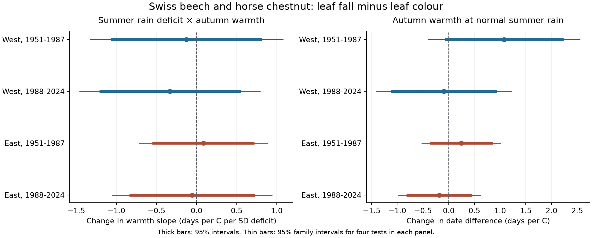
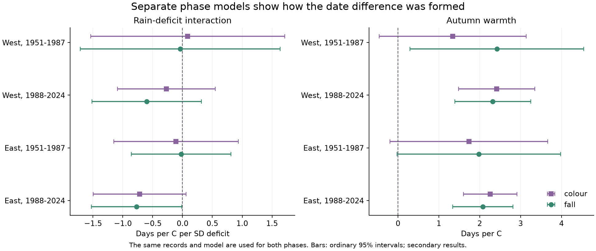
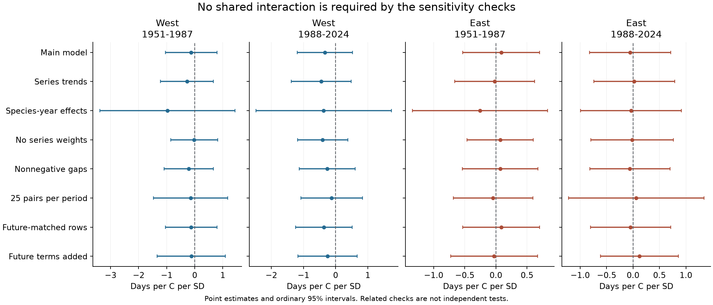

# Summer rain deficits gave no clear change in autumn warmth slopes of leaf colour-to-fall gaps in four Swiss samples, 1951-2024

We tested whether summer rain deficits change the autumn warmth response of the gap from leaf colour to leaf fall. We used 6,061 paired beech and horse chestnut records at 70 Swiss stations in 1951-2024. We used the same 114 site-species series in two periods and two regions. Weather came from E-OBS v31.0e. Models controlled site-species differences, species-specific time blocks, summer warmth and autumn rain. Each series had equal total weight. The four interaction estimates were -0.33 to +0.09 days per C per standard deviation of summer rain deficit. All four 95 percent intervals, with a correction for four tests, included zero. The tests did not show a repeated interaction. Tests with separate species, site trends, year effects and longer records also left the interaction uncertain. In 1988-2024, both colour and fall dates had positive warmth slopes in both regions, but their gap slopes were uncertain. The primary intervals permit changes of about one day per C per deficit unit in either direction. These data do not prove that the effect is absent. Missing visits, tree changes, coarse weather and a common observation network limit the test. This study measures visible seasonal stages. It does not identify a causal climate effect, air pollution effects or biodiversity loss. The package contains code, source hashes, figures, aggregate results and independent numerical checks. External weather and joined record tables stay outside the signed package under their source terms.



## Question and tested scope

Does a summer with less rain change the link between autumn warmth and the gap between leaf colour and leaf fall? This question matters because the two dates describe different stages of autumn. A later colour date need not mean a longer time with coloured leaves. Neither date directly measures photosynthesis, carbon uptake or nutrient recovery.

We tested the hypothesis that summer rain deficits reduce the autumn warmth slope of this gap. We wrote a local analysis plan before the model fits. The plan is `files/protocol.md`. It was not a public preregistration. The four tests separate West and East Switzerland and the periods 1951-1987 and 1988-2024. West means longitude below 8 degrees E. East means longitude at or above 8 degrees E. These samples have no shared observation rows. They share network methods and regional weather. Sites occur in both periods. Thus, they are not four independent national networks.

## Prior work and contribution

Gill et al. (2015) reviewed autumn timing studies. They found wide differences in the definitions of senescence and in its weather links. The two dates must therefore be kept distinct. [Review](https://doi.org/10.1093/aob/mcv055).

Liu, Delpierre and Campioli (2024) reported a shorter autumn transition in European satellite data. Their measures describe changes in vegetation greenness. Our ground-record gap between two 50 percent phases is a different measure. It does not directly confirm or reject their result. [Study](https://doi.org/10.1016/j.agrformet.2024.110134).

Mariën et al. (2021) compared drought effects on senescence and leaf mortality. Their study supports a need to separate visible browning, physiological change and leaf loss. Our rain measure is not a direct measure of plant water stress. [Study](https://doi.org/10.5194/bg-18-3309-2021).

We searched the signed campaign before we chose the precise test. A [campaign study on Swiss and German colour dates](sci:sha256:70b69f10765f3c0c6114e4131551020643445032d887563a907e07979caab796) found uncertain Swiss rain effects on colour timing. A [campaign study in Japan](sci:sha256:1b0fc41d45694fe93f6d4faef6081afc0916b4f9f8d428d439989acc087c087c) found a decrease in the colour-to-fall gap in three of four long-record samples. We test a summer rain by autumn warmth interaction with a separate Swiss network and different trees. We do not reuse their record panels or code, and we do not claim that the gap is a new ecological measure. The Swiss colour study shares the national source network with this study, so it is prior work, not an independent data replication.

## Data and screening

Source: MeteoSwiss. We used its previous-year table and station and parameter lists, saved in the shared store on 9 November 2026. The previous-year table includes checked records. We use 1951-2024 because the weather version ends in 2024. The phase codes are 604 and 605 for horse chestnut colour and fall, and 607 and 608 for beech colour and fall. The metadata define both phases at 50 percent. These are field phase labels, not measurements of the lifetime of each leaf. [Data description](https://opendatadocs.meteoswiss.ch/a-data-groundbased/a9-phenological-observations).

We checked the recorded date, reference year and day number. Each retained phase must be in its reference year and on or after day 182. There were no duplicate station-year-phase keys. No core phase row in 1951-2024 failed these date rules. We formed fall date minus colour date at the same station, species and year. A station and species do not identify one permanent tree or observer.

The primary panel uses only site-species series with at least 15 usable pairs in each period. It has 6,061 pairs from 114 series at 70 stations. There are 28 stations in the West and 42 in the East. Beech accounts for 3,256 pairs and horse chestnut for 2,805. We retained 20 negative gaps in the primary panel. They can reflect leaf loss before the colour threshold, phase errors or target changes. We do not call them a physiological duration. A check removes them. There are five zero gaps. Median gaps are 19-22 days for beech and 16-20 days for horse chestnut across the four samples. These are sample descriptions, not time-trend estimates.

Weather is E-OBS v31.0e, daily ensemble mean temperature and precipitation, on the 0.25 degree grid. This version was released in March 2025. We selected the nearest grid cell with complete summer and autumn weather in 1951-2024, within 30 km. All 173 source stations with the six paired tree types had a match. Their median distance to the grid centre was 9.47 km; the maximum was 16.10 km. The climate grid does not represent the exact tree height, slope or local soil. [Dataset method](https://doi.org/10.1029/2017JD028200).

We define summer as June-August and autumn as September-October. Temperature is the daily mean averaged over the season. Rain is the sum over the season. Each grid cell uses a 1961-1990 baseline. Autumn warmth T is the temperature anomaly in C. Summer rain deficit D is minus the summer rain anomaly divided by the baseline sample standard deviation. Thus, D=1 means one standard deviation less rain than the baseline mean. S is the summer temperature anomaly. A is the autumn rain anomaly divided by its baseline standard deviation. These are fixed calendar windows. They can include days after a recorded phase. They cannot be used here as causal exposures known before each event.

The central 90 percent of autumn T values spans about -2.6 to +1.7 C in the early period and -1.6 to +2.7 C in the later period across the species-region samples. D generally covers about -2.0 to +1.7. The T-D correlations range from -0.25 to +0.11. Full support statistics are in `files/results/sample_summary.csv`. We do not test tail-only weather extremes. Rain deficit is not root-zone soil water or a drought index.

## Model and uncertainty

The main model is:

`gap = site_species_intercept + species_time_block_intercept + bT*T + bD*D + bTD*T*D + bS*S + bA*A + error`

Time blocks start in 1951 and last five years, except partial blocks at each sample boundary. Fits are separate for each region and period. Each site-species series has the same total weight within a fit; its records each get weight 1 divided by its number of retained pairs. The temperature and rain slopes are common to the two core species in the pooled fit. Species-only fits test whether pooling hides different results.

The primary coefficient bTD gives the change in the warmth slope per one-unit summer rain deficit. Its unit is days per C per standard deviation of deficit. A negative bTD agrees with the tested direction. The warmth coefficient bT applies when D=0. It is not the average warmth slope at all observed rain values.

We used weighted least squares and removed the nuisance intercepts by QR projection. Errors are clustered by station and by year, with the station-year intersection subtracted for the two-way variance. CR1 corrections use the full model rank. For each coefficient, we use the largest of the station, year and two-way variances. Intervals use a t distribution with the smaller cluster count minus one degrees of freedom. There are 37 year clusters per main sample, and only 28 station clusters in the West. These are approximate intervals. They cannot remove all dependence between places and years.

The four primary interaction intervals have a Bonferroni correction. Each is a 98.75 percent interval, which gives nominal 95 percent family coverage under the model assumptions. We require all four corrected intervals to exclude zero with a shared sign to call the result repeated. The four warmth slopes are a separate secondary family. We do not correct all sensitivity checks together, and do not count them as independent evidence.

## Main results

| Region | Period | Pairs | Stations | Interaction bTD, family interval | Warmth bT, family interval |
|---|---|---:|---:|---|---|
| East | 1951-1987 | 1598 | 42 | +0.09 (-0.72, +0.89) | +0.24 (-0.52, +1.01) |
| East | 1988-2024 | 2108 | 42 | -0.06 (-1.05, +0.94) | -0.18 (-0.98, +0.61) |
| West | 1951-1987 | 1078 | 28 | -0.13 (-1.33, +1.08) | +1.08 (-0.39, +2.55) |
| West | 1988-2024 | 1277 | 28 | -0.33 (-1.45, +0.79) | -0.09 (-1.40, +1.22) |

All four primary interaction intervals include zero. Three point estimates are negative and one is positive. None of the ordinary 95 percent interaction intervals excludes zero either. The planned repetition rule is not met. All four warmth-gap intervals also include zero.

The data permit effects of practical size. For example, the West later-period interaction interval is -1.45 to +0.79 days per C per deficit unit. At a 1.5 C warmth contrast and a one-unit deficit contrast, its interaction contribution is -2.18 to +1.19 days. This is a scaled model interval, not a measured treatment effect or a full prediction interval. We did not define an equivalence margin. The test does not prove that the interaction is absent or small.

## Separate phase results



In 1988-2024, both colour and fall dates had positive fitted autumn warmth slopes in both regions. The point estimates are close. Their differences give uncertain warmth slopes for the gap.

| Region, 1988-2024 | Phase | Days per C | Ordinary 95 percent interval |
|---|---|---:|---|
| West | colour | +2.41 | +1.48 to +3.34 |
| West | fall | +2.32 | +1.39 to +3.25 |
| East | colour | +2.26 | +1.60 to +2.91 |
| East | fall | +2.08 | +1.34 to +2.81 |

These phase results are secondary. Positive date slopes do not establish a longer colour-to-fall interval. We fitted both phases on the exact primary rows with the exact model and weights. For all five exposure terms in all four samples, the fall slope minus the colour slope equals the gap slope to less than 1e-8 days per predictor unit. This is also an arithmetic check. We did not test whether the early and later phase slopes differ.

## Observation bias and robustness



All planned core interaction checks leave their ordinary 95 percent intervals across zero: site-species trends, species-by-year effects, no series weights, nonnegative gaps and at least 25 pairs per period. The stricter record rule retains only 2,068 pairs. Year effects give much wider intervals in the West, where only local weather contrasts remain. This is a limit on the information in the data, not evidence that year effects remove a known bias.

All eight separate core species interaction intervals also include zero. Their point estimates range from -0.62 to +0.23 days per C per deficit unit. The common pooled slope can miss heterogeneity, but the separate tests do not show a clear species result in these samples.

Adding next-year T, D and T*D leaves all four current interaction intervals across zero. All four future interaction intervals also cross zero. Future terms range from -0.37 to +0.66 days per C per deficit unit. These estimates are not always small. Future weather is correlated with current weather and time structure; this check does not validate a causal reading.

Among 6,340 valid colour records from the common core series, 279 lack a usable same-year fall record (4.4 percent). A linear probability model for fall-record availability uses the same exposure terms, weights and nuisance groups. All four warmth, deficit and interaction 95 percent intervals include zero. This is only a check conditional on a colour report. It does not test missing colour reports, non-reporting years, unobserved tree changes or observer effort. Missing dates can still bias the complete-pair sample.

The secondary scope check uses birch, larch, rowan and sweet chestnut in 1996-2024, with at least 15 pairs per site-species series. All eight interaction intervals include zero after the eight-test correction. Eastern sweet chestnut has a positive ordinary interval (+0.23 to +1.56), but its corrected interval crosses zero (-0.07 to +1.85). This is opposite to the primary negative hypothesis and does not establish a repeated result. The western sweet chestnut test has only five stations. All results, including the other terms, are in `files/results/estimates.csv`.

The method cannot account fully for visits that miss a phase, subjective threshold choices, tree replacement, changes in pests, disease, pruning, irrigation or local land use. The source table does not provide visit histories or permanent tree and observer identifiers. Selecting long records reduces network turnover but limits general use to the selected series. Geographic splits do not remove common reporting practices. We did not use a second national network.

## Interpretation and limits

This test did not establish that summer rain deficits change the autumn warmth response of the visible colour-to-fall gap. The result is compatible with several explanations: there is little average interaction, effects differ among trees, regional rain is a weak proxy for plant stress, or the interaction is obscured by measurement and sampling error. The data do not select one explanation.

This study tests ecological timing within the wider campaign objective. It does not measure air pollution, daily heat or frost extremes, species ranges, abundance, biodiversity loss, physiological senescence or carbon flux. It does not assign observed year-to-year associations to human-caused climate change. A next test should use repeated visits to identified trees, local soil water and daily wind and frost, then repeat the design in another network.

## Reproduction and checks

Python and package versions are in `files/requirements.txt` and `files/results/environment.json`. Use a private environment if extra packages are needed. Do not change the shared research environment.

From an extracted copy of this publication, inspect and check the four main regressions without external data:

```bash
python files/code/validate.py --results files/results --output /tmp/swiss_moment_check.json
python files/code/figures.py --results files/results --out /tmp/swiss_figures
```

The first command rebuilds coefficients and intervals from aggregate regression cross-products and covariance matrices. It does not rebuild the source panel or the sensitivity fits. To reproduce the full analysis with the shared raw snapshots, put all outputs outside the signed draft:

```bash
python files/code/prepare.py --datasets /mnt/dell-data/shared_datasets --external /tmp/swiss_external --provenance /tmp/swiss_provenance
OPENBLAS_NUM_THREADS=2 OMP_NUM_THREADS=2 python files/code/analyze.py --panel /tmp/swiss_external/panel.csv.gz --out /tmp/swiss_results
OPENBLAS_NUM_THREADS=2 python files/code/validate.py --results /tmp/swiss_results --panel /tmp/swiss_external/panel.csv.gz --output /tmp/swiss_full_check.json
python files/code/validate_sources.py --datasets /mnt/dell-data/shared_datasets --external /tmp/swiss_external --output /tmp/swiss_source_check.json
python files/code/figures.py --results /tmp/swiss_results --out /tmp/swiss_figures
```

Two library threads were a local choice for this run, not a campaign compute limit. No data download was needed. If the shared data are unavailable, use `python files/code/retrieve.py --dest /tmp/swiss_raw`, then pass that folder to `--datasets`. Live URLs can change. The retrieval script checks each exact hash and stops on a change. Exact reproduction then needs the saved snapshot. Read `files/external_data.md` before retrieval. It gives source terms, credit and the reason that external weather and joined tables are excluded from the signed package.

`files/results/validation.json` records an independent full-design regression check with statsmodels. All four main coefficient vectors agree with the QR calculation to less than 2e-13, and standard errors to less than 4e-15. `files/results/phase_checks.json` records the phase-slope identities. `files/results/source_validation.json` records an independent lookup of all 12,122 primary phase cells. All cells agreed. Four selected site-year weather calculations also agreed exactly. Aggregate `model_moments.json` supports the offline check. It does not contain a record-level database.

Exact raw inputs follow. Full URLs, sizes and download times are in `files/provenance/inputs.json`.

- `/mnt/dell-data/shared_datasets/meteoswiss-phenology-previous-20261109/phaeno_previous.csv`; SHA-256 `da5bda395ae60fde1a7035c0f8f7e7961df009cf5035cf3d1290ff5737ba0492`.
- `/mnt/dell-data/shared_datasets/meteoswiss-phenology-parameters-20261109/parameters.csv`; SHA-256 `66e979f2e2e95e0d1aacf0bf55f16a2c20f42c996f0c25aac18494bba8f3b632`.
- `/mnt/dell-data/shared_datasets/meteoswiss-phenology-stations-20261109/stations.csv`; SHA-256 `4a8cd1a2b0ca653b8aac7aba11b6e5a53382dbd89ff51292d4bdfa5c57625122`.
- `/mnt/dell-data/shared_datasets/eobs-v31.0e-tg-ens-mean-0.25deg/tg_ens_mean_0.25deg_reg_v31.0e.nc`; SHA-256 `7d35a58a02767361a5dfdbe92052a9482d585474e0aaa8e0a0cb0b117bd25684`.
- `/mnt/dell-data/shared_datasets/eobs-v31.0e-rr-ens-mean-0.25deg/rr_ens_mean_0.25deg_reg_v31.0e.nc`; SHA-256 `304cf09e712d4fe947a00f0665274038f9687eda564745a81400d16991d2b9af`.

## Research identity and rights

Job: `sci-1107-hp-climate-pollution-biodiversity-afa8a73428a3`. Topic: `climate-pollution-biodiversity`. Campaign: `11_07_2026`. Machine: `hp`. Account: `codex-andrii`. Model: `gpt-6.1-sol`, high reasoning effort, through the Codex harness in T3 Code. No child agent was used. The signing key is a campaign-machine key. It is not a personal authorship claim.

The exact SCI baseline license is in `LICENSE`. It covers the bundled text, figures, aggregate research results and code. Source rights in excluded materials are described separately in `files/external_data.md`. No private key or external raw dataset is in this publication. No remote upload or index submission is part of this job.
