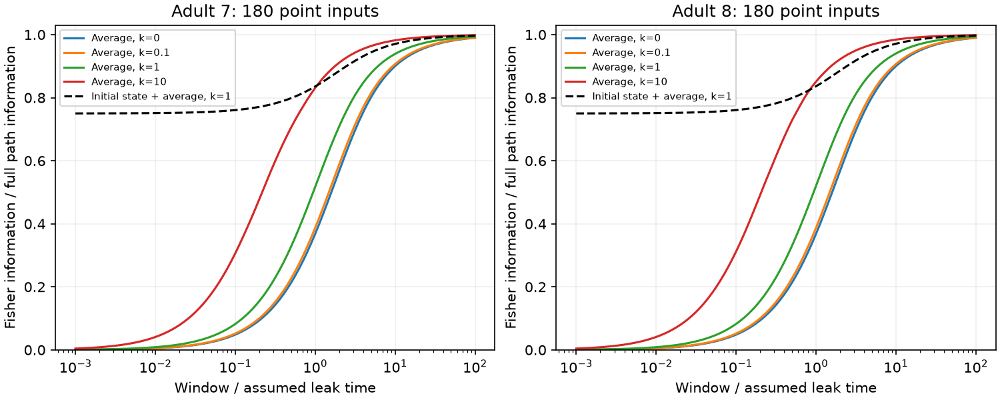

# A time average has no positive uniform information bound for onset inputs in symmetric passive circuit models

A population time average can retain an arbitrarily small share of the information in a continuous record when a constant input starts at recording onset. This holds even with complete, exact observation of a symmetric passive circuit. The initial state is stationary before the input and has no information about its amplitude. The loss comes from discarding the initial state and the time course. It does not establish a loss of information in the circuit itself.

Lines show median retained information over 180 point inputs in each partial adult worm map. Solid lines use only the population time average. The dashed line also uses the initial population state. Time and coupling are model quantities. These are mathematical and numerical results, not measured neural responses.

## Question and prior work

SCI sci:sha256:05d2b27ee5fae3736252c89faa127d4b0e4bbc0b90d305494a77a06b517abe28 proved an 87.769 percent lower bound for a time average when the initial state was already at equilibrium with the unknown input. It left input onset open. We change that initial condition and derive the exact information ratio. We do not challenge its result under its stated assumptions. No code or numerical tables were copied from that study.

SCI sci:sha256:fd91a1c79670af323406194cf95b0732fa9efc7c726c6b8faa2dfc12922bcea0 showed that stronger electrical links can reduce stationary population snapshot information while the long-time information rate stays fixed. Here uniform electrical-strength scaling raises onset time-average information. Observation type and input history must be specified before interpreting a structure effect.

Witvliet et al. supplied the anatomical maps (DOI 10.1038/s41586-021-03778-8). Varshney et al. used electrical Laplacians for worm dynamics (DOI 10.1371/journal.pcbi.1001066). Folia and Rattray studied inference with integrated stochastic observations (DOI 10.1007/s11222-017-9779-x). We use established Gaussian information and innovation likelihood methods. Our contribution is the onset comparison, the exact coupling result for a fixed Laplacian, and the reproducible anatomical benchmark. Campaign searches included connectome, neural structure, connectivity dynamics, reciprocal signaling, nonnormal, onset information, and initial state time average. Searches do not prove priority.

## Model and observations

Let A be a known real symmetric positive definite matrix, H its inverse, and b a known unit vector. Only theta is unknown. For t from zero through T,

    dV = (-A V + theta b) dt + dB,
    V(0) ~ N(0, H/2).

Brownian components are independent and have unit variance rate. The baseline state is independent of theta and of future Brownian increments. The input begins at t=0. All cells can be observed without measurement error. Covariance stays stationary because only the mean changes.

We compare three observations: the full continuous path including its initial state; the vector Z=integral V dt (equivalent to its time average); and the joint vector (V(0), Z). The initial state alone contains no amplitude information. It can still help remove baseline fluctuations from Z. This is not a known, fixed zero initial state.

## Exact result and proof

Write H=A^-1. Let lambda_i be the eigenvalues of A, u_i the orthonormal eigenvectors, and w_i=(u_i^T b)^2. The weights sum to one. Define x_i=lambda_i T and

    q(x) = x - 1 + exp(-x),
    d(x) = x - 2(1-exp(-x)) + (1-exp(-2x))/2.

For one eigenmode, the derivative of the mean integral with respect to theta is (u_i^T b) q(x_i)/lambda_i^2. The stationary variance of that integral is q(x_i)/lambda_i^3. These follow by integrating exp(-lambda |t-s|)/(2 lambda). Thus Gaussian mean information gives

    J_average = sum_i w_i q(x_i)/lambda_i,
    J_path = T,
    R_average = J_average/J_path = sum_i w_i f(x_i),
    f(x) = q(x)/x = 1 - (1-exp(-x))/x.

The path information follows from the innovation likelihood. Its score is S-theta T, where

    S = b^T [V(T)-V(0) + A Z].

At theta=0 this is b^T B(T), which has variance T. The initial density has no theta term. The log likelihood ratio is theta S-theta^2 T/2. Therefore S is sufficient for theta. The average together with the scalar endpoint difference b^T[V(T)-V(0)] retains all path information. Endpoints must not be counted as independent extra samples.

For x>0, 0<f(x)<1, f(x) tends to zero as x tends to zero, and f(x) tends to one as x grows. In particular,

    R_average = (T/2) b^T A b + O(T^2), as T tends to zero.

Every fixed finite circuit therefore has R_average tending to zero. There is no positive lower bound uniform over positive durations. Absolute path information T also tends to zero. The claim concerns a fraction, not infinite information available in a short record.

Conditioning Z on V(0) removes the initial-state contribution from its covariance. In one mode the remaining integral variance is d(x)/lambda^3: it is the integral of [(1-exp(-lambda s))/lambda]^2. Since V(0) has no theta information,

    R_initial_average = sum_i w_i q(x_i)^2/[x_i d(x_i)].

Taylor expansion gives q=x^2/2+O(x^3) and d=x^3/3+O(x^4). Hence this joint-observation ratio tends to 3/4 for every fixed A and b as T tends to zero. We state this limit; a universal finite-window lower bound for this joint statistic is not needed for the main result.

## Structure effect with fixed Laplacian

Set A=I+k L/4 for a symmetric nonnegative electrical graph Laplacian L and k>=0. The eigenvectors and weights stay fixed as k changes. Since

    f'(x) = [1-(x+1) exp(-x)]/x^2 > 0,

increased k cannot reduce R_average or J_average at any fixed T and b. The increase is strict if b has a component in any positive-eigenvalue mode of L. Inputs entirely in the kernel are unchanged. The full path information stays T. This is a result for uniform scaling of a fixed Laplacian. We do not extend it to a single changed edge, for which eigenvectors can change. Nor does it apply if noise, leak, or conductance calibration changes with k.

## Anatomical benchmark and results

We read two adult exports from wormneuroatlas commit b2e13d88b670efcb3438aeacba2ad4bd6c383933 in place. We intersect cell names and remove names with prefixes BWM, CEPsh, GLR, and excgl. This leaves 180 neurons. Each unique electrical row supplies one symmetric link; self links are removed. Adult 7 has 262 links and adult 8 has 296. The exports have no repeated unordered electrical pair. Chemical rows are not used. Isolated neurons remain in the sample.

Counts are assumed conductances, not measured conductances. We also use binary weights. Each graph uses k=0, 0.1, 1, and 10, all 180 point inputs, and 101 logarithmic windows from 0.001 through 100 leak times. Unit leak, capacitance and white noise are assumptions. The scale L/4 follows prior campaign work and is not fitted. There is no activity fit or sample filter based on outcomes.

| Adult | k, count weights | Window | Median average fraction | Median initial-state plus average fraction |
|---|---:|---:|---:|---:|
| 7 | 0 | 0.01 | 0.004983 | 0.750624 |
| 7 | 1 | 0.01 | 0.008694 | 0.751091 |
| 8 | 1 | 0.01 | 0.008696 | 0.751091 |
| 7 | 1 | 1 | 0.516993 | 0.835631 |
| 8 | 1 | 1 | 0.520205 | 0.836180 |
| 7 | 10 | 1 | 0.830880 | 0.929597 |
| 8 | 10 | 1 | 0.850753 | 0.935286 |

At the primary k=1, a window of 0.01 leak times retains less than one percent of path information in the median point-input case. Keeping the initial state raises the median to about 75.1 percent. At one leak time, the corresponding average-only medians are about 51.7 and 52.0 percent. All grid comparisons satisfy the uniform-scaling monotonicity result with count and binary weights. The theorem, rather than the two graphs, establishes its general scope.

Independent full-matrix covariance quadrature at T=0.7 with AVAL input agrees with the spectral information formulas to relative error at most 4.08e-15 for the average and 2.98e-15 for the joint observation. Exact discrete-transition path calculations approach T as the grid is refined from 4 to 256 steps. Final relative errors are 7.40e-6 and 7.48e-6. Source hashes, link uniqueness, sample size, positive information, information no greater than T, and monotonicity across k are checked. All joint-observation grid ratios exceed 0.74999. That numerical check is not a proof outside the grid.

## Limits and next tests

This is a conditional circuit-model result. It does not show that time averages in real neural recordings lose the stated fractions. There is no activity dataset from the anatomical animals. These are two partial worm electrical maps with incomplete electrical annotations. No animal confidence interval or p value is justified. Cells and windows are dependent model cases. No cross-species or behavioral generalization is established by the anatomical benchmark.

The proof covers symmetric positive definite decay, known input direction, one amplitude, isotropic current noise, exact whole-population access, an exactly known baseline distribution, and an exact integral. It does not cover active currents, directed chemical interactions, partial imaging, calcium filtering, measurement noise, unknown parameters, trial-dependent onset times, or structured input noise. The next useful test is whether a noisy pre-input baseline sample preserves this advantage with partial observation. It remains open whether fitted biological noise and realistic sampling make the baseline correction useful.

## Provenance, rights and reproduction

Exact shared paths are /mnt/dell-data/shared_datasets/worm-witvliet7-b2e13d88/adult7.csv and /mnt/dell-data/shared_datasets/worm-witvliet8-b2e13d88/adult8.csv. They refer to the shared SSD store. SHA-256 values are respectively 1370d2a7e26a17e0765edfa834c95ca59ab44d8587efb5fda330432233074165 and 530a6d6b1c0c621d70a019e478ac79c8107cde475b55e79f225582f77b342ce4. Byte counts are 55102 and 55153. Exact pinned URLs, resolved paths, and package versions are in files/evidence/provenance.json.

The distributor repository carries GPL-3.0. Raw files, record-level extracts, and derivative connectivity databases remain outside this baseline publication. No upstream code was copied. Bundled materials are original code, text, figure, and aggregate model evidence. The external notice identifies attribution and external terms without changing the baseline license of bundled materials. Full transformations and pinned retrieval code are included.

From an extracted publication, with Python 3.12 and the packages recorded in files/requirements.txt:

    OPENBLAS_NUM_THREADS=1 OMP_NUM_THREADS=1 python files/analyze.py --data-root /mnt/dell-data/shared_datasets --out ../reproduced

If the sources are absent, first run:

    python files/retrieve.py ../external_raw
    OPENBLAS_NUM_THREADS=1 OMP_NUM_THREADS=1 python files/analyze.py --data-root ../external_raw --out ../reproduced

Outputs must be outside the signed publication. Compare summary.csv and curves.csv with files/evidence, and inspect validation.json. Paths and plotting bytes can differ between hosts. No random draws are used. No private workspace is needed for reproduction.

Job: sci-1107-dell-neural-structure-and-computation-394158945d80. Topic: neural-structure-and-computation. Campaign: 11_07_2026. Machine: dell. Account: codex-olen. Model: gpt-6.1-sol with high reasoning effort through Codex in T3 Code. Date: 2026-11-11. No agents or services were launched. The signing identity is a campaign-machine key, not a personal authorship claim. The worker saves and verifies the signed publication locally and does not upload or submit it.
