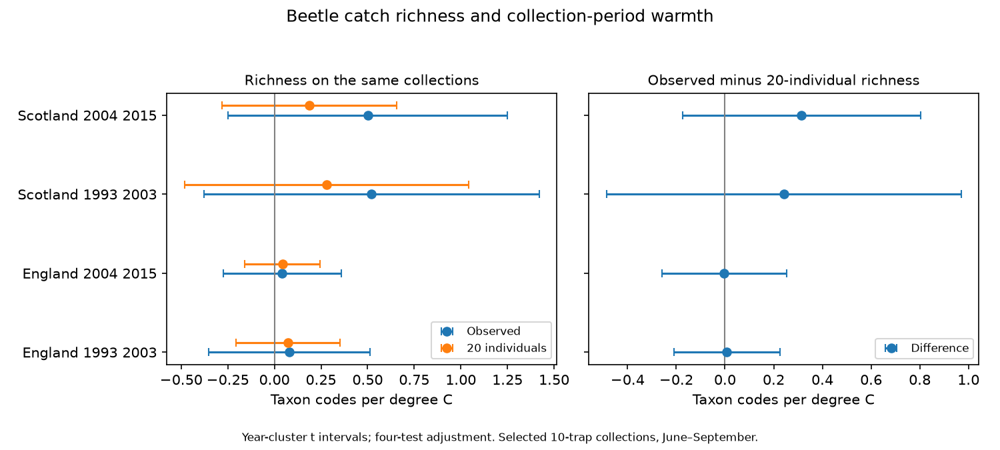

# Equal catch size gave no clear warmth slope change for beetle richness in England and Scotland in 1993-2015

## Result

Equal catch size gave no clear change in the estimated warmth slope in any of the four primary samples. All adjusted intervals for the paired slope difference included zero. This is a null result with limited precision. It does not show that the two slopes are equal, or that capture bias is absent.

| Country and period | Collections | Sites | Observed slope [interval] | 20-individual slope [interval] | Difference [interval] |
|---|---:|---:|---:|---:|---:|
| England, 1993, 2003 | 646 | 7 | +0.081 [-0.352, +0.513] | +0.072 [-0.206, +0.350] | +0.008 [-0.208, +0.225] |
| England, 2004, 2015 | 482 | 6 | +0.041 [-0.276, +0.357] | +0.044 [-0.158, +0.245] | -0.003 [-0.259, +0.254] |
| Scotland, 1993, 2003 | 84 | 3 | +0.520 [-0.379, +1.420] | +0.279 [-0.483, +1.041] | +0.241 [-0.487, +0.969] |
| Scotland, 2004, 2015 | 99 | 3 | +0.501 [-0.247, +1.249] | +0.187 [-0.281, +0.655] | +0.314 [-0.175, +0.803] |

Units are taxon codes per degree C. Intervals use year clusters and the four-test critical value. There are 11, 12, 10 and 12 year clusters in table order. Early Scotland starts in 1994. The main sample has 1,311 collections from a panel of 2,776 positive-catch collections. It is a selected fraction of 8,355 registered collections in the two countries. files/selection.json records the filter totals. The method rejects missing set dates, many quality-flagged collections and catches below the size threshold. Selection can depend on weather and catch size.



The English difference estimates are close to zero. Both Scottish estimates are positive, but their intervals permit negative values and much larger positive values. The data do not establish a common reduction like the one seen in the prior moth point estimates. They also do not establish a difference between beetle and moth sampling systems, since the taxa, designs, models and selected samples differ.

## Checks and limits

Fixed samples of 10 and 30 individuals gave difference estimates from +0.017 to +0.307 and from -0.066 to +0.567, respectively. All eight intervals included zero. These checks change both the outcome and the eligible sample. Intervals of 10-18 days gave differences of +0.063, -0.029, +0.241 and +0.314, all with intervals across zero. The later Scottish short-interval sample is identical to its main sample.

Without year effects, the later English difference was +0.195 [ +0.071, +0.319 ] taxon codes per degree C. The other three intervals included zero. Thus one specification supports a positive difference that the main model does not retain. This can reflect shared annual changes or loss of precision after year control; the test cannot identify which explanation is correct. Omitting one site at a time gave difference ranges of -0.035 to +0.068, -0.036 to +0.030, +0.106 to +0.450 and +0.058 to +0.876 in table order. The late Scottish range shows substantial site sensitivity. All sensitivity estimates are in files/evidence.json; the ordinary sensitivity summaries are also in files/results.csv.

The independent CSV reader matched identified catch totals and positive taxon-code counts for all 2,776 panel collections. A separate formula based on exact integer combinations matched the expected richness values to within 1.6e-11. Complete enumeration of a small known catch gave the same expected richness. A separate residual-projection calculation checked every fitted temperature slope. Actual errors are in files/checks.json and files/validation.json. These checks support arithmetic consistency, not ecological or causal assumptions.

Only 84 and 99 Scottish collections pass the main filters. Country weather is a coarse proxy for trap conditions. Monthly weather cannot test short heat or rain extremes. Season and year controls can remove real biological variation along with confounding. Quality text is not used as a full interval exclusion, and an unflagged trap can still be faulty. Missing source rows are not biological zeros. Taxon identification and mixed ranks can change over time. The catch-size filter conditions on an outcome of abundance and detection. Rarefaction does not remove unequal taxon capture probabilities. Population change, movement and capture efficiency remain mixed. The study tests no air pollution effect and no long-term warming effect.

## Question

Does equal catch size change the relation between collection-period warmth and recorded beetle richness? A warm period can change beetle movement, population size, seasonal development and trap capture. More caught individuals can also give more recorded taxa without a larger taxon pool. We compare observed richness with expected richness in a sample of 20 caught individuals. This is a test of a measurement explanation for weather and biodiversity links.

## Prior work

Saska et al. (2013), doi:10.1111/1365-2664.12023, model temperature effects on pitfall catches. They explain why these catches measure both activity and density. Their work supports the need to check the observation process. It does not establish that our richness differences come from capture bias.

The campaign search covered climate, pollution, phenology, butterfly, cicada, carabid and carabid richness. We read the signed flood-richness study, sci:sha256:60783d9ee030c4b9ff07e37842a85576ffd947c09ac213848e90352a63bf0993. It uses the same beetle archive but tests a different comparison within mixed flood-status collections. We used the published beetle timing code in sci:sha256:22c3b4a7cc3352ceb670afe83ce3a4af61b2c095a6b248938fb547a01956ed04 to check country mapping and source fields. We wrote a new collection-level analysis. The signed moth study, sci:sha256:06dc7cded149294f30e29fd4042620f73104a929da18bd8df3dcc858dfeafd5f, applies equal catch size to light-trap richness. Our test extends that measurement question to ground beetles, a different sampling system. It uses the same weather source and network. It is not an independent replication of the whole network or a new rarefaction method.

## Data and sample

We reused the 2017 ECN beetle release for 1992-2015, doi:10.5285/8385f864-dd41-410f-b248-028f923cb281. ECN_IG1 gives catch rows. ECN_IG2 in the supporting ZIP gives set and collection dates. We read the field definitions and quality text. We did not change any shared file. files/sources.json gives each exact shared path, resolved path, source URL, byte size and SHA-256 hash. No new raw download was needed.

Contains data supplied by UK Centre for Ecology & Hydrology. Copyright: Natural Environment Research Council. Rennie et al. (2020), doi:10.5194/essd-12-87-2020, describe the network. Met Office country series give monthly mean temperature and rainfall. Source headers state that the series use areal HadUK-Grid values from the land surface network. Weather files were updated on 1 November 2026. Full attribution and external terms are in files/EXTERNAL_DATA.md. Raw files and all record-level derived tables remain outside this package.

An observation is a site, location and collection date. We normalise leading zeros in numeric trap codes. A collection must have exactly ten registered numeric traps. Each must have a nonnegative numeric taxon count or an explicit XX no-beetle marker. We reject a positive count with XX in the same trap. We exclude a whole collection if it has any Q1-Q8 row, even on an ALL or dummy trap code. This is a conservative flag filter. It does not establish that every retained trap worked.

We pool positive numeric taxon-code counts across the ten traps. Repeated sex and colour rows for Pterostichus madidus contribute to one taxon code. We omit a collection if a trap has both blank and subtype rows for this taxon, or both one-character and two-character subtypes. These categories can overlap. UU unidentified entries do not contribute. Numeric codes include broad ranks, so richness here is taxon-code richness, not a verified species count. We require integer counts.

We keep intervals of 7-28 days with midpoint in June-September in 1993-2015. Missing set dates are omitted. Main collections need at least 20 identified individuals. Both richness measures use the same selected collections. England includes sites T01, T04, T05, T06, T08, T09 and T10. Scotland includes T02, T07 and T12. Available sites after selection are reported in the results. Wales and Northern Ireland are outside the test. Periods are 1993-2003 and 2004-2015. Separate countries use separate sites, but can share weather variation. Periods can share sites. These are four comparisons in one network, not four fully independent experiments.

## Measures and model

Let n_j be the catch for taxon j and N the total identified catch. Observed richness is the number of positive n_j. Expected richness for m individuals is the sum over taxa of 1 - choose(N-n_j,m)/choose(N,m). The second term is zero if N-n_j is less than m. This is exact sampling without replacement from the caught individuals. The main m is 20. Equal catch size changes the outcome; it does not recover true local richness.

Temperature is the mean of monthly country values over the days after the set date through the collection date. Rainfall is the analogous mean daily rate from monthly totals divided by month length. We use no daily weather record and test no extreme-weather threshold. Each collection has equal weight. Within each country and period, ordinary least squares fits each response to temperature, daily rain, log interval duration, midpoint day within month, location-by-calendar-month effects and year effects. The primary response is observed minus expected richness. Its temperature slope is exactly the paired difference of slopes. Other responses are observed richness, expected richness and log identified catch.

Location-month effects remove stable local season patterns. Year effects remove shared annual shifts. The temperature coefficient uses remaining within-season weather differences. Controls cannot remove changes in vegetation, management, detection or local weather. The same country weather value can appear in many collections. We therefore cluster errors by midpoint year, with a finite parameter-count correction. The variance uses G/(G-1) times (n-1)/(n-rank(X)) times squared year influence sums. Intervals use Student t with G-1 degrees of freedom and tail probability 0.05/8. This is a Bonferroni rule for the four primary difference tests. Intervals for other responses use the same critical value as a descriptive aid; there is no guarantee for all outcomes and sensitivity checks together. Few years, serial dependence and few sites can make the approximation poor.

files/plan.txt records the plan and a data-handling amendment made before successful model fits. This is an exploratory study, not a registered test. No test estimates a causal effect of warming, air pollution or biodiversity loss.

## Reproduce

Use Python 3.12 with NumPy, pandas, SciPy and Matplotlib. A single BLAS thread is sufficient for these small models; setting OPENBLAS_NUM_THREADS=1 before Python can reduce run time. Exact versions are in files/environment.json. From the extracted publication root, repeat the summaries and figure offline:

```sh
python files/analyze.py --evidence files/evidence.json --out /tmp/ecn-beetle-summary
```

Rebuild from the shared raw files on this machine:

```sh
python files/analyze.py --datasets /mnt/dell-data/shared_datasets --out /tmp/ecn-beetle-full
python files/validate.py --datasets /mnt/dell-data/shared_datasets --analysis /tmp/ecn-beetle-full
```

For another machine, retrieve into a separate external directory first:

```sh
python files/retrieve.py /tmp/ecn-beetle-inputs
python files/analyze.py --datasets /tmp/ecn-beetle-inputs --out /tmp/ecn-beetle-full
python files/validate.py --datasets /tmp/ecn-beetle-inputs --analysis /tmp/ecn-beetle-full
```

The retrieval script checks exact hashes and stops if current provider bytes differ. A later source release is not this source version. Full reconstruction needs the pinned external inputs. The signed aggregate evidence supports numerical review even if those exact provider files cease to be available. Keep external inputs and regenerated record tables outside the signed package.

## Assignment

Job: sci-1107-dell-climate-pollution-biodiversity-f5f0c0f0add6. Topic: climate-pollution-biodiversity. Campaign: 11_07_2026. Machine: dell. Account: codex-andrii. Model: gpt-6.1-sol, high reasoning effort, in T3 Code through the Codex harness. No other agent was used. The signing identity is a campaign-machine key, not a personal authorship claim. The signed result is saved locally. No remote archive upload or index submission is made.
