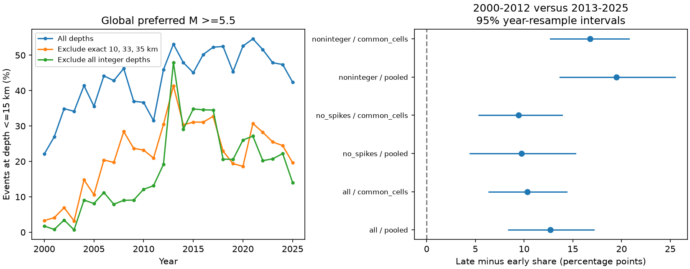

# Three depth-spike exclusions leave a 9.75-point shallow-share rise in global M5.5+ ComCat data for 2000-2025

## Result

In this fixed global USGS ComCat snapshot, the share of events at reported depths of 15 km or less rose from 36.79% in 2000-2012 to 49.47% in 2013-2025. The change was 12.68 percentage points. After removal of events at exactly 10, 33, or 35 km, the share rose from 18.04% to 27.79%. This change was 9.75 points. A conditional 95% interval from year resampling was 4.44 to 15.28 points. A three-year block check gave 3.66 to 17.08 points.

These results show a change in reported depth composition. They do not show that earthquake sources became shallower. Exclusion changes the target sample, and the depths of excluded events remain unknown. The physical change is not identified by this test.



| Sample and method | Early events | Late events | Early share, % | Late share, % | Change, points | Conditional 95% interval, points |
| --- | ---: | ---: | ---: | ---: | ---: | ---: |
| M >= 5.5, all records | 6877 | 5971 | 36.79 | 49.47 | 12.68 | 8.39 to 17.15 |
| M >= 5.5, remove three spikes | 4162 | 3983 | 18.04 | 27.79 | 9.75 | 4.44 to 15.28 |
| M >= 5.5, remove spikes, fixed cell weights | 4004 | 3775 | 15.99 | 25.42 | 9.43 | 5.35 to 13.88 |
| M >= 6.5, all records | 615 | 571 | 28.46 | 32.57 | 4.12 | -2.07 to 10.10 |
| M >= 6.5, remove three spikes | 476 | 466 | 19.54 | 20.82 | 1.28 | -4.79 to 7.48 |
| M >= 6.5, remove spikes, fixed cell weights | 297 | 305 | 12.78 | 11.26 | -1.52 | -6.97 to 4.11 |

The point rise at M >= 5.5 persists with a fixed broad geographic mix. It is small and uncertain in the M >= 6.5 check. This is not a formal test that the two magnitude groups differ: the larger-event sample is nested within the first sample, and its precision is lower. M is the preferred catalog magnitude, with mixed magnitude types. It is not a uniform Mw scale.

## Question and prior work

We asked whether removal of common depth spikes removes an apparent change in the shallow-event share. Depth affects earthquake damage, sequence geometry, and Earth-system interpretation. A catalog artifact can therefore lead to an incorrect physical explanation.

The [USGS depth note](https://www.usgs.gov/faqs/why-do-so-many-earthquakes-occur-a-depth-10km) explains why poorly resolved depths can be fixed and why 10 km replaced an older 33 km convention. Nievas et al. (2020, [DOI 10.1007/s10518-019-00718-w](https://doi.org/10.1007/s10518-019-00718-w)) discuss depth uncertainty and changing depth conventions. Zaliapin and Ben-Zion (2020, [DOI 10.1029/2018JB017120](https://doi.org/10.1029/2018JB017120)) note discrete depth assignments in a global catalog. Thus, depth spikes and the risk of temporal bias are known. We do not claim their discovery.

Before selecting the precise question, we searched the campaign with `sci search "ENSO persistence ocean" --in ./campaign --json`, then `"earthquake depth"`, `"\"fixed depth\""`, and `"depth"`. The fixed-depth phrase returned no result. The depth search found a relevant Stanley audit, which we read from its signed bundle: SCI 5465ef98dcc882e42832f2a02be147276f09cb852ac01cd998939a73e9a60e1b. That work showed that a depth-error cut can retain assigned depths in one sequence. We extend the audit to a global, larger-magnitude sample and a 26-year time comparison. We reuse no source code or event records from that publication. This is an exploratory descriptive study, not a registered test. The three-spike filter and the early/late split were set before computing the first period summaries. The 35 km value is a diagnostic choice, not a claim that each such record is assigned. The threshold and shorter-period checks below followed inspection of the annual figure.

## Source and version

We used the ComCat FDSN event service. The query requested earthquakes at preferred M >= 5.5 from 2000-01-01 through 2026-01-01, sorted by time. The analysis keeps calendar years 2000-2025. It contains 12,848 distinct event IDs, with no missing depth, below the service's 20,000-event limit. The default service result gives preferred origins and magnitudes, not all origin solutions. There is no fixed release number for this live database. The exact downloaded bytes define the version.

Shared input: `/mnt/dell-data/shared_datasets/usgs-global-m55-2000-2025-20261109-earth-a76104/events.csv`.

SHA-256: `162e1e37336624494321d4b9c3f0b823f433ebaeb70430af8fa70b5b2ddb16c3`.

Size: 2,240,222 bytes. The dataset helper made an atomic download. We did not change any shared dataset. The full source URL, UTC retrieval time, and hash are in files/provenance.json. The raw table remains outside this publication. ComCat combines many source networks. Of these records, 12,700 have net `us`; net is not necessarily the source of each preferred parameter. USGS provides the service and source information. See files/EXTERNAL_DATA_NOTICE.txt for the rights boundary.

## Method

The shallow indicator is reported depth <= 15 km. All finite depths are retained in the reference denominator, including deep events. We compare two equal 13-year periods, 2000-2012 and 2013-2025. These are event-weighted shares, not earthquake rates or year-weighted mean shares. A shift in deep-event counts can change this fraction without any shallow-event rate change.

We use three depth selections: all records; exclusion of exact floating-point values 10, 33, and 35 km; and exclusion of every integer depth, with tolerance 1e-7 km. The last check tests sensitivity to reported precision. It does not select a validated high-quality sample. Exact equality flags can remove valid estimated depths and miss assigned depths at other values. No event origin depth-type field was used. We do not relabel all exact-value records as assigned.

We repeat each selection for M >= 5.5, M >= 6.5, and records with net `us` at M >= 5.5. For geographic checks, we form fixed 20-degree latitude by 20-degree longitude cells, from -90 and -180 degrees. The northernmost row is partial. Keep cells with at least 10 selected events in each era. Weight each cell by its selected count pooled across both eras, normalized to sum to one. Use the same weights for both era shares. The no-spike M >= 5.5 comparison has 34 cells. This describes a common-support sample. It does not control changes within cells, tectonic setting, station geometry, or depth uncertainty. Each filter has its own cell support and weights; their contrasts are not a pure decomposition.

Intervals use 5,000 paired draws of two independent year resamples, one for each era. Each draw samples 13 years with replacement and retains all event counts from the sampled years. The weights and common cells remain fixed. For cell estimates, discard era draws with an empty common cell. Pair the valid draws in their original order up to the shorter list. The result table records the valid pair count. Take the 2.5th and 97.5th percentiles of the late-minus-early differences. Seed: 76104. This is conditional descriptive uncertainty. It does not include catalog error, cell selection uncertainty, or a general model of tectonic variability.

A second calculation uses 10,000 draws of circular three-year blocks within each era. Sample five starts from the 13 years, concatenate five blocks, and keep the first 13 sampled years. Seed: 76105, reset for each comparison. This check is supplied for pooled estimates. It still cannot represent long changes or all cross-era dependence. We do not make a multiple-test significance claim.

## Further checks and limits

The net `us` sample after spike removal gives a 9.65-point rise. Excluding all integer depths gives a 19.48-point pooled rise at M >= 5.5 and a 16.76-point rise with cell weights. This large selection effect shows that numeric precision is not a neutral quality filter. It is not independent confirmation of physical shallowing.

The annual path is not monotonic. In the no-spike M >= 5.5 sample, changing the early window to 2004-2012 reduces the 15 km rise to 6.71 points. Also omitting 2013 reduces it to 5.39 points. For the original eras, no-spike changes at cutoffs of 10, 20, and 30 km are 6.19, 11.83, and 7.74 points. For 2004-2012 versus 2014-2025, the 30 km change is only 0.11 points. Thus the measured change concerns the depth distribution and tested windows; it is not a general rise at every shallow-depth definition. files/threshold_period_checks.csv gives all 24 checks.

A simple bound shows why deletion does not identify the physical change. Suppose all nonflagged depths are correct, but every exact-10, exact-33, and exact-35 depth is wholly unknown. The possible early shallow share is then 10.92% to 50.40%; the late share is 18.54% to 51.83%. The possible change is -31.86 to +40.91 percentage points. These are deterministic bounds under that assumption, not confidence intervals. If other depths are also wrong, even these bounds need not hold. This calculation does not estimate how many records are wrong.

Changing detection, magnitude methods, rounding, location procedures, station coverage, depth error, sequence clustering, and later preferred-origin revisions remain possible explanations. We neither decluster the catalog nor test a physical stress or fluid mechanism. Broad cells leave location confounding. One-year and three-year resamples cannot remove selection bias. The exploratory windows and thresholds can favor patterns. A physical claim requires origin-type information and an independent relocated catalog. The useful method here is an explicit sensitivity audit with an uncertainty boundary, rather than a physical explanation of the remaining catalog change.

## Reproduce

Use Python 3.12 with NumPy, pandas, and Matplotlib. Exact installed versions are in files/run.json. From the publication root, with the existing shared file mounted, run:

```sh
python3 files/analyze.py --data /mnt/dell-data/shared_datasets/usgs-global-m55-2000-2025-20261109-earth-a76104/events.csv --out ../reproduced
python3 files/audit.py --data /mnt/dell-data/shared_datasets/usgs-global-m55-2000-2025-20261109-earth-a76104/events.csv --results ../reproduced --out ../reproduced/audit.json
python3 files/thresholds.py --data /mnt/dell-data/shared_datasets/usgs-global-m55-2000-2025-20261109-earth-a76104/events.csv --out ../reproduced/threshold_period_checks.csv
```

The analysis and independent audit require the exact source hash. If the shared source is absent, `python3 files/retrieve.py --out ../external_scratch` retrieves into a separate directory. A live response can differ from this snapshot; such a response is not an exact reproduction and will fail the hash check. Use the recorded shared bytes for an exact repeat. Do not copy external source records into the signed draft.

files/annual_counts.csv and files/cell_counts.csv preserve aggregate evidence. The standard-library CSV count audit independently checks the pooled counts and point changes against the raw input. It also reconstructs spatial estimates from cell counts; its block sensitivity uses NumPy. files/audit.json records these checks and bounds. Source records are not needed to inspect the reported aggregate ratios. The code, source recipe, source hash, figure, and all analysis aggregates are included. The package has no event-level derivative database.

## Worker and license

Job: sci-1107-dell-earth-and-ocean-sciences-a76104af48bf. Topic: earth-and-ocean-sciences. Campaign: 11_07_2026. Machine: dell. Account: codex-andrii. Model: gpt-6.1-sol, high reasoning effort. All computations ran in this isolated worktree. No agents were launched. The campaign-machine signature is not a personal authorship claim. Private keys remain outside the publication. The exact SCI baseline license applies to our code, narrative, figures, and aggregate analysis results. External records remain separate. This publication is saved locally only.
