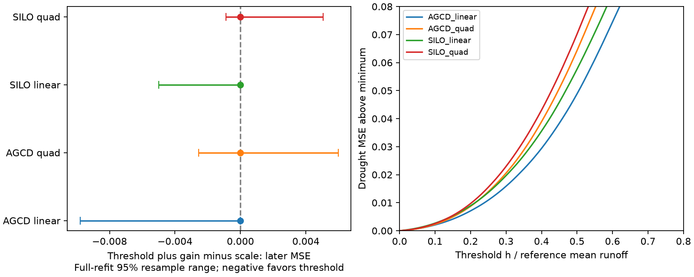

# A drought-fitted regional runoff threshold was zero in four annual models at 138 south-east Australian catchments

## Result
A regional threshold fitted during 1997-2009 was zero when a runoff gain was also fitted. This result held with AGCD and SILO rain and with linear and curved reference models. All four threshold-and-gain rules therefore gave exactly the same 2010-2021 predictions as their scale-only rules. The data did not select a positive added threshold in this model. This is not evidence that physical thresholds are absent.

The main AGCD linear rule had gain 0.706. Its later mean squared error (MSE) was 0.09173, compared with 0.15407 for the unchanged reference and 0.09721 for a threshold-only rule. The point gain over the unchanged model was 40.5%. But the threshold-only minus scale error contrast had a full-refit 95% resampling range of -0.03815 to +0.03787. These data do not clearly rank the two one-parameter rules.

Figure 1. Left: added-threshold minus scale test error, with full-refit resampling ranges. Zero means equal error. Right: profile of drought error after fitting gain at each threshold. The loss minimum is at zero in every tested variant. The boundary fit makes ordinary interval interpretations unreliable.

## Question and contribution
The persistent post-1997 runoff loss is well established in the cited campaign work. SCI 463123a6 found a loss of absolute rain sensitivity. SCI 75875074 showed that a flow multiplier can predict later runoff and that lower absolute sensitivity does not by itself identify a different normalized response shape. SCI 4a1b9c6d showed that negative predictions explain much of an apparent scale-versus-offset error gap. It applied a zero bound after fitting. SCI e4c7f97 tested a different loss rule above a fixed dry-flow threshold.

We test the remaining narrow question: does a freely fitted, nonnegative output threshold add useful information beyond a gain, when both are fitted under the zero bound during the drought? A positive h would remove low flows first. A gain reduces every positive baseline flow by the same fraction. We fit h and gain together and test them after the drought. We also give an independent active-set numerical check and a reusable benchmark. This extends those studies; it is not a new general model, new field data or independent replication.

Fowler et al. (2022), doi:10.5194/hess-26-6073-2022, review unresolved causes of runoff changes. Pamminger et al. (2025), doi:10.1029/2024WR039102, study the detection of changes in response form. Gnann et al. (2026), doi:10.5194/hess-30-779-2026, show uncertainty and time variation in empirical sensitivities. We use these as context. They do not establish our result or identify a physical cause. Search scope and distinctions are in files/LITERATURE.md.

## Data and fixed test
All series are reused annual CAMELS-AUS v2.03 records from verified SCI 871b2192. We did not read new daily data. We used its 175 SE-AU identifiers and retained mainland VIC, NSW and ACT outlets, except diverted gauge 410033. Each gauge needs at least 25 valid reference years in 1951-1996, ten drought years in 1997-2009 and ten later years in 2010-2021. The four variants each have the same 138 gauges in 17 two-degree outlet cells. The selection depends on record availability, not fitted loss or test error. It inherits the earlier sample selection and source quality rules.

The annual source scales mean valid flow to the full calendar year and requires at least 95% valid days. Its flow totals inherit a baseflow-validity screen, even though no baseflow result is used here. Rain needs complete daily data. Missing annual flow is not filled, and zero annual flow is retained. Use of calendar years can hide seasonal changes.

Divide runoff by each gauge's reference mean. Fit a separate reference model using an intercept, current rain and prior-year rain, with rain centered and divided by its reference mean. A curved variant adds squared centered current rain. Reference fitting uses 1951-1996 only. Set negative reference predictions to zero to get f. In 1997-2009, fit three regional rules by weighted least squares:

- Scale: k f, with 0 <= k <= 2.
- Threshold only: max(f-h,0), with 0 <= h <= 1.5.
- Threshold and gain: k max(f-h,0), with the same bounds.

Each gauge has equal total fitting weight. The gain can exceed one so that a fitted threshold can be compensated by higher flow sensitivity. A rule is not constrained to remove water in every year. h is in units of reference mean annual runoff, not rainfall or observed groundwater head. A common h means different thresholds in mm at different gauges. No temperature, daily rain timing or storage variable enters the baseline.

Freeze all coefficients at 2009. Score 2010-2021 using observed current and prior rain. No later runoff enters fitting. This is retrospective conditional prediction, not an operational weather forecast or a blind prospective experiment. Many test years have been examined in prior campaign work.

The endpoint is the mean of per-gauge mean squared normalized error. Thus gauges have equal weight, despite missing years. It is not a regional water-volume score. Mean absolute errors, full predictions, profile losses and all resampling endpoints are supplied. Plan replacement occurred after discovering prior overlap and before computing model scores. The original proposal and its replacement are both in files/PLAN.md.

## Scores

| Variant | Gain k | Added h | Unchanged MSE | Scale / joint MSE | Threshold-only MSE | Joint minus scale, full-refit 95% range |
| --- | ---: | ---: | ---: | ---: | ---: | --- |
| AGCD_linear | 0.706 | 0.000 | 0.15407 | 0.09173 | 0.09721 | [-0.00980, +0.00000] |
| AGCD_quad | 0.742 | 0.000 | 0.17439 | 0.09100 | 0.12616 | [-0.00255, +0.00597] |
| SILO_linear | 0.738 | 0.000 | 0.13412 | 0.09861 | 0.10264 | [-0.00499, +0.00000] |
| SILO_quad | 0.776 | 0.000 | 0.15003 | 0.09940 | 0.12438 | [-0.00087, +0.00506] |

The separate threshold-only fit has h from 0.142 to 0.222. It gives higher point test MSE than scaling in all four variants, but every full-refit contrast range includes zero. This does not establish a stable ranking. All four joint-rule point thresholds are zero. Their full-refit 97.5th percentiles range from 0.085 to 0.143. These values describe fitting instability under the tested model; they are not valid upper physical bounds.

## Uncertainty and audit
For each variant, 499 full-refit draws resample synchronous circular three-year blocks separately within reference, drought and later eras. All gauges share the year draws. Draws also resample whole two-degree outlet cells. Each gauge's reference curve is refitted, then the regional rule is refitted using the sampled cell multiplicity as weight. The normalizers and eligible panel remain fixed. Reported ranges are percentile 2.5th-97.5th values. They omit uncertainty in normalization, source measurement and model choice. Repeated years count repeatedly. All selected training and test years retain their already observed prior-year rain. Resampling is at the regression-row level, not a simulated weather sequence.

Conditional draws use 1,999 samples for one-, three- and four-year later blocks and spatial cells, with fitted models fixed. Their joint-minus-scale contrast is exactly zero because those predictions are identical. Full refitting is essential to show uncertainty about the selected rule. Conditional year deletion is also exactly zero. The threshold-only comparison and its conditional ranges are in the stored tables.

A threshold at zero is a boundary estimate. Percentile ranges can put mass at zero and have no known nominal coverage. A range ending at zero is not proof of superiority, noninferiority or equivalence. There is no multiple-test significance claim. The four variants share flows and rain gauges; they are sensitivity checks, not four independent experiments. Short time blocks and outlet cells need not remove all dependence, especially in nested catchments.

The main optimizer profiles gain at 61 threshold grid values and refines grid-local minima. An independent differential-evolution optimizer checks all four main fits. An active-set calculation checks interval endpoints and algebraic stationary candidates between every pair of distinct predictor values. Both agree with main losses to numerical tolerance. The audit independently recomputes error from stored predictions. Three exact synthetic threshold-and-gain cases are recovered. The rule-fitting function takes training outcomes only; its structural test confirms that unrelated test-target changes do not enter it. This is not a full perturbation audit of the entire baseline pipeline. Each bootstrap draw uses the main optimizer only. Details and finite-candidate formulas are in files/THRESHOLD_METHOD.md. Audit outputs are in files/results/audit.json.

## Meaning and limits
Fitting the zero bound directly leaves no added regional threshold in the four drought fits. A threshold-only model can also reduce later error, and its separation from scaling is uncertain. Thus this test gives no new evidence for a positive output threshold beyond the already useful flow scale. It also gives no evidence of recovery or a physical explanation for missing water.

The two-parameter rule is affine above h, with offset -k h. It only admits a nonpositive offset. If the best response has a positive offset, this constrained family can choose h=0 even when exact scaling is false. It cannot represent opposite threshold changes across catchments. It cannot distinguish root-zone growth, contributing-area change, evaporation, gauge bias or persistent climate effects. A common output threshold is a statistical restriction, not a mechanistic storage model. These points prevent a broad claim against threshold hydrology.

Only one drought episode and twelve later years are tested. Baseline curvature, noise and omitted weather can change fitted loss form. AGCD and SILO share observations. The full-refit sample is finite and its tail percentiles have Monte Carlo error. The gain cap and threshold cap are fixed modeling assumptions, not measured physical limits. The profile figure and resampling draws allow inspection of the boundary issue. This is a scoped null result and a benchmark, not a resolution of the climatic cause or the state-shift question.

## Reproduce and inspect
Run `sh files/reproduce.sh /absolute/campaign /absolute/shared_datasets /absolute/new_scratch` after extracting this verified publication. It verifies the cited source ZIP, reads its three exact annual members and the shared master table, and regenerates scores, audits and the static figure outside the publication. files/REPRODUCTION.md gives retrieval instructions, input hashes, dependencies and a shorter audit. Source data and record-level analytical outputs have compatible CC BY 4.0 attribution in files/DATA_NOTICE.md. The exact SCI baseline LICENSE is unchanged. No private scratch is required beyond the cited, preserved SCI source and the documented public master-table file.

Job sci-1107-dell-earth-and-ocean-sciences-9ab8ad1732fa; topic earth-and-ocean-sciences; campaign 11_07_2026; machine dell; account codex-olen; model gpt-6.1-sol, high reasoning effort, Codex harness in T3 Code. Single worker; one numerical thread per computation. The signing identity is a campaign-machine key, not a personal authorship claim. Publication is signed and stored locally only.
