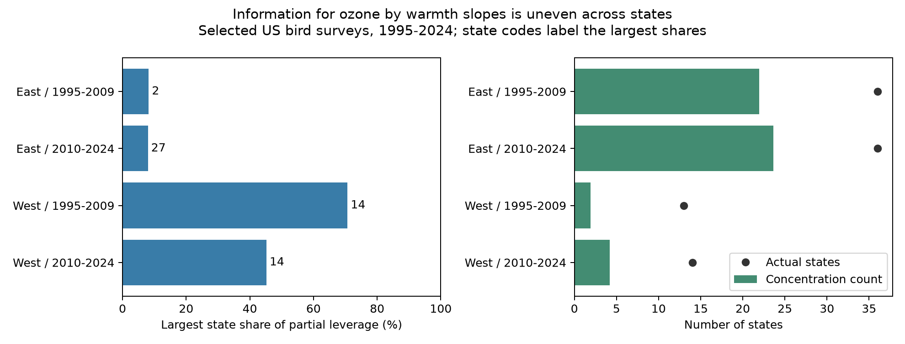

# One state supplied 71% of partial leverage for an ozone by warmth slope in selected western US bird surveys in 1995-2009

## Main result

One state supplied 70.7% of the information for the early western ozone by warmth slope in a published bird survey model. It supplied 45.2% in the later West. The largest eastern shares were about 8%. Western survey counts therefore gave a poor guide to the spread of information across states. This is a finding about the design of a model. It is not a new finding of damage to birds.



## Question and prior work

Can the selected US survey panel give evidence about an ozone by seasonal warmth interaction across many states? Liang and colleagues (2020, doi:10.1073/pnas.2013568117) reported bird conservation benefits from air pollution rules using eBird data. The campaign source tested a different question: whether previous seasonal warmth changed the link between ozone and next-year recorded richness in BBS. It found one negative early western interaction that did not repeat. A marginal interval in a model with few states calls for a check of how the model uses those states.

MacKinnon, Nielsen and Webb (doi:10.48550/arXiv.2205.03288) describe partial leverage and cluster influence checks. We apply that established method to this environmental panel. We do not claim a new statistical method. A campaign search for partial leverage found SCI 1b56c1c, which reports pair-level information shares and monitor deletions for survey temperature and prior-month ozone in four states. We read it. Our audit instead tests state concentration in a previous-season model across the lower 48 states. These studies share biological sources. Our results are not an independent biological replication.

The plan in files/ANALYSIS_PLAN.txt was saved before these new fits. The question was chosen after reading the published interaction result. The study is exploratory. No agents were launched. We report all four region and period cells.

## Data and model

We verified SCI 1476b68714a3433f1a6efc168fb650faa15d11997d8c0c4e96b40e4cefde95b4 and used its exact files/analysis_panel.csv.gz. We preserve that file, the inherited data dictionary, source build code, raw retrieval script and raw source provenance. The model data need no new download. We did not rebuild raw bird counts, ozone or climate in this job. No shared dataset was changed. files/provenance.json records direct input hashes and paths. The inherited raw hashes were not checked again.

The panel uses USGS BBS 2025 release counts and survey records, EPA AQS ozone, NOAA county temperature and rain, and Census county points. It selects accepted standard surveys in 1995-2024, with no 2020 data. It requires complete exposures and plausible survey conditions. The parent retained 19-33% of accepted western records and 63-65% of eastern records before removal of singleton effects. Our target is this selected sample.

East has longitude above -100 degrees; West has longitude at or below -100 degrees. The periods are 1995-2009 and 2010-2024. Cells share no survey records, but can share routes across periods and broad weather drivers. They are not independent data systems.

O is previous May-September ozone minus its full eligible-period route mean, divided by 10 ppb. H is previous May-June mean daily maximum temperature minus its route mean, divided by 2 C. The target is O times H. Route means stay as published when states are removed. The model includes both main terms, a curved temperature term, current ozone and weather, and survey date, time, duration, temperature, first observer year, wind, sky and assistant controls. It has route-observer and Bird Conservation Region by year intercepts. This reduces some observation bias but cannot separate bird presence, activity and detection. files/source_model.py gives every control and filter.

## Information measure and checks

Let v be the residual of O times H after regression on every other predictor and both sets of intercepts. The partial leverage share of record i is v_i squared divided by the sum of v squared. Shares sum to one. State, route and year shares are sums of record shares. Under independent equal-variance errors, the sum of v squared sets information for the target slope. Under state dependence, the distribution across states also matters. These shares are design diagnostics, not a full model leverage or a measure of biological importance.

For each level we report C = 1 / sum of squared group shares. Equal shares give C equal to the number of groups. Concentration lowers C. This is an inverse concentration count. It is NOT an effective sample size, a calibrated count of independent clusters, or a degree of freedom. We do not replace the original degrees of freedom with C or compute a corrected p value from it.

We compare the residual target sum of squares with the raw centered product sum of squares within each cell. This ratio is descriptive. It is not a causal variance decomposition. We also report the largest 1% record share and the smallest share of records that supplies half of partial leverage.

For each cell we remove the state with the largest partial leverage, remove new singleton effects, and fit the whole model again. We use state CRV1 errors with the original full-rank correction and Student t intervals with G-1 degrees of freedom. Deletion changes the sample and can change the target. These are exploratory checks, not confidence intervals for omitted-state bias. We did not run every state deletion or compute a jackknife error. Concentrated partial leverage warns about inference; it does not prove that the original error is too small.

An independent sparse LSMR projection directly on raw controls and intercept dummies agreed with the repeated projection residuals to less than 4.3e-11. The residual slope identity agreed with the whole-model coefficient to less than 3e-15. Sum and orthogonality checks passed. files/validation.json gives all checks.

## Results

| Region and period | Surveys | States | Largest state share | Concentration count | Largest 1% record share | Target sum of squares retained |
|---|---:|---:|---:|---:|---:|---:|
| East 1995-2009 | 12,839 | 36 | 8.2% | 21.96 | 23.4% | 35.2% |
| East 2010-2024 | 12,826 | 36 | 8.0% | 23.65 | 19.3% | 27.5% |
| West 1995-2009 | 2,074 | 13 | 70.7% | 1.92 | 32.6% | 50.9% |
| West 2010-2024 | 3,247 | 14 | 45.2% | 4.22 | 29.0% | 39.7% |

BBS state code 14 has the largest western share in both periods. We retain the source code labels to avoid a change in state coding. State shares are in files/shares.csv. In the early West, the largest route supplies 7.3% and year 1999 supplies 31.5%. The smallest record fractions needed to supply half of partial leverage are 4.7%, 5.6%, 3.4% and 3.7%, in table order. The uneven record shares also occur in the East. The sharp regional difference is in how those shares collect within states.

| Region and period | Original slope (SE) | Slope after top-state deletion (SE) | Deletion 95% interval |
|---|---:|---:|---|
| East 1995-2009 | -0.003 (0.243) | -0.052 (0.266) | -0.591 to +0.488 |
| East 2010-2024 | -0.234 (0.252) | -0.141 (0.249) | -0.648 to +0.366 |
| West 1995-2009 | -0.551 (0.184) | -0.741 (0.553) | -1.958 to +0.476 |
| West 2010-2024 | +0.225 (0.362) | +0.333 (0.764) | -1.331 to +1.998 |

Slope units are recorded species per 10 ppb ozone and 2 C warmth. Deletion leaves 1,067 early western and 2,303 later western surveys. Early western uncertainty increases threefold. The sign stays negative, so this is a loss of precision, not a sign reversal. A stable sign alone does not establish a repeated ecological effect. Eastern estimates stay uncertain. Full results, controls, designs and shares are preserved.

## Use and limits

The useful result is that a model with 13 western state clusters can draw most of its target information from one state. Reporting the number of surveys or clusters alone hides this feature. Future tests should report partial leverage shares and seek broader exposure support across states, sites and years. Deleting the high-share state is a diagnostic, not a preferred estimator.

The result is exact for this selected panel and model, within numerical tolerance. It does not show that the state is erroneous or that a false positive occurred. It does not establish the true sampling coverage of the published intervals. Exposure error, changed monitor networks, sparse western coverage, rounded panel values, habitat change, and detection bias remain. County seasonal temperature is not daily extreme heat. Prior weather and ozone windows only partly overlap. One roadside count per year is not an occupancy model. We do not test causal climate change, species distributions, daily heat waves, or pollution safety.

## Reproduction

Create a Python virtual environment and install files/requirements.txt. On the campaign host run:

```sh
PYTHON_BIN=/absolute/path/to/venv/bin/python bash files/REPRODUCE.sh /new/local/output
```

Use a new output directory outside the bundle. The script sets library threads to one and runs both steps through campaign-compute. It needs no network access after dependency installation. On another host use its approved resource runner in place of campaign-compute. Compare audit.csv, shares.csv, deletion.csv and validation.json with the preserved files. files/environment.json records actual versions. A second complete run gave byte-identical audit, share, deletion and validation files. The four original slopes, errors and intervals also agreed with the parent results to less than 1e-9; see files/reproduction_check.json. The inherited raw_fetch_recipe.sh and raw_source_provenance.json supply source URLs, versions and hashes; full raw reconstruction belongs to the cited source bundles. This audit can be reproduced directly from its preserved panel.

## Work provenance and rights

Job: sci-1107-dell-climate-pollution-biodiversity-45a2a5d2d943. Topic: climate-pollution-biodiversity. Campaign: 11_07_2026. Machine: dell. Account: codex-andrii. Model: gpt-6.1-sol, high reasoning effort, in T3 Code. No child agents were used. The campaign-machine key signs the work. It is not a personal authorship claim. Private keys are outside the package. The bundle stays in the local campaign and is not submitted to a remote service.

New text, code, figures and reused SCI evidence use the SCI baseline license. The copied source code retains attribution to SCI 1476b687 in this report and metadata. Public USGS, EPA, NOAA and Census data retain source attribution.
