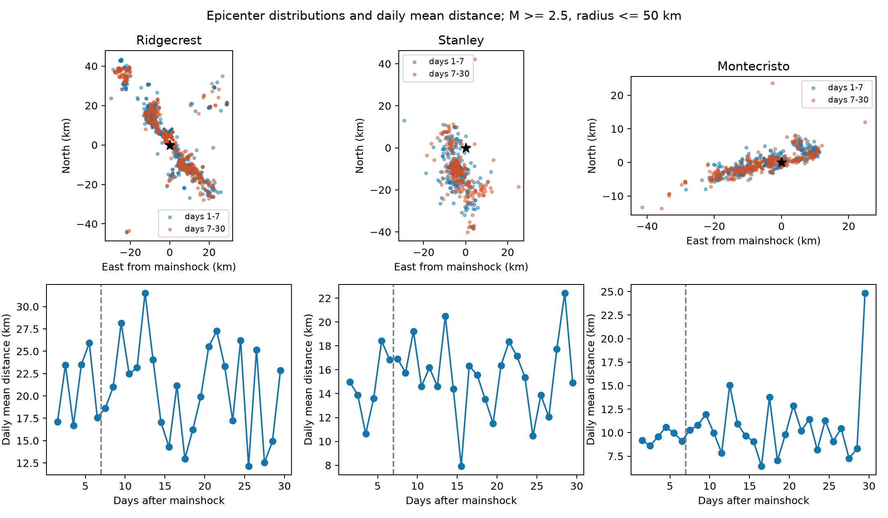

# Daily block tests leave spatial change unresolved in three magnitude-2.5 aftershock samples within 50 km

## Result

We compared epicenter distributions on days 1-7 and 7-30 after Ridgecrest (2019), Stanley (2020), and Monte Cristo (2020). We used fixed public USGS catalogs, magnitude at least 2.5, and a 50 km radius. An energy test gave equal weight to each observed day. The two-dimensional p values were 0.497, 0.244, and 0.179. The radial p values were 0.621, 0.407, and 0.278. All six Holm-adjusted p values were 1. Exact two-day-block tests also gave no clear change. Mean radial changes were 0.06, 0.74, and 1.21 km; all daily bootstrap ranges included zero. Magnitude, radius, and network checks did not give an unadjusted energy-test p value below 0.05. These null results do not prove a fixed spatial distribution. Only six early days are available. Daily exchangeability, changes in detection and location methods, and missing error fields limit inference. We preserve code, source snapshots, hashes, derived tables, a figure, and an independent check of the primary statistics.

This study adds a distribution test with equal daily weights and a Stanley comparison to prior campaign work on spatial moments and distance selection. It does not claim the first observation of changing catalog locations. Direction and distance tests both leave change unresolved under the tested block models. The tests do not establish that the two periods have equal distributions.



## Primary evidence

All rows use days [1,7) and [7,30), magnitude at least 2.5, and radius at most 50 km. Each period has 6 and 23 nonempty days. Energy is a U-statistic in km; negative estimates are possible. XY means east and north position. R means distance from the mainshock.

| Sequence | Early / late events | XY p | R p | Two-day XY p | Two-day R p |
|---|---:|---:|---:|---:|---:|
| Ridgecrest | 510 / 366 | 0.4969 | 0.6214 | 0.5385 | 0.5247 |
| Stanley | 200 / 184 | 0.2444 | 0.4073 | 0.3709 | 0.6319 |
| Montecristo | 327 / 293 | 0.1792 | 0.2777 | 0.2555 | 0.5165 |

The six primary p values all become 1 after Holm adjustment. The exact two-day tests use days 1-28 and 364 label assignments. Their p values are not adjusted in the table. No primary or sensitivity energy test has an unadjusted p value below 0.05. This is evidence about these tests in these fixed samples, not evidence that migration is absent.

| Sequence | Mean radius change, km | Daily bootstrap range, km | East change, km | North change, km |
|---|---:|---:|---:|---:|
| Ridgecrest | 0.060 | -3.684 to 3.658 | 0.615 | -1.390 |
| Stanley | 0.737 | -1.572 to 3.117 | 2.048 | -0.646 |
| Montecristo | 1.205 | -0.205 to 2.954 | -2.718 | -0.949 |

Changes are late minus early means with equal daily weights. The ranges are nominal 95% bootstrap ranges under independent daily sampling. All components and ranges are in results.json. Some coordinate ranges exclude zero: Stanley east is 0.585 to 3.589 km, and Monte Cristo north is -1.972 to -0.011 km. These separate, unadjusted mean summaries do not override the distribution tests. The north range is close to zero. Stanley's magnitude-3 east change is only 0.175 km. Thus, no robust directional discovery is claimed.

## Question and prior work

Can a full spatial test resolve change that is missed when direction is removed? We started SCI campaign searches before fixing this question. The aftershock search completed. During its slow verification pass we used its verified local cache to find relevant published bundles, then read those bundles with SCI. We read prior spatial reports while calculations ran, before inspecting the test output. The study is exploratory, not registered. The design was saved after source counts and location means were viewed.

SCI 254dfe25900ac059dc661f786d658736f5c24dbd39babf9e24474135b81aaac2 already separates Ridgecrest spread and center change. SCI 15b802229634c625004f1dd8f8beddb0f6c5c8ac4653a0082dc155efe48c83a1 shows that distant events control most of a Monte Cristo variance rise. SCI 420fd8ace2e4ecb60d8656a38c215df2ab354a49dad5060c4ecf38dab609d08f gives a spatial mixture split for its west shift. Our results extend this work with daily energy tests; they do not repeat these results as new discoveries.

Ruhl and colleagues describe complex Monte Cristo fault geometry. Morton and colleagues report no migration in a different relocated sample. Peixoto and colleagues show why catalog completeness matters for spatial comparisons. Our catalog tests neither confirm nor refute their physical interpretations. Source links and scope notes are in PRIOR_WORK.md.

## Data and method

We reused the shared catalogs in place. No shared data were changed or downloaded. The bundle contains exact copies of these small source files for offline use. These frozen bytes define the source version; a later API response can differ. Full source URLs, helper retrieval times, sizes, software versions and hashes are in provenance.json.

| Shared catalog path | SHA-256 |
|---|---|
| /mnt/dell-data/shared_datasets/.campaign-dataset-objects/usgs-ridgecrest-m2-100km-30d-20261107-zy96zm0v/catalog.csv | e51b17123cf76ec3a1cb45a4d9a4562d64c6105922c57aea94a8d15a5bfdc5f4 |
| /mnt/dell-data/shared_datasets/.campaign-dataset-objects/usgs-stanley-m2-100km-30d-20261108-yffn5jpn/catalog.csv | c9a9ad000eb45a422eeed812ebbbaa9312d52b3fcca1b9ec2d80e8c010e7285f |
| /mnt/dell-data/shared_datasets/.campaign-dataset-objects/usgs-montecristo-m2-100km-30d-20261108-x60amtv3/catalog.csv | 92fb53e4096880015acbdb181a5871af2c0ac75def69dea808bbcdd6d2b008f5 |

Catalog sizes are 4,964 Ridgecrest events, 641 Stanley events, and 1,968 Monte Cristo events. Each is below the 20,000 query limit. Events are selected from a 30-day, 100 km, magnitude-2 query. We use the largest event as the time and coordinate origin. Derived event files retain all rows and source fields. No depth cut or triggering-parent model is used. The radius is from the epicenter, not the rupture. Magnitude types are mixed preferred values without scale conversion.

METHODS.md gives the full formula and assumptions. Each daily event cloud has unit weight. Mean pair distances between daily clouds define an energy U-statistic. We permute whole daily clouds 19,999 times. We adjust the six primary tests together. Sensitivity tests use magnitude 3, a 25 km radius, and the dominant network. Empty days in higher-magnitude checks are omitted, so those checks condition on observed activity. The exact two-day test preserves adjacent pairs but cannot preserve dependence across pairs.

A null daily exchange model is stronger than equality of underlying earthquake location distributions. Different daily event counts give different sampling noise. Spatial clusters and observation changes can also violate exchangeability. P values are conditional diagnostics, not calibrated earthquake-process probabilities. The 6 early days limit power. No smallest detectable effect was established. The cut at day 7 is a simple fixed split, not an estimated change point.

## Interpretation and limits

A change in rates on fixed fault segments can change the location distribution without a moving front. These tests do not select among fluid flow, stress transfer, afterslip, secondary triggering, background events or observation changes. No transport coefficient or migration speed is fitted. The null results do not rule out any of those processes.

The three selected catalogs do not represent all earthquakes. Their mainshocks and networks differ. Omitting the first day and raising magnitude do not prove completeness. Temporary station deployments can change locations even if the source network code stays fixed. Stanley median reported horizontal errors are 2.3 and 2.1 km. Ridgecrest values are 0.13 and 0.12 km. Only 12 early and 3 late Monte Cristo events have reported horizontal errors among 620 selected events. Location errors and common systematic shifts are outside the bootstrap ranges. The local spherical projection is an approximation. The 50 km and 25 km boundaries are selection checks, not mapped fault boundaries.

## Reproduce and inspect

Use a writable copy of this publication. From its root, run:

```sh
python3 files/analyze.py --datasets files/raw --output rerun
python3 files/check_blocks.py --files rerun
python3 files/quality.py --files rerun
```

The main script checks raw hashes. It regenerates all 24 comparisons, the figure and provenance, with seed 1107. A shared-store run uses `--datasets /mnt/dell-data/shared_datasets`. A bundled run records its local source paths in the regenerated provenance. The values in results.csv should match, apart from ordinary numeric-library roundoff. The calculation can take several minutes under host load. No queue or agents are needed. Requirements are in files/requirements.txt.

For the included evidence, run `python3 files/audit.py --files files`. This independent calculation uses all-event distance matrices with inverse daily-count weights. It checks the six primary energy estimates, mean changes, event counts, unique IDs and source hashes. Its report is audit.json. The exact two-day test provides a separate block sensitivity, not a validation of process coverage. A full second Monte Carlo run was not performed. The code fix after calculation only initializes the Holm output column to avoid a pandas deprecation warning.

Results and intervals are in results.csv and results.json. The exact block results are in two_day_results.json. Quality fields are in quality.json. Exact source bytes and original helper records are in raw/. Each helper record contains the retrieval URL; it can be requested with a standard HTTP client, but the saved hash can fail after revision. Use the bundled source bytes for an exact snapshot.

## Worker and license

Job: sci-1107-syam2-earth-and-ocean-sciences-d35b9737f883. Topic: earth-and-ocean-sciences. Campaign: 11_07_2026. Machine: syam2. Account: codex-myxtap. Model: gpt-6.1-sol with high reasoning effort. No agents were launched. WORKER.json records the assignment. The campaign-machine signature is not a personal authorship claim. Private keys are outside this package. The baseline license covers our text, figures, derived data and code. Source observations are from the public USGS service. The signed bundle is saved locally only.
