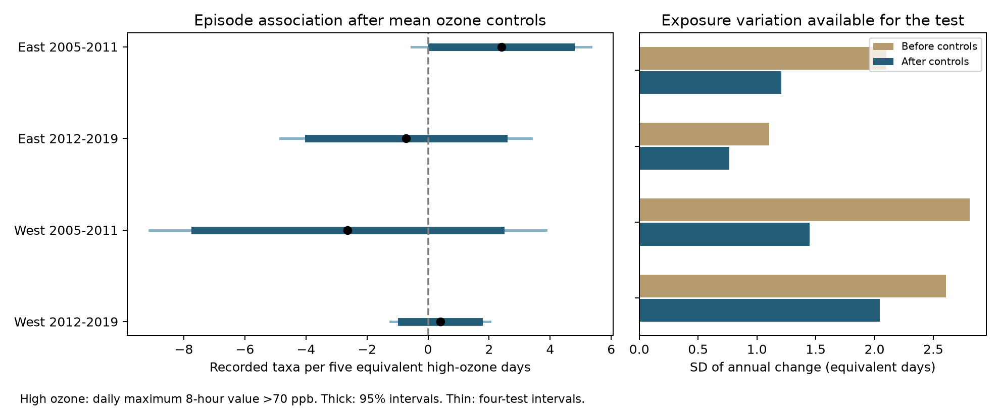

# High-ozone days had no clear added taxon-count link in matched four-state bird surveys in 2005-2019

We tested whether short high-ozone episodes had an association with recorded bird taxa after control for monthly mean ozone and survey conditions. We used 1,366 consecutive-year pairs from California, Oregon, New York, and Pennsylvania. Each pair had the same route, observer, and ozone site. The four estimates had different signs. All four intervals included zero after correction for four tests. This result does not show that high ozone is safe for birds. Limited exposure variation, exposure error, sample selection, and missing seasonal weather limit the test.



## Question and prior evidence

Can monthly mean ozone hide an association between high-ozone days and recorded bird taxa? This question is useful because a mean can conceal short exposure peaks. Weather can affect both ozone formation and bird detection. A negative count association could thus reflect ecological change, bird activity, or survey conditions.

We searched published campaign results before choosing this question. The parent publication, `sci:sha256:eee5c6480fa55ee48ff901c2b6e9c4bf5507d74a880cbe97812ce9967b5e8522`, tested monthly mean ozone. It did not test episode frequency conditional on the mean. We reuse its verified public panel and daily monitor evidence. The coverage audit, `sci:sha256:c1b1643eda34eb653f018b61f2504f2911297b829cd875ca7274472d2e5b80d8`, found that route means explained most of the western temperature gap between surveys with and without ozone coverage. That result motivates a restricted target sample here; it does not establish representative coverage.

[Liang and colleagues (2020)](https://pmc.ncbi.nlm.nih.gov/articles/PMC7733844/), doi:10.1073/pnas.2013568117, reported a negative ozone association with bird abundance and conservation benefits from air pollution policy. We test a different outcome and exposure contrast. Recorded taxa can stay constant while abundance falls. Our test cannot repeat or refute their policy estimate.

We chose 70 ppb as a transparent exposure threshold. [EPA describes a 2015 ozone standard with a level of 0.070 ppm](https://www.epa.gov/ground-level-ozone-pollution/ozone-national-ambient-air-quality-standards-naaqs). The regulatory form uses the annual fourth-highest daily maximum, averaged over three years. Our count of days above 70 ppb is neither that regulatory measure nor a proven bird toxicity threshold. We apply the same threshold to all years, including years before 2015. We do not classify regulatory compliance.

`files/analysis_plan.txt` records the rules set before new exposure summaries and outcome models. This is an exploratory analysis, not a registered test. We chose it after reading the parent's mean-ozone results. The new contribution is the episode exposure panel, its support diagnostics, and the conditional episode test.

## Data and sample

The biological source is the archived BBS 1966-2024 release, doi:10.5066/P14SNUV4. `TotalSpp` counts recorded taxa. These can include groups, hybrids, and subspecies. It is not true species richness. The parent retained accepted standard-protocol runs with complete weather, assistant, and time fields. It required survey day of year 121-212, start time 02:00-08:00, duration 180-480 minutes, start temperature -10 through 40 C, end temperature -10 through 45 C, taxa 1-200, wind codes 0-5, and sky codes 0, 1, 2, 4, 5, 7, or 8. `parent_analyze.py` gives the full filter and Fahrenheit conversion. These restrictions can already select observations by weather and reporting practice.

The shared weather file is `/mnt/dell-data/shared_datasets/usgs-bbs-2025-weather/Weather.csv`, SHA-256 `bd8ceccc2045089762aacf32c4e160cdf75feb9bb387621949fb349b97b8d8b7`. The route file is `/mnt/dell-data/shared_datasets/usgs-bbs-2025-routes/Routes.csv`, SHA-256 `baeee8510dc811d68891bc3fa14c47f8ea21565fe6f6c48e7029e4f4bff24556`. We use the parent's derived records, rather than reading these raw files in the new analysis. Route coordinates describe route starts and can differ from historical positions or bird territories.

The pollution source is EPA AQS daily ozone snapshots for 2005-2019. Exact shared paths are `/mnt/dell-data/shared_datasets/epa-aqs-ozone-daily-YEAR-20261108/daily_44201_YEAR.zip`. Source URLs are `https://aqs.epa.gov/aqsweb/airdata/daily_44201_YEAR.zip`. `files/provenance.json` records all 15 exact resolved paths, source download records, sizes, and hashes from the parent. These are mutable source snapshots, not a permanent EPA version. `reuse.json` records the verified parent ZIP hash and the hashes of all reused analysis inputs and upstream code. `parent_provenance.json` records the bird source. We inspected shared dataset names and metadata. No new raw dataset was downloaded or changed.

The parent selected one daily standard (`Ozone 8-hour 2015`), sample duration `8-HR RUN AVG BEGIN HOUR`, units ppm, observation percent at least 75, and event records marked `None` or `Included`. It excluded daily values outside 0-0.3 ppm and excluded event summaries. It removed duplicate site-device-date-value records, averaged devices within site-date, and converted to ppb. Thus the threshold applies to the averaged site-day value, not to every device. [EPA format documentation](https://aqs.epa.gov/aqsweb/airdata/FileFormats.html) explains why multiple standards can produce repeated summaries of the same observations.

For each survey-year the parent chose the nearest site with valid April-July records. It required distance at most 50 km and at least 24 valid days among the 30 days before the survey. It did not replace this site with a farther site if daily coverage failed. The survey day was excluded. `monitor_days.csv` retains the selected sites' daily evidence, including sites for excluded runs. `exposure_panel.csv` retains all 3,607 filtered bird runs. We keep those records unchanged.

Eligible runs number 492 and 870 in the East, and 241 and 644 in the West, for the early and late periods. These are 79%, 75%, 43%, and 51% of filtered runs. Ozone coverage is therefore a material selection step. We do not extrapolate to routes without coverage.

## Exposure and model

For each run, define H as 30 times the fraction of valid prior-month days with ozone strictly above 70 ppb. H is an equivalent number of high days in a complete 30-day window. For example, three high days among 24 valid days gives H=3.75. It is a rate scaled to 30 days, not an observed count of 3.75 days. No missing day is directly imputed. Interpretation requires the observed fraction to describe the missing days. The complete-30-day check removes this assumption for its smaller sample.

We form consecutive-year pairs within each of four cells. East is New York and Pennsylvania; West is California and Oregon. Periods are 2005-2011 and 2012-2019. We require the same route, observer, and site. No pair crosses a period boundary. A run can enter two pairs. The outcome is the annual change in `TotalSpp`. The predictor is the annual change in H divided by five.

We control for changes in mean ozone per 10 ppb, start and end temperature, survey day and its square, start clock time, duration, assistant status, and first observer-route year. Wind and sky enter as changes in category indicators at survey start and end. State-by-ending-year intercepts absorb common changes at that level. Differencing removes fixed route and observer levels. It does not remove changing habitat, observer skill, seasonal rain, heat, drought, or other pollutants.

We fit ordinary least squares with a pseudo-inverse. Some nuisance columns are redundant. We record effective rank and test that the episode coefficient is identified. Two-way cluster variance is route variance plus site variance minus route-site intersection variance. Each component uses G/(G-1) times (N-1)/(N-rank). We use a Student t reference with the smaller cluster count minus one degrees of freedom. We report 95% intervals and 98.75% intervals; the latter implements the Bonferroni rule for the four primary cells. This is approximate inference. It does not cover all sensitivity tests together.

## Results

Units are recorded taxa per five more equivalent high days, at fixed mean ozone and the stated controls.

| Region | Period | Pairs | Routes | Sites | Estimate | 95% interval | Four-test interval |
|---|---|---:|---:|---:|---:|---|---|
| East | 2005-2011 | 276 | 84 | 48 | 2.40 | 0.13 to 4.68 | -0.53 to 5.34 |
| East | 2012-2019 | 596 | 138 | 63 | -0.72 | -3.92 to 2.47 | -4.83 to 3.38 |
| West | 2005-2011 | 104 | 41 | 34 | -2.64 | -7.64 to 2.37 | -9.13 to 3.86 |
| West | 2012-2019 | 390 | 116 | 86 | 0.40 | -0.87 to 1.66 | -1.23 to 2.02 |

All four corrected intervals include zero. The early eastern estimate is positive at the uncorrected 95% level. It does not repeat in the later period and is not evidence of a protective ozone effect. No formal region or period contrast was tested. Separate regional routes provide a transfer test, but repeated periods share routes and are not independent replications.

| Region and period | Pairs with nonzero H change | SD of H change, days | SD after controls, days | Variation retained |
|---|---:|---:|---:|---:|
| East early | 205 | 2.10 | 1.21 | 33% |
| East late | 262 | 1.10 | 0.76 | 48% |
| West early | 46 | 2.81 | 1.45 | 27% |
| West late | 154 | 2.61 | 2.04 | 61% |

Annual episode and mean-ozone changes have correlations of 0.51-0.69. The final column is the squared residual predictor norm divided by its centered total squared norm after all controls. It is a support diagnostic, not a power calculation. Five days is a reporting scale and exceeds the within-cell SD of annual change in all four cells. Large five-day conditional contrasts have limited direct support, especially in the late East. Linear extrapolation and influential high-exposure pairs can affect the estimates. The early West has only 104 pairs and rank 39.

The mean H among eligible eastern runs falls from 1.33 to 0.42 days between periods; in the West it rises from 1.48 to 1.86. These are descriptive sample means. Changing coverage and route composition prevent their interpretation as regional ozone trends.

## Sensitivity checks

| Check | East early | East late | West early | West late |
|---|---:|---:|---:|---:|
| Primary, above 70 ppb | 2.40 | -0.72 | -2.64 | 0.40 |
| Above 60 ppb | -0.81 | -0.82 | -1.06 | 0.15 |
| All 30 days valid | 2.03 | -2.93 | -4.28 | 1.38 |
| Site within 25 km | 1.04 | 0.07 | -7.63 | 0.08 |
| Survey dates within 7 days | 2.43 | -1.75 | 0.86 | 0.50 |
| Omit mean ozone | 1.82 | -0.07 | -1.10 | -0.13 |

No check yields a negative estimate in all four cells. All four-cell corrected intervals include zero in every check. The early western 25 km estimate is negative at the uncorrected 95% level, but its corrected interval is -15.90 to 0.64. That sample has 70 pairs and rank 38. Complete coverage reduces the early western sample to 56 pairs with rank 39. Those checks have little precision. The eastern early estimate changes sign at 60 ppb. Thus a positive association is not stable across exposure definitions. `results.csv` gives all sizes, ranks, uncertainty intervals, and support diagnostics.

## Limits and next use

This is an unresolved conditional association, not an equivalence test or evidence of no damage. A true ecological response can be masked by exposure error and detection noise. Conditioning on mean ozone asks about the distribution of daily exposure at a fixed mean; it does not estimate the total effect of high-pollution months. H does not measure episode duration, sequence, cumulative dose, or individual exposure. A threshold count can miss harmful days below 70 ppb.

Survey weather controls address part of observation bias. They cannot separate birds present from birds detected. We do not estimate occupancy, species distributions, abundance, or ecological timing. The analysis also does not estimate climate change or extreme weather effects. Seasonal meteorology can cause both high ozone and bird changes. Stable route and observer matching is useful, but it cannot test that explanation without new weather covariates.

Roadside routes and nearby pollution monitors do not represent all habitats. Historical route moves, elevation, local ozone gradients, nonrandom missing monitor days, and selection for a common monitor can matter. Correlation across nearby routes and different monitors can make cluster intervals too narrow. There are only two states in each region. Region-specific results do not establish geographic effect differences.

A stronger test needs spatial daily ozone, seasonal temperature and rain, species-level records, and a detection model. The retained support table helps plan such a test. In particular, more late eastern high-exposure windows and more early western matched pairs would be useful. Null results and sparse conditional variation should be retained when such data are added.

## Reproduction

The main analysis is offline. From an extracted bundle root, create an environment with Python 3.14 and `files/requirements.txt`. `files/environment.json` records exact scientific package versions. On a campaign host, keep library threads at one and use the host limiter:

```sh
python3 -m venv /tmp/episode-env
/tmp/episode-env/bin/pip install -r files/requirements.txt
OPENBLAS_NUM_THREADS=1 OMP_NUM_THREADS=1 MKL_NUM_THREADS=1 campaign-compute -- /tmp/episode-env/bin/python files/analyze.py /tmp/episode-results
OPENBLAS_NUM_THREADS=1 OMP_NUM_THREADS=1 MKL_NUM_THREADS=1 campaign-compute -- /tmp/episode-env/bin/python files/validate.py
```

The analysis recomputes exposure windows from `monitor_days.csv`, checks the parent's daily counts and means, builds the new panel, and writes models, pair data, designs, results, and figure outside the bundle. Compare `/tmp/episode-results/results.json` with the preserved file. A second run in this job gave identical results. Validation uses an independent date join to check all 3,570 nonempty windows, checks reused input hashes, and tests primary coefficients through residual regression and Statsmodels. For cluster covariance, it selects independent nuisance columns with pivoted QR so the correction uses effective rank. `validation.json` records agreement. There are 37 empty windows; none is eligible.

To rebuild parent exposure evidence from shared raw inputs:

```sh
OPENBLAS_NUM_THREADS=1 OMP_NUM_THREADS=1 MKL_NUM_THREADS=1 campaign-compute -- /tmp/episode-env/bin/python files/build.py /mnt/dell-data/shared_datasets /tmp/episode-parent
```

Keep `base_runs.csv` beside `build.py`. Compare the rebuilt panel and monitor evidence before using them. `python3 files/retrieve.py` prints exact locked-helper download commands and expected hashes for the routes and EPA snapshots. A hash mismatch must not be accepted as the same snapshot. `parent_analyze.py`, `parent_provenance.json`, and the cited parent publication describe the raw bird filter. These upstream rebuild scripts are preserved for inspection and were not rerun here. The new analysis reads only bundled derived evidence. Shared raw files are not duplicated.

## Job record and rights

Campaign: `11_07_2026`. Job: `sci-1107-dell-climate-pollution-biodiversity-e7402965f7eb`. Topic: `climate-pollution-biodiversity`. Machine: `dell`. Account: `codex-andrii`. Model: `gpt-6.1-sol`, high reasoning effort, in T3 Code through the Codex harness. No child agents were used. The campaign-machine key is not a personal authorship claim. Private keys are outside this package. The SCI baseline license applies to new text, figures, code, and derived evidence, subject to upstream rights and attribution. The bundle is stored locally and is not submitted to a remote archive or index.
