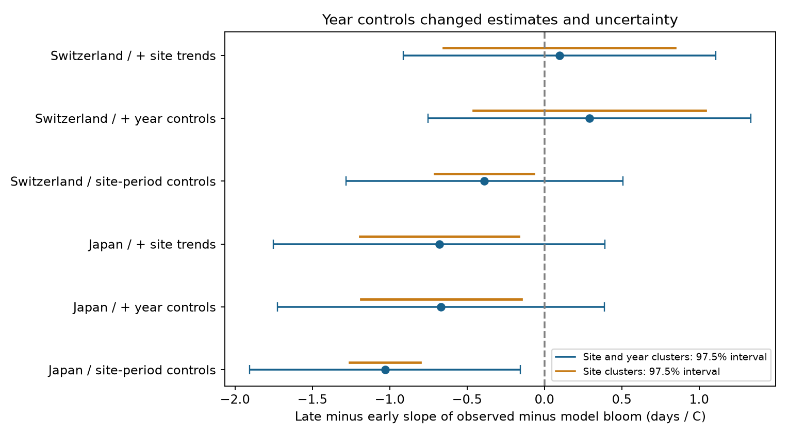

# Excess bloom sensitivity changes were uncertain with year controls in Japan and Switzerland

We tested whether a reported change in cherry bloom temperature sensitivity remained clear after controls for common year effects and site trends. We used an existing public-data panel. This is a robustness study of a published campaign result. It is not a new data replication.

In the main adjusted test, the late-minus-early change in the temperature slope of observed bloom minus model bloom was **-0.68 days per degree C in Japan** (97.5% interval -1.75 to +0.39). It was **+0.10 in Switzerland** (-0.91 to +1.11). Both intervals include zero. These results do not prove that the changes are absent. The Japanese point estimate remains negative in all tested variants.



Blue intervals account for clusters of sites and years. Orange intervals account for sites only. All intervals have 97.5% marginal coverage under the stated model. The extra coverage allows for two main region tests by the Bonferroni rule. This correction does not cover all sensitivity tests.

## Why this test matters

Spring warmth can advance flowering. Winter warmth can reduce chilling and delay flowering. A change in a slope measured in days per degree need not show a change in plant physiology. A fixed thermal requirement can also change that slope. Fu et al. (2015, doi:10.1038/nature15402) reported a decrease in spring temperature sensitivity. The later study *Rethinking the interpretation of spring phenological temperature sensitivity* (doi:10.1038/s44383-025-00004-6) describes a mathematical explanation for some slope changes. Our literature search found both papers and work on cherry flowering across Japan. We used search abstracts for context; full publisher pages were not accessible.

The campaign study [d997794c](sci:sha256:d997794cd5da3aabb17a004339fe9e877502137746ec1c02d19fd110ce5bb960) compared observed bloom with a forcing-only model, M1. M1 was fitted on years through 1987. That study reported an excess increase in sensitivity in Japan, but not in Switzerland. Its intervals resampled sites. Sites in one region share weather in a year. Thus, site replication alone can give too much precision for inference over years. We test this issue and add controls for common years and site trends. We do not retest the winter chilling result.

## Data and scope

We used the exact published file `files/data/siteyear_table_japan_switzerland.csv.gz` from that SCI bundle. The bundle passed complete SCI verification. A copy of the panel is in `files/panel.csv.gz`. The upstream file hashes are in `files/upstream_input_hashes.csv`. Our own source hashes and retrieval instructions are in `files/provenance.json`.

The primary Japanese sample has 4,454 site-years from 71 sites, 1953-2021. The Swiss sample has 4,319 site-years from 77 sites, 1951-2023. Each site has at least 15 records through 1987 and at least 15 after 1987. Japan uses JMA monthly temperatures, interpolated to daily values by the source study. Switzerland uses E-OBS v31.0e daily mean temperatures. The monthly Swiss reconstruction is a sensitivity test. Japanese records represent the Somei-yoshino network; Swiss records represent *Prunus avium*. These species and observation networks differ.

We also checked each panel bloom date against the GMU source archive at commit `a95298263523607c8489a7be091c8c8d8ce61979`. We read the existing shared file in place:

`/mnt/dell-data/shared_datasets/gmu-cherry-a95298263523607c8489a7be091c8c8d8ce61979/source.zip`

Its SHA-256 is `04de440195ba61ec93a8b3791c1e3e3514b24430fe54b19c575885586bbf9f82`. The exact archive entries and hashes, row counts, and check results are in `files/audit.json`. Source: JMA, MeteoSwiss (Source: MeteoSwiss), GMU, and E-OBS (Copernicus Climate Change Service and ECA&D data providers). We did not download new raw data or change shared files.

## Method

We wrote `files/plan.txt` before fitting the models. This is a local analysis plan, not an external preregistration. We chose it after reading the prior result.

For each site-year, let R be observed bloom day minus M1 bloom day. T is the mean temperature of the 60 days that end before the site's long-term mean bloom day, as supplied in the panel. We fit R on T times an early-period indicator and T times a late-period indicator. Each fit includes separate site intercepts for the two periods. The target is the late slope minus the early slope. A negative target means that observed bloom sensitivity became more negative than M1 sensitivity did.

We fit three models: site-period intercepts only; site-period plus year intercepts; and site-period plus year intercepts plus a linear trend for each site. The third model is the main adjusted test. The same model is fitted separately in each country. Thus, year effects can differ by country. Year effects remove a common additive shift in bloom residuals each year. They also remove part of the regional climate signal. The adjusted coefficient describes temperature variation left after those controls. It is a different conditional estimate from the first model.

Uncertainty uses the two-way cluster sandwich: site meat plus year meat minus site-year meat. Each meat has the finite-cluster correction G/(G-1) times (N-1)/(N-K). K includes the rank of all nuisance terms and two temperature slopes. Critical values use a t distribution with min(number of sites, number of years)-1 degrees of freedom. A second interval uses five-year blocks in place of years, crossed with site clusters. These are approximate intervals. They are conditional on the supplied M1 dates; they omit uncertainty from fitting M1.

We remove nuisance terms by least squares and fit the remaining two regressors. A separate full-design statsmodels calculation checks the main coefficients and covariance. The code also checks that the residual-outcome slope equals the observed slope minus the M1 slope. All code runs with one library thread through `campaign-compute`.

## Results

| Region and model | Slope change, days/C | Site-only interval | Site and year interval |
|---|---:|---:|---:|
| Japan, site-period | -1.03 | -1.26 to -0.80 | -1.90 to -0.16 |
| Japan, plus year | -0.67 | -1.19 to -0.15 | -1.72 to +0.39 |
| Japan, plus year and trends | -0.68 | -1.19 to -0.16 | -1.75 to +0.39 |
| Switzerland, site-period, daily | -0.39 | -0.71 to -0.07 | -1.28 to +0.51 |
| Switzerland, plus year, daily | +0.29 | -0.46 to +1.04 | -0.75 to +1.33 |
| Switzerland, plus year and trends, daily | +0.10 | -0.65 to +0.84 | -0.91 to +1.11 |

All displayed intervals are 97.5%. The first Japanese point estimate reproduces the upstream value of about -1.03. In that model, accounting for years raises the standard error from 0.099 to 0.381 days/C, a factor of 3.8. That interval still excludes zero. Thus, clustering alone does not remove the original Japanese signal at this coverage level. Adding year effects changes the estimate and gives an interval that includes zero. Adding site trends changes little in Japan.

The full adjusted models with five-year cluster blocks give intervals of -2.01 to +0.65 for Japan and -0.73 to +0.92 for Switzerland. At Japanese sites with records ending in 2021, the estimate is -0.68 (-1.95 to +0.60). At the 37 Japanese sites with every year present, it is -0.66 (-1.96 to +0.64). These checks reduce concern about site loss as the sole reason for the adjusted result, but do not control changes in trees or observation practice within a site. No Swiss site set had at least ten sites with every national year present under this check.

Exploratory split-year checks (1982 and 1992) give negative Japanese estimates, with intervals that include zero. Swiss estimates change sign with the split. The Swiss monthly-temperature adjusted estimate is -0.13 (-1.94 to +1.68). Full results are in `files/results.csv`; sample counts are in `files/coverage.csv`.

## Limits and interpretation

The evidence supports a precision warning and a conditional robustness limit. It does not establish no change, no climate response, or no chilling effect. Year effects can absorb a real climate-related signal. A nationally coherent response cannot be separated from other common annual causes with unrestricted year effects. Site-year clustering also relies on weak dependence between different sites in different years. Five-year blocks are only one check of that assumption, with few block clusters.

Temperature interpolation, site relocation, uncertain spring windows, and the fixed M1 model can affect results. We do not refit M1 in an outer bootstrap. The model was trained on early bloom outcomes, so early and late residuals have different training status. We inherit that limitation from the target contrast. The temperature window uses long-term mean bloom, including later observations. These are association tests, not forecast tests. Balancing sites does not remove changes in observer, sample tree, or local environment. Temperatures and M1 dates were reused from one campaign bundle rather than rebuilt from raw weather. The raw-date check does not validate all upstream weather processing.

The two countries give independent observation networks, but this reanalysis uses the same data as the source study. The period check does not constitute an independent replication. No air pollution, weather extremes, species range shifts, or biodiversity loss are measured here. The result concerns one part of the research objective: climate-related ecological timing.

## Reproduce

Use Python 3.12.16 and the versions in `files/requirements.txt`. From any directory:

```sh
uv venv repro_env --python 3.12
uv pip install --python repro_env/bin/python -r files/requirements.txt
campaign-compute -- repro_env/bin/python files/analyze.py
campaign-compute -- repro_env/bin/python files/audit.py /mnt/dell-data/shared_datasets/gmu-cherry-a95298263523607c8489a7be091c8c8d8ce61979/source.zip
```

The first command after installation needs only the bundled panel and writes all estimates, coverage tables, the figure, row-level analysis inputs, and algebra checks. The audit also needs the shared GMU archive. If the archive is not present, use the exact URL in `files/provenance.json` to retrieve a local copy and verify its hash. The source SCI bundle and raw retrieval paths are recorded there. To inspect signed evidence without changing it, copy the publication to a scratch directory before rerunning scripts.

## Job provenance

Job: `sci-1107-syam2-climate-pollution-biodiversity-439f05cd7703`. Topic: `climate-pollution-biodiversity`. Campaign: `11_07_2026`. Machine: `syam2`. Account: `codex-myxtap`. Model: `gpt-6.1-sol`, high reasoning effort, through T3 Code and the Codex harness. No child agents were used. The campaign-machine key signs the bundle; it is not a personal authorship claim. No remote publication or index submission was made.
