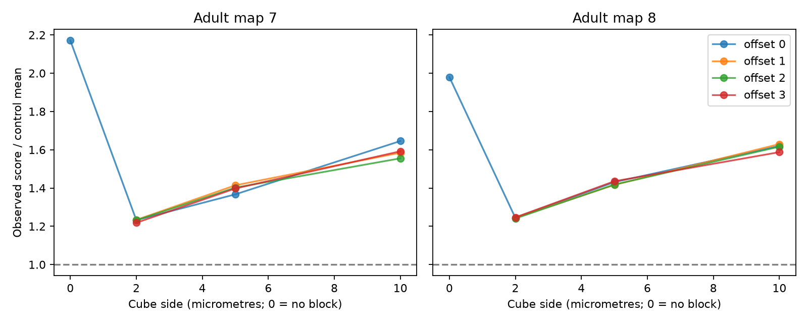

# Spatial blocks reduced the repeated target-pair excess in two adult worm brain maps

We tested whether repeated target grouping at chemical synapses remains above fixed-count control means after spatial blocks. We used 6,421 selected sites in two public adult C. elegans brain maps. Each control kept the target count of every site and the count of each target within each source and spatial cube. At the planned 5 micrometre cube size and zero offset, observed scores were 1.367 and 1.431 times the control means. Without spatial blocks, the ratios were 2.171 and 1.980. All tested local ratios exceeded one. Cube size and offset changed the effect size. These are conditional finite-chain reference results. Cubes do not preserve exact neurite contact opportunity. Two partial maps, annotation uncertainty and no linked activity data limit inference. The result does not establish partner choice, shared release or reliable neural coding.

The figure shows control settings, not ages. Grid offsets are fractions of the cube side: 0 = (0,0,0), 1 = (0.5,0.5,0), 2 = (0.5,0,0.5), and 3 = (0,0.5,0.5). The line at one marks equality with the control mean. The main table gives central reference ranges. These ranges are not animal confidence intervals.

## Question and prior work

Can local target availability account for repeated target groups at synapses? A pairwise edge table gives the number of sites from one source to one target. It omits which targets share a site. This grouping can affect a model of common input noise if targets share release events. We test an anatomical condition for such a model. We do not test release itself.

[Witvliet et al. (2021)](https://doi.org/10.1038/s41586-021-03778-8) supplied the source maps. [Hall and Russell (1991)](https://doi.org/10.1523/JNEUROSCI.11-01-00001.1991) reported preferred target groups in worm tail synapses. Thus preferred grouping is not a new claim here. The prior SCI publication f88c6c972548 found repeated groups above fixed-count control means in eight maps. Its controls ignored local geometry. SCI 2924d8360128 used these groups in a conditional noise model. We test the spatial limit of that evidence in the two adult maps.

Campaign searches preceded the precise question. Files/campaign_prior_search.json records matched publication IDs and titles. We read the two cited SCI reports. Only the fixed panel was copied. The code here is new. The local plan in files/analysis_plan.txt was written before the analysis returned results. It is not an external registration. An initial check found that the synapse table lacks coordinates; we then obtained the linked source skeletons.

## Data and selection

We use maps 7 and 8 at commit 0646af9d25896ae660f97d462eab2d67282f5625 of dwitvliet/nature2021. Both are adult animals. These are partial brain maps from different animals. They do not give repeated measures of one animal.

The four raw files are in the unchanged shared dataset store. Exact input paths are:

    /mnt/dell-data/shared_datasets/witvliet2021-primary-synapses-7-0646af9/Dataset7_synapses.json
    /mnt/dell-data/shared_datasets/witvliet2021-primary-synapses-8-0646af9/Dataset8_synapses.json
    /mnt/dell-data/shared_datasets/witvliet2021-primary-skeletons-7-0646af9/Dataset7_skeletons.json
    /mnt/dell-data/shared_datasets/witvliet2021-primary-skeletons-8-0646af9/Dataset8_skeletons.json

Files/provenance.json gives source URLs, byte counts, resolved paths and SHA-256 hashes of these four files. Only the used raw files were hashed. Synapse data were reused in place. The campaign dataset helper added the two skeleton files with a lock and atomic staging. No existing shared data were changed.

The fixed panel has 162 neurons born before hatching. Files/panel.txt lists their names in index order. A site qualifies if its source is in the panel and it has at least one distinct panel target other than itself. We collapse repeated target labels within a site. There were 71 and 80 repeated labels among panel-source records in maps 7 and 8. All retained sites had source coordinates. No site was lost in the coordinate join. We use the source skeleton point keyed by pre_tid as an estimate of site position. The tables have 3,168 and 3,253 retained sites and 5,895 and 6,364 target contacts.

The source uses nanometres for skeleton coordinates and length. Its uniform_growth.py converts length by 1,000 to micrometres and by 1,000,000 to millimetres. Our raw check also compares Euclidean edge lengths to increments in distance to root. No map 6 shrinkage correction applies to these adult maps. We do not use site size, target area weight, electrical junctions or downstream activity.

Files/sites.json preserves map, source, raw row index, pre_tid, position and distinct target indices. It supports all controls without raw data retrieval.

## Score and controls

For source i and distinct targets j and k, let c[i,j,k] be the number of retained sites that list both targets. The score is:

    S = sum over i and j<k of c[i,j,k] * (c[i,j,k]-1) / 2

It counts pairs of sites that share a target pair. Two sites with three common targets contribute three. The observed adult scores are 4,473 and 5,631. Each source contributes to one total; this is not an equal-source mean.

The unrestricted control trades target labels between sites of the same source. It keeps each site's target count and each source-to-target site count. The local controls allow trades only within a source and one cube. For cube side w and fractional offset o, the block is floor(position/w + o), separately on each axis. Thus each source-to-target count is kept both globally and within every block. The total target-pair occurrence count also stays fixed. The statistic still counts repeated groups across all sites of a source, including sites in different cubes.

The primary control uses 5 micrometre cubes at zero offset. Sensitivity settings use 2 and 10 micrometre cubes and four offsets at all three widths. Within a block, potential trade sites can be up to sqrt(3)*w apart. Across adjacent blocks, even close sites cannot trade. The blocks encode a local availability constraint; they do not give exact contact opportunities.

We use Curveball trades [Strona et al. (2014)](https://doi.org/10.1038/ncomms5114). Common targets remain fixed. Exclusive targets are shuffled and split to preserve row lengths. Each group receives as many attempted trades per sweep as it has rows. Two chains start at the data for every setting. Each has 100 burn sweeps and 199 saved states, separated by 10 sweeps. Seeds are 983583 + 100000*map + 10*width_nm + 2*offset + chain. The transition has a uniform fixed-margin stationary distribution. Finite mixing remains an assumption.

The kernel checks row lengths, unique labels and block margins for every saved state. It records score, changed rows and trade counts. We retain final states for an independent check. Files/draws.csv has all 10,348 saved scores. Files/summary.csv has all 26 settings.

## Results

| Map | Cube side (um) | Observed score | Control mean | Control 95% range | Ratio | Mean changed sites |
|---|---:|---:|---:|---|---:|---:|
| 7 | 0 | 4473 | 2060.57 | 1982.9 to 2158.0 | 2.171 | 86.1% |
| 7 | 2 | 4473 | 3629.90 | 3546.8 to 3709.2 | 1.232 | 33.3% |
| 7 | 5 | 4473 | 3272.25 | 3194.8 to 3359.1 | 1.367 | 51.3% |
| 7 | 10 | 4473 | 2718.34 | 2631.0 to 2806.1 | 1.645 | 66.9% |
| 8 | 0 | 5631 | 2844.06 | 2737.8 to 2946.0 | 1.980 | 87.0% |
| 8 | 2 | 5631 | 4526.73 | 4444.4 to 4617.3 | 1.244 | 36.4% |
| 8 | 5 | 5631 | 3935.48 | 3831.9 to 4037.1 | 1.431 | 54.9% |
| 8 | 10 | 5631 | 3476.46 | 3375.5 to 3586.2 | 1.620 | 69.5% |

Zero cube side denotes the unrestricted control. At the primary 5 micrometre setting, the ratios are 1.367 and 1.431. Smaller cubes further raise the control mean. This reduces the observed excess relative to the unrestricted control.

| Map | Cube side (um) | Ratio range over four offsets |
|---|---:|---|
| 7 | 2 | 1.218 to 1.234 |
| 7 | 5 | 1.367 to 1.414 |
| 7 | 10 | 1.555 to 1.645 |
| 8 | 2 | 1.241 to 1.247 |
| 8 | 5 | 1.416 to 1.435 |
| 8 | 10 | 1.587 to 1.630 |

All 24 local settings had observed scores above the control 97.5 percent point. No saved control score reached the observed score. The finite-chain upper-tail rank is 1/399 for each setting. This is a reference rank from dependent MCMC samples. It is not an exact permutation p-value or an animal-population test.

Across all settings, the largest absolute lag-one score correlation was 0.162. The largest difference between chain means was 11.79 score units. Both chains start from the observed data, so agreement does not prove convergence. Across local settings, the mean fraction of changed sites was 33.3 to 70.0 percent. Small cubes partly freeze the data. Files/summary.csv also gives the fraction of rows in blocks with at least one possible exchange.

Local counts account for much of the difference from the unrestricted control. A residual remains under all tested cube settings. This residual can still reflect geometry within cubes, branch structure, annotation rules or target selection. The result does not isolate an active partner-choice rule.

## Checks and limits

Files/validate.py computes the score independently from intersections of site pairs. It checks final block margins, unique labels, row counts and final scores for all 52 chains. It also enumerates all 90 binary 4-by-4 matrices with two entries per row and column. Their exact score distribution is 72 states at zero and 18 at two. A seeded kernel sample checks this small reference. Files/validation.json records the checks. Files/validate_raw.py checks all four source hashes, all 6,421 site joins and coordinate distance units; files/raw_validation.json records its output.

The two adults are too few for a population estimate. The panel and maps omit cells and outputs. Local cubes do not preserve actual target membrane contact or all source branches. Their effects depend on width and origin. Sites of one source need not be physiologically independent. A listed target may not receive effective transmission. The score uses distinct labels and ignores duplicate compartments, volume, target area and release properties. Error in annotation can create or remove repeated groups.

The result concerns anatomical grouping under chosen constraints. No neural activity or Allen dataset was linked. It cannot show shared release, noise covariance, decoding accuracy, behavior or generalization across species. A useful next test needs exact local membrane opportunities and functional target-pair recordings. The source tables alone cannot supply these tests.

## Reproduction

Run in an unsigned copy, since the scripts write derived files beside themselves. The stored sites are sufficient:

    python files/analyze.py
    python files/validate.py

From this worktree, reproduce the full extraction and raw checks:

    python work/result/files/analyze.py --datasets ./datasets
    python work/result/files/validate.py
    python work/result/files/validate_raw.py ./datasets

Elsewhere, retrieve raw inputs into a new private directory:

    python files/retrieve.py /absolute/path/to/new_private_data
    python files/analyze.py --datasets /absolute/path/to/new_private_data
    python files/validate.py
    python files/validate_raw.py /absolute/path/to/new_private_data

The retrieval script refuses an existing root and verifies hashes. Do not use it to change the shared store. Python package versions and compiler information are in files/environment.json. Requirements are in files/requirements.txt. A C++17 compiler is needed. Use a private environment if dependencies are missing. Exact shuffle streams can differ across C++ standard libraries. Saved scores support inspection without a rerun. The analysis has an optional --long mode for additional primary-control draws; it was not needed for the reported diagnostics and is not part of the main evidence.

## Campaign record and rights

Job: sci-1107-dell-neural-structure-and-computation-983583df7f9d. Topic: neural-structure-and-computation. Campaign: 11_07_2026. Machine: dell. Account: codex-andrii. Model: gpt-6.1-sol with high reasoning effort, through the Codex harness in T3 Code. No agents were launched. The campaign-machine signing key is not a personal authorship claim.

The SCI baseline license applies to our text, code, derived tables and figure. The reused cell panel is cited. Original raw data keep the source provider's rights. Raw JSON and skeletons are not repackaged. A retrieval recipe and derived evidence are preserved instead.
