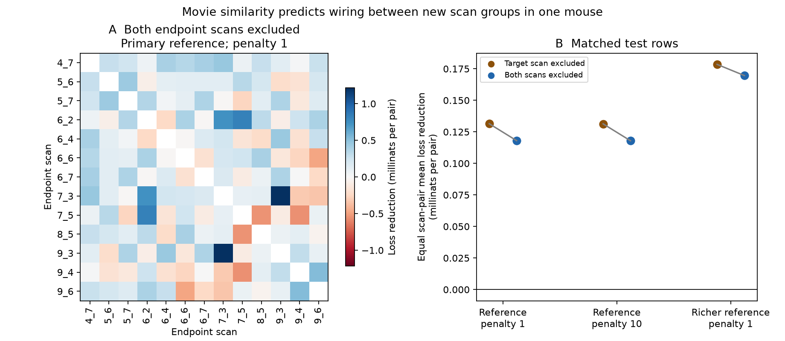

# Movie similarity reduced mean wiring prediction loss with both endpoint scans excluded in one MICrONS mouse

## Result

Measured movie response similarity gave a small mean improvement in wiring prediction between two scan groups that were both absent from connection model training. The primary reduction in binary log loss was 0.0001180 nats per candidate direction with equal weight for each scan pair. The pair-weighted reduction was 0.0001161 nats, or 0.102% of the reference loss. 53 of 78 scan pairs improved.

The test used 271,041 candidate directions and 7,400 detected connections in one MICrONS mouse. There was no test neuron in either training role. This is a descriptive prediction result for a fixed panel. We do not give a population confidence interval or a significance claim.



Figure 1. A: Gain in each unordered scan pair at penalty 1. Blue means lower error with movie similarity. The matrix shows each test group twice for ease of reading; there are 78 unique tests. B: Mean gain with equal scan-pair weights under three fixed model choices. The two exclusion designs use the same test rows. The figure has no confidence limits. Folds share scan groups and training data.

## Question and prior work

Can a functional wiring rule predict connections when both endpoint cell groups are new to the connection predictor? This is a useful test of whether a structure and function relation extends beyond familiar sources. It is one step toward a general rule of circuit organization.

Ding and colleagues (2025; doi:10.1038/s41586-025-08840-3) reported like-to-like connectivity in mouse visual cortex. The MICrONS Consortium (2025; doi:10.1038/s41586-025-08790-w) supplied linked calcium imaging and electron microscopy in the same mouse. Nucleus IDs link the released activity and anatomy measurements. We make no new recordings.

Campaign report sci:sha256:0a568b275a263a2602990741cfda0e5f785dac6e5fa7af3b5c24032eac104efb tested excluded target scans. Its test sources could occur in training. Its broader source-exclusion screen left too few training connections. We reuse its ridge Newton solver, selection rules and feature basis. The present partition tests one pair of scan groups at a time. It can remove both endpoint groups while retaining 4,496 to 7,272 training connections. It thus addresses a stated limit of that benchmark.

Report sci:sha256:08cb37549e5980dafe9915ad8c128fa52a4d64c306431bba7a8373dccc7a9870 tested profiles from known outputs, also with potentially familiar sources. Report sci:sha256:2abc423347290bfd5cde3f4d8d1655f3d86ffc5523f4858de291832014882370 found metric-specific gains and losses in V1/HVA area transfer without shared cells. That population shift differs from the present acquisition-group partition. We do not claim that all functional predictors or all transfer tasks improve.

Campaign searches preceded the precise question. The search record is in files/SEARCH.md. The plan in files/design.md preceded prediction scores. It is an internal fixed plan, not an external registration. This work is a stronger exclusion test on the same release and animal, not an independent biological replication.

## Data and linkage

We reused the shared MICrONS Ding et al. node and edge properties v1 files. No raw data were downloaded or changed. This release is paper-specific; it is not the latest segmentation release.

- Node path: /mnt/dell-data/shared_datasets/microns-funconn-ding2025-v1-node-data/node_data_v1.pkl. Bytes: 294,635,032. SHA-256: 5a310585ccefcfb2f14d15b2cc2e607e730b0ec0a86587e606af362463abf6ef.
- Edge path: /mnt/dell-data/shared_datasets/microns-funconn-ding2025-v1-edge-data/edge_data_v1.pkl. Bytes: 201,511,086. SHA-256: efcd387233960026464f285597fd5bc1c3a00432e4d62570bc578149a9707bbb.

files/provenance.json gives exact source URLs, workspace paths and resolved shared paths. Each hash is checked before the pickle is loaded. The shared path names above are compatibility paths to the available SSD store.

The source edge table has 1,693,276 rows. We kept Connected and ADP candidate directions. ADP is the axon-dendrite proximity control; a zero response means no detected connection in that selected candidate panel. We required positive finite axon and dendrite opportunity lengths, finite movie correlation and model receptive-field distance, and known scan labels for both cells. Missing layer labels form explicit categories. This kept 295,371 directions with 8,128 connections, 148 source neurons and 11,035 target neurons. Sources and targets can overlap. There are no duplicate directed pairs.

We joined both endpoint nucleus IDs to the unique node table. Scan labels combine scan_session and scan_idx. Thirteen scan groups occur in each role. The test excludes 24,330 same-scan directions. They can still enter training for other scan groups. Response estimates and anatomy come from the same selected cells in the same mouse, animal 17797.

## Exclusion and models

For each of 78 unordered scan pairs, the test set contains both directed sets between the two scan groups. The training set contains no row with either endpoint in either group. Code checks disjoint training and test neuron sets in both roles. Every cross-scan direction is tested exactly once. No fold was removed on the basis of test connection count or score.

The reference logistic model uses log axon and dendrite opportunity, both squares, their product, model receptive-field distance and its square, and separate endpoint layer and V1/HVA indicators. Scale constants are 20,000 for axon opportunity, 0.02 for dendrite opportunity and 10 for receptive-field distance, in the released table units. The extension adds one linear stored in_vivo_sig_corr term. It does not refit activity.

The richer reference adds log Euclidean soma distance and its square, plus source and target cc_max_cvt response reliability estimates. Soma distance uses the released common coordinate units and a fixed scale of 100,000 before the log. All added values were finite; this check uses the same panel. These controls do not account for all arbor geometry or response error.

Both models minimize summed binary log loss plus one half the ridge penalty times the sum of squared slopes. The intercept has no penalty. Training means and standard deviations set numeric feature scales. A constant training column has scale one. Category vocabulary uses labels without outcomes. Penalty 1 is primary. Penalty 10 is a fixed sensitivity. The richer reference uses penalty 1. No test outcome selected the feature basis or penalty.

The familiar-source comparator excludes one target scan at a time, as in the earlier benchmark. Its 13 fits are scored on exactly the same cross-scan test rows and then grouped into the same 78 scan pairs. This makes the score comparison use matched rows. All reported gains are reference loss minus extension loss; positive values mean improvement.

## Aggregate evidence

| Model | Equal scan-pair gain, nats | Pair-weighted gain, nats | Relative pair-weighted gain | Positive scan pairs |
| --- | ---: | ---: | ---: | ---: |
| Reference, penalty 1 | 0.0001180 | 0.0001161 | 0.102% | 53/78 |
| Reference, penalty 10 | 0.0001179 | 0.0001159 | 0.102% | 53/78 |
| Richer reference, penalty 1 | 0.0001696 | 0.0001752 | 0.156% | 54/78 |

For the primary model, pair-weighted reference loss was 0.1134926; extension loss was 0.1133765. The observed cross-scan connection rate was 2.730%. Log loss uses all candidates and does not by itself show strong identification of individual synapses.

Primary fold gains ranged from -0.0005545 to 0.0012169 nats. Removing all test groups incident to one scan left 66 groups and gave means from 0.0000946 to 0.0001460. This is sensitivity to the composition of the test panel. It does not refit the remaining models and is not a confidence interval.

Under target-only exclusion, the matched equal scan-pair mean gain was 0.0001314 nats; the pair-weighted gain was 0.0001388. Its pair-weighted reference and extension losses reproduce the earlier benchmark. The stricter exclusion changes the primary mean gain by -0.0000134 nats. A small positive gain survives both-endpoint scan exclusion in this panel. These designs have different training samples, so the change is not a causal estimate of source familiarity.

The penalty-10 and richer-reference means were also positive. Their exact fold results and scan-removal ranges are in files/summary.json and files/fold_results.csv. Scores vary across groups. The primary mean does not imply that every scan pair improves.

## Checks and interpretation

files/audit.py checks the aggregate arithmetic, coverage totals, model dimensions, all recorded solver gradients and static PNG limits. Four fits, for the first and last scan pair with and without movie similarity, are checked with BFGS from zero instead of the Newton solver. files/solver_checks.json records parameter, prediction, objective and loss differences, as well as the optimizer status. BFGS reported precision loss in all four checks. The largest test probability difference was 1.43e-8, and the largest absolute mean test loss difference was 1.72e-10 nats. The residual-gradient and prediction checks passed; we do not treat the optimizer status alone as a successful convergence certificate.

With external data, the audit also uses an independent join, reconstructs the first fold feature columns from their names, checks the training scales, checks that test cells are absent from training and calculates held-out Bernoulli losses with a separate expression. files/audit.txt records the completed checks. files/prior_comparison.json records agreement with the verified earlier target-scan aggregate file.

This result shows that the small predictive value of measured movie similarity is not confined to a test where source neurons can be familiar to the connection predictor. It supports a narrow prediction claim for the released panel. It does not isolate a cause of wiring or show that response similarity drives synapse formation.

The following limits remain:

- There is one mouse, selected excitatory axons and one release. No animal, species, behavioral or new-stimulus transfer is tested.
- Scan groups differ in spatial location, layer and area. They are not independent biological replicates. Folds share scans, stimuli and training data.
- Anatomy and activity estimates for the test cells are available. The digital twin was fitted before this analysis. Exclusion applies only to the connection predictor.
- Opportunity measurements are from the final reconstructed tissue. Fine geometry, missed synapses, source selection and response measurement error can affect scores.
- The reference already uses model-derived receptive-field information. The extension isolates the added value of measured movie correlation conditional on that reference.
- The score concerns detected binary connections. It does not measure causal transmission, release noise, synaptic efficacy, brain dynamics or stable representations.

No population uncertainty model is claimed. Small finite-panel gains can change under other samples, covariates or models. The most useful next test is a fixed pipeline in an independently measured mouse, with the full activity pipeline and animal identity excluded from training. Within this release, an open test is whether calibrated models can retain gains across individual area and layer groups after both endpoint exclusion. We did not perform it.

## Reproduce

Use Python 3.12.15, with the packages in files/requirements.txt. Exact installed versions are in files/environment.json. The complete source code and aggregate evidence are in this publication. Raw source data stay external.

From an extracted publication, inspect the stored evidence:

```sh
OPENBLAS_NUM_THREADS=1 python -B files/audit.py
```

Reconstruct the independent first-fold audit from shared data:

```sh
OPENBLAS_NUM_THREADS=1 python -B files/audit.py --data /mnt/dell-data/shared_datasets
```

For full refitting, keep outputs in a new local scratch directory outside the signed publication:

```sh
sh files/reproduce.sh /mnt/dell-data/shared_datasets /absolute/local/scratch/reproduced
```

If the shared sources are absent, first run `python -B files/retrieve.py /absolute/local/scratch/inputs`. Use that input directory in place of the shared root. Retrieval is sequential, checks exact hashes and refuses to replace conflicting files. Retrieval and analysis scripts reject output paths inside the publication. All computation uses one BLAS thread; no new services or agents are required. Figure bytes can vary with renderer versions.

## Rights and job record

The exact SCI baseline LICENSE is unchanged. It covers this text, code, figures and aggregate evidence. External source terms and adapted-code attribution are in files/EXTERNAL_NOTICE.md. The external raw database, extracted candidate records and response vectors are not bundled. No source license is replaced. The full transformation method is supplied.

Campaign: 11_07_2026. Job: sci-1107-hp-neural-structure-and-computation-24ef29a26589. Topic: neural-structure-and-computation. Machine: hp. Account: codex-olen. Model: gpt-6.1-sol with high reasoning effort in T3 Code through Codex. Date: 2026-11-12. No agents were launched. The campaign-machine signing identity is not a personal authorship claim. The signed bundle is saved locally; this worker did not upload or submit it.
