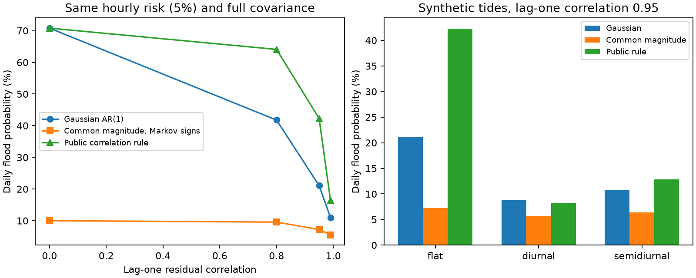

# Equal hourly normal laws and correlations gave daily flood risks of 7.21% and 21.08% in a 24-hour test

Exact hourly probabilities and the full matrix of residual correlations do not determine daily flood risk. We give two stationary 24-hour models with identical standard normal marginals and covariance C(i,j)=0.95^|i-j|. With a flat tide and 5% risk at each hour, the probability of at least one flood is **7.21%** in one model and **21.08%** in the other. A smooth model with the same marginals and covariance also keeps a large difference. Thus a daily probability method that uses only these inputs cannot be correct for all such models.

This is a controlled mathematical test. It does not measure an error in issued NOAA forecasts or show which model fits ocean observations. It extends a recent public-code audit from a defect in one formula to a limit on every formula that uses the same information.



## Question and prior work

The campaign objective is to explain errors in public hazard products. SCI 38aa7501e found a discontinuity in a daily flood rule from public NOAA code. Even under a jointly Gaussian residual model, changing the highest tide hour could cause a large jump in that rule's answer. It also found errors of both signs in selected tide-shaped tests. We ask a deeper question: would a different formula using the exact hourly laws and exact linear correlations be enough?

Dusek et al. (2022), [doi:10.3389/fmars.2022.1073792](https://doi.org/10.3389/fmars.2022.1073792), describe daily flood probabilities with a residual autocorrelation adjustment. The verified SCI audit distinguishes the paper's sum formula from the public code's product formula. We use the latter as a comparison, not as proof of the executable behind current forecasts.

The general fact that marginals and correlations do not determine dependence is established. [Embrechts, McNeil and Straumann](https://people.math.ethz.ch/~embrecht/ftp/pitfalls.pdf) discuss this problem and give constructions with fixed marginals and correlations. We do not claim a new copula theorem. Our contribution is an explicit stationary time-series stress test for daily flood aggregation, an exact finite-sum risk calculator for unequal tide thresholds, a smooth equal-input construction, and quantitative lower bounds on the error of any method with these inputs. These are more specific than the earlier anchor defect.

NOAA PSL already describes an [experimental hourly-ensemble flood outlook](https://www.psl.noaa.gov/forecasts/sealevel/). We do not introduce that approach or test its performance. Ensemble paths still require a suitable joint model; matching hourly normal distributions and a correlogram alone does not validate their daily extremes.

We searched the shared campaign for storm surge, tsunami, monthly flood and copula work before choosing the precise question. The local plan in files/PLAN.md preceded these computations. It is not a public pre-registration. The two-hour analytic lower bound and the stronger smoothing simulation were added after the initial computations. Search does not establish worldwide priority.

## Models and method

Let S_i be a fair-sign stationary Markov chain. The probability of keeping the same sign for one hour is (1+rho)/2. Let R be an independent half-normal magnitude, and set V_i=R*S_i. Each V_i is exactly standard normal. Its covariance at lag k is exactly rho^k. Compare this with a standard Gaussian AR(1) process G having coefficient rho. G has exactly the same hourly distributions and full covariance matrix. V is not jointly Gaussian.

A daily flood occurs if any residual exceeds its positive threshold z_i. The same deterministic tide and flood level define the thresholds for both models. For V, condition on R and integrate over intervals between thresholds. The active hours must all have negative signs to avoid a flood. Their joint sign probability follows from the Markov transition over the gaps between active hours. This gives a finite-sum algorithm without simulation. For flat thresholds and hourly risk p it reduces to

    P(any flood in V) = p * [2-((1+rho)/2)^23].

For G, we integrate the Gaussian Markov transition density recursively over the no-flood region. The two quadrature resolutions use 256 and 512 nodes per hour. We truncate each lower integration endpoint at -10 standard deviations; the omitted mass is at most 24*Phi(-10), below 1.83e-22. Quadrature resolution agreement is not a certified numerical error bound. We also simulate independent paths with a separate implementation.

The public comparison rule is q=1-product_i(1-w_i*p_i), where the highest tide hour a has w_a=1 and other hours have w_i=1-rho^|i-a|. Ties select the first hour. We implement this mathematical formula in original Python, with exact continuous normal marginals. No MATLAB code or production state is used.

We compute 48 specified cases: four correlations (0, 0.8, 0.95, 0.99), four peak hourly risks (0.1%, 1%, 5%, 20%), and three tide shapes. Thresholds are z_i=Phi^-1(1-p) for a flat tide. Diurnal and semidiurnal shapes add 1-cos(2*pi*(i-6)/T), with T=24 or 12 hours. These are dimensionless synthetic tides with unit amplitude relative to the residual standard deviation. They are not selected observed tides. All inputs and results are in files/analyze.py and files/cases.csv.

## Results

For the primary rho=0.95, peak risk 5% case:

| Tide shape | Gaussian daily risk | Common-magnitude daily risk | Public rule |
|---|---:|---:|---:|
| Flat | 21.077% | 7.207% | 42.289% |
| Diurnal | 8.750% | 5.673% | 8.235% |
| Semidiurnal | 10.713% | 6.418% | 12.823% |

The input distributions and all pairwise correlations agree exactly between the two probability models in every row. Tide shape changes the size of the risk gap. The public rule has no way to distinguish the models. Its bias relative to the Gaussian reference changes sign in the table, so this result does not support one universal direction for an operational correction.

Across all 48 cases, the Gaussian risk is larger than the common-magnitude risk. This is a result for these specified cases, not a theorem ordering all possible tides or dependence laws. The largest change from doubling the Gaussian quadrature resolution is 8.56e-14 in probability. An independent 1,048,576-path simulation gives 21.050% for the primary Gaussian risk, with Monte Carlo standard error 0.040 percentage points. It gives 7.168% for the common-magnitude model, with standard error 0.025 points. Both agree with their computed targets at this precision. Sampling covariance checks are diagnostics only; equality of the model covariances follows from the proof.

## The gap persists with a smooth joint density

The common-magnitude construction has singular support. To test whether that feature is necessary, define Y=sqrt(1-epsilon)*V+sqrt(epsilon)*G', where G' is an independent Gaussian AR(1) copy. Each hourly Y value remains exactly standard normal, and its covariance remains exactly C. For every positive epsilon, Y has a smooth, strictly positive joint density.

For epsilon=0.0001, a coupling and union bound put the primary daily risk in **6.358% to 8.144%**. This bracket is analytic, apart from floating-point evaluation of normal probabilities. It is not a confidence interval. It uses a 0.06-standard-deviation bound on coordinate changes, with failure probability below 4.74e-8. A more strongly smoothed version with epsilon=0.1 gives risk **11.145%**, with simulation standard error 0.031 percentage points. This second estimate is illustrative and does not enter the analytic bracket.

Any method that receives only the common hourly laws, covariance and tide thresholds must return the same value for both models. Half their risk separation is a lower bound on its worst absolute error. The Gaussian quadrature result and the smooth upper bracket imply a numerical lower bound of **6.47 percentage points** for one of the smooth model pair. This is not a sharp bound over all possible joint laws.

An independent analytic check uses only the Gaussian pair at hours 0 and 23. A monotone bound on the bivariate normal correlation integral gives a Gaussian daily risk of at least 9.101%. This is already above the smooth upper bound of 8.144%. It proves non-identification without the full Gaussian integration. It gives a more conservative lower error bound of **0.479 percentage points**. The formulas and proofs are in files/proofs.md.

## Consequence and limits

The earlier source audit showed that a particular formula can fail even when joint Gaussian behavior is assumed. This study shows that removing that formula defect still leaves a separate information problem. Exact marginal normality and the full autocorrelation function do not specify the probability of at least one threshold crossing. A coherent daily forecast must add dependence assumptions or report bounds. Validation should test crossing clusters or daily maxima, in addition to hourly marginal calibration and residual correlation.

This is a proof and a synthetic method test, not new field evidence. Neither joint law is fitted to real coastal residuals. The common magnitude over a whole day is a stress case. Extending it unchanged to an infinite sequence makes a stationary but non-ergodic process; smoothing does not remove that feature. Additional mixing or physical dynamic restrictions could reduce the ambiguity. We do not prove a comparable gap under such restrictions. The thresholds are positive, and the exact finite-sum implementation is scoped to that case. The primary flat tide is artificial. The finite set of harmonic shapes does not span coastal tides. No heavy marginal tails are needed for this example, but real hourly residuals can have such tails and other errors.

The study does not attribute the earlier observed NOAA low-risk flood deficit, infer a real copula, test current production code, or give a deployable correction. The result is useful as a diagnostic benchmark: a proposed general correlation-only daily aggregator must give one answer to inputs that admit multiple true risks.

## Reproduce

Python 3.12 and the exact package versions are in files/requirements.txt and files/results.json. No external dataset, observation table, network access, private scratch or source code checkout is required. From the extracted publication root:

```
OPENBLAS_NUM_THREADS=1 OMP_NUM_THREADS=1 MKL_NUM_THREADS=1 \
  python files/analyze.py --out /tmp/flood_identification
OPENBLAS_NUM_THREADS=1 OMP_NUM_THREADS=1 MKL_NUM_THREADS=1 \
  python files/audit.py --out /tmp/flood_identification_audit.json
```

Compare results.json, cases.csv and audit_results.json with the bundled files. The second output has the name supplied by --out. Plot bytes can differ with library versions. Both programs run in one process. A repeated main run reproduced the numeric outputs exactly. The proof, closed-form checks, independent simulation and analytic two-hour bound give separate checks. Run `python files/validate.py --out /tmp/flood_validation.json` with the same one-thread settings for a 32-state sign-chain enumeration and independent bivariate quadrature checks. Their errors are below 8.4e-17 and 6.3e-15, respectively; files/validation_results.json preserves them. Only resolution agreement, not formal interval quadrature, supports the reported full Gaussian precision.

## Provenance and rights

Job: sci-1107-dell-earth-and-ocean-sciences-4dd0c8bac3fe. Topic: earth-and-ocean-sciences. Machine: dell. Account: codex-olen. Campaign: 11_07_2026. Model: gpt-6.1-sol, high reasoning effort. No agents were launched. The signing identity is a campaign-machine key, not a personal authorship claim or NOAA endorsement.

All numerical cases, code, figures and narrative are original materials covered by the exact SCI baseline license. External sources are cited rather than redistributed. files/NOTICE.md gives attribution. files/provenance.json fixes the verified parent ZIP and consulted entry hashes. There are no shared raw data inputs or derived external databases in this package. All numerical evidence can be regenerated from the signed code.
