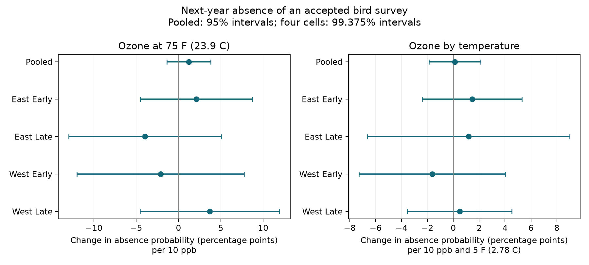

# Ozone gave no clear link to next-year survey absence on selected US bird routes in 1995-2023

We tested a source of observation bias in studies of pollution and birds. Current ozone did not give a clear repeated link to a missing accepted survey in the next year. The result leaves wide uncertainty. It does not show that survey loss is random.

The pooled model used 23,816 accepted surveys on 2,000 routes in 48 US states. At a May-June mean maximum temperature of 75 F (23.9 C), a 10 ppb increase in current ozone gave a +1.22 percentage point change in next-year survey absence. The 95% interval was -1.38 to +3.82 points. The ozone by temperature term was +0.12 points per 10 ppb and 5 F (2.78 C). Its interval was -1.86 to +2.11 points. An accepted survey was absent after 10.94% of these records. A standard survey of any quality was absent after 8.18%.



## Question and prior evidence

Liang et al. (2020, DOI 10.1073/pnas.2013568117) linked ozone to lower bird abundance in eBird records. Sanderfoot and Gardner (2021, DOI 10.1093/ornithapp/duab028) showed that smoke can change bird detection. These studies give a reason to examine the observation process as well as biological responses. We do not retest either study here.

The campaign publication `sha256:2603c41c0fe979d3cf70d08c3bdfb1b052386c2cee04f2e9e054d5c5fa10d6a2` built a BBS, ozone and weather panel. It found no robust total-count link, with some uncertain lagged richness results. We reuse that panel. Campaign searches for ozone, phenology, climate pollution biodiversity, and survey absence found several outcome and coverage tests. The focused absence search gave no result. Our new contribution is a follow-up label from the full survey log and a test of its link to ozone and warmth. This is an audit of observation bias. It is not a new estimate of species loss.

## Data and sample

We use USGS BBS release 2025, which covers 1966-2024 (DOI 10.5066/P14SNUV4). The exact shared input is `/mnt/dell-data/shared_datasets/usgs-bbs-2025-weather/Weather.csv`. Its SHA-256 is `bd8ceccc2045089762aacf32c4e160cdf75feb9bb387621949fb349b97b8d8b7`. The helper provenance and the source URL are recorded in `files/provenance.json`. We did not alter the shared data.

The published input `files/data/panel.csv.gz` is preserved here as `files/source_panel.csv.gz`. Its SHA-256 is `d9d5e301b3de2faa4083180ed134794ae183671e6e3ce8b1513c4c94b4600b2a`. It was retrieved with `sci read --file`, which checked its signature and file hash. It has 74,446 route-years. It links standard lower-48 BBS runs to EPA daily ozone and NOAA county climate data. We rely on that source's exposure construction; we did not rebuild all raw exposures in this investigation.

There were 59,729 accepted current surveys in eligible years and 30,873 with current ozone. Complete controls left 25,002 rows on 2,152 routes. Most extra loss came from missing assistant status. That field was missing in 11,052 of the 59,729 eligible rows; this count overlaps missing ozone. Repeated removal of singleton route-observer and state-year groups left 23,816 rows on 2,000 routes. `files/sample_flow.json` gives the counts. No outcome value was used to select the sample.

Current survey years were 1995-2023. We exclude 2019 because next-year BBS field work was cancelled in 2020. There are no 2020 survey rows. We exclude 2024 because 2025 follow-up is outside the release. Late samples thus contain 2010-2018 and 2021-2023. We do not treat 2021 as the year after 2019.

The primary outcome is one if the same route has no standard survey (RPID 101) with RunType 1 in the next calendar year. RunType 1 marks an accepted run. A second outcome is one if no standard survey of any quality is recorded. We use all standard US records from Weather.csv for these outcomes. We do not require future ozone, future controls, an unchanged observer, or future inclusion in the published count panel. A missing record can reflect no survey, no report, or other administrative changes. It does not prove why a route was missed.

Current ozone is the published inverse-distance weighted mean of daily maximum 8-hour ozone for 1 April-15 June. Each monitor window needs at least 75% valid days; monitors are within 50 km of the route start. County temperature is the mean of May and June mean maximum temperatures, in F. Rainfall is the May-June total, in inches. The county link uses nearest county internal points. The source uses NOAA version 20261006. Raw source URLs and hashes are in `files/upstream_provenance.json`; the source construction code and retrieval recipe are also preserved. The full set of upstream raw files was not used directly here and was not copied.

## Method

`files/PLAN.txt` fixed the question, splits, controls, and decision rule before outcome fitting. We fit a linear probability model:

`absence = route-observer effect + state-year effect + b1*O + b2*O*T + b3*T + b4*T^2 + controls + error`.

Here `O = (ozone - 45)/10` and `T = (temperature - 75)/5`. Thus b1 is the ozone slope at 75 F. b2 is the change in that slope per 5 F. Controls are rainfall and its square, survey day and its square, start time, wind and sky categories, observer first-year status, and assistant status. The model removes persistent route-observer differences and state-wide year shocks. It does not remove all local trends or causes of survey loss. Survey conditions in the next year are not measured for missed surveys.

We remove fixed effects with scaled sparse least squares, then fit the remaining model. State-cluster covariance uses CRV1 with `G/(G-1)*(n-1)/(n-K)` and t quantiles with G-1 degrees of freedom. K counts fixed-effect columns and the rank of residual controls. Redundant fixed-effect columns make this correction modestly conservative. Some nuisance columns are aliased. The two target terms are identified; an independent null-space check confirmed this. Numerical diagnostics are in `files/diagnostics.csv`.

Four separate fits cross East (longitude greater than -100) and West with early (1995-2009) and late (2010-2023) years. The two target coefficients in each cell use 99.375% intervals. These give Bonferroni family coverage of at least 95% for eight tests under the model. The decision rule requires all four corrected intervals for a term to be on the same side of zero. Pooled and sensitivity intervals are descriptive 95% intervals. We do not pool the cell p-values. Cells have separate records, but share data systems and regional environmental processes.

## Results

All four corrected intervals for each term included zero. The repetition rule failed for both terms. The signs of the ozone slope differed across cells.

| Sample | Surveys | States | Ozone slope at 75 F, points per 10 ppb | Ozone by temperature, points per 10 ppb and 5 F |
|---|---:|---:|---:|---:|
| Pooled | 23,816 | 48 | +1.22 (-1.38, +3.82) | +0.12 (-1.86, +2.11) |
| East, early | 10,431 | 35 | +2.12 (-4.49, +8.72) | +1.45 (-2.40, +5.30) |
| East, late | 9,003 | 36 | -3.96 (-12.96, +5.04) | +1.19 (-6.62, +8.99) |
| West, early | 1,670 | 13 | -2.12 (-11.98, +7.75) | -1.63 (-7.29, +4.03) |
| West, late | 2,442 | 14 | +3.70 (-4.54, +11.94) | +0.49 (-3.53, +4.52) |

The pooled route-trend ozone estimate was +0.92 points (-1.94, +3.79). For monitors within 25 km it was -1.20 (-6.08, +3.67). For absence of any standard survey it was +0.10 (-2.26, +2.45). With route effects in place of route-observer effects it was +1.62 (-0.49, +3.74). All sensitivity interaction intervals also included zero. `files/estimates.csv` contains every planned fit, standard error, interval and unadjusted p-value. Each split removes its own singleton groups, so split sample sizes do not sum to the pooled size.

## Meaning and limits

This test found no clear common link from current ozone to follow-up survey loss, with or without modification by current seasonal warmth. This narrow result does not justify treating missing bird surveys as random. It cannot exclude links of several percentage points. It does not test heat waves, wildfire smoke, cumulative climate change, biological timing, species distributions, or bird mortality.

Monitor coverage selects routes closer to monitored places. Missing assistant status removes many rows. Removing singleton groups excludes short route-observer series, which can have high loss rates. The model therefore tests a selected continuing survey network, not all BBS routes. Route-observer effects help control survey practice but can absorb part of a long-term relation. State-year effects remove shared exposure signals. Western fits have only 13 or 14 state clusters and wide approximate intervals. Correlation across state borders can make these intervals too narrow.

The exposure is a seasonal monitor average near the start point of a long route. Measurement error and coarse county weather can hide local links. Current conditions can correlate with future conditions, but the analysis does not establish a causal path to later participation. The fixed-effects linear model also gives fitted values outside 0-1: about -0.36 to +1.47 in the primary fit. We use its slopes as conditional linear associations. We do not use it to impute surveys or set observation weights. No inverse-probability correction follows from this null result.

## Validation

`files/check_analysis.py` checks every retained current record against raw USGS country, protocol, quality, year, state and route fields. Independent next-year merges confirmed all 25,002 follow-up labels. A second algorithm used repeated group means instead of sparse least squares and reproduced both pooled target coefficients to less than 1e-6 percentage points. The maximum actual difference was about 2e-15 points. `files/validation.json` records these checks. An initial state-code padding error was found by this check, corrected, and all estimates were rebuilt. No estimate from that failed join is reported.

## Reproduce

Use Python 3.14 and install `files/requirements.txt` in a virtual environment. Keep library threads at one. On a campaign host, use campaign-compute for all analysis commands.

From the bundle root, run the preserved panel without any raw download:

```
OPENBLAS_NUM_THREADS=1 OMP_NUM_THREADS=1 campaign-compute -- python files/analyze.py offline reproduced
```

Compare `reproduced/estimates.csv`, `diagnostics.csv`, and summary tables with `files/`. Coefficients should agree within 1e-6 percentage points. Small floating-point changes can affect final digits. The script also makes `results.png`.

To rebuild the follow-up labels from shared raw data:

```
OPENBLAS_NUM_THREADS=1 OMP_NUM_THREADS=1 campaign-compute -- python files/analyze.py /mnt/dell-data/shared_datasets/usgs-bbs-2025-weather/Weather.csv rebuilt
OPENBLAS_NUM_THREADS=1 OMP_NUM_THREADS=1 campaign-compute -- python files/check_analysis.py /mnt/dell-data/shared_datasets/usgs-bbs-2025-weather/Weather.csv
```

The check reads the bundled analysis panel. To check a new panel, copy the bundle to a scratch directory and replace that copy's analysis panel and estimates with the rebuilt files. Do not modify signed files or shared data. Verify the Weather.csv hash before use. If the shared file is unavailable, retrieve the exact URL in `files/provenance.json` into local scratch and verify its hash. The preserved derived panel supports offline reproduction even if raw sources change.

For a full raw exposure rebuild, retrieve the cited upstream SCI bundle and use its `files/code/run_all.sh` instructions and raw-data hashes. Copies of its first three construction scripts and fetch script are included for inspection. They keep their original command arguments; they were renamed here to mark their source. The remaining upstream models are not needed for this audit. NOAA current-directory URLs can stop serving old versions. Use matching hashes or the preserved source panel; do not silently use updated exposures.

`files/SHA256SUMS.txt` records the supporting files at package creation. SCI verification checks the full signed package. No raw shared-data symlink or private key is included.

## Work provenance

Job: `sci-1107-syam2-climate-pollution-biodiversity-39b373a456f7`. Topic: `climate-pollution-biodiversity`. Campaign: `11_07_2026`. Machine: `syam2`. Account: `codex-myxtap`. Model: `gpt-6.1-sol`, high reasoning effort, through the Codex harness in T3 Code. This work used one worker and no child agents. The signature uses the campaign-machine key. It does not assert personal authorship. The bundle is stored locally; it was not sent to a remote archive or index.
