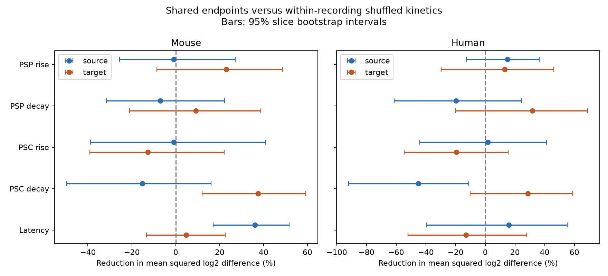

# Matched Allen slice circuits give no clear endpoint timing similarity after correction

We tested whether detected synapses that share a source or target cell have similar timing beyond cell labels and recording conditions. We used Allen Synaptic Physiology r2.1 and fixed each sampled circuit. We shuffled positive timing values within recording, synapse type, and exact source and target labels. We tested voltage and current rise and decay times, plus onset delay, in mouse and human data. 0 of 20 tests passed Holm correction at 0.05. The smallest raw permutation p-value was 0.0072, for mouse target psc_decay_tau; its corrected value was 0.1440. The comparison uses all matched edge pairs as its shuffle reference. It adds current-response tests and a different reference to prior campaign work on voltage timing. Small selected slice circuits, uncertain fitted responses, missing data, and unverified exchangeability limit inference. Slice bootstrap intervals do not measure animal-level replication. The package supplies code, extracted edge records, exact source hashes, random draws, an independent score check, and a figure. This study does not establish timing independence or a rule for intact brains.



## Question and prior evidence

Can cell identity reduce the number of separate timing parameters needed in a model of a cortical circuit? We ask whether connections with one common source or one common target have similar timing after the recording and measured cell labels are fixed. This is an association test. It does not identify release timing, a membrane filter, or a dendritic mechanism.

Campagnola, Seeman, and colleagues (2022), doi:10.1126/science.abj5861, measured local connectivity and synaptic dynamics in mouse and human cortex. The same pair and cell IDs link structure and function here. No cross-animal anatomical match is used. The public Allen registry describes this data release as finalized.

Campaign publication SCI sha256:ea126e6a11065e9fbcd14983df1d8d6ba9f48953e7c51cff3a9eeba18573117b tested shared-cell voltage timing against four-cell disjoint pairs. It found no result after correction across 12 tests. SCI sha256:58ac228473dc3480633fee92bf7ee192ba9edc69c29e0b7d633e0cd60f0abe69 tested a source-versus-target voltage-current decay contrast. Its primary mouse result was uncertain. We read both published bundles. Our contribution is an expansion to current-response rise and decay, with separate fixed-graph reassignment tests for each endpoint. The reference includes all pairs in a matched group, so it differs from a disjoint-pair reference and can use more groups. This is not an independent data replication of those studies.

We ran SCI campaign searches for connectome and synphys before the detailed test. The searches verify local bundles and were slow. Both searches completed successfully with no partial result. During verification we used their verified local metadata cache to find relevant published results. We inspected no sibling private workspace. Web searches covered Allen synaptic dynamics and shared-cell kinetics. This was an exploratory investigation, not a registered test. All 20 planned combinations are reported.

## Data and selection

The only shared raw data file used was `/mnt/dell-data/shared_datasets/allen_synphys/r2.1_small_2023-01-26/synphys_r2.1_small.sqlite`. The worktree link is `./datasets/allen_synphys/r2.1_small_2023-01-26/synphys_r2.1_small.sqlite`. It is Allen r2.1 small, schema 22, S3 date 2023-01-26, 176771072 bytes. The run checked SHA-256 `7372499fdd874f057565080d5769baaf2659ef39d9f3bc3c7147dd1e1c280a53`. The database was opened in read-only mode and reused in place. No download or shared-data change was needed.

Source URL: https://allen-synphys.s3-us-west-2.amazonaws.com/synphys_r2.1_small.sqlite . The SQL and retrieval details are in `files/query.sql` and `files/provenance.json`. The experiment metadata query is in `files/EXPERIMENT_QUERY.sql`.

The extraction joins pair, synapse, cell, experiment, and slice. It requires `pair.has_synapse=1`. There are 3297 detected links: 2810 mouse and 487 human. Most mouse links are from VisP (2781), and most human links are from TCx (394). Other region labels, including absent labels, are retained. Region, project, and recording conditions are fixed within each matched group because experiment ID is fixed. Species and region effects cannot be separated by this design. `files/experiments.csv` preserves the metadata.

Each timing measure is selected separately and must be positive. There is no additional amplitude, fit-error, distance, or upper-time filter. No pulse-train array is used. The pinned Allen source states that the kinetics combine accepted averaged response fits with response-count weights. The latency summary also requires agreement among its component fits. Voltage and current measures can combine different holding conditions and are not simultaneous common responses. We did not rebuild those fits. Missingness and shared fit error remain possible biases.

## Fixed-graph test

A group fixes experiment, synapse sign, source nonsynaptic cell class, source Cre label, source target-layer label, and the same three target labels. Missing labels form an unknown category. A shared source pair has equal pre-cell IDs. A shared target pair has equal post-cell IDs. The edges must differ. We keep only groups with at least three measured edges, at least one pair of the tested sharing role, and at least one pair without that sharing role. A group where every pair shares the endpoint has no information for this test and is excluded.

For timing values t1 and t2, the pair score is `(log2(t1)-log2(t2))^2`. The observed score is its mean across pairs with the tested sharing role. The exact mean under uniform reassignment of edge values is `2 * sample_variance(log2(t))`, which is also the mean score over every distinct pair in the group. We weight groups within a recording by their number of shared pairs, then weight recordings equally. The reported reduction is `(mean_null - mean_observed) / mean_null`. It is not explained variance. A negative reduction means less similarity than the reference.

We shuffle edge timing values independently within each group 9999 times. The graph, measured values, and exact labels stay fixed. The test statistic is the unnormalized recording-mean difference, null minus observed. The two-sided p-value uses its absolute value and the plus-one rule. Holm correction covers five measures, two roles, and two species. The nominal 95% intervals use 5000 slice bootstrap draws, with all recordings in a slice kept together. They are not corrected intervals. `files/environment.json` records the seed and library versions. `files/draws_*.npz` preserves all random statistics.

This randomization assumes that the outcomes can be exchanged among edges within a matched group under the null. Geometry, hidden cell types, synapse position, electrode artifacts, and shared fit quality can violate this assumption. A rejected test would therefore not prove a cell-level biological mechanism. The reference includes some endpoint-sharing pairs; it is not a pure four-cell control. The two roles use different selected groups, so their reductions must not be treated as a paired source-versus-target test.

## Results

| Species | Measure | Endpoint | Recordings / slices | Edge pairs | Reduction (%) | 95% slice interval (%) | Holm p |
|---|---|---|---:|---:|---:|---|---:|
| mouse | psp_rise_time | source | 62 / 62 | 113 | -0.9 | -25.6 to 27.1 | 1.0000 |
| mouse | psp_rise_time | target | 61 / 61 | 108 | 23.1 | -8.6 to 48.6 | 1.0000 |
| mouse | psp_decay_tau | source | 62 / 62 | 113 | -7.0 | -31.6 to 22.3 | 1.0000 |
| mouse | psp_decay_tau | target | 61 / 61 | 108 | 9.1 | -21.0 to 38.7 | 1.0000 |
| mouse | psc_rise_time | source | 48 / 48 | 70 | -0.9 | -38.8 to 40.9 | 1.0000 |
| mouse | psc_rise_time | target | 48 / 48 | 76 | -12.7 | -39.1 to 22.1 | 1.0000 |
| mouse | psc_decay_tau | source | 48 / 48 | 70 | -15.2 | -49.7 to 16.1 | 1.0000 |
| mouse | psc_decay_tau | target | 48 / 48 | 76 | 37.5 | 12.0 to 59.2 | 0.1440 |
| mouse | latency | source | 67 / 67 | 120 | 36.1 | 17.0 to 51.7 | 0.9728 |
| mouse | latency | target | 68 / 68 | 119 | 4.7 | -13.3 to 22.6 | 1.0000 |
| human | psp_rise_time | source | 17 / 14 | 27 | 15.0 | -12.8 to 36.4 | 1.0000 |
| human | psp_rise_time | target | 18 / 15 | 40 | 13.2 | -29.7 to 46.1 | 1.0000 |
| human | psp_decay_tau | source | 17 / 14 | 27 | -19.6 | -61.3 to 24.5 | 1.0000 |
| human | psp_decay_tau | target | 18 / 15 | 40 | 31.7 | -20.2 to 69.0 | 1.0000 |
| human | psc_rise_time | source | 16 / 13 | 22 | 1.7 | -44.1 to 41.4 | 1.0000 |
| human | psc_rise_time | target | 19 / 16 | 39 | -19.4 | -54.7 to 15.3 | 1.0000 |
| human | psc_decay_tau | source | 16 / 13 | 22 | -45.1 | -92.0 to -11.1 | 1.0000 |
| human | psc_decay_tau | target | 19 / 16 | 39 | 28.7 | -10.2 to 59.0 | 1.0000 |
| human | latency | source | 18 / 15 | 30 | 15.8 | -39.5 to 55.1 | 1.0000 |
| human | latency | target | 20 / 17 | 39 | -13.0 | -52.1 to 28.0 | 1.0000 |


0 of 20 tests passed Holm correction at 0.05. Mouse target-sharing current decay had a 37.5% reduction, with a nominal 95% slice interval from 12.0% to 59.2%. Its raw p-value was 0.0072 and its Holm value was 0.144. This is a follow-up signal, not a corrected positive result. Nominal bootstrap intervals and corrected permutation tests answer different questions. A nominal interval that excludes zero is not a corrected positive result. Edge pairs overlap; their counts are not independent sample sizes.

These data do not establish a universal timing rule. They also do not establish independence or equivalence. The useful result is a reproducible conditional test and its full null or uncertain evidence. A larger study should obtain more matched multi-edge circuits with per-fit errors and balanced regions before imposing endpoint-specific timing constraints in a model.

## Checks and limitations

`files/check_results.py` rebuilds groups and scores with Python scalar arithmetic. It checks the analytic shuffle expectation against explicit all-pair means, the recording weights, sample counts, saved-draw intervals and p-values, and Holm correction. It does not independently regenerate random draws or validate raw response fits.

The graph contains detected physiological links in small selected brain-slice recordings. It is not a complete anatomical connectome. Cut axons, detection thresholds, incomplete cell labels, and absent kinetics can affect both topology and selection. The bootstrap clusters slices, not verified animals or human donors; several slices can come from one animal. Thus its bands can understate animal-level uncertainty. We make no population-level claim across animals. Excitatory and inhibitory links are matched by sign but pooled in each species score. The sign mixture can change the aggregate. No trial covariance, behavior, coding accuracy, or intact-brain dynamics was measured.

## Reproduce

Use Python 3.12 with numpy, pandas, and matplotlib. Copy the package to a local scratch folder before a rerun: the scripts write outputs next to their own files.

```sh
python files/analyze.py
python files/check_results.py
```

This uses the included extracted measurements. For a source rebuild, use:

```sh
python files/analyze.py --database /mnt/dell-data/shared_datasets/allen_synphys/r2.1_small_2023-01-26/synphys_r2.1_small.sqlite
python files/check_results.py
```

If the shared file is unavailable, download the source URL to a local scratch file and verify the exact hash above before passing its path. Never write into an existing shared dataset. The scripts need no network connection after data retrieval. `files/results.csv` gives the full summary and `files/experiment_evidence.csv` gives the recording contributions. Source measurements retain the Allen Institute Terms of Use. The baseline license applies to new text, figures, derived summaries, and original code, and does not replace upstream data terms.

## Campaign record

Job: sci-1107-dell-neural-structure-and-computation-37ee313b2fe8. Topic: neural-structure-and-computation. Campaign: 11_07_2026. Machine: dell. Account: codex-andrii. Model: gpt-6.1-sol, high reasoning effort. No subagents were used. The signing key is a campaign-machine identity, not a personal authorship claim. No private key is included. This bundle is stored locally and was not submitted to a remote archive or index.
