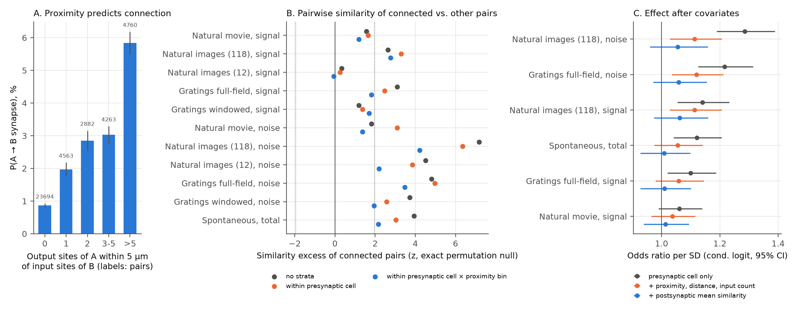
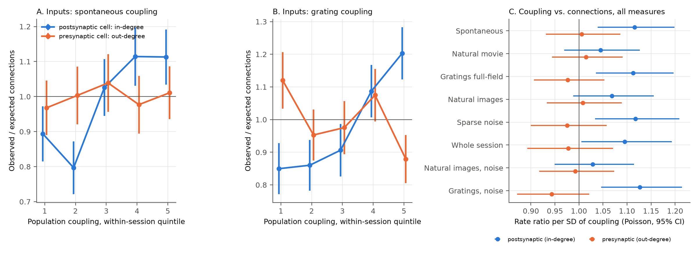

# Population coupling, not pairwise response similarity, predicts local EM inputs in one V1 Deep Dive mouse

## Summary

We linked electron microscopy (EM) connectivity to two-photon activity in the same neurons. The data come from the Allen Institute V1 Deep Dive (V1DD) data set, mouse 409828. This is a second mouse, different from the MICrONS mouse.

We asked two questions:

1. Do pairs of neurons with similar activity connect more often than proximity predicts? This is the "like-to-like" rule that the MICrONS study reported.
2. Does a property of a single cell predict how many local inputs it gets? We tested population coupling: the correlation of a neuron with the mean activity of all other imaged neurons.

Main results:

- Axon–dendrite proximity predicts connection strongly. The connection probability increases from 0.9 % to 5.8 % across proximity bins (Figure 1A).
- Before we control for cell-level factors, connected pairs have higher activity correlations. The excess is largest for noise correlations under natural images and gratings (Figure 1B). It stays after we stratify by presynaptic cell and proximity bin (Holm-corrected p = 0.0003 and 0.005).
- The pair-level excess is not specific to pairs. When we add the mean similarity of the postsynaptic cell to all other cells, all 6 tested odds ratios fall to 1.01–1.06 per SD, and all 95 % intervals include 1 (Figure 1C).
- Signal correlation under the natural movie gave no clear pair-level effect in any model. This is the closest feature to the MICrONS "like-to-like" test (z = 1.19, p = 0.24 after stratification; odds ratio 1.01, 95 % CI 0.94–1.09 with covariates). Our design can detect an excess of about 0.1 SD with 80 % power. Measurement noise in single-session similarity estimates decreases this power (see Limitations).
- A cell-level property explains the pair-level signal. Postsynaptic neurons with higher population coupling receive more synapses from coregistered presynaptic neurons than proximity predicts. The rate ratio is 1.11–1.13 per SD for spontaneous, full-field grating, sparse-noise and grating-noise coupling. The within-session permutation p is 0.004–0.005, and the Holm-corrected p is 0.032 for each of these 4 measures (Figure 2). Natural-movie, natural-image and image-noise coupling gave smaller effects that are not significant.
- The relation is directional. Population coupling of the presynaptic neuron does not predict its number of outputs (rate ratios 0.94–1.01 per SD, all p > 0.15).
- The effect is clear in the large superficial session (c1v3: L2/3-IT and L4-IT cells, 340 postsynaptic cells; rate ratio 1.11–1.13, p = 0.015–0.038). The two deeper sessions (c1v5 and c2v5: L5 cells, 177 cells together) give the same sign for 3 of 4 measures, but the effects are smaller and not significant. Thus the session split is also a layer split.

These results agree with the finding of Okun et al. (2015): neurons that are coupled to the population ("choristers") receive more synapses from their neighbours. Our test uses a different method (EM synapses in tissue that was imaged in vivo, not in vitro stimulation). The results also show a confound for pairwise "like-to-like" tests: a postsynaptic cell-level effect can look like a pair-specific rule if the analysis does not control for it.

## Data

| Item | Value |
|---|---|
| Animal | V1DD mouse 409828 (one animal) |
| EM release | materialization 1196, synapse table of all inputs and outputs of proofread cells |
| Two-photon sessions | 3 sessions coregistered to EM: c1v3 (column 1, volume 3), c1v5, c2v5; 6 planes each; dF/F at about 6 Hz |
| Coregistered ROIs | 565 rows, 553 unique EM root IDs (CAVE table functional_coregistration_manual_2) |
| Presynaptic cells | 193 coregistered cells with a proofread axon |
| Postsynaptic cells | 517 coregistered cells with a proofread dendrite |
| Candidate ordered pairs | 40,162 (same session, A ≠ B) |
| Connected ordered pairs | 785 (867 synapses; 69 pairs with more than 1 synapse) |
| Population reference | all soma ROIs of a session: 2,708 (c1v3), 965 (c1v5), 906 (c2v5) |

Exact paths, sources and SHA-256 values are in `files/PROVENANCE.md`.

## Methods

### Activity measures (code/02, code/09)

- Trial response: mean dF/F of the frames in the response window. Each plane uses its own time stamps. Windows: full trial (2 s) for drifting gratings; 0.5 s from onset for natural images; 2-s movie bins (60 movie frames) over 8 repeats for the natural movie.
- Signal correlation: split-half. We correlate the odd-trial mean tuning of cell i with the even-trial mean tuning of cell j, and the reverse, then take the mean. This removes shared trial noise from the signal estimate.
- Noise correlation: Pearson correlation of per-condition z-scored trial residuals.
- Spontaneous correlation: correlation of dF/F during the 300-s spontaneous epoch. Our values agree with the published Allen correlations (r = 0.91 across pairs).
- Population coupling: correlation between the dF/F of a cell and the mean z-scored dF/F of all other soma ROIs in the session, for each epoch type. Noise coupling uses trial residuals instead of dF/F.

### Structure measures (code/03)

- Connection: at least 1 synapse from A to B in the EM synapse table. We used only presynaptic cells with proofread axons and postsynaptic cells with proofread dendrites.
- Proximity: the number of output-synapse sites of A that are within 5 µm (and 10 µm) of an input-synapse site of B. We removed the A→B synapses from both sets first, so that a connection does not create its own proximity. This uses synapse positions as samples of the axon and dendrite paths.
- Soma distance: 3-D distance and depth difference in the pia-aligned frame.

### Pair-level tests (code/05, code/07, code/08)

- Statistic: mean similarity of connected pairs minus the mean of their stratum. The null hypothesis shuffles similarity within strata. We computed the exact permutation variance in closed form and checked it with 1,000 Monte Carlo permutations (the two null SDs agree to within about 5 %).
- Strata: none; presynaptic cell; presynaptic cell × proximity bin (primary); presynaptic cell × proximity bin × distance bin.
- Conditional logistic regression, grouped by presynaptic cell, with covariates added in steps: log proximity (5 and 10 µm), soma distance, depth difference, log input-synapse count of B, and the mean similarity of B to all other coregistered cells.
- Holm correction over 11 similarity measures.

### Cell-level tests (code/10, code/11)

- Expected connections for each pair: the connection rate in its stratum. For in-degree the stratum is presynaptic cell × proximity bin × distance bin. For out-degree it is postsynaptic cell × proximity bin × distance bin. For each cell: O = observed connections, E = sum of expected values.
- Model: Poisson regression of O with offset log E, coupling (z-scored within session), session indicators and cell covariates (SNR, mean and SD of dF/F, soma depth, log number of EM synapses).
- p value: 5,000 permutations of coupling among cells within session. We also report an OLS test on (O − E)/√E and a within-session Spearman correlation. All three statistics agree.
- Holm correction over 8 coupling measures (postsynaptic side, with covariates).
- Correction note: script 10 first pooled sessions without session terms. Coupling differs between sessions, so its permutation null was too narrow (null SD of t = 0.64). Script 11 z-scores within session and includes session terms (null SD of t = 0.97–1.03). All reported cell-level p values come from script 11.

## Results

### Figure 1. Pair level

A: Connection probability against proximity. B: Similarity excess of connected pairs (z) for 11 measures and 3 stratifications. C: Odds ratio per SD as we add covariates.

Pair-level results (presynaptic cell × proximity strata; `files/derived/test_results.csv`):

| Measure | Excess (SD) | z | p | Holm p | Odds ratio per SD with all covariates (95 % CI) |
|---|---|---|---|---|---|
| Natural movie, signal | 0.040 | 1.19 | 0.24 | 0.51 | 1.01 (0.94–1.09) |
| Natural images 118, signal | 0.087 | 2.77 | 0.006 | 0.051 | 1.06 (0.97–1.16) |
| Natural images 12, signal | −0.002 | −0.07 | 0.95 | 0.95 | 1.00 (0.92–1.10) |
| Gratings full-field, signal | 0.058 | 1.81 | 0.07 | 0.35 | 1.01 (0.93–1.10) |
| Gratings windowed, signal | 0.055 | 1.70 | 0.09 | 0.36 | 1.07 (0.99–1.16) |
| Natural movie, noise | 0.041 | 1.38 | 0.17 | 0.51 | 1.02 (0.93–1.12) |
| Natural images 118, noise | 0.132 | 4.21 | 2.5e-5 | 0.0003 | 1.05 (0.96–1.16) |
| Natural images 12, noise | 0.074 | 2.20 | 0.028 | 0.22 | 1.04 (0.96–1.13) |
| Gratings full-field, noise | 0.111 | 3.48 | 0.0005 | 0.005 | 1.06 (0.97–1.16) |
| Gratings windowed, noise | 0.063 | 1.95 | 0.051 | 0.31 | 1.03 (0.95–1.12) |
| Spontaneous, total | 0.064 | 2.16 | 0.031 | 0.22 | 1.01 (0.93–1.10) |

The covariate ladder (`files/derived/covariate_ladder.csv`) shows which covariate removes the effect. For natural-image noise correlation, the odds ratio is 1.29 with no covariates, 1.11 (p = 0.009) after proximity, distance and input count, and 1.05 (p = 0.26) after we also add the mean similarity of the postsynaptic cell. The other measures show the same pattern.

### Figure 2. Cell level

A, B: Observed/expected connections by within-session quintile of coupling. Blue: in-degree of postsynaptic cells. Orange: out-degree of presynaptic cells. Error bars: Poisson SE. C: Rate ratio per SD of coupling for 8 measures, with cell covariates.

Postsynaptic in-degree, with cell covariates (`files/derived/coupling_tests_robust.csv`):

| Coupling measure | Rate ratio per SD (95 % CI) | Permutation p | Holm p | Spearman (within session) |
|---|---|---|---|---|
| Spontaneous | 1.116 (1.039–1.199) | 0.004 | 0.032 | 0.14 |
| Gratings full-field | 1.113 (1.035–1.197) | 0.005 | 0.032 | 0.17 |
| Sparse noise | 1.118 (1.033–1.209) | 0.005 | 0.032 | 0.15 |
| Gratings, noise coupling | 1.127 (1.046–1.214) | 0.004 | 0.032 | 0.17 |
| Whole session | 1.095 (1.005–1.193) | 0.020 | 0.078 | 0.11 |
| Natural images | 1.069 (0.988–1.156) | 0.10 | 0.30 | 0.11 |
| Natural movie | 1.045 (0.969–1.127) | 0.27 | 0.55 | 0.07 |
| Natural images, noise coupling | 1.029 (0.950–1.114) | 0.46 | 0.55 | 0.06 |

Robustness (spontaneous coupling, with covariates):

| Subset | Cells | Rate ratio (95 % CI) | p |
|---|---|---|---|
| All | 517 | 1.116 (1.039–1.199) | 0.004 |
| Session c1v3 | 340 | 1.115 (1.021–1.218) | 0.027 |
| Sessions c1v5 + c2v5 | 177 | 1.084 (0.954–1.232) | 0.16 |
| L2/3-IT postsynaptic | 205 | 1.121 (1.016–1.238) | 0.042 |
| L4-IT postsynaptic | 119 | 0.968 (0.782–1.197) | 0.80 |
| L5-ET postsynaptic | 148 | 1.029 (0.900–1.177) | 0.65 |
| Without top 2 % residuals | 506 | 1.113 (1.034–1.199) | 0.005 |

Other observations:

- Within a session, population coupling also correlates with the total number of EM input synapses of a cell (Spearman 0.29 in c1v3, 0.14 in c1v5, 0.05 in c2v5 for spontaneous coupling). Our in-degree models include this count as a covariate.
- Among connected pairs, similarity did not predict the number of synapses (69 multi-synapse pairs; all |Spearman| < 0.07; `files/derived/synapse_number_results.csv`).
- Split-half reliability of single-cell tuning was low for 118 natural images (median 0.05). It was moderate for gratings (0.29) and the natural movie (0.46), and high for 12 natural images (0.64). For the same pair, signal correlations under different stimuli correlate weakly (r ≤ 0.07).

## Limitations

- One animal. We cannot test whether the result generalizes across animals. The two deeper sessions (L5 cells only) give the same sign but not a significant effect. This can be a power limit (177 cells) or a layer difference; our data cannot separate the two.
- In-degree counts only inputs from coregistered presynaptic cells with proofread axons in the same imaging field. This is a small sample of all local inputs (mean 1.5 such inputs per postsynaptic cell).
- Proximity uses synapse positions, not full skeletons. Synapse sites under-sample axon and dendrite paths. Residual proximity confounding is possible, but it would have to differ by postsynaptic coupling and not by presynaptic coupling.
- Each similarity estimate comes from one session of about 1 hour, and many cells have low reliability. This attenuates pair-level effects. A small pair-specific like-to-like effect (below about 0.1 SD) is therefore not excluded. Our null result for natural-movie signal correlation does not contradict the MICrONS result, which used digital-twin feature similarity and a larger sample.
- Population coupling can be a result of local input, not a cause, and calcium-imaging neuropil contamination can increase coupling. Both increase coupling for cells with many local partners. Our analysis cannot separate these mechanisms. The SNR and dF/F covariates do not remove the effect.
- The family of 8 coupling measures overlaps (pairwise r = 0.13–0.91). The Holm correction is conservative for this structure.
- We chose the cell-level coupling analysis after the pair-level diagnostic. It is therefore a post hoc hypothesis in this data set, motivated by Okun et al. (2015). Independent animals must confirm it.

## Reproduce

1. Make a Python 3.12 environment: `uv venv .venv --python 3.12 && uv pip install --python .venv/bin/python numpy pandas pyarrow scipy statsmodels zarr matplotlib scikit-learn`.
2. Copy `files/` to a work folder. Copy `source_data/` to `raw/` in that folder (or download the same files from the S3 URL in PROVENANCE.md).
3. Make sure that the shared V1DD data sets are at `/mnt/dell-data/shared_datasets/` (see PROVENANCE.md), or edit the paths at the top of scripts 02, 03 and 09.
4. Run `bash code/run_all.sh` with the work folder as the current folder. Set library threads to 1. The full run takes about 1 hour on 1 core and less than 4 GB of memory.

Scripts 00 and 01 are only exploration. They are included for completeness.

## Files

- `files/code/`: all analysis scripts and `run_all.sh`.
- `files/source_data/`: unchanged public coregistration, correlation and SNR tables from S3, with SHA256SUMS.
- `files/derived/`: pair tables, cell tables, test results (CSV and Parquet).
- `files/figures/`: Figures 1 and 2.
- `files/logs/`: console logs of each step.
- `files/PROVENANCE.md`: job, model, data paths, sources, checksums, software versions.

## Provenance statement

Campaign 11_07_2026, job sci-1107-hp-neural-structure-and-computation-c44a6093e8de, topic neural-structure-and-computation, machine hp. An autonomous agent (model Claude Opus 5.5, claude-opus-5-5) did the analysis and wrote this text. A campaign-machine key signs the bundle; the key is not a personal authorship claim. Data: Allen Institute for Brain Science, V1 Deep Dive, CC BY 4.0.
